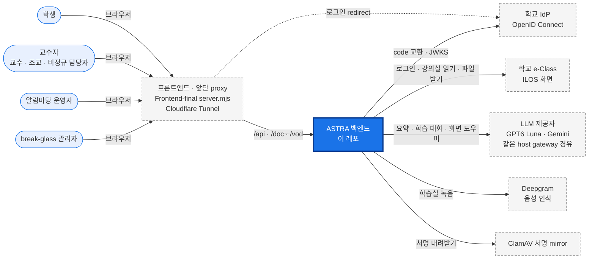
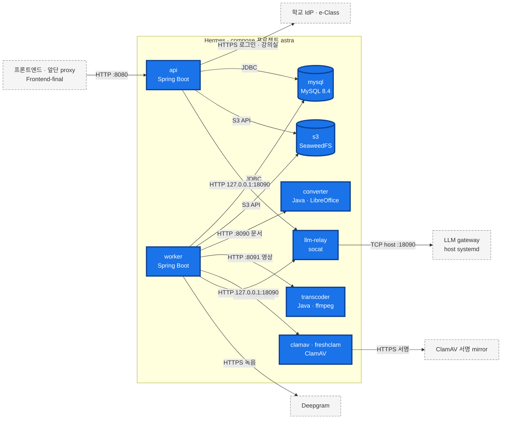

<p align="center">
  <picture>
    <source media="(prefers-color-scheme: dark)" srcset="assets/stack-corp-logo-dark.png">
    
  </picture>
</p>

# STack-Backend

서울과학기술대학교 e-Class(ILOS LMS, 원본 서비스명 `ASTRA`) 재구현의 백엔드 레포다. e-class는 캠퍼스 온과 **별개 서비스**이며 백엔드·DB·ERD를 따로 둔다. 두 서비스는 API로 연결한다([서비스 경계 초안](https://github.com/STack-Corp/ASTRA-Reference/blob/main/backend/05_service_boundary.md)).

| 서비스 | 프론트엔드 | 백엔드 | ERD |
|---|---|---|---|
| e-class | [Frontend-final](https://github.com/STack-Corp/Frontend-final) | 이 레포 (MySQL 8.4) | [ERD A](https://www.erdcloud.com/d/B5bWYfGmFisJTYLka) |
| 캠퍼스 온 | [STack-Frontend-Keep-](https://github.com/STack-Corp/STack-Frontend-Keep-) `archive/campus-on` 브랜치 | 이 레포 `archive/campus-on` 브랜치 (PostgreSQL 17) | [ERD B](https://www.erdcloud.com/d/G75sZP24bZNHuezyy) |

2026-11-10 STack-Backend에서 루트 `src/`·MySQL 마이그레이션·`db/`·`docs/`를 커밋 이력과 함께 STack-eclass-Backend로 옮겼다(STAC-90). 2026-11-13 STack-eclass-Backend를 커밋 이력과 함께 다시 STack-Backend로 옮겼고, 이때 캠퍼스 온 백엔드(`backend/`)는 main에서 지웠다. 캠퍼스 온의 마지막 상태는 `archive/campus-on` 브랜치에 있다.

## 구조 한눈에 보기 (C4)

이 레포의 코드와 배포 파일이 정의하는 구조를 C4의 위 두 단계로 그린다. 운영 배포는 Hermes host 한 대에서 `compose.yaml`과 Frontend-final의 `deploy/hermes/eclass-backend/compose.hermes.yaml`을 함께 읽어 띄운 구성이고, 그림은 이 구성을 따른다. 둥근 끝 상자는 사람, 굵은 파란 상자는 이 시스템과 그 실행 단위, 점선 상자는 외부 시스템, 원통은 저장소다. 실선 화살표는 호출이고, 점선 화살표는 브라우저 redirect나 공유 volume이다.

### System Context



사람은 코드가 정하는 역할로 나눈다. 학생과 교수자는 과목 안의 역할(`catalog.api.CourseMemberships.CourseRole`의 `STUDENT`, `INSTRUCTOR`)이다. 알림마당 운영자는 `community_operators` 행으로 정하고(`communication/CommunityOperators`), break-glass 관리자는 로컬 로그인과 TOTP로 들어오는 계정이다(`identity/breakglass/BreakGlassLogin`).

| 외부 시스템 | 방향 | 오가는 것 |
|---|---|---|
| 프론트엔드 · 앞단 proxy | 브라우저 → proxy → 백엔드 | SPA와 `server.mjs`는 [Frontend-final](https://github.com/STack-Corp/Frontend-final) 레포에 있다. `server.mjs`가 `/api`, `/doc`, `/vod`를 api로 넘기고, 그 앞의 Cloudflare Tunnel이 TLS를 끝낸다. Terraform 구성(`infra/`)에서는 CloudFront가 이 자리에 온다 |
| 학교 IdP | 백엔드 → IdP, 브라우저 → IdP | OpenID Connect code flow와 PKCE. 설정했을 때만 켜진다 |
| 학교 e-Class | 백엔드 → e-Class | 학번·비밀번호로 학교 화면에 로그인해 이름·학과·학년과 수강과목을 읽고, 이어서 강의실마다 주차와 학습활동 목록을 가져온다. 학생이 화면을 열 때 그 학생의 학교 session으로 자료, 공지, 과제, 영상 상세, 강의계획서, 출석, 성적을 읽는다. 받은 파일은 과목 파일로 객체 저장소에 복사한다. 학교에 공개 API가 없어 브라우저와 같은 요청을 보낸다. 설정했을 때만 켜진다 |
| LLM 제공자 | 백엔드 → gateway → 제공자 | 교수자가 동의한 자료의 쪽별 요약과 학습 대화, 학습실 문서 요약과 녹음 요약, 화면 AI 도우미. 운영 배포에서는 같은 host의 LLM gateway(Frontend-final `deploy/hermes/ops/agy-llm-gateway`)가 GPT6 Luna를 먼저 부르고, 실패하면 agy CLI로 Gemini를 부른다. API key가 있을 때만 켜진다 |
| Deepgram | 백엔드 → Deepgram | 학습실 녹음 원본을 보내 전사문을 받는다. key가 있을 때만 켜진다 |
| ClamAV 서명 mirror | 백엔드 → mirror | 악성코드 서명만 내려받는다. 업로드 파일은 보내지 않는다 |

### Container



| container | 기술 | 맡는 일 |
|---|---|---|
| `api` | Spring Boot 4, Java 25 (Spring profile `api`) | HTTP API와 로그인, 학교 e-Class 읽기, 화면 AI 도우미. 시작할 때 Flyway 마이그레이션을 적용한다. 학생의 학교 session은 이 process의 메모리에만 두므로 api를 다시 띄우면 학생은 학교 내용을 새로 읽기 전에 학교 계정으로 다시 로그인한다 |
| `worker` | api와 같은 jar (Spring profile `worker`) | 배경 작업. 업로드 검사, 문서 변환, 영상 변환, 쪽별 요약(강의자료, 학습실 문서), 학습 대화, 녹음 전사·요약, 정리 작업을 한다. 할 일은 DB의 작업 행에서 가져오고 api와 직접 통신하지 않는다 |
| `converter` | 같은 jar의 `com.stackcorp.converter`, PDFBox, LibreOffice | 문서를 쪽 이미지·텍스트·썸네일로 바꾸고 아바타 사진을 정규화한다. 외부 network, 비밀값, 저장소 credential이 없다 |
| `transcoder` | 같은 jar의 `com.stackcorp.transcoder`, ffmpeg | 영상을 HLS segment로 바꾼다. 외부 network, 비밀값, 저장소 credential, 암호화 key가 없다 |
| `mysql` | MySQL 8.4 (compose profile `mysql`) | 정본 데이터와 작업 행. profile을 끄면 RDS 같은 외부 MySQL을 쓴다 |
| `s3` | SeaweedFS (`compose.hermes.yaml`) | content, delivery bucket. api와 worker만 닿는 `data` network에 있다. Terraform 구성에서는 AWS S3가 이 자리에 온다 |
| `clamav`, `freshclam` | ClamAV (compose profile `scan`) | clamav는 업로드 파일을 검사하고 worker만 닿는다. freshclam은 서명을 받아 두 container가 함께 쓰는 volume에 둔다 |
| `llm-relay-api`, `llm-relay-worker` | socat (`compose.hermes.yaml`) | api와 worker의 network namespace 안 `127.0.0.1:18090`을 host의 LLM gateway로 넘긴다. 앱은 http LLM 주소를 loopback에만 허용한다 |

api의 코드는 `com.stackcorp.astra` 아래 패키지 하나가 모듈 하나다. 모듈은 다른 모듈의 `api` 패키지만 쓸 수 있고 `ModuleStructureTests`가 이를 확인한다. worker는 같은 모듈을 실행하고 배경 작업 bean만 더 켠다.

| 모듈 | 맡는 일 |
|---|---|
| `identity` | 사용자, 외부 신원 연결, session, 기기, 재인증, break-glass 로그인, 학번·학교 비밀번호 로그인. STack session마다 학교 e-Class session을 메모리에 붙여 둔다 |
| `catalog` | 학기, 과목, 수강, 시간표, 알림. 학교 로그인 때 수강과목을 맞춘다 |
| `learning` | 강의실, 주차, 학습활동, 영상 학습 session, 출석. 학교 강의실의 주차·학습활동 가져오기와 학교 자료·공지·과제·영상 상세·강의계획서·출석·성적 읽기 |
| `assessment` | 과제, 퀴즈, 설문, 성적. 학교 과목의 과제 목록과 성적 화면은 `learning`이 읽은 학교 값을 쓴다 |
| `communication` | 공지, Q&A, 게시판, 쪽지, 알림마당. 학교 과목의 공지는 `learning`이 읽은 학교 공지를 함께 보인다 |
| `files` | 업로드, 첨부, 파일함, 학습실(녹음, 내 문서), 학교 파일 사본, 문서 rendition, 영상 asset, 업로드 검사와 녹음 전사·요약 작업. 객체 저장소를 부르는 유일한 모듈이다 |
| `summary` | 강의 자료와 학습실 문서의 쪽별 요약, LLM 동의, 학습 대화 |
| `home` | 메인 화면 집계, 할 일, 캘린더, 화면 AI 도우미(`POST /api/assistant`). 도메인 쓰기가 없다 |
| `integration` | 다른 모듈이 정의한 port의 구현. 학교 IdP, 학교 e-Class, LLM, Deepgram, converter·transcoder·clamd client, `/doc`·`/vod` cookie 서명. 외부 network를 여는 유일한 모듈이다 |
| `shared` | 오류 형식, requestId, 시간, 멱등 원장, 감사 로그, 지표. 모든 모듈이 쓴다 |

모듈 안의 구성, port, 배경 작업, 요청 흐름은 [docs/c4.md](docs/c4.md) 3~4절에 있고, 배포 토폴로지와 결정의 이유는 [docs/architecture.md](docs/architecture.md)에 있다.

## 폴더 구성

| 경로 | 내용 |
|---|---|
| `reference/` | [ASTRA-Reference](https://github.com/STack-Corp/ASTRA-Reference) 서브모듈: 화면 명세, 엔드포인트 계약, DB 설계 근거 |
| `src/` | Spring Boot 애플리케이션. DB 마이그레이션은 `src/main/resources/db/migration/` |
| `db/` | ERD 생성·비교 도구, ERDCloud 스냅샷, [DB 가이드](db/README.md) |
| `docs/` | [백엔드 아키텍처](docs/architecture.md), [C4 모델](docs/c4.md), 결정 기록 [docs/adr/](docs/adr/) |
| `assets/` | 팀 로고 |

처음 받을 때는 서브모듈까지 함께 받는다.

```sh
git clone --recurse-submodules https://github.com/STack-Corp/STack-Backend.git
# 이미 받았다면
git submodule update --init
```

## 참고 자료

| 문서 | 내용 |
|---|---|
| [reference/README.md](https://github.com/STack-Corp/ASTRA-Reference/blob/main/README.md) | 화면별 UI·동작 명세 |
| [reference/backend/README.md](https://github.com/STack-Corp/ASTRA-Reference/blob/main/backend/README.md) | 서버 책임, 근거 수준(`OBSERVED`/`CLIENT`/`INFERRED`/`PROPOSED`/`UNKNOWN`) |
| [reference/backend/00_server_contract.md](https://github.com/STack-Corp/ASTRA-Reference/blob/main/backend/00_server_contract.md) | 권한·과목 context·트랜잭션·시간 등 서버 공통 불변식 |
| [reference/backend/endpoint_inventory.md](https://github.com/STack-Corp/ASTRA-Reference/blob/main/backend/endpoint_inventory.md) | 엔드포인트 ID(`EP-xxxx`)와 계약 문서 |
| [reference/backend/90_changes.md](https://github.com/STack-Corp/ASTRA-Reference/blob/main/backend/90_changes.md) | 바꿔야 할 부분과 우선순위 |
| [reference/db/design/](https://github.com/STack-Corp/ASTRA-Reference/tree/main/db/design) | DB 영역별 설계 근거와 미결 사항 |
| [db/README.md](db/README.md) | DB 영역 구성, 데이터 흐름, 설계 규칙, 스키마 변경·ERD 반영 절차 |
| [docs/architecture.md](docs/architecture.md) | 배포 토폴로지, 모듈 구조, 인증·인가, 영상 전달, 관측, 단계 계획 |
| [docs/c4.md](docs/c4.md) | C4 모델: System Context, Container, Component(모듈·port·배경 작업), Code, 의존 규칙과 확인 방법 |
| [reference/backend/05_service_boundary.md](https://github.com/STack-Corp/ASTRA-Reference/blob/main/backend/05_service_boundary.md) | 캠퍼스 온–e-class 서비스 경계, 신원 발급, 서비스 간 API (논의용 초안) |

## 두 레포의 역할

| | ASTRA-Reference | STack-Backend |
|---|---|---|
| 담는 것 | 화면 명세, 엔드포인트 계약, DB 설계 근거 | 서버 코드, 정본 DB 스키마, ERD A 도구·스냅샷, 테스트 |
| 변경 기준 | 근거와 근거 수준을 함께 기록 | 계약을 지키는지 테스트로 확인 |

명세나 계약을 바꿔야 하면 Reference를 먼저 고친다. 그다음 이 레포에서 서브모듈을 그 변경으로 올리고 구현한다.

```sh
git -C reference pull origin main
git add reference
git commit -m "Update reference to <변경 요약>"
```

서브모듈은 특정 커밋에 고정된다. Reference에 새 커밋이 생겨도 이 레포의 `reference/`는 위 명령으로 올리기 전까지 바뀌지 않는다.

## DB 스키마 기준

- 정본은 Flyway 마이그레이션 [`src/main/resources/db/migration/`](src/main/resources/db/migration/)이다. `V1__baseline.sql`은 Reference에서 설계한 97개 테이블 그대로다. Reference의 `db/design/*.md`에 있는 DDL 조각은 설계 당시 초안이다.
- 이미 적용된 마이그레이션 파일은 고치지 않는다. 바꿀 내용은 다음 번호의 새 파일로 만든다.
- 변경·점검·ERD 반영 절차는 [db/README.md](db/README.md) 5~6절을 따른다.
- ERD는 [ERD A](https://www.erdcloud.com/d/B5bWYfGmFisJTYLka)(MySQL)다. 지금 스키마는 129 테이블이고 `db/erdcloud/snapshot.json`이 그 상태다. ERDCloud 화면에는 V1의 97 테이블까지만 올라가 있다([db/README.md](db/README.md) 6절). 캠퍼스 온의 ERD B는 STack-Backend 레포가 관리한다.

## 빌드와 실행

| 항목 | 버전 |
|---|---|
| JDK | 25 (Gradle toolchain으로 지정) |
| Spring Boot | 4.1.2 |
| Gradle | 9.8.2 (wrapper 포함, 따로 설치하지 않음) |
| DB | MySQL 8.4, Flyway |

테스트와 로컬 실행에는 Docker와 `ffmpeg`·`ffprobe`(PATH)가 필요하다. Testcontainers가 MySQL 8.4와 S3 호환 저장소 컨테이너를 띄우고 마이그레이션을 적용한다. 영상 변환 테스트는 ffmpeg로 짧은 시험 영상을 만들어 쓴다.

두 컨테이너는 테스트 JVM 하나에 하나씩만 뜨고 모든 Spring context가 함께 쓴다(`TestcontainersConfiguration`). context마다 번호를 받아 자기 database(`astra_c<번호>`)와 bucket(`astra-content-c<번호>`, `astra-delivery-c<번호>`)을 만들고, Flyway는 context마다 자기 database를 처음부터 마이그레이션한다. 한 context의 worker와 저장소 GC는 다른 context의 행과 객체를 보지 못한다. 컨테이너는 JVM이 끝나면 Testcontainers(Ryuk)가 지운다. 로컬 실행은 context가 하나이므로 실행할 때마다 새 컨테이너에 `astra_c1`과 그 bucket을 쓴다.

```sh
./gradlew build          # Windows: gradlew.bat build
./gradlew bootTestRun    # DB 없이 로컬 실행. MySQL과 S3 호환 저장소 컨테이너를 자동으로 띄운다
```

`bootTestRun`은 테스트 소스의 `TestStackBackendApplication`을 실행한다. 배포하는 jar에 없는 것을 세 가지 더한다.

| 더하는 것 | 내용 |
|---|---|
| 표본 데이터 | 학생 박민준(`21101234`), 교수 박은주(`P-1042`), 이번 학기 과목 7개. 과목 키는 프론트엔드가 `kj`로 쓰는 값(`bi`, `algo`, `ai`, `db`, `oss`, `se`, `secu`)이다. 화면별 내용은 아래 표 |
| 개발용 로그인 | `POST /api/auth/dev-login` `{"externalRef":"21101234"}`. 이 컴퓨터에서 온 요청만 받는다. CSRF token이 필요하다 |
| 학교 e-Class 로그인 | `POST /api/auth/eclass-login` `{"studentId":"학번","password":"e-Class 비밀번호"}`. `astra.eclass-login.base-url=https://eclass.seoultech.ac.kr`을 켠다. 학교에 실제로 로그인해 이름·학과·학년을 갱신하고 정규·비정규 수강과목을 동기화한다 |
| `local` 프로필 | `127.0.0.1`에만 listen, cookie의 `Secure` 끔, 허용 Origin `http://127.0.0.1:4190`·`http://localhost:4190`, 앱이 `/doc`·`/vod`를 직접 응답([ADR-0009](docs/adr/0009-origin-delivery-without-cdn.md)), `worker` 프로필 포함 |

학교 수강과목 동기화는 로그인 transaction commit 후 별도 transaction으로 완료한다. 학교 과목 키로 과목·학기·시간표·수강 관계를 갱신하고 `/api/me/courses`에서 본인의 과목만 반환한다. 담당자 이름·비정규 학습기간은 표시용 필드로 보관하며, 담당자 사용자나 학교에 없는 학습활동을 만들지 않는다. 재로그인해도 중복 수강을 만들지 않고 학교 목록에서 빠진 동기화 수강만 취소한다. 파싱 결과가 비어 있으면 기존 수강을 보존한다. 동기화 실패는 rollback하고 로그인은 유지한다. `V39__school_course_sync.sql`이 표시용 필드를 추가한다. 학교 비밀번호와 학교 세션 쿠키는 저장하지 않는다.

표본은 `src/test/java/com/stackcorp/astra/local/Local*Seed.java`가 영역마다 넣는다. 시각은 모두 표본을 넣는 때의 DB 시계(기관 시간대, 기본 `Asia/Seoul`) 기준이고, 이미 있는 영역은 다시 넣지 않는다. 개발 PC나 MySQL container의 시간대와 관계없이 화면에는 한국 벽시계 시각이 나온다. 사람은 두 인물 말고도 교수 이준호(`P-2071`, 사이버보안·컴퓨터보안 공동 담당)와 학생 8명(`21101235`~`20101242`, 데이터베이스는 모두 수강)이 있다. 대부분의 표본은 데이터베이스(`bi`) 과목에 있다.

| 화면 | 학생 박민준 | 교수 박은주 |
|---|---|---|
| 메인·할 일 | 공지 5, 할 일(내일 마감 과제, 응시할 퀴즈, 온라인 강의), 새 성적 | 담당 과목 |
| 과제 | 마감·점수 공개(9/10), 마감·채점 비공개, 임시저장만 한 과제, 최종 제출한 과제 | 과제 넷의 제출 목록(늦은 제출 1건 포함) |
| 퀴즈 | 응시하고 결과가 공개된 퀴즈(다시 응시 불가), 응시할 수 있는 퀴즈, 채점을 기다리는 퀴즈 | 위에 더해 모레 열리는 퀴즈, 단답형 채점 대기 6건 |
| 성적 | 공개된 항목(과제, 퀴즈, 중간고사)의 점수와 합계 | 성적부 9명, 직접 입력 항목 "중간고사"(가중치 30), 항목별 가중치 |
| 출석 | 지난 여섯 주 차시 기록, 휴강 1회와 보강 | 출석부(출석·지각·결석·공결), 출석 설정(지각 3회 = 결석 1회) |
| 그룹·강의계획서 | 본인 조 | 조 셋과 구성원, 강의계획서 15주와 담당자 정보 |
| 온라인 강의 | 지난 강의 진도(인정 완료), 영상 준비 중인 강의 | 수강생별 진도 |
| 캘린더·시간표 | 오늘 앞뒤 학사일정 5건, 마감 활동, 주간 수업(주말이면 그날 실습 시간 하나) | 같음(담당 과목) |
| 알림 | 공지·과제 공개·점수 공개·답변·쪽지 알림(일부 읽음) | 쪽지 알림 둘(하나 읽음) |
| 쪽지·게시판 | 받은 쪽지 둘, 질의응답, 열린게시판 | 받은 쪽지 둘, 보낸 쪽지 |
| 파일함 | 폴더 트리와 파일 4개, 휴지통 1 | 강의자료 폴더와 파일, 휴지통 1(폴더째) |

표본의 온라인 강의에는 영상 바이트가 없다. 지금 기간의 강의는 콘텐츠가 변환 중(API `state` `processing`)이고, 지난 강의는 학생들이 본 뒤 원본이 내려간 상태(`video_state` `removed`, API `state` `failed`)다. 재생되는 강의는 교수 박은주로 로그인해 강의 화면에서 영상 파일을 올려 만든다. 로컬 실행은 transcoder를 같은 process에서 띄우므로 PATH에 `ffmpeg`가 있으면 곧 `ready`가 된다. 외부 LLM 처리 동의는 넣지 않는다. 쪽별 요약이나 학습 대화를 쓰려면 제공자 key를 넣고 띄운 뒤(`ASTRA_LLM_API_KEY=… ./gradlew bootTestRun`, 아래 "LLM 설정") 교수 화면에서 직접 동의한다. key가 없으면 `GET /api/llm/policy`가 `enabled=false`이고, 교수 화면의 외부 AI 처리 동의는 "이 서비스에서는 외부 AI 기능을 쓰지 않습니다"를 보이며 새로 동의할 수 없다(이미 한 동의는 철회만 할 수 있다). 요약 생성과 학습 대화는 503 `llm_disabled`다.

프론트엔드([Frontend-final](https://github.com/STack-Corp/Frontend-final))는 개발 서버가 `/api`, `/doc`, `/vod`를 이 서버로 넘긴다. 브라우저는 프론트엔드 주소만 쓴다. 백엔드는 CORS를 열지 않는다.

```sh
ASTRA_API_ORIGIN=http://127.0.0.1:8080 npm start    # Frontend-final에서
```

8080 포트를 다른 프로그램이 쓰고 있으면 `Port 8080 was already in use`로 실패한다. Docker로 띄운 다른 앱이 8080을 쓰는 경우가 많다. 이때는 포트를 바꿔 실행한다.

```sh
./gradlew bootTestRun --args=--server.port=18080    # Windows: gradlew.bat bootTestRun --args=--server.port=18080
```

상태 확인용 관리 port 8081(`127.0.0.1`에만 열린다)도 같다. 겹치면 `--management.server.port=18081`을 함께 넘긴다.

실제 DB에 붙여 실행할 때는 `DB_URL`, `DB_USERNAME`, `DB_PASSWORD` 환경 변수를 넣고 `./gradlew bootRun`을 쓴다.

### 시간대 설정

DB의 일시와 API의 offset 없는 일시(`openAt`, `closeAt`, `serverTime` 등)는 기관 시간대의 벽시계다([ADR-0039](docs/adr/0039-institution-wall-clock-time.md)). 앱은 DB 연결마다 session 시간대를 이 시간대의 offset으로 정하고, JVM 기본 시간대도 맞춘다. DB 서버의 시간대(RDS parameter group, MySQL 기본 UTC)나 JDBC URL에 기대지 않고, 시작할 때 설정·JVM·DB session의 offset이 다르면 세 값을 남기고 뜨지 않는다. `Z`가 붙은 일시(`createdAt` 등)는 절대 시각이다.

| 환경 변수 | 기본값 | 내용 |
|---|---|---|
| `ASTRA_TIME_ZONE` | `Asia/Seoul` | 기관 시간대. 앱은 IANA 이름과 고정 offset(`+09:00`)을 받고, 서머타임이 있는 시간대는 받지 않는다. compose의 `mysql`(`TZ`)과 Terraform의 RDS `time_zone`도 이 값을 쓰므로 배포에는 IANA 이름을 넣는다. `GET /api/auth/methods`의 `timeZone`으로 client에 알린다. 이미지의 JVM option `-Duser.timezone`도 이 값이다 |

### LLM 설정

쪽별 요약([ADR-0006](docs/adr/0006-summary-module.md))은 OpenAI Chat Completions 호환 제공자를 부른다([ADR-0008](docs/adr/0008-llm-port-deepseek.md)). 설정은 환경 변수로 넣는다. key가 없으면 앱은 뜨고, 외부 AI 기능은 `ASTRA_LLM_ENABLED=false`일 때와 같이 꺼진 것으로 보인다. `GET /api/llm/policy`가 `enabled=false`를 알리고, 요약 생성과 학습 대화는 503 `llm_disabled`다. key를 넣기 전에 원장에 들어온 작업은 worker가 `not_configured`로 실패시킨다.

| 환경 변수 | 기본값 | 내용 |
|---|---|---|
| `ASTRA_LLM_API_KEY` | 없음 | 제공자 API key. 저장소와 로그에 남기지 않는다 |
| `ASTRA_LLM_BASE_URL` | `https://api.deepseek.com` | 이 주소 뒤에 `/chat/completions`를 붙여 부른다. https만 허용한다 |
| `ASTRA_LLM_MODEL` | `deepseek-flash` | 이미지 입력을 받는 model |
| `ASTRA_LLM_VISION` | `true` | `false`면 쪽 이미지를 보내지 않고 추출 텍스트만 보낸다 |
| `ASTRA_LLM_TIMEOUT` | `300s` | 요청 하나의 전체 제한 시간 |
| `ASTRA_LLM_MAX_CONCURRENCY` | `2` | 동시에 보내는 요청 수 상한 |
| `ASTRA_LLM_EXTRABODY_*` | 없음 | 요청 본문에 더하는 제공자 전용 값. 예: `ASTRA_LLM_EXTRABODY_THINKING_TYPE=disabled`는 본문에 `{"thinking":{"type":"disabled"}}`를 더한다 |
| `ASTRA_LLM_ENABLED` | `true` | `false`면 요약 생성과 학습 대화를 모두 503 `llm_disabled`로 막고 모델을 부르지 않는다. `true`여도 `ASTRA_LLM_API_KEY`가 없으면 새 요청은 같은 503이다 |

Google Gemini는 OpenAI 호환 주소로 쓴다: `ASTRA_LLM_BASE_URL=https://generativelanguage.googleapis.com/v1beta/openai`, `ASTRA_LLM_MODEL=gemini-3.5-flash`. Gemini는 도구 호출에 `extra_content.google.thought_signature`를 붙이고 다음 요청에 같은 값이 없으면 400을 내므로, client는 도구 호출의 `extra_content`를 받은 그대로 돌려보낸다.

쪽별 요약(강의자료, 학습실 문서)은 쪽 묶음마다 답을 JSON 객체 하나로 요청한다(`response_format` `json_object`). 형식만 맞고 권장 분량을 조금 넘는 것 같은 가벼운 문제는 다시 묻지 않고 경고로 받는다. 같은 host의 agy LLM gateway(Frontend-final `deploy/hermes/ops/agy-llm-gateway`)를 쓰는 배포에서는 아래 동작을 하는 gateway가 먼저 배포돼 있어야 한다. 그 전 gateway는 `json_object` 요청을 모두 화면 도우미용 짧은 경로(약 17초 예산)로 보내서 요약 요청이 시간 초과로 실패한다.

- `max_tokens`가 `JSON_MAX_TOKENS`(기본 2000)보다 큰 `json_object` 요청은 일반 경로로 보낸다.
- 이미지(`image_url`)가 든 요청은 텍스트만 넘기는 agy(Gemini)를 건너뛰고 폴백(Hive DeepSeek)으로 바로 보낸다. 폴백은 쪽 이미지를 받으므로 `ASTRA_LLM_VISION=true` 그대로 두면 된다.
- agy 답이 JSON 객체가 아니면 같은 요청을 폴백으로 다시 보낸다.

과목 자료는 담당 교수자가 그 과목에 범위별(`page_summary`, `study_chat`)로 동의한 뒤에만 보낸다([ADR-0032](docs/adr/0032-llm-consent-and-study-chat.md)). 동의와 쪽별 요약 생성·재시도는 담당자 명단의 교수와 비정규 담당자만 하고, 조교는 403 `llm_decider_required`다. 동의 목록의 `canGrant`가 화면에 이 구분을 알린다. 교수자는 아래 처리 조건을 `GET /api/llm/policy`로 보고 동의한다. 제공자를 바꾸면 이 값과 `NOTICE_VERSION`을 함께 바꾼다. 값이 바뀌면 이전 동의는 효력을 잃는다.

| 환경 변수 | 기본값 | 내용 |
|---|---|---|
| `ASTRA_LLM_POLICY_PROVIDER_NAME` | `DeepSeek API` | 화면에 보일 제공자 이름 |
| `ASTRA_LLM_POLICY_PROVIDER_OPERATOR` | `Hangzhou DeepSeek Artificial Intelligence Co., Ltd.` | 입력을 받는 계약 주체 |
| `ASTRA_LLM_POLICY_PROCESSING_REGION` | `CN` | 처리·저장 지역(국가 코드나 클라우드 지역) |
| `ASTRA_LLM_POLICY_RETENTION_DAYS` | 없음 | 제공자 보관 일수. 0은 보관 안 함, 비우면 제공자가 밝히지 않음 |
| `ASTRA_LLM_POLICY_TRAINING_USE` | `true` | 제공자가 입력을 학습·개선에 쓸 수 있는지 |
| `ASTRA_LLM_POLICY_CROSS_BORDER_TRANSFER` | `true` | 국외 이전 여부. 이 값이나 학습 이용이 `true`면 동의할 때 따로 확인받는다 |
| `ASTRA_LLM_POLICY_NOTICE_VERSION` | `deepseek-2026-11-11` | 교수자에게 보여 주는 고지 문구의 판 |

학습 대화(질문과 답)는 `worker` 프로필이 처리한다.

| 환경 변수 | 기본값 | 내용 |
|---|---|---|
| `ASTRA_STUDYCHAT_POLL_INTERVAL` | `1s` | worker가 답을 기다리는 질문을 찾는 간격 |
| `ASTRA_STUDYCHAT_RATE_LIMIT` · `ASTRA_STUDYCHAT_RATE_WINDOW` | `20` · `10m` | 한 사용자가 구간 안에 보낼 수 있는 질문 수 |
| `ASTRA_STUDYCHAT_DAILY_TOKEN_BUDGET` | `2000000` | 과목 하나가 하루(DB 날짜)에 학습 대화로 쓸 수 있는 입력·출력 token 합 |
| `ASTRA_STUDYCHAT_QUESTION_MAX_CHARS` | `2000` | 질문 길이 상한 |
| `ASTRA_STUDYCHAT_HISTORY_EXCHANGES` · `ASTRA_STUDYCHAT_HISTORY_MAX_CHARS` | `4` · `6000` | 함께 보내는 지난 질문·답 수와 글자 수 상한 |
| `ASTRA_STUDYCHAT_MAX_TOOL_STEPS` | `4` | 답 하나에서 도구를 쓸 수 있는 모델 호출 수 |
| `ASTRA_STUDYCHAT_MAX_INPUT_TOKENS_PER_ANSWER` · `ASTRA_STUDYCHAT_MAX_OUTPUT_TOKENS` | `60000` · `2000` | 답 하나의 입력 token 상한, 호출 하나의 출력 token 상한 |
| `ASTRA_STUDYCHAT_LEASE` | `10m` | 질문 하나의 실행 lease. `ASTRA_LLM_TIMEOUT`보다 길게 둔다 |
| `ASTRA_STUDYCHAT_RETENTION` | 없음 | 마지막 질문 뒤 대화를 지우기까지의 기간(예: `365d`). 비우면 소유자 삭제와 파일 삭제로만 지운다 |

화면 AI 도우미(`POST /api/assistant`, [ADR-0044](docs/adr/0044-screen-assistant.md))는 api가 처리한다. 분명한 명령은 규칙으로 답하고, 나머지는 위 LLM 설정의 모델에 한 번 묻는다. `ASTRA_LLM_ENABLED=false`이거나 key가 없으면 규칙 답만 하고 모델이 필요한 요청은 503 `llm_disabled`다. 같은 host의 LLM gateway를 쓰는 배포에서는 `ASTRA_LLM_API_KEY`가 gateway의 `GATEWAY_TOKEN`과 같아야 한다.

| 환경 변수 | 기본값 | 내용 |
|---|---|---|
| `ASTRA_ASSISTANT_ENABLED` | `true` | `false`면 규칙 답까지 모두 503 `llm_disabled` |
| `ASTRA_ASSISTANT_TIMEOUT` | `20s` | 모델 답을 기다리는 시간(동시 요청 자리를 기다리는 시간 포함). 넘으면 504 `assistant_timeout` |
| `ASTRA_ASSISTANT_REQUEST_RATE_LIMIT` | `30` | 한 사용자가 `ASTRA_ASSISTANT_RATE_WINDOW` 안에 보낼 수 있는 요청 수(규칙 답 포함) |
| `ASTRA_ASSISTANT_RATE_LIMIT` · `ASTRA_ASSISTANT_TOTAL_RATE_LIMIT` | `10` · `60` | 구간 안에 모델을 부를 수 있는 수. 사용자별, 모든 사용자 합계 |
| `ASTRA_ASSISTANT_RATE_WINDOW` | `1m` | 위 한도의 구간 |
| `ASTRA_ASSISTANT_MAX_OUTPUT_TOKENS` | `600` | 모델 호출 하나의 출력 token 상한 |
| `ASTRA_ASSISTANT_REASONING_EFFORT` | `none` | 요청의 `reasoning_effort`. 추론하는 모델(DeepSeek v4.x)이 추론 token으로 출력 상한을 다 써 답이 잘리지 않게 한다. 이 값을 받지 않는 제공자면 비운다 |

### 저장소와 문서 변환 설정

파일 원본과 파생물은 S3 API로 읽고 쓴다([ADR-0007](docs/adr/0007-confidential-content-placement.md)). 운영에서는 bucket 이름만 넣고 credential은 EC2 instance role로 받는다. 로컬 실행과 테스트는 Testcontainers가 띄운 S3 호환 저장소(`adobe/s3mock`)와 같은 process의 converter를 쓴다.

| 환경 변수 | 기본값 | 내용 |
|---|---|---|
| `ASTRA_STORAGE_CONTENT_BUCKET` | `astra-content` | 원본, 모델 입력용 rendition, 요약 결과 |
| `ASTRA_STORAGE_DELIVERY_BUCKET` | `astra-delivery` | CloudFront가 읽는 HLS(`vod/`)와 화면용 쪽 이미지(`doc/`) |
| `ASTRA_STORAGE_REGION` | `ap-northeast-2` | |
| `ASTRA_CONVERTER_URL` | `http://converter:8090` | converter 주소 |
| `ASTRA_SUMMARY_POLL_INTERVAL` | `5s` | worker가 대기 중인 요약 작업을 찾는 간격 |
| `ASTRA_SUMMARY_STUDY_DOCUMENT_DAILY_LIMIT` | `20` | 한 사용자가 하루(기관 시간대)에 요청할 수 있는 학습실 내 문서 요약 수([ADR-0040](docs/adr/0040-study-room-sync.md) 14번). 넘으면 429 `summary_daily_limit` |
| `ASTRA_UPLOAD_TTL` | `24h` | 첨부하지 않은 업로드를 쓸 수 있는 시간 |
| `ASTRA_UPLOAD_RATE_LIMIT` · `ASTRA_UPLOAD_RATE_WINDOW` | `30` · `10m` | 한 사용자가 구간 안에 올릴 수 있는 파일 수 |
| `ASTRA_FILES_GC_INTERVAL` | `1m` | worker 저장소 GC가 한 번 돈 뒤 쉬는 시간 |
| `ASTRA_FILES_GC_BATCH_SIZE` | `100` | GC 한 번에 단계마다 처리하는 행 수 상한 |
| `ASTRA_FILES_GC_DERIVATIVE_GRACE` | `10m` | 파일을 지운 뒤 파생물·rendition 객체를 지우기까지 기다리는 시간 |
| `ASTRA_FILES_GC_BLOB_GRACE` | `1h` | 참조가 0이 된 원본 객체를 지우기까지 기다리는 시간 |
| `ASTRA_FILES_CONVERSION_POLL_INTERVAL` | `5s` | worker가 미리보기 변환 대기열을 찾는 간격([ADR-0033](docs/adr/0033-document-preview-and-office-conversion.md)) |
| `ASTRA_FILES_CONVERSION_LEASE` | `15m` | 변환 하나의 lease. converter 제한 시간(`ASTRA_CONVERTER_TIMEOUT`, 기본 10분)보다 길게 둔다 |
| `ASTRA_FILES_CONVERSION_MAX_ATTEMPTS` | `3` | converter에 닿지 못했거나 worker가 멈춘 변환을 다시 하는 횟수 상한 |
| `ASTRA_FILES_CONVERSION_RETRY_DELAY` | `1m` | converter에 닿지 못했을 때 다시 시도하기까지 기다리는 시간 |

업로드는 파일 하나에 50 MB까지 받는다. 허용 확장자와 크기는 `upload_policies`에 있고, 확장자와 내용 형식이 맞지 않으면 거부한다([ADR-0010](docs/adr/0010-upload-acceptance.md)). 강의 영상은 `POST /api/uploads/stream`으로 본문을 그대로 받고 `lecture_video` 정책의 `max_file_bytes`(기본 2 GiB)까지 받는다([ADR-0016](docs/adr/0016-video-upload-and-transcoder.md)). 상한을 바꾸려면 새 마이그레이션으로 그 행을 고친다.

요약 작업, 미리보기 변환, 저장소 GC(만료 업로드, 지운 파일의 파생물, 참조 없는 원본 객체 정리, [ADR-0011](docs/adr/0011-material-deletion.md))는 `worker` 프로필(`--spring.profiles.active=worker`)에서만 실행된다. converter는 같은 jar를 다른 main으로 띄운다. 외부 network가 없는 container에서 실행한다.

```sh
java -Dloader.main=com.stackcorp.converter.ConverterServer -cp stack-eclass-backend.jar \
  org.springframework.boot.loader.launch.PropertiesLauncher   # CONVERTER_PORT 기본 8090, CONVERTER_HEALTH_PORT 기본 8092
```

converter는 PDF를 받는다. `CONVERTER_SOFFICE`에 LibreOffice 실행 파일의 절대 경로가 있으면 pptx, docx, xlsx도 받아 PDF로 바꾼 뒤 같은 길로 처리한다. HWP, HWPX는 받지 않는다([ADR-0033](docs/adr/0033-document-preview-and-office-conversion.md)). converter 이미지(Dockerfile target `converter`)는 아래 값을 넣어 둔다. 로컬 실행과 테스트의 converter는 LibreOffice 대신 가짜 엔진(`FakeOfficeEngine`)으로 office 문서를 번호만 적힌 쪽으로 바꾼다. 상태 확인 `GET /health`는 변환 port가 아니라 `127.0.0.1`의 `CONVERTER_HEALTH_PORT`에서 자기 thread로 답한다. 느린 client가 변환 thread를 모두 붙잡아도 healthcheck는 바로 답을 받는다.

| converter 환경 변수 | 기본값 | 내용 |
|---|---|---|
| `CONVERTER_HEALTH_PORT` | `8092` | `GET /health`만 답하는 port. container 안의 `127.0.0.1`에만 열린다 |
| `CONVERTER_SOFFICE` | 없음(이미지: `/usr/lib/libreoffice/program/soffice`) | 비우면 office 형식을 `unsupported_format`으로 거부한다 |
| `CONVERTER_PRLIMIT` | `/usr/bin/prlimit` | soffice의 자원 상한을 거는 실행 파일. 없으면 converter가 뜨지 않는다 |
| `CONVERTER_OFFICE_TIMEOUT_SECONDS` | `120` | 문서 하나를 PDF로 바꾸는 제한 시간. 넘으면 process tree를 강제로 끝낸다 |
| `CONVERTER_OFFICE_MAX_PDF_BYTES` | `104857600` | 변환한 PDF의 크기 상한 |
| `CONVERTER_OFFICE_MEMORY_BYTES` | `3221225472` | soffice의 주소 공간 상한 |
| `CONVERTER_RENDER_HEAP_MB` | `768` | PDF를 그리는 자식 JVM의 heap 상한(MiB). 문서마다 자식 JVM을 새로 띄운다. 쪽 하나가 넘으면 그 쪽을 낮은 해상도로 다시 그리고, 그래도 넘으면 "이 쪽은 표시할 수 없습니다" 그림과 그 쪽 텍스트로 바꾼다. 문서를 읽다가 넘으면 `too_large`다 |
| `CONVERTER_RENDER_TIMEOUT_SECONDS` | `300` | 문서 하나를 쪽 이미지로 바꾸는 제한 시간. 넘으면 자식 process tree를 강제로 끝내고 `timeout`이다 |
| `CONVERTER_RENDER_STEP_TIMEOUT_SECONDS` | `20` | 쪽 하나의 텍스트 뽑기나 그리기 한 번의 제한 시간. 그리기가 넘으면 낮은 해상도로 다시 그리지 않고 바로 "이 쪽은 표시할 수 없습니다" 그림과 그 쪽 텍스트로 바꾼다. 텍스트 뽑기가 넘으면 그 쪽 텍스트 없이 그림만 그린다 |

### 악성코드 검사 설정

업로드는 같은 배포의 ClamAV daemon(clamd, compose 서비스 `clamav`)에 TCP `INSTREAM`으로 보내 검사한다([ADR-0018](docs/adr/0018-malware-scan-clamd.md)). 검사기를 설정하면 새 내용은 검사를 마칠 때까지 `quarantined`이고, `worker` 프로필의 검사 worker가 `clean` 또는 `rejected`로 바꾼다. 검사기에 닿지 못하면 `quarantined`로 두고 다시 시도한다. host를 비우면 형식 검사만 하고 시작할 때 경고를 남긴다.

| 환경 변수 | 기본값 | 내용 |
|---|---|---|
| `ASTRA_SCAN_CLAMD_HOST` | 없음 | clamd host 이름이나 IP. 앱이 연결하는 검사기는 이 host와 port 하나다 |
| `ASTRA_SCAN_CLAMD_PORT` | `3310` | clamd TCP port |
| `ASTRA_SCAN_REQUIRED` | `false` | `true`면 검사기 없이 시작하지 않는다. 학교 자료를 받는 배포에서 켠다 |
| `ASTRA_SCAN_CLAMD_CONNECT_TIMEOUT` · `ASTRA_SCAN_CLAMD_TIMEOUT` | `2s` · `120s` | 연결 제한 시간, 파일 하나의 전체 제한 시간 |
| `ASTRA_SCAN_CLAMD_MAX_STREAM_BYTES` | `64MB` | 보내는 내용의 상한. clamd의 `StreamMaxLength`와 같게 둔다 |
| `ASTRA_SCAN_CLAMD_CHUNK_SIZE` | `64KB` | `INSTREAM` chunk 크기 |
| `ASTRA_SCAN_POLL_INTERVAL` · `ASTRA_SCAN_BATCH_SIZE` | `10s` · `20` | worker가 검사 대기 내용을 찾는 간격과 한 번에 검사하는 수 |
| `ASTRA_SCAN_RETRY_BACKOFF` · `ASTRA_SCAN_MAX_RETRY_BACKOFF` | `30s` · `1h` | 검사기에 닿지 못했을 때 첫 재시도 간격과 상한. 시도마다 두 배로 늘린다 |
| `ASTRA_SCAN_LEASE` | `10m` | 검사 하나의 lease. clamd 전체 제한 시간보다 길게 둔다 |

clamd의 `StreamMaxLength`, `MaxFileSize`는 업로드 상한(50 MB)보다 크게, `MaxScanSize`는 그 이상으로 둔다. `StreamMaxLength`가 작으면 큰 파일은 검사되지 못하고 `quarantined`에 남는다.

로컬에서 검사기를 붙여 실행하려면 clamd를 띄우고 host를 넣는다. 이미지가 처음 뜰 때 signature를 받느라 1분 남짓 연결을 받지 않는다. 그동안 올린 파일은 `quarantined`로 남았다가 다음 재시도에 검사된다.

```sh
docker run -d --name clamav -p 127.0.0.1:3310:3310 clamav/clamav:stable
ASTRA_SCAN_CLAMD_HOST=127.0.0.1 ./gradlew bootTestRun
```

EICAR 표준 시험 문자열(68 byte)만 담은 `.txt`를 올리면 `rejected`가 된다. 테스트는 clamd 대신 테스트 소스의 `FakeClamd`(INSTREAM 형식을 구현한 가짜 서버)를 쓴다.

### 개인 파일함 설정

파일함 용량, 항목 수, 폴더 깊이, ZIP 일괄 다운로드 한도는 [ADR-0028](docs/adr/0028-filebox.md)을 따른다. 사용자 한 사람의 용량은 `filebox_quotas.quota_bytes`에 값이 있으면 그 값, 없으면 아래 기본값이다. ZIP은 `worker` 프로필이 만들고, TTL이 지난 생성물(content bucket `zips/`)을 지운다. 끝내지 못한 multipart upload는 content bucket의 lifecycle 규칙(`abort_incomplete_multipart_days`)이 지운다.

| 환경 변수 | 기본값 | 내용 |
|---|---|---|
| `ASTRA_FILEBOX_QUOTA` | `1GB` | 사용자 한 사람의 기본 용량. 휴지통에 넣은 파일도 영구 삭제할 때까지 센다 |
| `ASTRA_FILEBOX_MAX_ITEMS` · `ASTRA_FILEBOX_MAX_DEPTH` | `5000` · `10` | 사용자 한 사람의 항목 수(폴더, 휴지통 포함)와 폴더 깊이 상한 |
| `ASTRA_FILEBOX_RATE_LIMIT` · `ASTRA_FILEBOX_RATE_WINDOW` | `120` · `10m` | 한 사용자가 구간 안에 보낼 수 있는 파일함 변경 명령 수. 파일함 올리기와 다시 쓰기는 업로드 제한(`ASTRA_UPLOAD_RATE_LIMIT`)을 함께 쓴다 |
| `ASTRA_FILEBOX_ZIP_MAX_ITEMS` · `ASTRA_FILEBOX_ZIP_MAX_TOTAL_SIZE` | `100` · `500MB` | ZIP 하나에 넣을 파일 수와 크기 합의 상한 |
| `ASTRA_FILEBOX_ZIP_MAX_CONCURRENT` | `2` | 한 사용자가 동시에 기다리거나 만들고 있을 수 있는 ZIP 작업 수 |
| `ASTRA_FILEBOX_ZIP_TTL` | `2h` | 생성물을 내려받을 수 있는 시간 |
| `ASTRA_FILEBOX_ZIP_LEASE` · `ASTRA_FILEBOX_ZIP_MAX_ATTEMPTS` | `10m` · `3` | worker가 작업 하나를 잡는 lease(파일 하나를 넣을 때마다 늘린다)와 생성 시도 수 상한 |
| `ASTRA_FILEBOX_ZIP_POLL_INTERVAL` | `10s` | worker가 대기 작업과 만료 생성물을 찾는 간격 |
| `ASTRA_FILEBOX_ZIP_RATE_LIMIT` · `ASTRA_FILEBOX_ZIP_RATE_WINDOW` | `10` · `10m` | 한 사용자가 구간 안에 요청할 수 있는 ZIP 작업 수 |

### 학습실 설정

학습실의 내 폴더, 항목 배치, 강의 녹음, 내 문서(`/api/me/study-room/**`)는 [ADR-0040](docs/adr/0040-study-room-sync.md)을 따른다. 녹음 파일 하나의 크기와 확장자는 `upload_policies`의 `study_recording` 행(50 MB, `webm, weba, ogg, opus, mp3, m4a, mp4, wav, aac, flac`)이, 문서는 `study_document` 행(50 MB, `pdf`)이 정한다. 녹음 행에 확장자를 더하려면 `StudyRoomService.AUDIO_TYPES`에 재생 형식도 더한다(없으면 422). 크기를 올리면 clamd `StreamMaxLength`와 `ASTRA_SCAN_CLAMD_MAX_STREAM_BYTES`도 그보다 크게 둔다.

| 환경 변수 | 기본값 | 내용 |
|---|---|---|
| `ASTRA_STUDYROOM_QUOTA` | `2GB` | 사용자 한 사람의 녹음과 문서 바이트 합 상한. 파일함 용량과 따로 센다 |
| `ASTRA_STUDYROOM_MAX_RECORDINGS` | `500` | 사용자 한 사람의 녹음 수 상한 |
| `ASTRA_STUDYROOM_MAX_DOCUMENTS` | `500` | 사용자 한 사람의 문서 수 상한 |
| `ASTRA_STUDYROOM_MAX_FOLDERS_PER_COURSE` | `50` | 한 과목 학습실의 폴더 수 상한 |
| `ASTRA_STUDYROOM_RATE_LIMIT` · `ASTRA_STUDYROOM_RATE_WINDOW` | `120` · `10m` | 한 사용자가 구간 안에 보낼 수 있는 학습실 변경 명령 수. 녹음·문서 올리기는 업로드 제한(`ASTRA_UPLOAD_RATE_LIMIT`)을 쓴다 |
| `ASTRA_STUDYROOM_PLAY_RATE_LIMIT` | `600` | 한 사용자가 같은 구간 안에 보낼 수 있는 녹음 재생·문서 내용 요청 수(GET·HEAD, 탐색마다 하나) |

### 학습실 녹음 전사·요약 설정

새 학습실 녹음은 올리면 자동으로 Deepgram이 전사하고 요약 모델이 요약한다([ADR-0041](docs/adr/0041-recording-transcription-and-summary.md)). `ASTRA_DEEPGRAM_API_KEY`가 없으면 기능이 꺼진다: 작업을 만들지 않고 응답에 `transcription`, `summary`를 싣지 않는다. Deepgram key만 있고 모델(`ASTRA_LLM_API_KEY`, `ASTRA_LLM_ENABLED`, 위 "LLM 설정")이 없으면 전사만 한다. 요약은 그 모델 설정을 그대로 쓴다. api와 worker가 같은 `.env`를 받아야 한다(api가 작업을 만들고 worker가 처리한다). 이미 만든 작업은 worker에서 그 제공자 설정이 없어지면 `failed`로 닫힌다. 값은 시작할 때 검사하고, 틀리면 앱이 뜨지 않는다.

| 환경 변수 | 기본값 | 내용 |
|---|---|---|
| `ASTRA_DEEPGRAM_API_KEY` | 없음 | Deepgram API key. 저장소와 로그에 남기지 않는다 |
| `ASTRA_DEEPGRAM_URL` | `https://api.deepgram.com` | 이 주소 뒤에 `/v1/listen`을 붙여 부른다. https만(loopback은 http 허용). EU 처리는 `https://api.eu.deepgram.com` |
| `ASTRA_DEEPGRAM_MODEL` | `nova-3` | 인식 모델 |
| `ASTRA_DEEPGRAM_LANGUAGE` | `multi` | 인식 언어. `multi`는 한국어·영어가 섞인 강의를 한 모델로 받는다 |
| `ASTRA_DEEPGRAM_LANGUAGE_HINTS` | `ko,en` | `multi`일 때만 보내는 `language_hint` |
| `ASTRA_DEEPGRAM_TIMEOUT` | `15m` | 요청 하나의 전체 제한 시간 |
| `ASTRA_DEEPGRAM_MAX_RESPONSE_BYTES` | `64MB` | 응답 본문 상한 |
| `ASTRA_RECORDING_STUDY_MAX_RECORDING_MINUTES` | `180` | 녹음 하나의 길이 상한(분) |
| `ASTRA_RECORDING_STUDY_DAILY_MINUTES` · `ASTRA_RECORDING_STUDY_MONTHLY_MINUTES` | `300` · `1800` | 사용자 한 사람이 하루·한 달(달력 월)에 전사할 수 있는 오디오 분. Deepgram이 잰 실제 길이로 센다 |
| `ASTRA_RECORDING_STUDY_MAX_CONCURRENT` | `4` | 모든 worker를 합쳐 동시에 처리하는 전사 수, 요약 수(종류마다) |
| `ASTRA_RECORDING_STUDY_SUMMARY_CHUNK_CHARS` | `24000` | 요약 호출 한 번에 보내는 전사 글자 수. 넘으면 나눠 요약한다 |
| `ASTRA_RECORDING_STUDY_POLL_INTERVAL` | `10s` | worker가 대기 작업을 찾는 간격 |
| `ASTRA_RECORDING_STUDY_LEASE` · `ASTRA_RECORDING_STUDY_LEASE_RENEWAL` | `20m` · `1m` | 실행 lease와 갱신 간격(lease보다 짧게) |
| `ASTRA_RECORDING_STUDY_MAX_ATTEMPTS` · `ASTRA_RECORDING_STUDY_RETRY_BACKOFF` | `4` · `1m` | 일시 오류일 때 실행 횟수와 첫 재시도 대기(4배씩 늘고 1시간 상한) |

### 온라인 강의 학습 설정

학습 session과 출석 인정 적립은 [ADR-0014](docs/adr/0014-learning-session-credit.md)를 따른다. 적립 간격의 하한과 상한, lease는 하트비트 주기에서 정해진다.

| 환경 변수 | 기본값 | 내용 |
|---|---|---|
| `ASTRA_LEARNING_HEARTBEAT_INTERVAL` | `60s` | 서버가 player에 알려 주는 하트비트 주기(10초~5분). 영상 cookie 유효 시간(10분)보다 짧아야 한다 |
| `ASTRA_LEARNING_LEASE_SWEEP_INTERVAL` | `30s` | worker가 lease가 지난 학습 session을 닫는 간격 |
| `ASTRA_LEARNING_REQUIRE_AUTH_GRANT` | `false` | `true`면 학생의 학습 시작과 적립에 학습 인증 grant를 요구하고 그 만료에서 적립을 자른다(SC-06-A, [ADR-0029](docs/adr/0029-step-up-and-learning-auth.md)). 학교 IdP를 붙인 배포에서 켠다 |

### 알림 설정

예약 공지, 시작 일시가 미래인 자료·과제의 알림은 worker가 그 시각 뒤에 보낸다([ADR-0027](docs/adr/0027-notifications-in-producer-transaction.md)). 과목 없는 전체 알림(알림마당 공지)은 worker가 대상 사용자를 묶음으로 나눠 보낸다([ADR-0036](docs/adr/0036-notification-screen-target-and-instructor-roster.md)). 같은 주기에 보존 기간(60일)이 지난 알림을 지운다.

| 환경 변수 | 기본값 | 내용 |
|---|---|---|
| `ASTRA_NOTIFICATION_SWEEP_INTERVAL` | `30s` | worker가 보낼 시각이 된 알림을 찾는 간격. 예약 알림은 보일 시각부터 이 간격만큼 늦을 수 있다 |
| `ASTRA_NOTIFICATION_SITE_BATCH` | `500` | 전체 알림을 한 transaction에 보내는 사용자 수 |

### 영상 변환 설정

강의 영상은 worker가 transcoder로 HLS segment를 만들고 AES-128로 암호화해 `delivery` bucket의 `vod/`에 게시한다([ADR-0016](docs/adr/0016-video-upload-and-transcoder.md)). transcoder는 converter처럼 같은 jar를 다른 main으로 띄운다. `ffmpeg`와 `ffprobe`가 있는 container에서, 외부 network와 AWS credential 없이 실행하고 worker에서 오는 요청만 받는다.

```sh
java -Dloader.main=com.stackcorp.transcoder.TranscoderServer -cp stack-eclass-backend.jar \
  org.springframework.boot.loader.launch.PropertiesLauncher   # TRANSCODER_PORT 기본 8091
```

transcoder process의 환경 변수:

| 환경 변수 | 기본값 | 내용 |
|---|---|---|
| `TRANSCODER_PORT` | `8091` | listen 포트 |
| `TRANSCODER_MAX_BYTES` · `TRANSCODER_MAX_OUTPUT_BYTES` | 2 GiB · 4 GiB | 원본, 결과 전체의 크기 상한(byte) |
| `TRANSCODER_MAX_DURATION_SECONDS` | `14400` | 재생 길이 상한 |
| `TRANSCODER_TIMEOUT_SECONDS` | `7200` | ffmpeg 실행 제한 시간 |
| `TRANSCODER_THREADS` | `2` | ffmpeg encoder thread 수. container CPU 상한과 맞춘다 |
| `TRANSCODER_WORK_DIR` | `java.io.tmpdir` | 요청마다 작업 directory를 만드는 곳. 거부·실패 응답은 그 directory를 지운 뒤에, 성공 응답(zip)은 보낸 뒤에 지운다. 시작할 때 이전 실행이 남긴 `transcode-*` directory를 지우므로 이 transcoder process만 써야 한다(다른 transcoder나 process와 공유하지 않는다) |
| `TRANSCODER_FFMPEG` · `TRANSCODER_FFPROBE` | `ffmpeg` · `ffprobe` | 실행 파일 |

api·worker의 환경 변수:

| 환경 변수 | 기본값 | 내용 |
|---|---|---|
| `ASTRA_TRANSCODER_URL` | `http://transcoder:8091` | transcoder 주소 |
| `ASTRA_TRANSCODER_TIMEOUT` | `3h` | 영상 하나의 변환과 응답을 기다리는 시간. transcoder 제한 시간보다 길게 둔다 |
| `ASTRA_TRANSCODER_WORKER_POLL_INTERVAL` | `10s` | worker가 대기 작업과 삭제된 원본을 찾는 간격 |
| `ASTRA_TRANSCODER_WORKER_MAX_ATTEMPTS` · `ASTRA_TRANSCODER_WORKER_RETRY_BACKOFF` | `3` · `1m` | 일시 오류일 때 실행 횟수와 첫 재시도 대기(4배씩 늘고 1시간 상한) |
| `ASTRA_TRANSCODER_WORKER_LEASE` | `10m` | 실행 lease. worker가 멈추면 이 시간 뒤 작업을 다시 대기로 돌린다 |
| `ASTRA_UPLOAD_STREAM_PART_SIZE` | `8MB` | 영상 업로드의 S3 multipart part 크기. 업로드 하나가 이만큼 메모리를 쓴다 |
| `ASTRA_UPLOAD_STREAM_ABANDON_AFTER` | `24h` | 이 시간이 지나도 끝나지 않은 multipart upload는 worker가 취소한다 |

`bootTestRun`은 transcoder를 같은 process에서 띄운다. PATH에 `ffmpeg`가 없으면 영상 콘텐츠가 `failed`로 끝난다.

### 퀴즈 설정

퀴즈 응시와 채점은 [ADR-0021](docs/adr/0021-quiz-attempt-model.md)을 따른다. 마감 일시가 지난 진행 중 응시는 worker가 마지막으로 저장한 답안으로 닫는다.

| 환경 변수 | 기본값 | 내용 |
|---|---|---|
| `ASTRA_QUIZ_CLOSE_INTERVAL` | `30s` | worker가 마감이 지난 진행 중 응시를 찾아 닫는 간격 |

### 스마트출석 설정

PIN/QR 출석의 보안 값이다([ADR-0030](docs/adr/0030-attendance-and-smart-rounds.md)). 지각 기준, 회차 진행 시간, 지각 환산은 과목마다 담당자가 정하는 출석 정책(`PUT /api/courses/{courseId}/attendance/settings`)이고 여기 없다.

| 환경 변수 | 기본값 | 내용 |
|---|---|---|
| `ASTRA_ATTENDANCE_PIN_LENGTH` | `6` | PIN 자릿수(4~8) |
| `ASTRA_ATTENDANCE_MAX_FAILURES` | `5` | 회차마다 한 학생이 틀릴 수 있는 횟수. 넘으면 그 회차에서 잠긴다 |
| `ASTRA_ATTENDANCE_QR_ROTATION` · `ASTRA_ATTENDANCE_QR_GRACE` | `15s` · `5s` | QR token 교체 주기(5초~5분)와 바뀐 뒤 앞 token을 받는 시간(교체 주기보다 짧게) |
| `ASTRA_ATTENDANCE_POLL_INTERVAL` | `3s` | 화면이 회차 상태를 다시 묻는 간격(응답의 `pollAfterSec`) |
| `ASTRA_ATTENDANCE_ROUND_FAILURE_ALERT` | `50` | 한 회차의 틀린 시도가 이 수에 닿으면 경고 로그를 한 번 남긴다 |

### 인증과 CDN 서명 설정

학교 e-Class 비밀번호 로그인은 `ASTRA_ECLASS_LOGIN_BASE_URL`을 설정하면 열린다. 별도로 break-glass 계정([ADR-0004](docs/adr/0004-sso-bff-session.md) 6번)의 비밀번호 hash와 TOTP secret은 DB가 아니라 Secrets Manager에서 환경 변수로 넣는다. break-glass 설정 셋 중 하나라도 없으면 해당 로그인만 꺼진다. 운영자는 `users`에 같은 `external_ref`의 행을 먼저 만든다.

| 환경 변수 | 기본값 | 내용 |
|---|---|---|
| `ASTRA_BREAK_GLASS_EXTERNAL_REF` | 없음 | break-glass 계정의 `users.external_ref` |
| `ASTRA_BREAK_GLASS_PASSWORD_HASH` | 없음 | `{bcrypt}...` 형식의 비밀번호 hash |
| `ASTRA_BREAK_GLASS_TOTP_SECRET` | 없음 | RFC 6238 TOTP secret(Base32) |
| `ASTRA_ECLASS_LOGIN_BASE_URL` | 없음 | 학교 e-Class origin(예: `https://eclass.seoultech.ac.kr`). 있으면 `POST /api/auth/eclass-login`이 열리고 `GET /api/auth/methods`에 `eclassPassword`가 나온다. 비밀번호는 학교 확인 요청 한 번에만 쓰고 저장하지 않는다. 학교 서버가 보내지 않는 중간 인증서(Thawte TLS RSA CA G1)를 이 client의 신뢰 목록에 더한다 |
| `ASTRA_SCHOOL_ACTIVITIES_ENABLED` | `true` | 학교 로그인 때 그 학생의 학교 강의실 주차·학습활동 목록(본인 완료 표시 포함)을 가져와 강의실 주차 목록에 붙인다([ADR-0042](docs/adr/0042-school-activity-import.md)). 끄면 학교 session을 로그인 응답 전에 버린다 |
| `ASTRA_SCHOOL_ACTIVITIES_WAIT` | `3s` | 로그인 응답이 바로 시작한 가져오기를 기다리는 최대 시간(0~30초). 나머지는 뒤에서 이어 간다. 줄에서 기다리는 가져오기는 기다리지 않는다 |
| `ASTRA_SCHOOL_ACTIVITIES_BUDGET` | `2m` | 로그인부터 잰 가져오기 한 번의 전체 시간(1초~10분, 줄에서 기다린 시간 포함). 넘으면 남은 과목은 읽지 않고, 시작 전에 넘으면 시작하지 않는다 |
| `ASTRA_SCHOOL_ACTIVITIES_REQUEST_TIMEOUT` | `8s` | 학교 요청 하나의 제한 시간(1초~1분) |
| `ASTRA_SCHOOL_ACTIVITIES_MAX_COURSES` | `20` | 한 번에 읽는 과목 수(1~60, 학교 메인 화면 순서) |
| `ASTRA_SCHOOL_ACTIVITIES_INTERVAL` | `10m` | 같은 학생이 이 간격 안에 가져오기를 시작했으면 다시 로그인해도 가져오지 않는다(건너뛴 가져오기는 세지 않는다) |
| `ASTRA_SCHOOL_ACTIVITIES_CONCURRENCY` | `8` | 동시에 도는 가져오기 수(1~32). 가져오기 하나는 학생 한 명의 학교 session으로 요청을 차례로 보낸다. 자리가 없으면 줄에서 기다린다 |
| `ASTRA_SCHOOL_ACTIVITIES_QUEUE_CAPACITY` | `200` | 자리가 날 때까지 줄에서 기다리는 가져오기 수(0~5000). 줄도 가득 차면 그 로그인은 가져오지 않고 다음 로그인이 가져온다. 기본값은 수업 시작 때 한 반(40명)이 1분 안에 로그인해도 넉넉하다(가져오기 하나 1.2초면 줄 200개가 동시 8개로 30초에 빈다). 지표 `astra.learning.school.imports.queued`, `astra.learning.school.imports.skipped{reason}` |
| `ASTRA_SESSION_ALLOWED_ORIGINS` | 없음 | 상태를 바꾸는 요청에 허용하는 Origin(쉼표 구분). 브라우저가 보내는 모양(`scheme://host[:port]`, 소문자, 기본 port와 끝의 `/` 없이) 그대로 적고, 다른 모양이면 앱이 시작하지 않는다. 비우면 요청 자신의 origin만 허용하는데, proxy 뒤에서는 앱이 보는 Host·scheme이 브라우저의 것과 달라 POST·PUT·DELETE가 모두 403이 된다. 그래서 compose 구성은 이 값을 요구한다(아래 "컨테이너로 실행") |
| `ASTRA_CLIENT_ADDRESS_TRUSTED_PROXIES` | 없음 | 요청을 넘기는 proxy의 주소 또는 CIDR(쉼표 구분). 연결한 쪽 주소가 여기 있을 때만 `X-Forwarded-For`를 오른쪽부터 읽고, 여기 있는 주소를 건너뛴 첫 주소를 브라우저 주소로 쓴다(로그인 기록, session, 학교 비밀번호·break-glass 로그인의 주소 단위 한도. IPv6 한도는 /64 단위로 센다). 믿는 hop마다 받은 header 뒤에 자기가 본 주소를 덧붙여야 안전하다. 덧붙이지 않는 앞단이 믿는 hop 바로 앞에 있으면 브라우저가 보낸 주소가 기록되고 한도도 그 주소로 센다. 비우면 header를 믿지 않고 연결한 쪽 주소를 쓴다. prefix 0(`0.0.0.0/0`, `::/0`), 점 넷이 아닌 IPv4(`10/8`), 범위 밖 bit가 있는 값(`10.0.0.1/8`)은 받지 않고 시작하지 않는다. Terraform 배포는 CloudFront VPC origin이 있는 app subnet, 프론트엔드 서버 뒤 단일 host는 `127.0.0.0/8,::1,<astra_egress 범위>`다([.env.example](.env.example)) |
| `ASTRA_CLOUDFRONT_BASE_URL` | 없음 | 서비스 도메인(https). signed cookie 정책의 resource 기준 |
| `ASTRA_CLOUDFRONT_KEY_PAIR_ID` | 없음 | CloudFront key group의 public key ID. 없으면 signed cookie를 발급하지 않는다 |
| `ASTRA_CLOUDFRONT_PRIVATE_KEY` | 없음 | PKCS#8 PEM RSA 개인 key. `ASTRA_CLOUDFRONT_KEY_PAIR_ID`를 넣으면 필수이고, 없거나 비어 있으면 앱이 시작하지 않는다 |
| `ASTRA_DELIVERY_ORIGIN_ENABLED` | `false` | CloudFront 없이 앱이 `/doc`, `/vod`를 직접 응답한다. CloudFront 서명과 함께 켤 수 없다 |
| `ASTRA_DELIVERY_ORIGIN_SIGNING_KEY` | 없음 | 위 방식의 cookie 서명 key(Base64, 32 byte 이상). 비밀값이다. 없거나 Base64가 아니면 앱이 시작하지 않는다 |
| `ASTRA_DELIVERY_REQUIRED` | `false` | `true`면 `/doc`, `/vod` cookie 서명(CloudFront 또는 앱 직접 응답)이 없을 때 시작하지 않는다. 서명이 없으면 쪽 이미지와 영상이 열리지 않는다. compose 구성은 api에 `true`로 고정한다 |

브라우저는 먼저 `GET /api/auth/csrf`로 `XSRF-TOKEN` 쿠키를 받고, 상태를 바꾸는 요청마다 그 값을 `X-XSRF-TOKEN` header로 보낸다. 값은 브라우저 session 동안 바뀌지 않는다. 로그인, 로그아웃, 지금 기기 폐기 응답만 새 값을 주므로 그 뒤에는 쿠키를 다시 읽는다([ADR-0004](docs/adr/0004-sso-bff-session.md) 4번).

### 멱등 원장 설정

자료 등록과 요약 생성 요청은 `Idempotency-Key` header(`[A-Za-z0-9._-]` 1~100자)를 받는다. 같은 key의 재전송은 처음 응답을 다시 받는다([ADR-0012](docs/adr/0012-idempotency-ledger-and-audit.md)). 모든 응답의 `X-Request-Id`는 서버가 만든 값이고, 같은 값이 로그 줄, 오류 본문의 `requestId`, 감사 기록에 들어간다.

| 환경 변수 | 기본값 | 내용 |
|---|---|---|
| `ASTRA_IDEMPOTENCY_RETENTION` | `24h` | 완료한 key의 receipt를 보존하는 시간 |
| `ASTRA_IDEMPOTENCY_IN_FLIGHT_WAIT` | `3s` | 같은 key를 처리 중일 때 기다리는 시간. 넘으면 409 `idempotency_in_progress` |
| `ASTRA_IDEMPOTENCY_PURGE_INTERVAL` | `15m` | worker가 보존기한이 지난 항목을 지우는 간격 |

### 지표와 trace 설정

앱은 Micrometer 지표와 OpenTelemetry trace를 OTLP로 내보낼 수 있다. 기본은 끈다. 아래 둘을 함께 줄 때만 보낸다. 켰는데 주소가 없으면 시작하지 않는다. 지표 endpoint는 API port에도 관리 port에도 열지 않는다. 지표 목록은 [ADR-0034](docs/adr/0034-observability-and-scheduler-lock.md), 알람은 [docs/operations/alarms.md](docs/operations/alarms.md)에 있다.

| 환경 변수 | 기본값 | 내용 |
|---|---|---|
| `ASTRA_OTLP_ENABLED` | `false` | `true`면 지표와 trace를 OTLP로 내보낸다 |
| `OTEL_EXPORTER_OTLP_ENDPOINT` | 없음 | OTLP/HTTP 수신 주소. 예: `http://otel-collector:4318`. 지표는 `/v1/metrics`, trace는 `/v1/traces`로 보낸다. 둘을 따로 주려면 `MANAGEMENT_OTLP_METRICS_EXPORT_URL`, `MANAGEMENT_OPENTELEMETRY_TRACING_EXPORT_OTLP_ENDPOINT`를 쓴다 |
| `ASTRA_TRACING_SAMPLING_PROBABILITY` | `0.1` | trace로 남길 요청의 비율 |
| `ASTRA_METRICS_BACKLOG_INTERVAL` | `1m` | worker가 대기열·backlog gauge를 다시 계산하는 간격 |

`OTEL_PROPAGATORS`, `OTEL_TRACES_SAMPLER`처럼 propagation과 sampler를 바꾸는 `OTEL_*` 변수는 두지 않는다. client가 보낸 trace header를 읽지 않는 설정을 덮어쓴다.

### 학교 SSO(OpenID Connect) 설정

학교 IdP가 OpenID Connect를 제공한다는 가정으로 authorization code flow + PKCE를 구현했다([ADR-0017](docs/adr/0017-school-sso-oidc.md)). `ASTRA_OIDC_ISSUER`가 없으면 SSO는 꺼지고 `/api/auth/login`, `/api/auth/callback`은 404다. 앱은 시작할 때 IdP를 부르지 않는다. 형식이 틀린 설정이 있으면 시작하지 않는다.

| 환경 변수 | 기본값 | 내용 |
|---|---|---|
| `ASTRA_OIDC_ISSUER` | 없음 | IdP의 issuer. discovery 문서와 ID token의 `iss`가 이 값과 글자 그대로 같아야 한다. https만 허용한다 |
| `ASTRA_OIDC_CLIENT_ID` | 없음 | IdP에 등록한 client ID |
| `ASTRA_OIDC_CLIENT_SECRET` | 없음 | client secret. Secrets Manager에서 넣고 로그에 남기지 않는다. 로그인 전용 쿠키의 암호화 key도 이 값에서 만든다 |
| `ASTRA_OIDC_REDIRECT_URI` | 없음 | IdP에 등록한 callback 주소. 서비스 origin 뒤에 `/api/auth/callback`을 붙인다. 예: `https://lms.example.ac.kr/api/auth/callback`. 등록한 값과 글자 그대로 같아야 한다 |
| `ASTRA_OIDC_USER_CLAIM` | `sub` | `users.external_ref`(학번·교번)와 맞출 ID token claim. userinfo는 부르지 않으므로 ID token에 있어야 한다 |
| `ASTRA_OIDC_SCOPES` | `openid` | 요청할 scope(쉼표 구분). `openid`가 있어야 한다. 학번 claim을 받으려면 IdP가 요구하는 scope를 더한다 |
| `ASTRA_OIDC_ALLOWED_HOSTS` | 없음 | discovery가 issuer와 다른 host의 token endpoint나 JWKS를 가리킬 때 그 https host(쉼표 구분). 그 밖의 host는 부르지 않는다 |
| `ASTRA_OIDC_TIMEOUT` | `10s` | IdP 요청 하나의 전체 제한 시간 |
| `ASTRA_OIDC_CLOCK_SKEW` | `60s` | ID token 시각(`exp`, `iat`, `nbf`) 검사에 허용하는 시계 오차. 5분까지 |

IdP에는 confidential client로 등록하고 ID token 서명 알고리즘은 RS256으로 둔다. 로그인 화면은 `GET /api/auth/methods`로 쓸 수 있는 수단을 받아 `GET /api/auth/login?returnTo=<같은 origin의 경로>`로 이동한다. 실패하면 `/?login=failed`로 돌아온다. `users`에 그 claim 값의 ACTIVE 사용자가 있어야 로그인된다. 사용자를 자동으로 만들지 않는다.

### 재인증과 학습 인증 설정

연락처 변경, 다른 session 모두 끝내기 같은 민감한 명령은 그 session의 최근 재인증을 요구한다. 학교 IdP 계정은 `GET /api/auth/reauth?returnTo=<경로>`로 IdP에서 다시 로그인하고(IdP에 `prompt=login`, `max_age=0`), break-glass 계정은 `POST /api/me/step-up/totp`로 TOTP를 다시 넣는다. 학습 인증 grant는 `POST /api/me/learning-auth/challenges`로 시작해 재인증한 뒤 `…/verify`로 받는다([ADR-0029](docs/adr/0029-step-up-and-learning-auth.md)). IdP는 `max_age` 요청에 `auth_time` claim을 ID token에 넣어야 한다. 로컬 실행(IdP 없음)은 `POST /api/me/step-up/dev`가 재인증을 대신한다.

| 환경 변수 | 기본값 | 내용 |
|---|---|---|
| `ASTRA_STEP_UP_RECENT_AUTH` | `10m` | 재인증 한 번이 민감한 명령을 허용하는 최대 시간(1분~1시간) |
| `ASTRA_STEP_UP_LEARNING_GRANT` | `2h` | 학습 인증 grant의 유효 시간(5분~12시간). 로그인 session의 절대 만료를 넘지 않는다 |
| `ASTRA_STEP_UP_CHALLENGE` | `5m` | 학습 인증 challenge를 확인할 수 있는 시간(1분~15분) |
| `ASTRA_STEP_UP_CHALLENGE_ATTEMPTS` | `5` | challenge 하나의 확인 시도 한도. 넘으면 그 challenge는 잠긴다 |
| `ASTRA_STEP_UP_LOCKOUT_ATTEMPTS` · `ASTRA_STEP_UP_LOCKOUT_WINDOW` | `10` · `15m` | 이 시간 안에 확인 실패 합이 이만큼이면 새 challenge를 만들지 못한다 |

### 컨테이너로 실행

host 한 대에서 api, worker, converter, transcoder를 container로 띄운다. 구성의 이유는 [ADR-0019](docs/adr/0019-container-image-and-single-host-compose.md)에 있다. Docker Engine과 Compose v2.24 이상이 필요하다.

```sh
docker build -t astra-backend:local .     # api, worker, transcoder 이미지. 역할은 command(api | worker | converter | transcoder)로 고른다
docker build --target converter -t astra-backend-converter:local .   # converter 이미지(LibreOffice 포함, ADR-0033)
cp .env.example .env                       # 값을 채운다. .env는 커밋하지 않는다
docker compose up -d --wait                # 모든 서비스가 healthcheck를 통과할 때까지 기다린다
docker compose down                        # 종료. MySQL 데이터 volume까지 지우려면 --volumes
```

`.env`에는 위 표의 환경 변수와 아래 compose 설정을 넣는다. 전체 목록과 설명은 [.env.example](.env.example)에 있다. api와 worker가 이 파일을 받고, converter, transcoder와 MySQL은 받지 않는다. 쓰지 않는 값은 `KEY=`처럼 빈 값으로 두지 말고 줄을 지운다. `$`가 든 값(bcrypt hash)은 작은따옴표로 감싼다.

| 변수 | 기본값 | 내용 |
|---|---|---|
| `COMPOSE_PROFILES` | 없음 | 함께 띄울 선택 서비스. `mysql`(같은 host의 MySQL 8.4), `scan`(ClamAV). 예: `mysql,scan`. RDS를 쓰면 `mysql`을 빼고 `DB_URL`을 RDS로 바꾼다 |
| `ASTRA_IMAGE` | `astra-backend:local` | api, worker가 실행할 이미지. ECR 이미지면 전체 이름과 tag |
| `ASTRA_CONVERTER_IMAGE` | `astra-backend-converter:local` | converter가 실행할 이미지(Dockerfile target `converter`). 같은 commit으로 만든 것을 쓴다 |
| `ASTRA_API_BIND` · `ASTRA_API_PORT` | `127.0.0.1` · `8080` | api를 publish할 host 주소와 port. CloudFront VPC origin이 붙는 EC2에서는 `0.0.0.0`으로 두고 security group으로 막는다 |
| `JAVA_OPTS` | 없음 | JVM option. 이미지 기본값(`-XX:MaxRAMPercentage=60` 등) 뒤에 붙는다 |

| 서비스 | 열리는 곳 | 외부 network | 하는 일 |
|---|---|---|---|
| `api` | host의 `ASTRA_API_BIND:ASTRA_API_PORT` → 8080 | 있음 | HTTP API |
| `worker` | 없음(container 안의 127.0.0.1) | 있음 | 요약 작업, 영상 변환 작업 등 배경 작업. converter와 transcoder를 부른다 |
| `converter` | worker만 닿는 내부 network의 8090 | 없음 | PDF, pptx, docx, xlsx → 쪽 이미지·텍스트·썸네일. office 문서는 container 안의 LibreOffice가 PDF로 바꾼다. 비밀값과 저장소 credential이 없다 |
| `transcoder` | worker만 닿는 다른 내부 network의 8091 | 없음 | 영상 → HLS segment(ffmpeg). 비밀값, 저장소 credential, 암호화 key가 없다. 작업 파일은 volume `transcoder-work`(`/work`)에 요청마다 만들고 지운다. 영상 하나(원본 2 GiB, 결과 4 GiB까지)를 담을 디스크 여유를 둔다 |
| `mysql` (프로필 `mysql`) | api, worker만 닿는 내부 network의 3306 | 없음 | DB. root는 container 안에서만 접속한다 |
| `clamav` (프로필 `scan`) | worker만 닿는 내부 network(`scanning`)의 3310 | 없음 | 업로드 검사(clamd). `ASTRA_SCAN_CLAMD_HOST=clamav`, `ASTRA_SCAN_CLAMD_PORT=3310`, `ASTRA_SCAN_REQUIRED=true`를 함께 넣는다. MySQL과 api에 닿지 않는다. 메모리 상한 3 GiB(서명만 약 1.2 GiB) |
| `freshclam` (프로필 `scan`) | 없음 | 있음(자기 network `signatures`에 혼자 있다) | ClamAV 서명 갱신. clamav와는 서명 volume만 함께 쓴다. 업로드 파일을 받지 않고 다른 container에 닿지 않는다 |

- `scan` 프로필은 host 메모리를 3 GiB 넘게 더 쓴다. api, worker, converter, transcoder와 함께 띄우려면 host 메모리가 8 GiB 이상이어야 한다. 빈 서명 volume으로 처음 띄우면 freshclam이 서명을 받는 몇 분 동안 clamav와 worker가 뜨지 않는다. 그동안 api가 받은 업로드는 `quarantined`로 남고, worker가 뜬 뒤 검사된다. clean으로 넘어가지 않는다.
- 상태 확인은 각 container 안의 `127.0.0.1:8081/actuator/health/readiness`(api, worker), `127.0.0.1:8092/health`(converter), `127.0.0.1:8091/health`(transcoder)뿐이다. converter의 상태 확인 port는 변환 port(8090)와 thread를 나누지 않아 변환 요청이 밀려도 답한다. host와 API port에는 `/actuator`가 없다. 상태는 `docker compose ps`로 본다.
- 로그는 stdout의 JSON(ECS) 한 줄이다. `docker compose logs api`로 본다.
- container는 uid 10001로 실행하고 root filesystem은 읽기 전용이다. 쓰기는 `/tmp`(tmpfs), transcoder의 `/work` volume, api가 multipart 업로드 본문을 임시로 받는 `/spool` volume(`upload-spool`)에만 한다. 이미지에는 transcoder가 쓰는 ffmpeg가 들어 있고 다른 역할은 실행하지 않는다.
- 저장소는 S3 API면 된다. AWS S3와 instance role이면 bucket 이름만 넣고, S3 호환 저장소면 `ASTRA_STORAGE_ENDPOINT`, `ASTRA_STORAGE_ACCESS_KEY`, `ASTRA_STORAGE_SECRET_KEY`, `ASTRA_STORAGE_PATH_STYLE=true`를 넣는다. 이 구성은 저장소를 띄우지 않는다. EC2에서 container가 instance role을 쓰려면 instance metadata의 hop limit이 2여야 한다. 그러면 bridge network의 모든 container가 instance metadata에 닿으므로, host firewall이 `egress` network(bridge `astra-egress`, api와 worker만 붙는다)에서 온 것만 통과시킨다([ADR-0020](docs/adr/0020-terraform-layout.md) 6번). Terraform으로 만든 EC2에는 이 규칙이 있다. 다른 host에서 instance role을 쓰면 같은 규칙을 직접 넣는다.
- api에는 두 설정이 꼭 있어야 하고, 없으면 뜨지 않는다. 브라우저는 api에 직접 오지 않고 앞단을 거치기 때문이다. 앞단은 둘 중 하나다.
  - Terraform 배포: CloudFront가 TLS를 끝내고 `/api/*`를 api로, `/doc/*`·`/vod/*`를 delivery bucket으로 보낸다. 배포 문서가 `.env`에 `ASTRA_SESSION_ALLOWED_ORIGINS`(서비스 주소)와 CloudFront 서명 key를 넣는다([infra/README.md](infra/README.md)).
  - CDN 없는 단일 host: 프론트엔드 서버(Frontend-final `server.mjs`)가 `/api/**`, `/doc/**`, `/vod/**`를 api로 넘긴다. 운영 구성(Frontend-final `deploy/hermes/eclass-frontend/compose.yaml`)은 프론트엔드 container를 `astra_egress` network에 붙여 `ASTRA_API_ORIGIN=http://api:8080`으로 넘기고, cloudflared가 같은 container의 network namespace에서 server.mjs(127.0.0.1:4190)에 붙는다. host에서 띄우면 `ASTRA_API_ORIGIN=http://127.0.0.1:8080`이다. 이 proxy는 Host를 api 주소로 바꾸고 `X-Forwarded-Host`를 붙이지만, 앱은 누구나 보낼 수 있는 `X-Forwarded-Host`·`X-Forwarded-Proto`로 자기 origin을 정하지 않는다(`server.forward-headers-strategy=none`). 그래서 `ASTRA_SESSION_ALLOWED_ORIGINS`에 브라우저 주소창의 origin(예: `https://eclass.stack-edu.com`)을 넣고, `/doc`, `/vod`는 앱이 직접 응답하도록 `ASTRA_DELIVERY_ORIGIN_ENABLED=true`와 `ASTRA_DELIVERY_ORIGIN_SIGNING_KEY`를 넣는다([ADR-0009](docs/adr/0009-origin-delivery-without-cdn.md)). api가 보는 연결은 모두 `astra_egress` network의 한 주소(프론트엔드 container, host에서 띄우면 bridge gateway)에서 오므로, 브라우저 주소는 `ASTRA_CLIENT_ADDRESS_TRUSTED_PROXIES`에 그 범위와 loopback을 넣어야 `X-Forwarded-For`에서 읽는다. server.mjs는 loopback에서 온 요청(cloudflared)이면 받은 `X-Forwarded-For` 뒤에 연결한 쪽 주소를 덧붙이고, 그 밖이면 연결한 쪽 주소 하나로 바꾼다. Cloudflare는 받은 값 뒤에 브라우저 주소를 덧붙인다. 이 덧붙임이 이 설정의 전제다. [.env.example](.env.example)이 이 구성이다.

  `ASTRA_SESSION_ALLOWED_ORIGINS`가 없으면 `docker compose`가 구성을 거부한다. compose는 api에 `ASTRA_DELIVERY_REQUIRED=true`를 넣으므로 `/doc`, `/vod` 서명이 없으면 api가 시작하지 않고 무엇을 넣을지 로그에 남긴다.
- `docker compose stop`은 api가 처리 중인 요청을 끝낼 때까지, worker가 실행 중인 요약 작업을 `interrupted`로 닫을 때까지 최대 75초를 기다린다.

#### 배포 전 `.env` 점검표

배포하는 사람이 host의 `.env`를 채운다(Terraform 배포 문서가 만드는 `.env`에는 아래 값이 이미 들어 있다). 이 판을 띄우기 전에 아래 표를 한 줄씩 확인한다. 새 `compose.yaml`을 받은 뒤 `docker compose config --quiet`가 통과하면 1번은 맞다. 나머지는 container가 떠야 드러나므로 값을 직접 확인한다. api와 worker는 같은 `.env`를 받는다.

| # | 변수 | 필요한 형식 | 예 | 없거나 틀리면 |
|---|---|---|---|---|
| 1 | `ASTRA_SESSION_ALLOWED_ORIGINS` | 필수. 비어 있지 않은 값 | `ASTRA_SESSION_ALLOWED_ORIGINS=https://eclass.stack-edu.com` | `docker compose up`과 `config`가 `required variable ASTRA_SESSION_ALLOWED_ORIGINS is missing a value: …`를 내고 끝난다. 구성을 읽는 단계에서 멈추므로 container는 만들지도 바꾸지도 않고, 돌던 container는 그대로 돈다 |
| 2 | `ASTRA_SESSION_ALLOWED_ORIGINS` | 쉼표로 구분한 항목. 각 항목은 브라우저 주소창의 origin 그대로 쓴다: `http` 또는 `https`, `scheme://host[:port]`, 소문자. 끝의 `/`, 경로, query, 기본 port(`:443`, `:80`)는 붙이지 않는다 | `https://eclass.stack-edu.com,http://127.0.0.1:4190` | compose는 값을 받고 container를 새로 만든다. 새 api(와 worker)는 시작하자마자 `astra.session.allowed-origins(ASTRA_SESSION_ALLOWED_ORIGINS)의 값 '…'은 브라우저가 보내는 Origin 형식이 아닙니다`와 고친 값을 로그에 남기고 끝난다. `up --wait`는 api가 healthy가 되지 않아 실패하고, 그동안 API는 멈춰 있다 |
| 3 | `ASTRA_SESSION_ALLOWED_ORIGINS` | 사용자가 브라우저로 여는 공개 주소가 들어 있어야 한다 | 프론트엔드 서버를 `https://eclass.stack-edu.com`으로 공개하면 그 값 | 시작은 정상이다. GET은 되지만 POST·PUT·DELETE는 모두 403 `forbidden`("허용하지 않은 출처의 요청입니다.")이 된다. 시작할 때는 알 수 없으므로 올린 뒤 로그인이나 저장을 한 번 해 본다 |
| 4a | `ASTRA_DELIVERY_ORIGIN_ENABLED`, `ASTRA_DELIVERY_ORIGIN_SIGNING_KEY` | 프론트엔드 서버가 `/doc`, `/vod`를 api로 넘기는 구성(CDN 없음)에서 쓴다. `true`와, Base64로 32 byte 이상인 비밀 key | `ASTRA_DELIVERY_ORIGIN_ENABLED=true`, `ASTRA_DELIVERY_ORIGIN_SIGNING_KEY='<openssl rand -base64 32의 출력>'` | 4a와 4b가 모두 없으면 api가 시작하자마자 `astra.delivery.required=true이지만 /doc, /vod 전달 cookie를 서명할 수 없습니다`와 넣을 변수를 로그에 남기고 끝난다(worker는 이 검사를 하지 않는다). `ENABLED=true`인데 key가 없거나 Base64가 아니면 api와 worker가 `ASTRA_DELIVERY_ORIGIN_SIGNING_KEY`를 대며 끝나고, 32 byte보다 짧으면 `astra.delivery.origin.signing-key는 32 byte 이상이어야 합니다`로 끝난다 |
| 4b | `ASTRA_CLOUDFRONT_BASE_URL`, `ASTRA_CLOUDFRONT_KEY_PAIR_ID`, `ASTRA_CLOUDFRONT_PRIVATE_KEY` | CloudFront가 `/doc`, `/vod`를 내보내는 구성에서 쓴다. 서비스 주소, key group의 public key ID, PKCS#8 PEM 개인 key(줄바꿈은 `\n`, 큰따옴표 안에 한 줄) | `.env.example`의 CloudFront 줄 | 4a와 4b가 모두 없을 때는 4a 칸과 같다. key ID만 있고 개인 key가 없으면 api와 worker가 `ASTRA_CLOUDFRONT_PRIVATE_KEY`를 대며 끝난다. 4a와 함께 두면 `astra.delivery.origin.enabled와 astra.cloudfront.key-pair-id를 함께 설정할 수 없습니다`로 끝난다 |
| 5 | `ASTRA_CLIENT_ADDRESS_TRUSTED_PROXIES` | 프론트엔드 서버 뒤 단일 host에서, server.mjs 앞이 받은 `X-Forwarded-For` 뒤에 브라우저 주소를 덧붙이는 앞단(Cloudflare Tunnel)일 때만 쓴다. `127.0.0.0/8,::1,`과 `docker network inspect astra_egress --format '{{range .IPAM.Config}}{{.Subnet}}{{end}}'`가 내는 범위. `compose.yaml`은 이 범위를 고정하지 않으므로 network를 다시 만들면 다시 확인한다 | `ASTRA_CLIENT_ADDRESS_TRUSTED_PROXIES=127.0.0.0/8,::1,172.18.0.0/16` | 주소나 CIDR이 아니거나 안전하지 않은 항목이면 api와 worker가 `ASTRA_CLIENT_ADDRESS_TRUSTED_PROXIES(astra.client-address.trusted-proxies)의 값 '…'`과 이유를 남기고 시작하지 않는다. 없거나 범위가 틀리면 시작은 정상이지만 모든 요청이 한 주소로 보여, 누군가 학교 비밀번호를 15분 안에 30번 틀리면 그 15분 동안 모두의 학교 비밀번호 로그인이 429가 되고 로그인 기록과 session의 주소가 모두 같다. 앞단이 덧붙이지 않으면 위조한 주소가 기록된다. 올린 뒤 이 host 밖에서 공개 주소로 위조 header 확인을 한다: 자기 학번으로 틀린 비밀번호의 `POST /api/auth/eclass-login`을 `X-Forwarded-For: 203.0.113.99` 한 줄로 한 번, `X-Forwarded-For: 203.0.113.99`와 `X-Forwarded-For: 203.0.113.98` 두 줄로 한 번 보낸다(Cloudflare Access가 앞에 있으면 `cloudflared access curl`). 그 뒤 로그인해 `GET /api/me/login-events`(내 정보의 로그인 기록)를 보면 두 실패의 주소가 자기 공인 주소여야 하고 `203.0.113.99`·`203.0.113.98`이 없어야 한다. 있으면 이 값을 지우고 앞단을 고친다 |

[docker/smoke-test.sh](docker/smoke-test.sh)는 `ASTRA_SESSION_ALLOWED_ORIGINS`가 없으면 compose가 구성을 거부하는지, 띄운 구성의 healthcheck, 공개 port, Host를 바꾸는 프론트엔드 proxy를 거친 상태 변경 요청이 허용 Origin이면 Origin·CSRF 검사를 지나고 목록에 없는 Origin이면 403인지, 같은 이미지와 `.env`에서 `/doc`, `/vod` 서명만 끄면 api가 시작하지 않는지, converter·transcoder의 network 차단과 비밀값 없음, 구성 파일의 network 경계(`egress`에는 api·worker만, clamav는 worker와만), transcoder의 ffmpeg와 작업 volume, 실행 user, 로그 형식, LibreOffice가 converter에만 있고 docx를 쪽으로 바꾸는지, 종료 처리를 확인한다. `X-Forwarded-Host`를 믿지 않는다는 것은 허용 목록이 비고 연결한 쪽(loopback)을 믿는 proxy로 둔 구성에서 `StackBackendApplicationTests`가 실제 Tomcat으로 확인한다. `scan` 프로필이 떠 있으면 clamav와 freshclam의 실제 도달 범위도 본다. EC2 host에서 실행하면 instance metadata token을 api와 worker만 받는지 보고, 다른 host에서는 이 단계를 건너뛴다. `.env`의 `COMPOSE_PROFILES`에 `mysql`이 있어야 하고 host에 `jq`가 있어야 한다.

#### 이 판으로 올릴 때

- 브라우저 주소를 `CloudFront-Viewer-Address` 대신 `X-Forwarded-For`에서 읽는다. Terraform 배포는 새 image를 먼저 배포하고, 그 뒤에 edge의 origin request policy 변경(`CloudFront-Viewer-Address` 제거)을 apply한다. 순서가 바뀌면 그 사이 이전 image는 header를 받지 못해 모든 요청이 CloudFront 주소 하나로 보인다.
- 프론트엔드 서버 뒤 단일 host는 `.env`에 `ASTRA_CLIENT_ADDRESS_TRUSTED_PROXIES`를 넣고 위 점검표 5번의 위조 header 확인을 한다. 이 확인은 Cloudflare와 프론트엔드 서버를 거쳐야 하므로 `docker/smoke-test.sh`에는 없다. 같은 모양의 요청은 `ClientAddressTomcatTests`가 실제 Tomcat으로 확인한다.

## CI

[`.github/workflows/ci.yml`](.github/workflows/ci.yml)이 `main`과 `dev` 푸시, 모든 PR에서 세 작업을 실행한다. `dev`는 여러 브랜치를 batch로 합치는 통합 브랜치이고, `main`으로 올리기 전에 이 세 작업을 거친다. PR 실행은 같은 ref의 새 실행이 오면 취소되고, 푸시 실행은 취소되지 않는다.

| 작업 | 확인하는 것 |
|---|---|
| Build and test | `./gradlew build`. 빌드 전에 `ffmpeg`를 설치한다. 테스트가 MySQL 8.4 컨테이너에 Flyway 마이그레이션을 적용하고 앱이 뜨는지 확인한다. `ModuleStructureTests`가 모듈 사이 의존이 [docs/architecture.md](docs/architecture.md) 4.1절 표를 벗어나지 않는지 확인하고 `build/spring-modulith-docs/`에 C4 component diagram을 쓴다 |
| Schema check and ERD snapshot | 마이그레이션을 MySQL 8.4에 적용한 뒤 `db/tools/check.sql`로 깨진 FK, COMMENT 누락, 고립 테이블을 찾는다. `db/erdcloud/snapshot.json`(ERD A)이 현재 스키마로 다시 만든 결과와 같은지도 확인한다 |
| Container image and compose smoke test | `Dockerfile`로 기본 이미지와 converter 이미지(target `converter`)를 만들고, `compose.yaml`이 참조하는 변수가 `.env.example`에 모두 있는지 본 뒤, 비밀값 없는 `.env`로 구성을 띄워 `docker/smoke-test.sh`를 실행한다. registry에는 올리지 않는다. `scan` 프로필은 띄우지 않는다. 실행마다 빈 volume에 서명 전체(수백 MB)를 받아야 하고, ClamAV mirror는 같은 IP의 잦은 내려받기에 429로 답해 freshclam이 한동안 갱신을 멈추기 때문이다 |

workflow의 action은 commit SHA로, `docker run`하는 이미지는 digest로 고정하고 판을 줄 끝 주석에 적는다. 판을 올릴 때는 SHA와 주석을 함께 바꾼다.

마이그레이션을 추가했다면 같은 PR에서 `python db/tools/erdcloud_snapshot.py`로 스냅샷도 갱신해야 CI가 통과한다. CI는 `reference` 서브모듈을 받지 않는다. 빌드에 필요 없고, 비공개 레포라 기본 토큰으로는 받을 수 없기 때문이다.

## 구현 순서

[reference/backend/90_changes.md](https://github.com/STack-Corp/ASTRA-Reference/blob/main/backend/90_changes.md)의 P0 항목부터 닫는다.

| 순서 | 변경 | 주로 닿는 영역 |
|---|---|---|
| CHG-01 | 서버 신원과 객체 권한을 하나의 정책으로 | identity, 전 영역 |
| CHG-02 | 과목 선택을 세션 전역 상태와 분리 | catalog, learning |
| CHG-03 | 수강신청을 폼 열기와 분리하고 한 번에 처리 | catalog |
| CHG-04 | 제출·시험·설문의 최종 상태와 첨부를 한 번에 처리 | assessment, files |
| CHG-05 | 출석·마감 시각을 서버 시계 기준으로 | learning, assessment |
| CHG-06 | 파일·변환·AI가 원문 권한을 우회하지 않게 | files |

## 일감 관리 (Jira)

일감은 Jira [STack 스페이스(키 `STAC`)](https://stack-corp.atlassian.net/jira/software/projects/STAC/boards/1)에서 관리한다.

| 에픽 | 내용 |
|---|---|
| STAC-1 개발 기반 준비 | DB 접근 방식, 브랜치 보호, GitHub 연동, 팀원 초대 |
| STAC-6 ~ STAC-63 | `CHG-01` ~ `CHG-12`. 하위 작업은 [90_changes.md](https://github.com/STack-Corp/ASTRA-Reference/blob/main/backend/90_changes.md)의 체크리스트 항목이고, 에픽 설명에 근거와 완료 판정이 있다 |
| STAC-68 | 기존 클라이언트 결함 수정(SEC-01~07) |
| STAC-76 미결 설계 결정 | [db/README.md](db/README.md) 7절의 결정 10개 |
| STAC-88 발표 데모 | 1차 데모는 프론트엔드에 목업 데이터를 넣어 동작을 보여준다(팀 합의 2026-11-08) |
| STAC-89 캠퍼스 온 정리 | 학교 정책 확인, Spring Boot 4.x 업그레이드, 스키마 COMMENT·ERD B 이름 검토 (`archive/campus-on` 브랜치의 캠퍼스 온 백엔드) |

후속 결정·작업 일감(STAC-90~100)은 이 레포의 GitHub 이슈 #5~#15와 서로 연결돼 있다. 진행 상태는 Jira를 기준으로 본다.

모든 일감에는 우선순위 라벨(`P0`/`P1`/`P2`)이, CHG 일감에는 `CHG-xx` 라벨이 붙어 있다. 영역 라벨 `area-identity`, `area-catalog`, `area-learning`, `area-assessment`, `area-communication`, `area-files`와 여러 영역에 걸친 `area-common`, 클라이언트 결함용 `area-client`로 영역별로 거를 수 있다. 개발 기반 준비(STAC-1~5)와 여러 영역을 묶는 STAC-76 에픽 자체에는 영역 라벨이 없다(STAC-76의 하위 결정 일감에는 있다). 보드 열은 To Do → In Progress → In Review(PR 리뷰 중) → Done이다.

GitHub 연동과 Jira 자동화 규칙 3개로 상태가 자동으로 바뀐다. 브랜치나 PR에 `STAC-<번호>`가 있어야 일감에 연결된다. 연동 대상 레포 목록은 STAC-98에서 정한다. 이 레포를 Jira GitHub 앱에 추가해야 연결된다.

| GitHub 이벤트 | 일감 상태 변화 |
|---|---|
| `STAC-<번호>-…` 브랜치 생성 | To Do → In Progress |
| 해당 일감이 연결된 PR 생성 | Done·In Review가 아니면 → In Review |
| 해당 PR 머지 | Done이 아니면 → Done |

규칙은 Jira 설정 → 전역 자동화에 `[STAC]`로 시작하는 이름으로 있다. Free 플랜은 자동화 실행 횟수에 월 한도가 있다.

## 작업 규칙

- 브랜치 이름은 `STAC-<번호>-<짧은-설명>`, 커밋 메시지와 PR 제목은 `STAC-<번호>`로 시작한다. 예: 브랜치 `STAC-7-session-principal`, 커밋 `STAC-7 세션 주체만으로 actor 판정`.
- 엔드포인트를 구현할 때는 커밋이나 PR 본문에 해당 `EP-xxxx` ID도 적는다.
- Reference에서 `UNKNOWN`이나 `[추정]`인 동작은 구현 전에 결정을 남긴다. 결정은 STAC-76 하위 일감에 기록하고, 결정 없이 원본 동작이라고 가정하지 않는다.
- 원본 캡처, 개인정보, 토큰, 비밀번호는 커밋하지 않는다.
