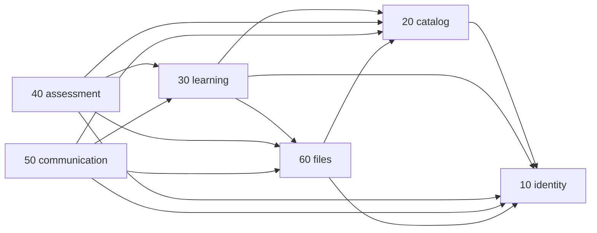

# DB 설계와 ERD 작업 가이드

ASTRA 재구현용 MySQL 8 스키마(97 테이블, FK 192개)를 어떻게 읽고, 바꾸고, ERDCloud ERD에 반영하는지 정한 문서다. 사람과 에이전트 모두 이 문서의 절차를 따른다. 경로는 이 레포 루트 기준이고, `reference/`는 [ASTRA-Reference](https://github.com/STack-Corp/ASTRA-Reference) 서브모듈이다(`git submodule update --init`).

- ERD A, ASTRA 목표 모델(MySQL, 이 문서의 대상): https://www.erdcloud.com/d/B5bWYfGmFisJTYLka (`STack DB`)
- ERD B, 캠퍼스 온 운영 스키마(PostgreSQL, `backend/`): https://www.erdcloud.com/d/G75sZP24bZNHuezyy. 6.1절 참고
- 근거 표기는 [reference/backend/README.md](https://github.com/STack-Corp/ASTRA-Reference/blob/main/backend/README.md)의 `OBSERVED`/`CLIENT`/`INFERRED`/`PROPOSED`/`UNKNOWN`과 화면 명세의 `[추정]`을 그대로 쓴다. DB 설계 대부분은 화면·JS에서 역으로 추론한 `INFERRED`다. 운영 서버의 실제 테이블이 아니다.

## 1. 기준 파일

| 파일 | 역할 |
|---|---|
| [src/main/resources/db/migration/](../src/main/resources/db/migration/) | **정본 DDL.** Flyway 마이그레이션 `V1__baseline.sql`, `V2__…sql` …을 버전 순서대로 적용한 결과가 기준이다 |
| [reference/db/design/](https://github.com/STack-Corp/ASTRA-Reference/tree/main/db/design) `10_identity` ~ `60_files` | 영역별 설계 근거(Reference 레포): 테이블 목록, 근거, 경계·미결 사항. 문서 안의 DDL 조각은 설계 당시 초안이고 기준이 아니다 |
| [tools/check.sql](tools/check.sql) | 로드한 스키마 점검: 테이블/FK 수, 깨진 FK, COMMENT 누락, 고립 테이블 |
| [tools/erdcloud_snapshot.py](tools/erdcloud_snapshot.py) | 로드한 스키마에서 ERDCloud 스냅샷 생성, `--compare`로 ERDCloud에서 내려받은 스냅샷과 비교 |
| [erdcloud/snapshot.json](erdcloud/snapshot.json) | 현재 ERDCloud에 올라간 내용과 같은 스냅샷. 표 위치의 기준이기도 하다 |

ERDCloud는 보기용 사본이다. ERDCloud 화면에서 직접 고친 내용은 정본에 반영되지 않으며, 다음 동기화 때 덮어써진다.

애플리케이션이 시작될 때 Flyway가 아직 적용되지 않은 마이그레이션을 버전 순서대로 실행한다. 한 번이라도 적용된 마이그레이션 파일은 고치지 않는다. 고치면 Flyway 체크섬 검사에서 시작이 실패한다. 바꿀 내용은 항상 다음 번호의 새 파일로 만든다.

## 2. 큰 그림

### 2.1 6개 영역

| 영역 | 담당 | 테이블 | 중심 테이블 | 다른 영역으로 거는 FK |
|---|---|---:|---|---|
| 10 identity | 사용자·자격증명·기기·세션·재인증·개인설정·접속이력 | 13 | `users`, `user_sessions`, `user_devices` | 없음(의도적, [reference/db/design/10_identity.md](https://github.com/STack-Corp/ASTRA-Reference/blob/main/db/design/10_identity.md)) |
| 20 catalog | 학기·과목·수강 원장·시간표·비정규 신청·좌석·학사일정·알림 | 14 | `terms`, `courses`, `course_enrollments` | identity, learning(`notifications.activity_id`) |
| 30 learning | 주차·학습활동·온라인강의 진도·출석·그룹·강의계획서 | 23 | `learning_activities`, `course_weeks`, `attendance_sessions` | catalog, identity, files |
| 40 assessment | 과제 제출·퀴즈 응시·설문 응답·성적 | 23 | `assignments`, `quiz_attempts`, `surveys`, `grade_items` | learning, catalog, identity, files |
| 50 communication | 게시판·게시글·댓글·읽음·쪽지·서포터즈 채팅·임시저장 | 11 | `boards`, `posts`, `messages` | catalog, identity, learning, files |
| 60 files | 업로드·파일·첨부 묶음·파일함·ZIP·미리보기·AI 요약 | 13 | `files`, `attachment_groups`, `filebox_items` | catalog, identity |



화살표는 FK가 가리키는 방향이다. 이해와 구현 모두 identity → catalog → learning → 나머지 순서로 진행한다.

### 2.2 중심 테이블

다른 테이블이 FK로 가리키는 횟수(`information_schema` 실측):

| 테이블 | 횟수 | 뜻 |
|---|---:|---|
| `users` | 61 | 누가 |
| `courses` | 26 | 어느 과목에서 |
| `learning_activities` | 12 | 무엇을(영상·자료·과제·퀴즈·설문의 공통 부모) |
| `files` | 8 | 어떤 파일 |
| `attachment_groups` | 7 | 어떤 첨부 묶음 |
| `posts` | 6 | 어떤 게시글 |

대부분의 테이블은 "누가(`users`) 어느 과목에서(`courses`) 무엇을(`learning_activities`)"에 매달려 있다. FK 없이 참조하는 곳은 `notifications.target_kind`/`target_ref_id`와 `file_thumbnails` 두 곳뿐이다.

### 2.3 ERDCloud에서 읽는 순서

표는 영역 순서대로 세로 열을 이루며 놓여 있다. 왼쪽 도구 모음의 `q`(논리+물리), `w`(한글만), `e`(영문만)로 표시를 바꾼다.

1. 맨 왼쪽 `사용자` 열(identity): `사용자`만 기억하고 나머지는 부속으로 본다.
2. `학기` → `과목` → `수강(등록) 원장`: 누가 어떤 과목을 듣는지가 정해진다.
3. `학습활동`: 과제·퀴즈·설문·성적 항목·자료 상세가 이 테이블과 1:1로 붙는다. ERD에서 "0 또는 1"로 표시된 관계가 이것이다.
4. 나머지 영역은 위의 세 축에 매달린 가지로 읽는다.

## 3. 핵심 데이터 흐름

각 흐름은 화면 동작 하나가 어느 테이블에 순서대로 쓰는지를 나타낸다. 새 기능은 이 표처럼 화면 → 엔드포인트 → 테이블 순서로 추적한다.

| 흐름 | 쓰는 순서 | 화면 | 엔드포인트 예 |
|---|---|---|---|
| 로그인·세션 | `users` → `user_credentials` → `user_devices` → `user_sessions` → `login_events` | 08, 09, 11 | EP-0146 로그아웃, EP-0149 세션 검사. 로그인 자체는 `UNKNOWN` |
| 수강신청 | `terms` → `courses` → `course_enrollments` → `enrollment_events` + `course_seat_counters` (청강은 `audit_request_details`) | 20~25, 42 | EP-0212 목록, EP-0197/0199 비정규 신청·취소 |
| 영상 학습·출석 | `learning_activities` → `online_lecture_items` → `learning_sessions` → `learning_heartbeats` → `learning_credit_ledger` → `online_lecture_item_progress`. 출석은 `attendance_sessions` → `attendance_records` | 40, 43, 61, 62 | EP-0049 학습창 진입, EP-0050 하트비트 |
| 과제 → 성적 | `assignments` → `assignment_submissions` → `assignment_submission_versions` → `attachments`. 채점은 `grade_items` → `grade_scores` | 64, 65, 45 | EP-0077 제출 저장, EP-0035 성적 목록 |
| 퀴즈·설문 | `quizzes` → `quiz_questions` → `quiz_attempts` → `quiz_attempt_answers`. 설문은 `surveys` → `survey_responses` → `survey_participations` | 66, 67, 35, 36 | EP-0112/0103 응시, EP-0099 설문 제출 |
| 게시판·쪽지·알림 | `boards` → `posts` → `post_read_receipts`/`comments`. 쪽지는 `messages` → `message_recipients`. 알림은 `notifications` | 30~34, 47~54, 04~07 | EP-0230 쪽지 발송 |
| 첨부파일 | `upload_sessions` → `files` → `file_blobs` → `attachment_groups`/`attachments` 또는 `filebox_items`. 미리보기는 `conversion_jobs` → `preview_sessions` | 12, 52, 63, 68 | EP-0127 업로드 |

엔드포인트 ID는 [reference/backend/endpoint_inventory.md](https://github.com/STack-Corp/ASTRA-Reference/blob/main/backend/endpoint_inventory.md)에서 경로와 계약 문서로 찾아간다.

## 4. 설계 규칙

새 테이블·컬럼은 아래 규칙을 따른다. `tools/check.sql`이 COMMENT 누락과 깨진 FK를 잡는다.

- **이름**: snake_case, 테이블은 복수형(원장은 `learning_credit_ledger`처럼 단수), PK는 `<단수>_id`, FK 제약은 `fk_<자식>_<부모>`. 예약어는 피한다(`role` → `enrollment_role`).
- **PK**: `BIGINT UNSIGNED AUTO_INCREMENT` 대리키. 부모와 1:1인 상세 테이블은 부모 PK를 그대로 PK+FK로 쓴다(`learning_material_details.activity_id` 등).
- **COMMENT 필수**: 모든 테이블·컬럼에 한글 COMMENT를 단다. ERD의 한글 이름은 COMMENT에서 `:` 앞, 맨 뒤 괄호 앞까지를 잘라 만든다. 예를 들어 `역할: STUDENT|TA`는 `역할`이 되므로, COMMENT는 "이름(보충 설명): 값 목록" 형태로 쓴다.
- **상태값**: MySQL ENUM이나 코드 테이블 대신 `VARCHAR`를 쓰고, 가능한 값은 COMMENT에 적는다.
- **시간**: `DATETIME(3)`, `DEFAULT CURRENT_TIMESTAMP(3)`, 수정 일시는 `ON UPDATE CURRENT_TIMESTAMP(3)`. `DATE`는 학기·주차·학사일정만 쓴다.
- **삭제**: 행을 지우지 않고 `deleted_at`, `revoked_at`, `canceled_at`, `item_state`로 표시한다.
- **이력**: 덮어쓰면 안 되는 기록은 별도 테이블에 추가만 한다(`enrollment_events`, `learning_heartbeats`, `assignment_submission_versions`, `login_events`).
- **첨부**: 부모 테이블은 `attachment_group_id` 하나만 가진다. 테이블마다 파일 테이블을 따로 만들지 않는다.
- **조건부 중복 금지**: MySQL 8에는 부분 인덱스가 없으므로, 조건이 맞을 때만 값을 갖는 생성 컬럼에 UNIQUE를 건다(`course_enrollments.active_scope_key`, `learning_sessions.active_user_key` 등). ERDCloud 그림에서는 일반 컬럼으로 보인다.
- **동시성·중복 요청**: 낙관적 잠금은 `version` 계열 컬럼, 중복 요청 방지는 `client_request_id` 계열 컬럼을 쓴다.
- **`legacy_*`**: 원본 ILOS 키를 대조하려고 둔 NULL 허용 컬럼이다. 새로 만드는 행은 비워 둔다.

## 5. 스키마 변경 절차

1. 설계 이유와 근거 수준을 ASTRA-Reference의 `db/design/<영역>.md`에 먼저 적고 Reference에 반영한다.
2. `src/main/resources/db/migration/`에 다음 번호의 새 파일(`V<번호>__<변경 요약>.sql`)을 만든다. 기존 파일은 고치지 않는다. 새 테이블과 컬럼에도 4절 규칙(COMMENT 등)을 그대로 적용한다.
3. 로컬 MySQL에 다시 올리고 점검한다. `tables`/`fks` 두 줄만 나오고 다른 행이 없어야 통과다.

```sh
# 최초 1회
docker run -d --name astra-erd-mysql -e MYSQL_ROOT_PASSWORD=erd mysql:8.4

# 변경할 때마다
docker exec astra-erd-mysql rm -rf /tmp/migration
docker cp src/main/resources/db/migration astra-erd-mysql:/tmp/migration
docker cp db/tools/check.sql astra-erd-mysql:/tmp/check.sql
docker exec astra-erd-mysql sh -c "mysql -uroot -perd -e 'DROP DATABASE IF EXISTS astra; CREATE DATABASE astra CHARACTER SET utf8mb4' \
  && for f in \$(ls /tmp/migration/V*__*.sql | sort -V); do mysql -uroot -perd --default-character-set=utf8mb4 astra < \$f || exit 1; done \
  && mysql -uroot -perd --default-character-set=utf8mb4 -N astra < /tmp/check.sql"
```

큰 SQL 파일을 `docker exec -i`의 표준 입력으로 흘려 넣으면 멈출 수 있다. 위처럼 `docker cp` 후 컨테이너 안에서 리다이렉트한다. 이 절차는 ERD와 COMMENT 점검용이다. 애플리케이션에서 마이그레이션이 실제로 적용되는지는 `./gradlew test`가 MySQL 8.4 컨테이너에서 확인한다.

4. 스냅샷을 다시 만든다. 기존 표 위치는 유지되고, 새 테이블은 오른쪽 새 열에 놓인다.

```sh
python db/tools/erdcloud_snapshot.py
```

5. 아래 6절대로 ERDCloud에 반영하고, 새 마이그레이션 파일, `db/erdcloud/snapshot.json`, 그리고 1단계 Reference 변경을 가리키도록 갱신한 `reference` 서브모듈을 같은 커밋에 넣는다(`git -C reference pull origin main` 후 `git add reference`).

## 6. ERDCloud 반영

**SQL Import는 쓰지 않는다.** ERDCloud의 SQL 가져오기에는 확인된 문제가 있다.

- 이름에 `primary`가 들어간 UNIQUE 키 줄을 기본키로 읽는다. `course_merged_group_members`의 기본키가 세 컬럼으로 그려졌다.
- UNSIGNED와 설명 속 `[` `]`를 지운다.
- 한글 이름 칸에 영문 이름을 그대로 넣는다.
- 관계를 모두 1:N으로 그린다.

`tools/erdcloud_snapshot.py`가 만든 스냅샷은 이 문제가 없다. 반영 절차:

1. 편집 권한이 있는 계정으로 ERD를 연다. 표 목록이 다 불러와질 때까지 몇 초 기다린다.
2. 하단 **Export → Download Snapshot**으로 현재 상태를 백업한다.
3. 기존 표를 모두 지운다. 업로드는 이름이 같은 테이블을 덮어쓰지 않고 건너뛰기 때문이다. 비우지 않고 올리면 아무것도 바뀌지 않는데 표 개수는 그대로 97개라서, 바뀌지 않은 것을 알아채기 어렵다.
   - **직전 작업이 스냅샷 업로드나 SQL 가져오기인 경우:** 상단 Undo 한 번에 표가 모두 지워진다. 표가 0개가 됐는지 확인한다.
   - **그 뒤 누가 ERDCloud에서 직접 편집한 경우:** Undo 한 번으로는 비워지지 않는다. Shift를 누른 채 끌면 여러 표가 선택되지만, Delete 키는 선택된 표 하나만 지운다(2026-11-07 확인). 화면을 최대로 줄여도 97개가 한 화면에 들어오지 않는다. 이때는 상단 **Create ERD**로 새 ERD를 만들어 4단계를 그 ERD에서 하고, 이 문서 맨 위의 ERD 주소를 새 주소로 바꾼다. 표를 하나씩 클릭해 Delete로 지워도 되지만 97번 반복해야 한다.
   - ERDCloud에서 직접 고친 내용은 정본에 없다. 남겨야 하면 먼저 새 마이그레이션으로 만들고 5절부터 다시 한다.
4. 하단 **Import → Upload Snapshot**으로 `db/erdcloud/snapshot.json`을 올린다.
5. 새로고침한 뒤 **Export → Download Snapshot**으로 다시 내려받아 생성본과 비교한다. 표 개수만 보는 것으로는 확인이 안 된다.

```sh
python db/tools/erdcloud_snapshot.py --compare "STack DB-snapshot.json"
```

   마지막 줄이 `… tables compared, 0 differences`여야 통과다. 비교 대상은 테이블과 컬럼의 영문·한글 이름, 타입, NULL 허용, 기본값, 설명, 기본키·FK 배치, 관계 대상, 관계 표기다. 표 위치는 비교하지 않는다. 차이가 있으면 다른 줄이 출력되고 종료 코드 1로 끝난다. 이때는 3단계부터 다시 하거나 2단계의 백업 파일을 올려 되돌린다.

반영 후 Undo를 누르면 방금 올린 표가 모두 사라질 수 있다. 그럴 때는 4단계부터 다시 한다.

### 6.1 ERD B: 캠퍼스 온 운영 스키마

`backend/`(캠퍼스 온, PostgreSQL 17)의 Flyway 마이그레이션 V1~을 적용한 결과를 그린 ERD다. 지금 실제로 동작하는 구조이며 ERD A와 테이블·타입·제약이 다르다. 두 모델의 대응은 [backend/docs/erd-handoff.md](../backend/docs/erd-handoff.md)에 있다.

| 파일 | 역할 |
|---|---|
| [erdcloud/campus-on-snapshot.json](erdcloud/campus-on-snapshot.json) | ERD B에 올라간 내용과 같은 스냅샷 |
| [erdcloud/campus-on-names.json](erdcloud/campus-on-names.json) | 한글 이름·설명과 처음 배치. `backend/` 마이그레이션에 COMMENT가 없어서 여기서 관리한다. `backend/`에 `COMMENT ON` 마이그레이션이 생기면 DB 설명이 없는 항목만 이 파일 값이 쓰인다 |

`backend/` 마이그레이션이 바뀌면 다음 순서로 다시 만들고, 6절 2~5단계를 ERD B 주소에서 한다. 새 컬럼의 한글 이름은 `campus-on-names.json`에 추가한다.

```sh
# 최초 1회
docker run -d --name campus-on-erd-pg -e POSTGRES_PASSWORD=erd -e POSTGRES_DB=campus postgres:17

# 변경할 때마다
docker exec campus-on-erd-pg psql -U postgres -c "DROP DATABASE IF EXISTS campus WITH (FORCE)" -c "CREATE DATABASE campus"
docker exec campus-on-erd-pg rm -rf /tmp/migration
docker cp backend/src/main/resources/db/migration campus-on-erd-pg:/tmp/migration
docker exec campus-on-erd-pg sh -c 'for f in $(ls /tmp/migration/V*__*.sql | sort -V); do psql -v ON_ERROR_STOP=1 -q -U postgres -d campus -f $f || exit 1; done'
python db/tools/erdcloud_snapshot.py --engine postgres --names db/erdcloud/campus-on-names.json \
  --previous db/erdcloud/campus-on-snapshot.json --out db/erdcloud/campus-on-snapshot.json --diagram G75sZP24bZNHuezyy

# ERDCloud에서 내려받은 스냅샷과 비교
python db/tools/erdcloud_snapshot.py --out db/erdcloud/campus-on-snapshot.json --compare "캠퍼스 온 운영 스키마 (PostgreSQL)-snapshot.json"
```

## 7. 미결 사항

아래는 테이블 구조가 바뀔 수 있는 결정이다. 해당 영역을 구현하기 전에 정한다. 자세한 내용은 `reference/db/design/*.md`의 경계·미결 절에 있다. 표의 `design/`은 `reference/db/design/`, `backend/`는 `reference/backend/`다.

| 항목 | 영향 테이블 | 문서 |
|---|---|---|
| 로그인/SSO 방식이 `UNKNOWN` | `user_credentials` 전체 | design/10_identity.md, backend/10_identity.md |
| 팀 과제를 대표 1명만 내는지 누구나 내는지 | `assignment_submissions` | design/40_assessment.md |
| 온라인 시험 응시 흐름을 관찰하지 못함 | `quizzes`, `quiz_questions`, `quiz_attempts` | design/40_assessment.md |
| 출석 판정 산식 | `attendance_records` | design/30_learning.md |
| 학습 완료가 조회(GET)의 부수효과로 처리됨 | `activity_progress` | design/30_learning.md, backend/30_learning.md |
| 익명 설문의 익명성 경계 | `survey_responses`, `survey_participations` | design/40_assessment.md |
| 파일함에 자동으로 올라가는 시점 | `filebox_items`, `zip_jobs` | design/60_files.md |
| 익명과 비공개를 두 축으로 나눈 것 | `posts.is_anonymous`, `posts.is_secret` | design/50_communication.md |
| 쪽지 자동삭제·전송취소 조건 | `message_recipients` | design/50_communication.md |
| 영역 소유권: 2차 인증, 메인 설정, 프로필 이미지, 비정규 강의계획, 학과 마스터 | identity·catalog·files 경계 | design/10_identity.md, design/20_catalog.md |

## 8. 구현 순서

[reference/backend/90_changes.md](https://github.com/STack-Corp/ASTRA-Reference/blob/main/backend/90_changes.md)의 P0 항목을 먼저 닫는다.

| 순서 | 변경 | 주로 닿는 영역 |
|---|---|---|
| CHG-01 | 서버 신원과 객체 권한을 하나의 정책으로 | identity, 전 영역 |
| CHG-02 | 과목 선택을 세션 전역 상태와 분리 | catalog |
| CHG-03 | 수강신청을 폼 열기와 분리하고 한 번에 처리 | catalog |
| CHG-04 | 제출·시험·설문의 최종 상태와 첨부를 한 번에 처리 | assessment, files |
| CHG-05 | 출석·마감 시각을 서버 시계 기준으로 | learning, assessment |
| CHG-06 | 파일·변환·AI가 원문 권한을 우회하지 않게 | files |

그다음 P1(CHG-07~10), P2(CHG-11/12) 순서다. 영역으로는 identity·catalog → learning → assessment → communication·files로 진행한다.

## 9. 처음 읽는 순서

1. [reference/README.md](https://github.com/STack-Corp/ASTRA-Reference/blob/main/README.md): 무엇을 어떻게 수집했는지, `[추정]` 표기
2. [reference/backend/README.md](https://github.com/STack-Corp/ASTRA-Reference/blob/main/backend/README.md): 근거 수준 5단계
3. [reference/backend/00_server_contract.md](https://github.com/STack-Corp/ASTRA-Reference/blob/main/backend/00_server_contract.md): 서버 공통 불변식. 스키마가 이렇게 생긴 이유다
4. 이 문서 2~4절
5. `reference/db/design/10` → `20` → `30` → `40` → `50` → `60`. 각 문서는 테이블 목록과 경계·미결 절을 먼저 보고, DDL 조각은 보지 않아도 된다
6. 3절의 흐름 하나를 화면 명세 → 엔드포인트 계약 → 테이블 순서로 끝까지 따라간다. 예: `reference/65_팝업_과제제출.md` → EP-0077 → `assignment_submissions`

## 10. 에이전트 작업 규칙

- 스키마를 바꾸면 5절 3단계 점검과 4단계 스냅샷 재생성까지 끝낸 뒤에 완료로 보고한다. ERDCloud에 반영했다면 6절 5단계 비교에서 `0 differences`가 나와야 한다.
- `reference/db/design/*.md`의 근거 수준을 바꾸거나 지우지 않는다. 추론한 내용은 `[추정]` 또는 `INFERRED`로 남긴다. 고칠 일이 있으면 Reference 레포에서 고친다.
- ERDCloud는 6절로만 고친다. ERDCloud 내부 API를 직접 호출하거나 AI Connect 토큰을 재발급하지 않는다. 재발급하면 기존 연결이 끊긴다.
- 원본 캡처, 개인정보, 토큰은 저장소에 넣지 않는다.
