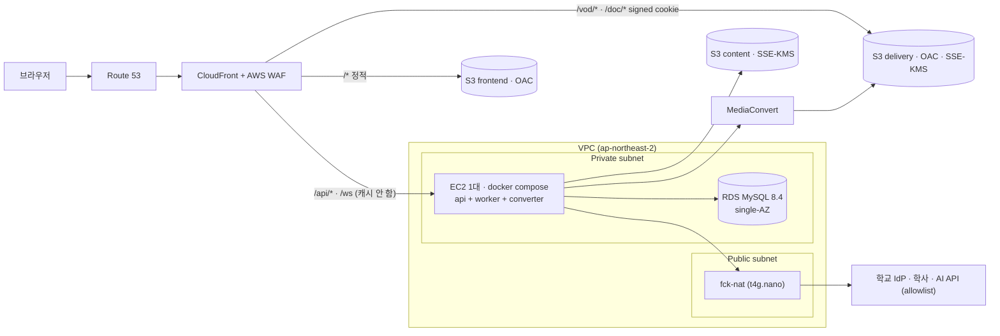
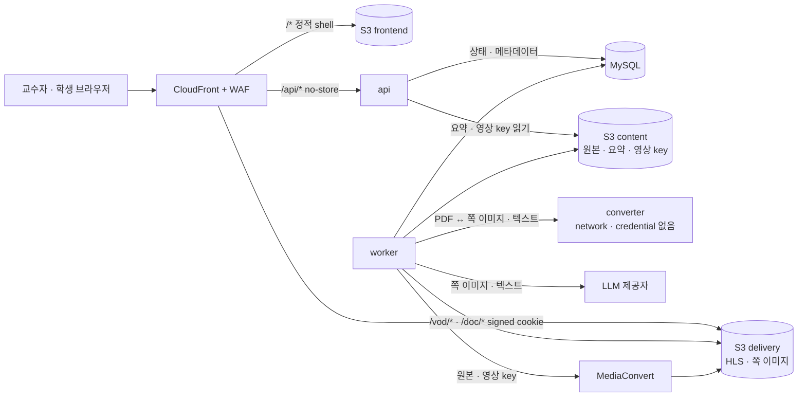
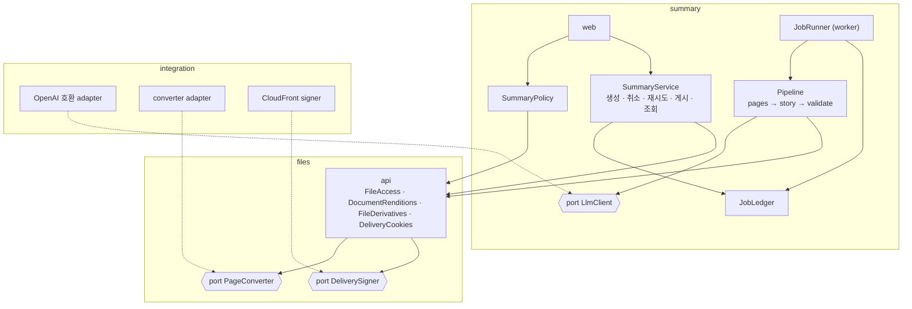

# 백엔드 아키텍처

작성일 2026-11-09. 시연부터 학교 도입 전까지 적용하는 기준안이다. 결정의 이유와 기각한 대안은 [docs/adr/](adr/)에 있다. 캠퍼스 온은 별개 서비스이며 [STack-Backend](https://github.com/STack-Corp/STack-Backend)의 `backend/docs/adr/`가 별도 번호 체계로 결정을 기록한다. 2026-11-10 이 문서와 루트 `src/`는 STack-Backend에서 이 레포(STack-eclass-Backend)로 옮겼다. 아래 "루트 `src/`"는 이 레포를 뜻한다.

## 1. 전제

| 항목 | 내용 |
|---|---|
| 목표 | 서울과학기술대학교 e-Class(ASTRA)를 대체한다. 이 학교에 먼저 도입한다 |
| 규모 | 1개 기관, 사용자 수백 명. 수만 명 규모를 전제로 설계하지 않는다 |
| 서버 계약 | [00_server_contract.md](https://github.com/STack-Corp/ASTRA-Reference/blob/main/backend/00_server_contract.md)의 SC-01~SC-10, [90_changes.md](https://github.com/STack-Corp/ASTRA-Reference/blob/main/backend/90_changes.md)의 CHG-01~CHG-12 |
| 실행 환경 | Java 25, Spring Boot 4.1, MySQL 8.4, AWS 서울 리전(`ap-northeast-2`) |

| ADR | 결정 |
|---|---|
| [ADR-0001](adr/0001-modular-monolith.md) | 단일 Gradle 프로젝트의 modular monolith와 같은 이미지의 worker 프로세스 |
| [ADR-0002](adr/0002-mysql-mainline.md) | 루트 `src/`의 MySQL 스키마를 본류로 하고, 캠퍼스 온(`backend/`)은 독립 프로젝트로 둔다 |
| [ADR-0003](adr/0003-aws-single-ec2-until-adoption.md) | 학교 도입 전까지 CloudFront VPC origin과 EC2 1대로 운영하고, ALB는 도입할 때 붙인다 |
| [ADR-0004](adr/0004-sso-bff-session.md) | 학교 SSO를 백엔드가 받는 BFF 방식, 브라우저에는 opaque session 쿠키, Zero-Trust 전환용 경계 |
| [ADR-0005](adr/0005-first-paint-static-shell.md) | 첫 화면은 CDN의 정적 shell과 집계 API 한 번으로 그린다. SSR 서버를 두지 않는다 |
| [ADR-0006](adr/0006-summary-module.md) | 강의 자료의 쪽별 요약을 `summary` 모듈로 구현한다. LessonViewer container를 붙이지 않는다 |
| [ADR-0007](adr/0007-confidential-content-placement.md) | 영상, 강의 자료, 요약 본문은 object storage에만 두고 SSE-KMS로 암호화한다. 영상은 HLS AES-128을 적용한다 |
| [ADR-0008](adr/0008-llm-port-deepseek.md) | LLM 호출은 port 뒤에 두고 DeepSeek로 시작한다. 데이터 처리 정책은 미결이다 |
| [ADR-0009](adr/0009-origin-delivery-without-cdn.md) | CDN이 없는 환경에서는 앱이 같은 cookie 흐름으로 `/doc`, `/vod`를 직접 응답한다 |
| [ADR-0010](adr/0010-upload-acceptance.md) | 업로드는 용도, 권한, 이름, 확장자, 크기, 내용 형식을 검사해 받는다. 악성코드 검사는 port로 남긴다 |
| [ADR-0012](adr/0012-idempotency-ledger-and-audit.md) | requestId는 서버가 만든다. 일반 명령의 멱등 원장과 감사 기록을 `shared`에 두고 명령과 같은 transaction에 쓴다 |
| [ADR-0013](adr/0013-course-notice-storage.md) | 강의실 공지는 과목마다 하나인 공지 게시판의 `posts` 행으로 두고, 게시판은 첫 공지를 쓸 때 DB 제약 아래 만든다 |
| [ADR-0018](adr/0018-malware-scan-clamd.md) | 업로드 악성코드 검사는 같은 배포의 ClamAV daemon으로 한다. 판정 전에는 열지 않고(fail closed), 판정은 같은 내용을 쓰는 모든 파일에 적용하며, 거부한 객체는 지운다 |
| [ADR-0015](adr/0015-assignment-submission-model.md) | 과제 최종 제출은 바뀌지 않는 버전이고, 공용 멱등 원장이 생기기 전까지 제출 버전 행이 멱등 receipt다 |
| [ADR-0017](adr/0017-school-sso-oidc.md) | 학교 SSO는 OpenID Connect code flow + PKCE adapter로 먼저 만든다. 로그인 전 값은 암호화한 쿠키에 두고 IdP token은 저장하지 않는다 |
| [ADR-0019](adr/0019-container-image-and-single-host-compose.md) | 이미지 하나를 api, worker, converter 역할로 실행하고, health는 container 안의 관리 port로만 연다 |
| [ADR-0014](adr/0014-learning-session-credit.md) | 온라인 강의 출석 인정은 서버 시각의 적립 원장으로 하고, 사용자당 활성 학습 session은 하나다. 새 session이 앞 session을 대체한다 |
| [ADR-0025](adr/0025-message-recipient-scope-and-boxes.md) | 쪽지 받는사람은 과목 관계로 서버가 정하고(담당자는 과목 구성원 누구에게나, 학생은 담당자에게만), 받은함과 보낸함은 따로 지운다. 읽음과 회수는 배타적인 조건부 전이다 |

## 2. 부하 가정

| 경로 | 가정 | 결과 |
|---|---|---|
| 온라인 강의 하트비트 | 서버가 정하는 주기 60초(원본은 240초, [62_온라인강의_플레이어.md](https://github.com/STack-Corp/ASTRA-Reference/blob/main/62_온라인강의_플레이어.md) §6). 동시 시청 500명 | 약 8 rps |
| 메인 첫 진입, 과제 마감 직전, 시험 시작, 비정규 수강신청 | 짧은 순간에 요청이 몰린다 | 처리량보다 정원·멱등의 정합성(SC-05)과 서버 시계 기준 마감 판정(SC-06)이 문제다 |
| 영상 송출 | 3 Mbps HLS 기준 시간당 약 1.35 GB. 500명이 월 12시간씩 보면 약 8 TB | 원 서버가 아니라 CDN이 송출한다. 월 비용 대부분이 이 전송량이다 |

위 수치는 학교 실측 전 가정이다. API는 서버 1대로 충분하고, 대역폭과 비용은 영상이 정한다. 3단계 부하 시험에서 실제 값으로 다시 잡는다.

## 3. 배포 토폴로지

### 3.1 학교 도입 전

- 도메인은 하나다. CloudFront가 경로로 정적 파일, 영상, API를 나눈다. CORS가 필요 없다. session 쿠키의 `SameSite` 예외는 5절에 있다.
- CloudFront [VPC origin](https://docs.aws.amazon.com/AmazonCloudFront/latest/DeveloperGuide/private-content-vpc-origins.html)이 private subnet의 EC2에 직접 연결한다. EC2와 RDS에는 public IP가 없다.
- api, worker, converter는 같은 이미지를 역할만 바꿔 같은 EC2에서 실행한다. 이미지는 루트 `Dockerfile`, 구성은 루트 `compose.yaml`이다([ADR-0019](adr/0019-container-image-and-single-host-compose.md)).
- converter는 문서 변환만 하는 별도 container다. 앱과 같은 jar를 converter main(`com.stackcorp.converter.ConverterServer`)으로 실행한다. worker와만 공유하는 내부 network에 있어 worker만 호출할 수 있고, 외부 network, 비밀값, AWS credential이 없다(SC-08).
- compose에서 host에 publish하는 port는 api의 8080 하나다. MySQL, converter, 관리 port는 host에 열지 않는다. 같은 host의 MySQL은 compose 프로필로 띄울 수 있고 위 구성에서는 RDS를 쓴다.
- bucket은 `frontend`, `content`, `delivery` 셋이다. 용도와 암호화는 [ADR-0007](adr/0007-confidential-content-placement.md)에 있다.
- 배포 중 JVM 기동 시간 동안 API가 끊긴다. 배포는 사용량이 적은 시간에 한다. 기동은 JDK AOT cache(JEP 483, 514)로, warm-up은 JEP 515로 줄인다.

### 3.2 학교 도입

| 바뀌는 것 | 내용 |
|---|---|
| 입구 | private subnet에 ALB를 만들고 CloudFront VPC origin을 EC2에서 ALB로 바꾼다. 도메인은 그대로다 |
| 실행 | ECS 서비스로 옮긴다. api는 min 2 / max 4, `ALBRequestCountPerTarget` target tracking. worker는 1개 |
| 캐시·broker | ElastiCache for Valkey를 붙이고 WebSocket fan-out과 사용자 단위 rate limit 저장소를 Valkey로 바꾼다(8절). 앱 코드는 설정만 바뀐다 |
| DB | RDS Multi-AZ, PITR 유지 |
| NAT | NAT Gateway로 바꿀지 판단한다(3.3절 fck-nat 장애 영향) |

이 전환이 인프라와 설정 작업으로 끝나려면 4.3절의 stateless 규칙을 1단계부터 지켜야 한다.

### 3.3 네트워크 경계

| 대상 | 들어오는 트래픽 | 나가는 트래픽 |
|---|---|---|
| CloudFront | 인터넷 443. AWS WAF managed rule(Core, SQL database, Known bad inputs) | origin만 |
| EC2(api, worker) | `CloudFront-VPCOrigins-Service-SG`에서 오는 앱 포트만 | RDS 3306, S3(gateway endpoint), 그 밖의 모든 외부·AWS API는 fck-nat 경유 |
| converter | 같은 host의 worker에서 오는 요청만 | 없음 |
| clamav | 같은 host의 worker에서 오는 3310만 | signature 갱신(freshclam)용 mirror만, fck-nat 경유 |
| RDS | EC2 security group의 3306만 | 없음 |
| fck-nat | private subnet에서 오는 트래픽만 | 인터넷 |

- WAF에 IP 기준 rate limit을 걸지 않는다. 교내 사용자가 NAT 하나로 나오면 학교 전체가 막힌다(SC-09). 요청 제한은 앱에서 사용자, 과목, 연산 단위로 건다.
- Core rule set의 `SizeRestrictions_BODY`는 8 KB를 넘는 본문을 막는다. 업로드(`POST /api/uploads`), 글 작성, 제출이 걸리므로 이 규칙은 Count로 바꾸고, 본문 크기 상한은 경로별 WAF 규칙과 앱의 413 응답으로 둔다.
- SSH 포트를 열지 않는다. 운영 접근은 SSM Session Manager로 한다.
- `/actuator`는 CloudFront 경로에 넣지 않는다. 앱은 `health`만 켜고, 관리 port(8081)를 API port와 따로 두어 container 안의 127.0.0.1에만 연다. API port에는 `/actuator` 경로가 없다. compose healthcheck가 container 안에서 readiness를 부른다.
- 외부 호출은 allowlist한 scheme, host, port만 허용하고 redirect, timeout, 응답 크기를 제한한다(SC-08).
- S3 외의 AWS API(SSM, ECR, Secrets Manager, CloudWatch, X-Ray, SQS, MediaConvert)도 fck-nat를 지난다. fck-nat가 멈추면 외부 IdP·AI 호출과 함께 배포, SSM 접속, 로그·지표 전송, 미디어 완료 처리가 멈춘다. interface endpoint는 개당 AZ별로 과금되어 이 단계의 NAT 비용보다 비싸므로 두지 않는다. 대신 fck-nat의 high-availability mode(크기 1 Auto Scaling group과 고정 ENI)로 인스턴스를 자동 교체하고, 교체되는 동안의 장애 범위는 받아들인다.

## 4. 애플리케이션 구조

### 4.1 모듈

단일 Gradle 프로젝트의 `com.stackcorp.astra` 아래에 모듈을 패키지로 나눈다. 영역은 [db/README.md](../db/README.md) 2.1절의 DB 영역을 따른다.

| 모듈 | 담당 | 코드가 의존하는 모듈 |
|---|---|---|
| `identity` | 사용자, 외부 신원 연결, session, 기기, 2차 인증, 개인 설정 | 없음 |
| `catalog` | 학기, 과목, 수강, 시간표, 알림 | `identity` |
| `learning` | 강의실, 주차, 학습활동, 영상 학습 session, 출석 | `catalog`, `identity`, `files` |
| `assessment` | 과제, 퀴즈, 설문, 성적 | `learning`, `catalog`, `identity`, `files` |
| `communication` | 공지, Q&A, 게시판, 쪽지, 임시저장 | `catalog`, `identity`, `learning`, `files` |
| `files` | 업로드 lifecycle, 첨부, 파일함, 미리보기, 문서 rendition, 영상 asset, 파일 파생물 저장 | `catalog`, `identity` |
| `summary` | 강의 자료의 쪽별 요약 생성 작업, 후보 확인, 게시, 조회 | `files`, `identity` |
| `integration` | 학교 IdP, 학사 동기화, AI, 외부 allowlist client | 각 모듈의 공개 API |
| `shared` | 오류 형식, requestId, 요청 제한, 멱등 원장, 감사 기록. 목록 query 규칙은 첫 페이지 목록과 함께 만든다 | 없음. 모든 모듈이 쓸 수 있다 |
| `home` | 메인 화면 집계 조회(`/api/me/home`)와 할 일 목록. 쓰기 없음 | `catalog`, `learning`, `assessment`, `communication`의 공개 API. 어떤 모듈도 `home`에 의존하지 않는다 |

의존 방향은 [db/README.md](../db/README.md) 2.1절의 FK 방향을 따른다. 순환은 의존 역전으로 끊는다. 이벤트를 써도 listener가 발행 측 타입을 참조하면 의존이 생기므로 순환을 끊지 못한다.

- 알림: `notifications`는 `catalog` 소유이고 `activity_id`로 `learning`을 가리킨다. `catalog`는 `learning`에 의존하지 않는다. 알림 생성 API는 `catalog`가 공개 API로 정의하고, 이미 `catalog`에 의존하는 `learning`, `assessment`, `communication`이 원래 변경과 같은 transaction 안에서 호출한다. `activity_id`는 값으로만 저장한다.
- 할 일: 별도 테이블 없이 활성 수강 × 공개 활동 × serverTime으로 계산한다([reference/db/design/20_catalog.md](https://github.com/STack-Corp/ASTRA-Reference/blob/main/db/design/20_catalog.md)). 계산에 `learning`, `assessment`가 필요하므로 `home`에 둔다.
- 외부 연동: `identity`가 `ExternalIdentityProvider` 같은 포트를 공개 API로 정의하고 `integration`이 구현한다. 다른 모듈도 외부 결과가 필요하면 같은 방식을 쓴다.
- 요약과 전달: `summary`가 `LlmClient` port를, `files`가 문서 변환 port와 전달 서명 port를 공개 API로 정의하고 `integration`이 구현한다. S3를 읽고 쓰는 모듈은 `files` 하나다([ADR-0007](adr/0007-confidential-content-placement.md)).

### 4.2 모듈 규칙

- 모듈은 공개 API 패키지만 외부에 노출한다. Spring Modulith는 기본으로 모듈 루트 패키지만 공개하므로 `api` 하위 패키지는 `@NamedInterface`로 지정한다. 내부 패키지 참조는 `verify()`가 막는다.
- 다른 모듈의 테이블을 직접 읽거나 바꾸지 않는다. 그 모듈의 operation을 호출한다(SC-01).
- 경계는 Spring Modulith 2.x(Boot 4 호환 라인)의 `ApplicationModules.verify()` 테스트로 CI에서 확인한다. 정확한 버전은 의존성을 추가할 때 호환표로 정한다.
- DB 변경과 commit 뒤 후속 작업(외부 API 호출 등)을 함께 보장해야 하는 곳에는 Spring Modulith JDBC event publication registry를 쓴다. 이벤트는 같은 transaction에 기록되고, listener는 commit 뒤 이벤트를 발행한 프로세스에서 비동기로 실행된다. worker는 실패했거나 정해진 시간 이상 끝나지 않은 이벤트만 재전송한다(`ResubmissionOptions.withMinAge` 또는 staleness 설정). 실행 중인 listener와 겹치지 않게 하기 위해서이고, 이 작업은 ShedLock으로 묶는다. 이 registry는 외부 broker로 내보내는 outbox가 아니다. 그런 outbox가 필요해지면 따로 결정한다. 테이블은 Flyway 마이그레이션으로 만든다([db/README.md](../db/README.md) 5절).
- 객체 권한은 각 모듈의 `Policy`가 판정한다. 컨트롤러나 서비스가 role만 보고 허용하지 않는다(5절).

### 4.3 프로세스와 stateless 규칙

| 프로세스 | 프로필 | 하는 일 |
|---|---|---|
| api | `api` | HTTP API, WebSocket, api에서 발행한 이벤트의 listener(예: 업로드 확정 뒤 MediaConvert 작업 지시) |
| worker | `worker` | 미완료 이벤트 재전송, MediaConvert 완료 처리(SQS), 업로드 GC, 업로드 악성코드 검사, ZIP job, 문서 rendition, 요약 작업, 학습 session lease 만료 처리, 학사 동기화, 멱등 원장 정리 |

- session은 DB(`user_sessions`)에 둔다. 서버 메모리에 사용자 상태를 두지 않는다.
- 파일은 S3에만 쓴다. 컨테이너 로컬 디스크는 임시 작업 공간으로만 쓰고 요청 사이에 남기지 않는다.
- `@Scheduled` 작업은 ShedLock(JDBC)으로 묶는다. 인스턴스가 늘어도 한 번만 실행된다.
- WebSocket fan-out은 인스턴스가 1대일 때 in-memory broker로 하고, 2대가 되면 Valkey pub/sub로 바꾼다(8절).

### 4.4 C4 보기

container 수준이다. 기밀 본문이 지나는 경로만 그렸다.

component 수준이다. 요약에 관여하는 모듈만 그렸다. 점선은 port 구현이다.

- 각 모듈의 `package-info.java`가 4.1절 표의 의존을 `allowedDependencies`로 선언한다. 선언하지 않은 의존이 생기면 `ModuleStructureTests`의 `verify()`가 실패한다.
- 같은 테스트가 코드에서 읽은 모듈 의존을 `build/spring-modulith-docs/`에 C4 component diagram(PlantUML)으로 쓴다. 위 그림과 다르면 코드가 기준이다.

## 5. 인증과 인가

상세는 [ADR-0004](adr/0004-sso-bff-session.md)에 있다.

- 백엔드가 학교 IdP의 OIDC 또는 SAML client 역할을 한다. IdP 토큰은 서버에만 둔다.
- 브라우저는 opaque session 쿠키(`HttpOnly`, `Secure`, `SameSite=Lax`)와 CSRF 토큰만 받는다. DB에는 token hash만 저장한다.
- SAML HTTP-POST 응답은 IdP에서 오는 cross-site POST라 `SameSite=Lax` 쿠키가 전송되지 않는다. SAML이면 로그인 전 요청 상태를 session 대신 `RelayState` 기준 저장소에 두거나, 로그인 전용 쿠키만 `SameSite=None`으로 둔다. OIDC의 GET callback에는 이 문제가 없다.
- actor는 session principal 하나다. 요청 본문의 학번, `ud`, role 값은 받지 않는다(SC-02, CHG-01).
- 과목 범위는 `/api/courses/{courseId}/...`처럼 요청에 명시한다. 서버 session에 현재 과목을 두지 않는다(SC-03, CHG-02).
- 권한 판정은 `principal × institution × course × membership × object × action × visibility × serverTime`으로 하고 기본은 거부다(SC-02). 첨부, 영상 URL 발급, AI 검색은 부모 객체의 권한을 그대로 따른다(CHG-06).
- 학교 IdP가 장애일 때 쓰는 관리자 break-glass 계정 하나만 로컬 로그인을 허용하고 MFA(TOTP)를 강제한다. 비밀번호 hash와 TOTP secret은 Secrets Manager에서 받고 DB에 두지 않는다. 15분 안에 5번 실패하면 잠그고, 같은 TOTP 코드를 다시 쓰지 못하도록 성공한 뒤 90초 동안은 다시 로그인하지 않는다. break-glass 계정은 과목 권한이 없다.
- session은 마지막 요청 뒤 2시간, 로그인 뒤 12시간이 지나면 끝난다. CSRF는 double-submit 쿠키(`XSRF-TOKEN` 쿠키와 `X-XSRF-TOKEN` header)로 검사하고, 상태를 바꾸는 요청은 `Origin`과 `Sec-Fetch-Site`도 본다.
- 파일 권한은 `files`의 `FileAccess`가 첨부한 부모 객체에 묻는다. 학습활동 첨부는 `learning`이 판정한다. 담당자는 언제나, 학생은 공개됐고 시작 일시가 지난 활동만 본다. 권한이 없거나 경로의 과목과 객체가 맞지 않으면 존재를 드러내지 않도록 404로 응답한다.
- 강의실 공지는 `communication`이 판정한다. 담당자는 임시·예약 공지까지 보고 쓰며, 학생은 게시 일시가 DB 시계로 지난 공지만 본다. 공지 조회는 읽음을 남기지 않고, 읽음과 확인은 각각 POST 명령이다(SC-04).
- 요청 본문은 문서에 있는 필드만 받는다. 그 밖의 필드가 있으면 400이다. 사용자와 역할은 session에서만 정한다.
- 오류는 problem JSON(`status`, `detail`, `code`, `requestId`)으로 응답하고 캐시하지 않는다. 권한이 없을 때와 대상이 없을 때는 같은 404다. detail에는 입력값, 저장 key, SQL, 다른 사용자의 ID를 넣지 않는다(SC-04).
- 모든 응답에 서버가 만든 `X-Request-Id`가 붙는다. filter에서 거부한 401, 403도 같다. client가 보낸 값은 쓰지 않는다([ADR-0012](adr/0012-idempotency-ledger-and-audit.md)).
- `Idempotency-Key`를 받는 명령은 권한 판정과 입력 검사 뒤 멱등 원장을 거친다. 같은 key와 같은 요청이면 처음 응답을, 다른 요청이면 409 `idempotency_conflict`를, 같은 key가 처리 중이면 3초까지 기다린 뒤 409 `idempotency_in_progress`를 돌려준다(SC-05). key는 사용자와 연산마다 따로다.
- 상태를 바꾸거나 민감한 연산은 감사 기록(`audit_events`)을 남긴다. 명령의 transaction 안이면 함께 commit하고, 밖이면 기록 실패가 요청을 실패시키지 않는다. 본문, 파일 이름, 자유 텍스트는 남기지 않는다(SC-09).
- 요청 제한은 사용자와 연산 단위로 건다(SC-09). 지금은 업로드, 자료 등록, 요약 생성, 공지 작성·수정, 학습 session 시작과 하트비트에 있다. counter는 process 메모리에 있고 api가 2대가 되면 Valkey로 옮긴다(8절).
- 개발용 로그인(`POST /api/auth/dev-login`)은 테스트 소스에만 있다. 배포하는 jar에는 들어가지 않고 로컬 실행(`./gradlew bootTestRun`)에서만 열린다. 이 컴퓨터에서 온 요청만 받고, proxy가 붙인 전달 header에 다른 주소가 있으면 거부한다.
- 쪽지는 `communication`이 판정한다. 받는사람은 서버가 과목 관계로 계산한 범위 안에서만 고르고, 범위 밖 ID가 하나라도 있으면 보내지 않는다. 보관함의 주인이 아니면 존재와 관계없이 404다. 쪽지 조회는 읽음을 남기지 않고 읽음은 POST 명령이다. 발송, 받는사람 검색, 임시저장에 사용자 단위 요청 제한이 있다([ADR-0025](adr/0025-message-recipient-scope-and-boxes.md)).
- 과제 제출 첨부는 `assessment`가 판정한다. 제출한 학생과 그 과목 담당자만 읽고, 같은 과목의 다른 학생은 읽지 못한다. 제출물 파일로는 요약 같은 파생물을 만들지 않는다. 학생 응답의 점수와 의견은 점수를 공개한 뒤에만 들어가고, 공개 전에는 속성 자체가 없다(SEC-14). 과제 등록·수정, 임시저장, 최종 제출에도 사용자 단위 요청 제한이 있다.
- 학교 IdP 로그인은 OpenID Connect authorization code flow + PKCE로 만들었다([ADR-0017](adr/0017-school-sso-oidc.md)). 학교 프로토콜이 정해지기 전의 가정이다. state, nonce, PKCE verifier, 돌아갈 경로는 암호화한 로그인 전용 쿠키에 두고 서버에는 두지 않는다. ID token의 claim 하나를 `users.external_ref`와 맞춰 ACTIVE 사용자만 로그인시키고, break-glass 계정은 IdP로 로그인하지 못한다. IdP token은 저장하지 않는다. 실패는 이유와 관계없이 같은 주소로 보낸다. `astra.oidc.issuer`가 없으면 로그인 경로는 404이고, IdP는 시작할 때 부르지 않으므로 IdP 장애가 앱 시작과 break-glass를 막지 않는다.
- 로그인 뒤 돌아갈 경로는 같은 origin의 상대 경로만 받는다. scheme, `//`, 역슬래시, 제어 문자, 공백, ASCII 밖의 문자가 있으면 `/`로 보낸다(EP-0195).

| API | 권한 | 하는 일 |
|---|---|---|
| `GET /api/auth/methods` | 누구나 | 쓸 수 있는 로그인 수단(`oidc`, `breakGlass`, 로컬 실행의 `devLogin`) |
| `GET /api/auth/login?returnTo=` | 누구나. IdP 설정이 없으면 404 | 로그인 전용 쿠키를 주고 IdP로 302 |
| `GET /api/auth/callback` | IdP가 돌려보낸 브라우저. IdP 설정이 없으면 404 | 검증 뒤 session 쿠키를 주고 `returnTo`로 302. 실패는 `/?login=failed`로 302 |
| `POST /api/auth/break-glass` | 누구나(CSRF token 필요) | break-glass 계정 로그인 |
| `POST /api/auth/logout` | 로그인한 사용자 | 이 서비스의 session만 끝낸다. IdP 로그아웃은 연계하지 않는다 |

## 6. 첫 화면 성능

상세는 [ADR-0005](adr/0005-first-paint-static-shell.md)에 있다.

| 단계 | 동작 | 예산 |
|---|---|---|
| 1 | CloudFront가 정적 shell HTML을 응답한다. critical CSS와 skeleton은 inline이다 | TTFB 수십 ms |
| 2 | shell의 `<head>`가 JS 번들을 기다리지 않고 `GET /api/me/home`을 시작한다 | 요청 waterfall 없음 |
| 3 | 백엔드 `home` 모듈이 메인에 필요한 과목, 할 일, 알림 수, 공지를 한 응답으로 돌려준다 | p95 100 ms 이하 |
| 4 | 과목 페이지는 route 단위로 code splitting하고 메인에서 미리 받는다 | — |

- session이 유효하면 IdP redirect를 거치지 않는다.
- `/api/me/home` 지연 시간은 Micrometer로 측정한다. 예산을 넘을 때만 캐시를 넣는다.
- 응답은 서버 시각(`serverTime`), 과목과 역할, 과목별 안 읽은 공지 수, 최근 공지 5개, 할 일 앞 5개와 전체 수, 안 읽은 쪽지 수(`unreadMessages`)다. 알림(`notifications`) 수는 알림을 만드는 쪽이 아직 없어 넣지 않았다.
- 쿼리는 과목 수와 관계없이 7개다(DB 시계, 과목, 할 일 목록과 건수, 안 읽은 공지 수, 최근 공지, 안 읽은 쪽지 수). 읽기 전용 transaction 하나에서 같은 snapshot으로 읽는다. 과목마다 쿼리가 늘지 않는 것은 `HomeApiTests`가 DB 문장 수로 확인한다.
- 할 일은 학생으로 수강하는 과목의, 공개됐고 `open_at <= now < close_at`인 학습활동이다. 마감 일시가 없는 활동은 넣지 않는다. 제출·완료 여부는 아직 보지 않는다(12절).

## 7. 영상과 문서 전달

암호화와 bucket 구분은 [ADR-0007](adr/0007-confidential-content-placement.md)에 있다.

### 7.1 영상

1. 업로드 원본은 `content` bucket에 `quarantined` 상태로 들어간다(SC-08, `files` 모듈).
2. 검사가 끝나면 업로드 확정 이벤트의 listener가 영상 asset의 AES-128 key를 만들어 `content` bucket에 저장하고, MediaConvert에 HLS 멀티비트레이트 작업을 지시한다. 기본 화질은 720p다.
3. 완료 이벤트는 EventBridge에서 SQS를 거쳐 worker가 받는다. 암호화된 결과는 `delivery` bucket의 `vod/`에 저장된다.
4. CloudFront는 OAC로 bucket을 읽는다. `delivery` bucket과 `frontend` bucket 모두 CloudFront 외의 공개 접근을 막는다.
5. 학습할 때 player가 학습 session을 시작한다. 백엔드는 권한을 판정한 뒤 그 강의 경로에만 유효한 짧은 TTL의 signed cookie를 발급하고 manifest 경로를 돌려준다. 하트비트 응답이 볼 수 있는 동안에만 cookie를 다시 발급하고, 권한이 사라지면 발급하지 않는다. 적립 없이 재생만 하는 `POST /api/courses/{courseId}/lecture-items/{itemId}/playback`도 같은 판정으로 남아 있다. CDN URL은 권한을 대신하지 않는다.
6. player는 manifest의 key URI인 `GET /api/courses/{courseId}/lecture-items/{itemId}/hls-key`에서 key를 받는다. 이 API는 요청마다 권한을 판정하고 `no-store`로 응답한다. key는 영상 asset마다 16 byte이고 `content` bucket의 `vod-keys/`에 있다.
7. 출석 인정은 서버 시각의 하트비트 적립 원장으로 한다([ADR-0014](adr/0014-learning-session-credit.md)). client가 보낸 경과 시간, 주기는 받지 않고, 재전송·역순·burst는 아무것도 더하지 않으며, 주기의 2배보다 긴 공백과 close_at 뒤는 적립하지 않는다. 사용자당 활성 session은 하나이고 적립은 사용자 단위 구간의 합집합이다. 재생 위치는 이어보기 힌트로만 쓴다(SC-06, SEC-05, SEC-11, CHG-05).

| API | 권한 | 하는 일 |
|---|---|---|
| `POST /api/courses/{courseId}/lecture-items/{itemId}/learning-sessions` | 그 활동을 지금 볼 수 있는 사람(담당자는 적립 없음) | session 시작. 앞 session은 `superseded`. 주기, lease, 이어보기 위치, 영상 cookie. 201 |
| `POST /api/courses/{courseId}/learning-sessions/{sessionId}/heartbeats` | session 소유자이고 지금도 볼 수 있을 때 | `{seq, positionSec, playing}`. 서버 시각으로 적립하고 진도, lease 남은 시간, 영상 cookie를 돌려준다. 닫힌 session은 409 |
| `POST /api/courses/{courseId}/learning-sessions/{sessionId}/end` | session 소유자 | 마지막 구간을 적립하고 닫는다. 멱등 |
| `GET /api/courses/{courseId}/lecture-progress` | 과목 구성원 | 내 콘텐츠별 적립 시간, 출석인정 필요 시간, 충족 시각을 주차별로 |
| `GET /api/courses/{courseId}/lecture-progress/students` | 담당자 | 수강생 전체의 콘텐츠별 진도 |

lease가 지난 session은 worker가 닫는다(4.3절). 출석인정을 처음 채운 시각을 한 번 기록하고, 활동에 출석 차시가 연결돼 있으면 출석부에 `출석`을 한 번 넣는다. 이후 사건으로 되돌리지 않는다.

HLS AES-128은 DRM이 아니다. 권한이 있는 사용자의 복호화와 화면 녹화는 막지 못한다.

### 7.2 문서 쪽 이미지와 요약

흐름과 실패 처리는 [ADR-0006](adr/0006-summary-module.md)에 있다.

1. 검사가 끝난 PDF를 worker가 converter로 쪽 이미지와 쪽 텍스트로 바꾼다. 화면용 쪽 이미지는 `delivery` bucket의 `doc/{renditionKey}/`에, 모델 입력용 이미지와 텍스트는 `content` bucket에 저장한다.
2. 교수자가 요약 생성을 요청하면 api가 `summary_jobs`에 작업을 기록한다. worker가 작업을 잡아 쪽 묶음마다 LLM을 호출하고 결과를 검사한다. 끝난 쪽은 checkpoint로 `content` bucket에 남긴다.
3. 완료된 결과는 후보다. 교수자가 게시하면 학생에게 보인다.
4. 학생이 자료를 열면 api가 권한을 판정한 뒤 요약 본문을 `no-store`로 응답하고, `/doc/{renditionKey}/*`에만 유효한 signed cookie를 발급한다.

| API | 권한 | 하는 일 |
|---|---|---|
| `POST /api/courses/{courseId}/files/{fileId}/summary-jobs` | 담당자 | 요약 생성 요청. 202. `Idempotency-Key` 지원 |
| `GET /api/courses/{courseId}/files/{fileId}/summary-jobs` | 담당자 | 최근 작업 20개 |
| `GET /api/courses/{courseId}/summary-jobs/{jobId}` | 담당자 | 작업 상태와 진행 쪽 수 |
| `POST /api/courses/{courseId}/summary-jobs/{jobId}/cancel` · `/retry` | 담당자 | 취소, 실패·취소한 작업 재시도 |
| `GET /api/courses/{courseId}/summary-jobs/{jobId}/result` | 담당자 | 게시 전 후보와 원본 대조가 필요한 쪽 |
| `POST /api/courses/{courseId}/summary-jobs/{jobId}/publish` | 담당자 | 게시 |
| `GET /api/courses/{courseId}/files/{fileId}/summary` | 열람 가능한 사람 | 게시본, `pageImageBase`, 쪽 이미지 signed cookie |

### 7.3 강의 자료 업로드와 내려받기

받는 순서와 저장 방식은 [ADR-0010](adr/0010-upload-acceptance.md)에 있다.

| API | 권한 | 하는 일 |
|---|---|---|
| `POST /api/uploads` | 용도가 요구하는 역할(강의 자료는 담당자) | 파일, 과목, 용도를 받아 검사하고 저장한다. 201. `Idempotency-Key` 지원 |
| `GET /api/uploads/{uploadId}` · `DELETE` | 올린 사람 | 상태 조회, 첨부 전 삭제 |
| `POST /api/courses/{courseId}/materials` | 담당자 | 자료 활동을 만들고 업로드를 첨부로 확정한다. 한 transaction. `Idempotency-Key` 지원 |
| `GET /api/courses/{courseId}/materials` | 과목 구성원 | 자료 목록과 첨부. 학생은 공개됐고 시작한 자료만 |
| `GET /api/courses/{courseId}/files/{fileId}/content` | 그 파일의 부모 활동을 볼 수 있는 사람 | 원본. 언제나 attachment |

설명은 일반 텍스트로만 받고 내보낸다. `learning_material_details.body_html`은 서버 HTML 정규화(SC-08, CHG-07)를 만들 때까지 쓰지 않는다.

검사기를 붙인 배포에서는 새 내용이 검사를 마칠 때까지 `quarantined`이고 첨부, 내려받기, 변환을 하지 않는다. `GET /api/uploads/{uploadId}`는 상태(`quarantined`, `clean`, `rejected` 등)만 알려준다. 판정 방식은 [ADR-0018](adr/0018-malware-scan-clamd.md)에 있다.

### 7.4 과목과 강의실 조회

| API | 권한 | 하는 일 |
|---|---|---|
| `GET /api/me/courses` | 로그인한 사용자 | 담당하거나 수강이 확정된 과목과 그 과목에서의 역할 |
| `GET /api/courses/{courseId}` | 과목 구성원 | 과목 하나 |
| `GET /api/courses/{courseId}/weeks` | 과목 구성원 | 주차와 활동 목록. 학생에게는 공개한 활동만, 시작 전 활동은 제목과 기간만 |
| `GET /api/courses/{courseId}/activities/{activityId}` | 그 활동을 볼 수 있는 사람 | 활동 상세, 첨부, 강의 영상 항목 |

### 7.5 CDN이 없는 환경

로컬 실행과 CloudFront를 붙이지 않은 시연에서는 앱이 `/doc`, `/vod`를 직접 응답한다([ADR-0009](adr/0009-origin-delivery-without-cdn.md)). 권한 판정과 cookie 발급 API는 같고, cookie의 서명과 검증만 앱이 한다. 학교 도입 구성에서는 쓰지 않는다.

### 7.6 강의실 공지

저장 방식은 [ADR-0013](adr/0013-course-notice-storage.md)에 있다.

| API | 권한 | 하는 일 |
|---|---|---|
| `GET /api/courses/{courseId}/notices?q=&page=&size=` | 과목 구성원 | 공지 목록. 고정 공지, 게시 일시 역순. `q`는 제목 검색. 항목마다 요청한 사람의 `read`, 담당자에게만 열람·확인 수 |
| `GET /api/courses/{courseId}/notices/{noticeId}` | 그 공지를 볼 수 있는 사람 | 공지 상세. 읽음을 남기지 않는다 |
| `POST /api/courses/{courseId}/notices` | 담당자 | 공지 작성. 201. 게시 일시를 비우면 지금, 미래면 예약, `published:false`면 임시. `Idempotency-Key` 지원 |
| `PUT /api/courses/{courseId}/notices/{noticeId}` | 담당자 | 공지 전체 수정. 본문의 `version`이 다르면 409 `version_conflict` |
| `DELETE /api/courses/{courseId}/notices/{noticeId}` | 담당자 | 소프트 삭제. 204 |
| `POST /api/courses/{courseId}/notices/{noticeId}/read` · `/confirm` | 그 공지를 볼 수 있는 사람 | 읽음, 확인 표시. 몇 번 보내도 결과가 같다. 조회수는 처음 읽을 때만 오른다 |

제목과 본문은 일반 텍스트로만 받고 내보낸다. 첨부는 아직 받지 않는다.

### 7.7 메인 화면과 할 일

| API | 권한 | 하는 일 |
|---|---|---|
| `GET /api/me/home` | 로그인한 사용자 | 6절의 집계 |
| `GET /api/me/todo?cursor=&size=` | 로그인한 사용자 | 할 일 전체. 마감 임박순, `nextCursor`로 다음 쪽 |

### 7.6 과제 등록과 제출

모델과 멱등 처리는 [ADR-0015](adr/0015-assignment-submission-model.md)에 있다. 제출 첨부는 `POST /api/uploads`에 용도 `assignment_submission`(그 과목의 수강생)으로 올린다.

| API | 권한 | 하는 일 |
|---|---|---|
| `POST /api/courses/{courseId}/assignments` | 담당자 | 과제 활동, 과제 설정, 성적 항목을 한 transaction으로 만든다. 201 |
| `PUT /api/courses/{courseId}/assignments/{assignmentId}` | 담당자 | 과제 수정. 읽은 `revision`이 다르면 409. 점수 공개(`scoresReleased`)도 여기서 바꾼다 |
| `GET /api/courses/{courseId}/assignments` | 과목 구성원 | 과제 목록. 담당자는 제출 수, 학생은 공개됐고 시작한 과제와 본인 상태만 |
| `GET /api/courses/{courseId}/assignments/{assignmentId}` | 담당자, 볼 수 있는 학생 | 과제, 서버 시각, 제출 구간. 학생에게는 본인 제출 상태, 현재 버전, 임시저장, 공개한 점수만 |
| `PUT /api/courses/{courseId}/assignments/{assignmentId}/submission/draft` | 수강생 본인 | 임시저장. 제출로 치지 않는다 |
| `POST /api/courses/{courseId}/assignments/{assignmentId}/submission` | 수강생 본인 | 최종 제출. `Idempotency-Key`와 `expectedVersion` 필수. 새 버전과 첨부를 한 transaction으로 확정하고 receipt를 돌려준다. 201 |
| `GET /api/courses/{courseId}/assignments/{assignmentId}/submissions` | 담당자 | 최종 제출한 학생, 접수 시각, 지각, 버전 수, 점수 |
| `GET /api/courses/{courseId}/assignments/{assignmentId}/submissions/{submissionId}` | 담당자 | 제출물의 모든 버전과 첨부, 점수와 의견 |
| `PUT /api/courses/{courseId}/assignments/{assignmentId}/submissions/{submissionId}/grade` | 담당자 | 점수(0~배점, 소수 둘째 자리)와 의견(일반 텍스트 1000자) |

제출 구간은 DB 시계로 `openAt <= now < closeAt`이고, 지각은 정책이 `allow_until`일 때 `closeAt <= now < lateUntil`만 받는다. 본문, 설명, 의견은 일반 텍스트로만 받고 내보낸다.

### 7.8 쪽지와 쪽지쓰기 임시저장

받는사람 범위와 보관함 모델은 [ADR-0025](adr/0025-message-recipient-scope-and-boxes.md)에 있다. 목록은 발송 일시 역순의 keyset cursor(`nextCursor`)로 쪽을 나누고 `size`는 50까지다.

| API | 권한 | 하는 일 |
|---|---|---|
| `GET /api/messages/recipients?courseId=&q=&page=&size=` | 로그인한 사용자(`courseId`는 그 과목 구성원) | 보낼 수 있는 사람만 이름으로 찾는다. 이름과 그 과목의 역할 |
| `POST /api/messages` | 로그인한 사용자 | 보내기. `Idempotency-Key` 필수. 범위 밖 받는사람이 있으면 400 `recipient_not_allowed`이고 아무에게도 보내지 않는다. 받는사람 300명, 본문 2000byte까지. 쪽지쓰기 초안을 지운다. 201 |
| `POST /api/messages/inbox/{messageId}/reply` | 그 쪽지를 받은 사람 | 발신자에게 답장. 받는사람은 서버가 정한다. `Idempotency-Key` 필수. 201 |
| `POST /api/messages/inbox/{messageId}/forward` · `/api/messages/sent/{messageId}/forward` | 그 쪽지를 받은 사람 · 보낸 사람 | 전달. 받는사람은 보내기와 같은 범위 판정. `Idempotency-Key` 필수. 201 |
| `GET /api/messages/inbox?read=&q=&cursor=&size=` | 로그인한 사용자 | 받은함. 회수·삭제된 쪽지는 없다. `total`, `unreadCount`, 전체 삭제에 쓰는 `serverTime` |
| `GET /api/messages/inbox/{messageId}` | 그 쪽지를 받은 사람 | 상세. 읽음을 남기지 않는다 |
| `POST /api/messages/inbox/{messageId}/read` | 그 쪽지를 받은 사람 | 읽음. 처음 한 번만 시각을 남긴다. `wasUnread`, `unreadCount` |
| `DELETE /api/messages/inbox/{messageId}` · `POST /api/messages/inbox/delete` | 그 쪽지를 받은 사람 | 받은함에서만 지운다. 일괄은 `messageIds`(하나라도 남의 것이면 404, 아무것도 안 지움) 또는 `all`+`read`·`q`+`until`+`exceptIds` |
| `GET /api/messages/unread-count` | 로그인한 사용자 | 안 읽은 쪽지 수. 색인만 읽는다 |
| `GET /api/messages/sent?q=&cursor=&size=` · `GET /api/messages/sent/{messageId}` | 보낸 사람 | 보낸함과 상세. 수신자별 읽은 시각과 회수 여부 |
| `POST /api/messages/sent/{messageId}/recall` | 보낸 사람 | 아직 읽지 않은 수신자에게서만 거둔다. 수신자마다 `recalled` 또는 `read`. 몇 번 보내도 같다 |
| `DELETE /api/messages/sent/{messageId}` · `POST /api/messages/sent/delete` | 보낸 사람 | 보낸함에서만 지운다. 수신자의 받은함은 그대로다. 일괄 규칙은 받은함과 같다(`read` 없음) |
| `GET` · `PUT` · `DELETE /api/messages/draft` | 로그인한 사용자(본인 초안만) | 쪽지쓰기 임시저장. `PUT {revision, title, body}`는 저장된 revision보다 클 때만 덮어쓴다. 같은 revision·같은 내용이면 200, 아니면 409 `draft_stale`. 없으면 GET이 204 |

제목과 본문은 일반 텍스트로만 받고 내보낸다. 쪽지 첨부와 도착 알림은 아직 없다.

## 8. Valkey 도입 기준

처음에는 두지 않는다. 캐시는 Spring Cache 추상화로만 작성해 저장소를 나중에 바꿀 수 있게 한다. 아래 조건이 생기면 ElastiCache for Valkey를 붙인다.

| 조건 | Valkey 용도 |
|---|---|
| api 인스턴스가 2대 이상 | WebSocket pub/sub fan-out(AI 채팅, 스마트 출석), 사용자 단위 rate limit 버킷 |
| `/api/me/home` 등이 측정 예산을 넘음 | 해당 조회의 cache-aside |

출석 원장, 멱등 receipt, 수강 정원은 Valkey에 두지 않는다. 진실의 원천은 DB 제약이다(SC-05).

## 9. 관측

| 대상 | 방식 |
|---|---|
| 로그 | 앱은 stdout에 한 줄씩 JSON(ECS) 로그를 쓴다. 요청마다 method, 처리한 경로 pattern, 상태 코드, 처리 시간을 한 줄 남긴다. requestId를 모든 줄에 넣는다. 본문, query string, cookie, 토큰, 개인정보는 남기지 않는다(SC-07). CloudWatch Logs로는 host의 log driver나 agent가 보낸다(아직 구성 없음) |
| 감사 | `audit_events`에 행위자, 연산, 대상, 과목, 결과 코드, requestId, DB 시각을 남긴다(SC-09, [ADR-0012](adr/0012-idempotency-ledger-and-audit.md)) |
| 지표 | Actuator와 Micrometer를 OTLP로 내보내 CloudWatch에 쌓는다. 지금은 health(liveness, readiness)만 켰고 지표 내보내기는 없다 |
| trace | OpenTelemetry를 X-Ray로 보낸다 |
| 알람 | CloudWatch 알람을 SNS를 거쳐 Slack으로 보낸다. 외부 uptime check를 하나 둔다 |

알람 대상 지표는 SC-09를 따른다. API p95와 5xx, 제출·시험 commit 실패, 하트비트 gap, orphan upload, MediaConvert·converter 실패, 미완료 이벤트 backlog, AI 토큰 비용이다. Grafana는 대시보드가 부족해지면 붙인다.

## 10. 빌드와 배포

- 인프라는 Terraform으로 관리한다. 코드는 [infra/terraform/](../infra/terraform/)에 있고, 만드는 것과 처음 만드는 순서는 [infra/README.md](../infra/README.md)에 있다.
- 이미지는 루트 `Dockerfile`로 만든다. multi-stage이고 base 이미지는 tag와 digest로 고정한다. 실행 user는 root가 아니고 root filesystem은 읽기 전용으로 쓴다([ADR-0019](adr/0019-container-image-and-single-host-compose.md)).
- CI의 `container` 작업이 이미지를 만들고 compose를 띄워 healthcheck, 공개 port, converter의 network 차단, 종료 처리를 확인한다. registry에는 올리지 않는다.
- GitHub Actions가 OIDC로 AWS role을 받는다. CI에 AWS access key를 저장하지 않는다.
- 이미지를 ECR에 push하고 SSM Run Command로 EC2의 compose를 갱신한다. CI role이 실행할 수 있는 명령은 image tag 하나를 받는 배포 문서뿐이다([ADR-0020](adr/0020-terraform-layout.md)). 3.2절 전환 뒤에는 ECS rolling 배포와 circuit breaker를 쓴다.
- 비밀값은 Secrets Manager에 두고 EC2 instance role로 읽어 compose의 `.env`로 넣는다. Terraform은 secret container만 만들고 값은 운영자가 넣는다. `.env`는 커밋하지 않는다.
- 종료 신호를 받으면 api는 새 요청을 받지 않고 처리 중인 요청을 끝낸다. worker는 새 작업을 잡지 않고, 실행 중인 요약 작업을 다음 모델 호출 경계에서 `interrupted`로 닫는다.

## 11. 단계 계획

| 단계 | 인프라 | 백엔드 |
|---|---|---|
| 0. 기반 | Terraform으로 VPC, subnet, fck-nat, ECR, GitHub OIDC role | 의존성(security, oauth2-client, data-jpa, validation, actuator, modulith), 모듈 골격과 경계 테스트, requestId·오류 형식 |
| 1. 핵심 기능 | CloudFront + WAF, S3 frontend, VPC origin, EC2 1대, RDS single-AZ | identity(session, CSRF, Policy)와 integration(IdP adapter) → catalog → learning → communication(공지 조회) → home. CHG-01~03, CHG-05, CHG-07 |
| 2. 기능 확장 | S3 content·delivery와 KMS key, MediaConvert, EventBridge·SQS, converter | files, assessment, communication(Q&A, 게시판, 쪽지), summary, 영상 signed cookie와 key API, ShedLock·event registry. CHG-04, CHG-06, CHG-08~10 |
| 3. 학교 도입 | 3.2절 전환(ALB, ECS min 2, Valkey, Multi-AZ) | k6 부하 시험(메인 첫 진입, 시험 시작, 정원 경쟁), 백업 복원 리허설, 알람. CHG-11, CHG-12 |

1단계의 `home`은 과목, 공지, 할 일을 채운다. 할 일은 `learning`의 활동 기간만 보므로, 과제·퀴즈를 제출했는지는 2단계 `assessment` 구현 뒤에 반영한다. 알림 수도 알림을 만드는 기능이 생긴 뒤 넣는다.

ShedLock과 event publication registry 테이블은 2단계에서 [db/README.md](../db/README.md) 5절 절차로 추가한다. 0단계는 스키마를 바꾸지 않는다.

0~1단계 인프라와 2단계의 S3 `content`·`delivery`, KMS key는 `infra/terraform/envs/pre-adoption`에 코드로 있다. 아직 어떤 계정에도 apply하지 않았다. MediaConvert, EventBridge·SQS는 2단계 앱 코드와 함께 만든다.

## 12. 미결 사항과 위험

| 항목 | 영향 | 다음 행동 |
|---|---|---|
| 학교 IdP 프로토콜(OIDC, SAML, CAS) | OIDC adapter는 만들었다([ADR-0017](adr/0017-school-sso-oidc.md)). SAML이나 CAS면 `integration`에 adapter와 callback을 새로 만든다. 학번이 들어 있는 claim, IdP 로그아웃 연계도 미정이다. [db/README.md](../db/README.md) 7절 1번 | 1단계 전에 학교 정보화본부에 프로토콜, ID token claim, redirect URI 등록 절차를 확인한다 |
| frontend 스택 | 6절 정적 shell의 구현 방식 | Vite SPA와 Next.js static export 모두 수용한다. SSR이 필요해지면 ADR-0005를 다시 연다 |
| 인프라 코드 미적용 | Terraform을 apply하지 않아 fck-nat HA, VPC origin security group 조회, WAF 오탐, 배포 문서를 실제 계정에서 확인하지 못했다 | 계정을 만든 뒤 [infra/README.md](../infra/README.md) 4절 순서로 apply하고 8절 항목을 확인한다 |
| 공공 클라우드 보안 인증 | 학교 공식 시스템으로 개인정보를 다루면 CSAP 중 등급이 요구될 수 있다. AWS는 하 등급만 보유하고 있다. 2027년 7월 국정원 단일 검증체계로 바뀔 예정이다 | 도입 협의 때 학교에 확인한다. 앱은 S3 API, 컨테이너, MySQL 표준만 쓰고 AWS 전용 기능은 Terraform에만 둔다 |
| 영상 전송 비용 | 2절 가정으로 월 수 TB | 학교 실제 시청량으로 다시 계산한다. 기본 화질 720p |
| 배포 중 API 중단 | 3.1절 | 사용량이 적은 시간에 배포한다. 불만이 생기면 3.2절 전환을 앞당긴다 |
| [db/README.md](../db/README.md) 7절 미결 결정 | 시험, 출석, 익명 설문 등 해당 기능 구현 | 구현 전에 STAC-76 하위 일감에 결정을 남긴다 |
| 발표 데모(STAC-88)의 백엔드 | 1차 데모는 프론트엔드에 목업 데이터를 넣어 동작만 보여준다(팀 합의 2026-11-08). 이 문서의 단계는 e-class 백엔드 기준이다 | 데모 이후 실제 API 연결 대상을 STAC-91/92에서 정한다 |
| 외부 LLM 데이터 처리 정책 | 제공자의 보존 기간, 학습 이용 여부, 국외 이전, 교수자 동의 절차가 정해지지 않았다([ADR-0008](adr/0008-llm-port-deepseek.md)) | 학교 자료로 요약을 생성하기 전에 정한다 |
| 파일 단위 요약 | 자료 상세 화면의 "ASTRA 서포터즈 요약"(`ai_file_summaries`)을 쪽별 요약의 story로 채울지 정하지 않았다 | `summary` 구현 때 정한다 |
| 악성코드 검사 | 검사기(같은 배포의 ClamAV daemon)를 설정해야 동작한다([ADR-0018](adr/0018-malware-scan-clamd.md)). 설정하지 않으면 형식만 검사하고 시작 때 경고한다. 검사기가 멈추면 새 업로드를 첨부할 수 없다. clamd의 크기 상한보다 큰 파일(수 GB 영상 등)은 검사되지 못하고 quarantined에 남는다 | 학교 자료를 받는 배포는 `ASTRA_SCAN_REQUIRED=true`로 띄운다. clamd 크기 상한을 업로드 상한 이상으로 둔다. quarantined 수와 `scanner unavailable` 로그에 알람을 건다. 영상 업로드의 검사 범위는 영상 업로드를 만들 때 정한다 |
| 감사 기록 보존과 누락 | `audit_events`의 보존 기간이 정해지지 않아 지우지 않는다(SC-07). transaction 밖의 기록은 저장 실패 때 경고 로그만 남기고 빠진다 | 기관 정책을 받아 보존 기간을 정한다. 빠진 수를 9절 지표에 넣는다 |
| 멱등 key와 목록 query 규칙 | `Idempotency-Key`는 선택이라 header를 보내지 않는 client는 재전송으로 자료를 두 번 만들 수 있다. SC-09의 page size 상한, cursor, 정렬 key allowlist는 아직 없다 | 수강신청, 제출을 만들 때 key 필수 여부를 정하고 frontend가 header를 보낸다. 첫 페이지 목록(공지, 게시판)과 함께 `shared`에 query 규칙을 만든다 |
| 할 일의 완료 판정 | 할 일은 기간 안의 공개 활동 전부다. 이미 제출한 과제, 다 본 영상도 마감까지 남는다(EP-0144의 "미완료"는 원본에서도 기준 미확인) | `assessment` 제출 원장과 `learning` 진도를 만들 때 각 모듈의 공개 API로 완료 여부를 받아 `home`에서 뺀다 |
| 과제 제출 첨부 이어받기 | 다시 제출할 때 이전 버전의 파일을 다시 올려야 한다(ADR-0015). SC-05-B의 `keep` 계약이 없다 | `files.api.Attachments`에 기존 첨부 참조를 더할 때 제출 요청에 `keep`을 받는다 |
| 과제 제출의 멱등 receipt | 공용 원장 없이 제출 버전 행과 `(submitted_by_user_id, idempotency_key)` 유일 제약으로 처리한다(ADR-0015) | `shared`에 원장을 만들면 receipt 조회를 옮기고 두 컬럼을 정리한다 |
| 기동 시간과 AOT cache | 3.1절의 JDK AOT cache를 이미지에 넣지 않았다. training run에 DB가 필요해 이미지 빌드 안에서 만들 수 없다 | 배포 중 중단 시간이 문제가 되면 배포 단계에서 training run을 돌려 cache를 만드는 방식을 정한다 |
| converter의 한글 글꼴 | 실행 이미지에 한글 글꼴이 없다. 글꼴을 포함하지 않은 PDF는 쪽 이미지에서 한글이 빠질 수 있다 | 학교 자료 표본으로 확인하고, 필요하면 converter 역할에 글꼴을 더한다 |
| 로그 수집 | compose는 json-file driver로 container 로그를 host에 남긴다(파일당 20 MB, 5개). CloudWatch Logs 전송은 없다 | EC2 구성(Terraform)에서 awslogs driver나 CloudWatch agent를 정한다 |
| 온라인 출석 정책 | 하트비트 주기 60초, 공백 상한(주기의 2배), lease(주기의 3배)는 제안값이다. 지각·결석 판정과 기간외 학습 시간은 만들지 않았다([ADR-0014](adr/0014-learning-session-credit.md)) | 학교 학사 담당과 허용 오차, 지각·결석 규칙을 정하고 규칙 버전을 올린다(CHG-05) |
| 쪽지 보존과 범위 | 읽은 쪽지 30일 삭제(`purge_after_at`)와 임시저장 보존 기한(`expires_at`)을 채우지 않는다. 지난 학기 과목 구성원에게도 보낼 수 있고, 학생끼리는 보낼 수 없다([ADR-0025](adr/0025-message-recipient-scope-and-boxes.md)) | 기관 정책으로 보존 기한과 학기 종료 뒤 연락 범위를 정하고 worker 정리 작업을 더한다 |
| 2차 인증 만료와 학습 적립(SC-06-A) | 적립 유효기한이 close_at만 반영한다. 2차 인증 grant가 없다 | `identity`의 grant와 `learning_sessions.credit_authorized_until`, `reauth_required` 상태를 함께 만든다(ADR-0014 결과 절) |
