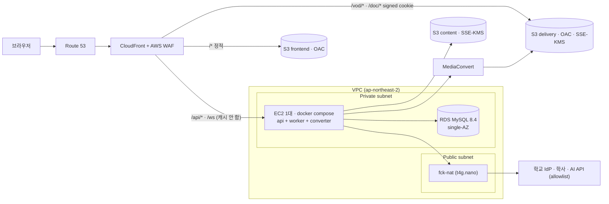
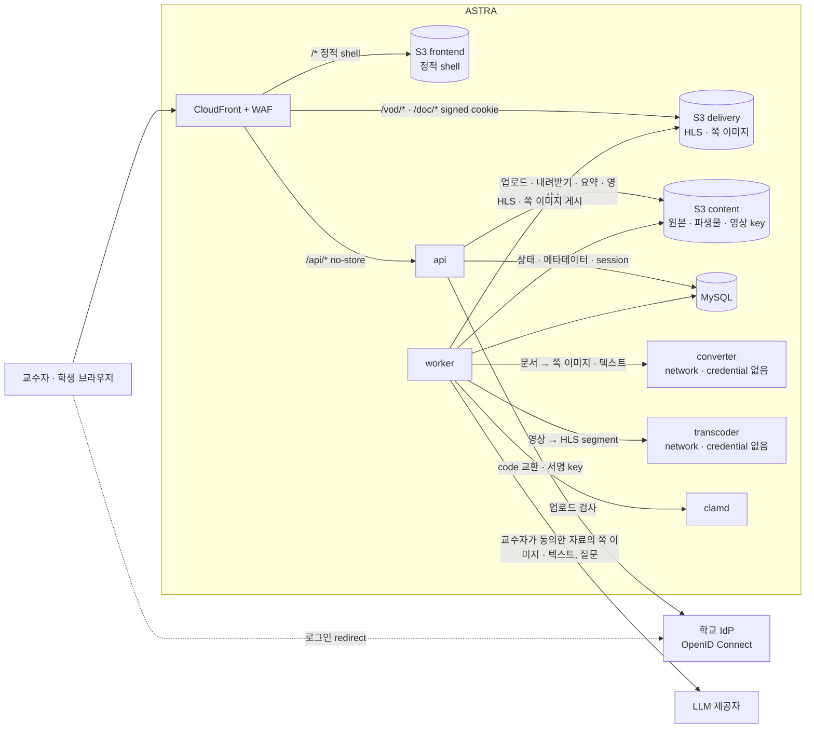
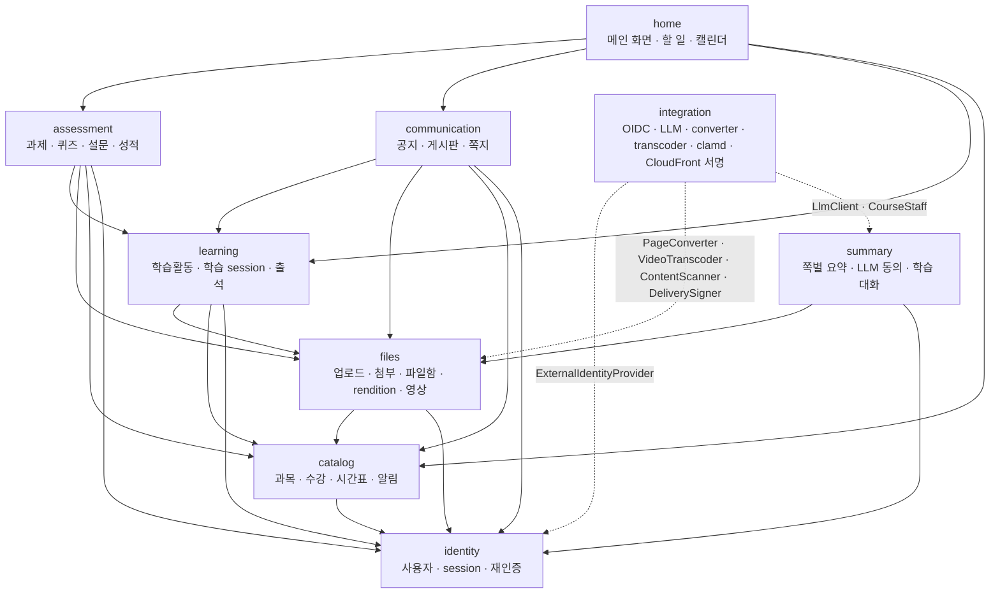
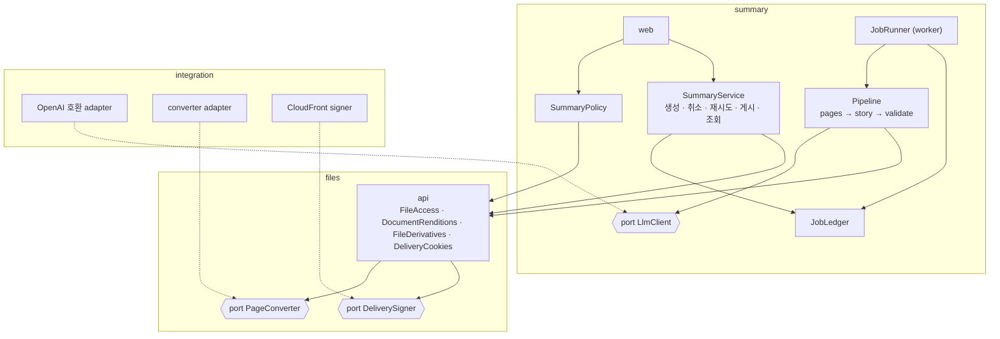

# 백엔드 아키텍처

작성일 2026-11-09. 시연부터 학교 도입 전까지 적용하는 기준안이다. 결정의 이유와 기각한 대안은 [docs/adr/](adr/)에 있다. 캠퍼스 온은 별개 서비스이며 [STack-Backend](https://github.com/STack-Corp/STack-Backend)의 `backend/docs/adr/`가 별도 번호 체계로 결정을 기록한다. 2026-11-10 이 문서와 루트 `src/`는 STack-Backend에서 이 레포(STack-eclass-Backend)로 옮겼다. 아래 "루트 `src/`"는 이 레포를 뜻한다.

## 1. 전제

| 항목 | 내용 |
|---|---|
| 목표 | 서울과학기술대학교 e-Class(ASTRA)를 대체한다. 이 학교에 먼저 도입한다 |
| 규모 | 1개 기관, 사용자 수백 명. 수만 명 규모를 전제로 설계하지 않는다 |
| 서버 계약 | [00_server_contract.md](https://github.com/STack-Corp/ASTRA-Reference/blob/main/backend/00_server_contract.md)의 SC-01~SC-10, [90_changes.md](https://github.com/STack-Corp/ASTRA-Reference/blob/main/backend/90_changes.md)의 CHG-01~CHG-12 |
| 실행 환경 | Java 25, Spring Boot 4.1, MySQL 8.4, AWS 서울 리전(`ap-northeast-2`) |
| 시간 | 기관 시간대 하나(`astra.time.zone`, 기본 `Asia/Seoul`). DB의 일시와 API의 offset 없는 일시는 이 시간대의 벽시계이고, "DB 시계"는 이 시간대로 고정한 DB session의 `CURRENT_TIMESTAMP`다([ADR-0039](adr/0039-institution-wall-clock-time.md)) |

| ADR | 결정 |
|---|---|
| [ADR-0001](adr/0001-modular-monolith.md) | 단일 Gradle 프로젝트의 modular monolith와 같은 이미지의 worker 프로세스 |
| [ADR-0002](adr/0002-mysql-mainline.md) | 루트 `src/`의 MySQL 스키마를 본류로 하고, 캠퍼스 온(`backend/`)은 독립 프로젝트로 둔다 |
| [ADR-0003](adr/0003-aws-single-ec2-until-adoption.md) | 학교 도입 전까지 CloudFront VPC origin과 EC2 1대로 운영하고, ALB는 도입할 때 붙인다 |
| [ADR-0004](adr/0004-sso-bff-session.md) | 학교 SSO를 백엔드가 받는 BFF 방식, 브라우저에는 opaque session 쿠키, Zero-Trust 전환용 경계 |
| [ADR-0005](adr/0005-first-paint-static-shell.md) | 첫 화면은 CDN의 정적 shell과 집계 API 한 번으로 그린다. SSR 서버를 두지 않는다 |
| [ADR-0006](adr/0006-summary-module.md) | 강의 자료의 쪽별 요약을 `summary` 모듈로 구현한다. LessonViewer container를 붙이지 않는다 |
| [ADR-0007](adr/0007-confidential-content-placement.md) | 영상, 강의 자료, 요약 본문은 object storage에만 두고 SSE-KMS로 암호화한다. 영상은 HLS AES-128을 적용한다 |
| [ADR-0008](adr/0008-llm-port-deepseek.md) | LLM 호출은 port 뒤에 두고 DeepSeek로 시작한다. 데이터 처리 정책은 미결이다 |
| [ADR-0009](adr/0009-origin-delivery-without-cdn.md) | CDN이 없는 환경에서는 앱이 같은 cookie 흐름으로 `/doc`, `/vod`를 직접 응답한다 |
| [ADR-0010](adr/0010-upload-acceptance.md) | 업로드는 용도, 권한, 이름, 확장자, 크기, 내용 형식을 검사해 받는다. 악성코드 검사는 port로 남긴다 |
| [ADR-0011](adr/0011-material-deletion.md) | 강의 자료는 삭제 표시로 지우고 수정·삭제는 `If-Match` version으로 막는다. 참조가 끊긴 파일은 바로 지우고 worker GC가 저장소를 정리한다 |
| [ADR-0012](adr/0012-idempotency-ledger-and-audit.md) | requestId는 서버가 만든다. 일반 명령의 멱등 원장과 감사 기록을 `shared`에 두고 명령과 같은 transaction에 쓴다 |
| [ADR-0013](adr/0013-course-notice-storage.md) | 강의실 공지는 과목마다 하나인 공지 게시판의 `posts` 행으로 두고, 게시판은 첫 공지를 쓸 때 DB 제약 아래 만든다 |
| [ADR-0014](adr/0014-learning-session-credit.md) | 온라인 강의 출석 인정은 서버 시각의 적립 원장으로 하고, 사용자당 활성 학습 session은 하나다. 새 session이 앞 session을 대체한다 |
| [ADR-0015](adr/0015-assignment-submission-model.md) | 과제 최종 제출은 바뀌지 않는 버전이고, 공용 멱등 원장이 생기기 전까지 제출 버전 행이 멱등 receipt다 |
| [ADR-0016](adr/0016-video-upload-and-transcoder.md) | 강의 영상은 본문 스트림으로 받고, 격리한 transcoder가 HLS로 나눈 뒤 files가 AES-128로 암호화해 게시한다. MediaConvert는 port로 남긴다 |
| [ADR-0017](adr/0017-school-sso-oidc.md) | 학교 SSO는 OpenID Connect code flow + PKCE adapter로 먼저 만든다. 로그인 전 값은 암호화한 쿠키에 두고 IdP token은 저장하지 않는다 |
| [ADR-0018](adr/0018-malware-scan-clamd.md) | 업로드 악성코드 검사는 같은 배포의 ClamAV daemon으로 한다. 판정 전에는 열지 않고(fail closed), 판정은 같은 내용을 쓰는 모든 파일에 적용하며, 거부한 객체는 지운다 |
| [ADR-0019](adr/0019-container-image-and-single-host-compose.md) | 이미지 하나를 api, worker, converter 역할로 실행하고, health는 container 안의 관리 port로만 연다 |
| [ADR-0020](adr/0020-terraform-layout.md) | Terraform은 환경마다 root module과 local module 7개로 조립한다. CI가 EC2에서 실행할 수 있는 것은 image tag 하나를 받는 배포 문서뿐이고, instance metadata는 api와 worker만 받으며, 악성코드 검사는 기본으로 켠다 |
| [ADR-0021](adr/0021-quiz-attempt-model.md) | 퀴즈 응시는 서버가 마감을 고정한 attempt 하나이고, 응시가 생기면 문항을 바꾸지 않는다 |
| [ADR-0022](adr/0022-survey-anonymity-and-idempotency.md) | 익명 설문은 참여 원장과 응답 저장부를 잇지 않고, 완료의 멱등은 참여 원장의 key로 지킨다 |
| [ADR-0023](adr/0023-gradebook-ownership-release-totals.md) | 성적부에서 과제 항목은 비율만 바꾼다. 학생 합계는 공개했고 점수를 받은 항목만 더하고, 점수 일괄 저장은 한 행이라도 틀리면 아무것도 저장하지 않는다 |
| [ADR-0024](adr/0024-course-qna-and-open-board.md) | 강의실 질의응답과 열린게시판도 과목마다 하나인 게시판의 `posts` 행이다. 익명(이름 숨김)과 비공개(작성자·담당자만)를 나누고, 질문은 답글 전까지만 작성자가 고친다 |
| [ADR-0025](adr/0025-message-recipient-scope-and-boxes.md) | 쪽지 받는사람은 과목 관계로 서버가 정하고(담당자는 과목 구성원 누구에게나, 학생은 담당자에게만), 받은함과 보낸함은 따로 지운다. 읽음과 회수는 배타적인 조건부 전이다 |
| [ADR-0026](adr/0026-enrollment-seat-accounting.md) | 수강신청은 과정 행 잠금 아래에서 좌석 카운터 조건부 갱신과 활성 행 unique 제약으로 판정한다 |
| [ADR-0027](adr/0027-notifications-in-producer-transaction.md) | 알림은 원래 변경과 같은 transaction에서 `catalog` API로 만들고, 미래에 보이는 대상은 알림 사건으로 남겨 worker가 그 시각의 구성원에게 보낸다. 대상을 숨기면 같은 transaction에서 거둔다 |
| [ADR-0028](adr/0028-filebox.md) | 개인 파일함은 사용자별 사용량 행을 잠가 차례로 바꾸고, 다시 쓰기는 같은 내용을 참조하는 새 파일로, ZIP은 worker가 저장소에서 저장소로 흘려 만든다 |
| [ADR-0029](adr/0029-step-up-and-learning-auth.md) | 민감한 명령의 재인증과 온라인 학습 인증 grant는 로그인 session에 묶은 `session_step_ups` 행이다. 학교 IdP 재인증(`prompt=login`, `auth_time`)이 근거이고, 학습 적립은 grant 만료에서 끊기고 `reauth_required`가 된다 |
| [ADR-0030](adr/0030-attendance-and-smart-rounds.md) | 출석부는 담당자 판정이 자동 판정보다 강하다. 스마트출석은 서버가 PIN/QR을 직접 검증해 같은 transaction에서 기록하고, 상태는 WebSocket 없이 조회로 알린다 |
| [ADR-0032](adr/0032-llm-consent-and-study-chat.md) | 외부 LLM 처리는 교수자 동의와 배포 profile로 묶고, 학습 대화는 게시한 자료 하나에 근거한다 |
| [ADR-0033](adr/0033-document-preview-and-office-conversion.md) | 문서 미리보기는 비동기 변환 대기열과 경로 cookie로 열고, office 문서는 converter 안의 LibreOffice로 PDF를 만든다 |
| [ADR-0034](adr/0034-observability-and-scheduler-lock.md) | 지표와 trace는 OTLP로 내보내되 기본은 끄고, 표 전체를 훑는 주기 작업만 DB lease로 묶는다 |
| [ADR-0035](adr/0035-community-operators-and-outside-course-files.md) | 알림마당 공지·자료 쓰기와 1:1 문의 답변은 `community_operators` 행이 있는 운영자만 한다. 과목이 없는 첨부(알림마당, 쪽지)는 과목 없는 용도로 올리고 `GET /api/files/{fileId}/content`로만 연다. 과목 파일은 이 경로로 열리지 않는다 |
| [ADR-0036](adr/0036-notification-screen-target-and-instructor-roster.md) | 알림의 연결 대상은 화면이 그 대상을 여는 ID로 적는다(과제 알림은 과제 ID). 과목 없는 전체 알림은 사건 하나를 worker가 대상 사용자 묶음으로 나눠 보낸다. 담당자 수강생 명단은 그 과목 담당자에게 화면 항목(이름, 학번, 수강 근거)만 내보낸다 |
| [ADR-0037](adr/0037-quiz-regrade-and-assessment-deletion.md) | 퀴즈 정답 정정은 한 transaction의 재채점이고, 평가 활동 삭제는 활동의 삭제 표시다 |
| [ADR-0038](adr/0038-avatar-photo.md) | 아바타 사진은 상태를 identity가, 바이트를 files가 갖는다. 올린 원본은 검사 뒤 격리한 converter가 256px JPEG로 다시 만든 것만 내보내고, 본인과 폐강하지 않은 과목을 함께하는 사람만 본다 |
| [ADR-0039](adr/0039-institution-wall-clock-time.md) | 일시는 기관 시간대(기본 `Asia/Seoul`)의 벽시계로 두고, DB session과 JVM을 그 시간대에 고정한 뒤 시작할 때 세 값이 같은지 확인한다. `Instant`는 절대 시각이고 기관 시간대는 `GET /api/auth/methods`가 알린다 |

## 2. 부하 가정

| 경로 | 가정 | 결과 |
|---|---|---|
| 온라인 강의 하트비트 | 서버가 정하는 주기 60초(원본은 240초, [62_온라인강의_플레이어.md](https://github.com/STack-Corp/ASTRA-Reference/blob/main/62_온라인강의_플레이어.md) §6). 동시 시청 500명 | 약 8 rps |
| 메인 첫 진입, 과제 마감 직전, 시험 시작, 비정규 수강신청 | 짧은 순간에 요청이 몰린다 | 처리량보다 정원·멱등의 정합성(SC-05)과 서버 시계 기준 마감 판정(SC-06)이 문제다 |
| 영상 송출 | 3 Mbps HLS 기준 시간당 약 1.35 GB. 500명이 월 12시간씩 보면 약 8 TB | 원 서버가 아니라 CDN이 송출한다. 월 비용 대부분이 이 전송량이다 |

위 수치는 학교 실측 전 가정이다. API는 서버 1대로 충분하고, 대역폭과 비용은 영상이 정한다. 3단계 부하 시험에서 실제 값으로 다시 잡는다.

## 3. 배포 토폴로지

### 3.1 학교 도입 전

- 도메인은 하나다. CloudFront가 경로로 정적 파일, 영상, API를 나눈다. CORS가 필요 없다. session 쿠키의 `SameSite` 예외는 5절에 있다.
- CloudFront [VPC origin](https://docs.aws.amazon.com/AmazonCloudFront/latest/DeveloperGuide/private-content-vpc-origins.html)이 private subnet의 EC2에 직접 연결한다. EC2와 RDS에는 public IP가 없다.
- api, worker, converter는 같은 이미지를 역할만 바꿔 같은 EC2에서 실행한다. 이미지는 루트 `Dockerfile`, 구성은 루트 `compose.yaml`이다([ADR-0019](adr/0019-container-image-and-single-host-compose.md)).
- converter는 문서 변환만 하는 별도 container다. 앱과 같은 jar를 converter main(`com.stackcorp.converter.ConverterServer`)으로 실행한다. worker와만 공유하는 내부 network에 있어 worker만 호출할 수 있고, 외부 network, 비밀값, AWS credential이 없다(SC-08).
- compose에서 host에 publish하는 port는 api의 8080 하나다. MySQL, converter, 관리 port는 host에 열지 않는다. 같은 host의 MySQL은 compose 프로필로 띄울 수 있고 위 구성에서는 RDS를 쓴다.
- transcoder는 영상을 HLS segment로 나누기만 하는 별도 container다. 같은 jar를 transcoder main(`com.stackcorp.transcoder.TranscoderServer`)으로 실행하고 ffmpeg를 쓴다. converter와 같이 worker만 호출하고 외부 network와 AWS credential을 주지 않는다. AWS 계정을 쓰게 되면 MediaConvert로 옮길 수 있게 port를 두었다([ADR-0016](adr/0016-video-upload-and-transcoder.md)).
- 업로드 악성코드 검사는 같은 EC2의 clamav(clamd)와 freshclam container가 한다([ADR-0018](adr/0018-malware-scan-clamd.md)). Terraform 배포는 기본으로 켜고 검사기 없이는 앱이 뜨지 않는다([ADR-0020](adr/0020-terraform-layout.md) 7번). clamd가 메모리를 쓰므로 앱 EC2는 메모리 8 GiB 이상(`t3.large`)이다.
- bucket은 `frontend`, `content`, `delivery` 셋이다. 용도와 암호화는 [ADR-0007](adr/0007-confidential-content-placement.md)에 있다.
- 배포 중 JVM 기동 시간 동안 API가 끊긴다. 배포는 사용량이 적은 시간에 한다. 기동은 JDK AOT cache(JEP 483, 514)로, warm-up은 JEP 515로 줄인다.

### 3.2 학교 도입

| 바뀌는 것 | 내용 |
|---|---|
| 입구 | private subnet에 ALB를 만들고 CloudFront VPC origin을 EC2에서 ALB로 바꾼다. 도메인은 그대로다 |
| 실행 | ECS 서비스로 옮긴다. api는 min 2 / max 4, `ALBRequestCountPerTarget` target tracking. worker는 1개 |
| 캐시·broker | ElastiCache for Valkey를 붙이고 WebSocket fan-out과 사용자 단위 rate limit 저장소를 Valkey로 바꾼다(8절). 앱 코드는 설정만 바뀐다 |
| DB | RDS Multi-AZ, PITR 유지 |
| NAT | NAT Gateway로 바꿀지 판단한다(3.3절 fck-nat 장애 영향) |

이 전환이 인프라와 설정 작업으로 끝나려면 4.3절의 stateless 규칙을 1단계부터 지켜야 한다.

### 3.3 네트워크 경계

| 대상 | 들어오는 트래픽 | 나가는 트래픽 |
|---|---|---|
| CloudFront | 인터넷 443. AWS WAF managed rule(Core, SQL database, Known bad inputs) | origin만 |
| EC2(api, worker) | `CloudFront-VPCOrigins-Service-SG`에서 오는 앱 포트만 | RDS 3306, S3(gateway endpoint), 그 밖의 모든 외부·AWS API는 fck-nat 경유. instance metadata(IAM role credential)는 api와 worker만 |
| converter | 같은 host의 worker에서 오는 요청만 | 없음 |
| clamav | 같은 host의 worker에서 오는 3310만 | 없음 |
| freshclam | 없음 | signature mirror만, fck-nat 경유. 다른 container와 instance metadata에는 닿지 않는다 |
| transcoder | 같은 host의 worker에서 오는 요청만 | 없음 |
| RDS | EC2 security group의 3306만 | 없음 |
| fck-nat | private subnet에서 오는 트래픽만 | 인터넷 |

- WAF에 IP 기준 rate limit을 걸지 않는다. 교내 사용자가 NAT 하나로 나오면 학교 전체가 막힌다(SC-09). 요청 제한은 앱에서 사용자, 과목, 연산 단위로 건다.
- Core rule set의 `SizeRestrictions_BODY`는 8 KB를 넘는 본문을 막는다. 업로드(`POST /api/uploads`, `POST /api/uploads/stream`), 글 작성, 제출이 걸리므로 이 규칙은 Count로 바꾸고, 본문 크기 상한은 경로별 WAF 규칙과 앱의 413 응답으로 둔다. 영상 업로드 경로의 상한은 `lecture_video` 정책(2 GiB)에 맞춘다.
- SSH 포트를 열지 않는다. 운영 접근은 SSM Session Manager로 한다.
- `/actuator`는 CloudFront 경로에 넣지 않는다. 앱은 `health`만 켜고, 관리 port(8081)를 API port와 따로 두어 container 안의 127.0.0.1에만 연다. API port에는 `/actuator` 경로가 없다. compose healthcheck가 container 안에서 readiness를 부른다.
- 외부 호출은 allowlist한 scheme, host, port만 허용하고 redirect, timeout, 응답 크기를 제한한다(SC-08).
- EC2 instance metadata의 hop limit은 api와 worker container가 instance role을 쓰도록 2다. 그러면 bridge network의 모든 container가 instance metadata에 닿으므로, host firewall이 compose `egress` network(api와 worker만 붙는다)에서 온 트래픽만 통과시킨다. 배포 문서가 배포마다 container별로 이를 확인한다([ADR-0020](adr/0020-terraform-layout.md) 6번).
- S3 외의 AWS API(SSM, ECR, Secrets Manager, CloudWatch, X-Ray, SQS, MediaConvert)도 fck-nat를 지난다. fck-nat가 멈추면 외부 IdP·AI 호출과 함께 배포, SSM 접속, 로그·지표 전송, 미디어 완료 처리가 멈춘다. interface endpoint는 개당 AZ별로 과금되어 이 단계의 NAT 비용보다 비싸므로 두지 않는다. 대신 fck-nat의 high-availability mode(크기 1 Auto Scaling group과 고정 ENI)로 인스턴스를 자동 교체하고, 교체되는 동안의 장애 범위는 받아들인다.

## 4. 애플리케이션 구조

### 4.1 모듈

단일 Gradle 프로젝트의 `com.stackcorp.astra` 아래에 모듈을 패키지로 나눈다. 영역은 [db/README.md](../db/README.md) 2.1절의 DB 영역을 따른다.

| 모듈 | 담당 | 코드가 의존하는 모듈 |
|---|---|---|
| `identity` | 사용자, 외부 신원 연결, session, 기기, 2차 인증, 개인 설정 | 없음 |
| `catalog` | 학기, 과목, 수강, 시간표, 알림 | `identity` |
| `learning` | 강의실, 주차, 학습활동, 영상 학습 session, 출석 | `catalog`, `identity`, `files` |
| `assessment` | 과제, 퀴즈, 설문, 성적 | `learning`, `catalog`, `identity`, `files` |
| `communication` | 공지, Q&A, 게시판, 쪽지, 임시저장 | `catalog`, `identity`, `learning`, `files` |
| `files` | 업로드 lifecycle, 첨부, 파일함, 미리보기, 문서 rendition, 영상 asset, 파일 파생물 저장, 아바타 사진의 바이트(상태는 `identity`) | `catalog`, `identity` |
| `summary` | 강의 자료의 쪽별 요약 생성 작업, 후보 확인, 게시, 조회 | `files`, `identity` |
| `integration` | 학교 IdP, 학사 동기화, AI, 외부 allowlist client | 각 모듈의 공개 API |
| `shared` | 오류 형식, requestId, 요청 제한, 멱등 원장, 감사 기록. 목록 query 규칙은 첫 페이지 목록과 함께 만든다 | 없음. 모든 모듈이 쓸 수 있다 |
| `home` | 메인 화면 집계 조회(`/api/me/home`)와 할 일 목록. 쓰기 없음 | `catalog`, `learning`, `assessment`, `communication`의 공개 API. 어떤 모듈도 `home`에 의존하지 않는다 |

의존 방향은 [db/README.md](../db/README.md) 2.1절의 FK 방향을 따른다. 순환은 의존 역전으로 끊는다. 이벤트를 써도 listener가 발행 측 타입을 참조하면 의존이 생기므로 순환을 끊지 못한다.

- 알림: `notifications`는 `catalog` 소유이고 `activity_id`로 `learning`을 가리킨다. `catalog`는 `learning`에 의존하지 않는다. 알림 생성 API(`catalog.api.Notifications`)는 `catalog`가 공개 API로 정의하고, 이미 `catalog`에 의존하는 `learning`, `assessment`, `communication`이 원래 변경과 같은 transaction 안에서 호출한다. transaction 밖에서 부르면 실패한다. 대상 ID와 `activity_id`는 값으로 받고 `catalog`는 그 행을 읽지 않는다. 대상을 숨기는 변경(삭제, 비공개, 예약으로 되돌림)도 같은 transaction에서 `withdraw`를 부른다([ADR-0027](adr/0027-notifications-in-producer-transaction.md)).
- 캘린더: 학사일정은 `catalog`, 활동 마감은 `learning`에 있어 둘을 함께 읽는 `GET /api/me/calendar`는 `home`에 둔다. 시간표는 `catalog`의 테이블만 쓰므로 `catalog`에 둔다.
- 할 일: 별도 테이블 없이 활성 수강 × 공개 활동 × serverTime으로 계산한다([reference/db/design/20_catalog.md](https://github.com/STack-Corp/ASTRA-Reference/blob/main/db/design/20_catalog.md)). 계산에 `learning`, `assessment`가 필요하므로 `home`에 둔다.
- 외부 연동: `identity`가 `ExternalIdentityProvider` 같은 포트를 공개 API로 정의하고 `integration`이 구현한다. 다른 모듈도 외부 결과가 필요하면 같은 방식을 쓴다.
- 요약과 전달: `summary`가 `LlmClient` port를, `files`가 문서 변환 port와 전달 서명 port를 공개 API로 정의하고 `integration`이 구현한다. S3를 읽고 쓰는 모듈은 `files` 하나다([ADR-0007](adr/0007-confidential-content-placement.md)).

### 4.2 모듈 규칙

- 모듈은 공개 API 패키지만 외부에 노출한다. Spring Modulith는 기본으로 모듈 루트 패키지만 공개하므로 `api` 하위 패키지는 `@NamedInterface`로 지정한다. 내부 패키지 참조는 `verify()`가 막는다.
- 다른 모듈의 테이블을 직접 읽거나 바꾸지 않는다. 그 모듈의 operation을 호출한다(SC-01).
- 경계는 Spring Modulith 2.x(Boot 4 호환 라인)의 `ApplicationModules.verify()` 테스트로 CI에서 확인한다. 정확한 버전은 의존성을 추가할 때 호환표로 정한다.
- DB 변경과 commit 뒤 후속 작업을 함께 보장해야 하는 곳은 지금 모두 같은 transaction에 쓰는 원장 행으로 한다. 업로드 확정 뒤 검사는 `file_blobs`의 quarantined 행, 요약 요청은 `summary_jobs`의 queued 행이고 worker가 `SKIP LOCKED`로 잡는다. Spring Modulith JDBC event publication registry는 commit 뒤 api process가 바로 외부 API를 불러야 하는 경로(예: 영상 변환 작업 지시)가 생길 때 그 변경에서 더한다. 그때 재전송 작업은 실패했거나 정해진 시간 이상 끝나지 않은 이벤트만 다시 보내고 4.3절의 잠금으로 묶는다. 이 registry는 외부 broker로 내보내는 outbox가 아니다([ADR-0034](adr/0034-observability-and-scheduler-lock.md) 6번).
- 객체 권한은 각 모듈의 `Policy`가 판정한다. 컨트롤러나 서비스가 role만 보고 허용하지 않는다(5절).

### 4.3 프로세스와 stateless 규칙

| 프로세스 | 프로필 | 하는 일 |
|---|---|---|
| api | `api` | HTTP API, WebSocket, api에서 발행한 이벤트의 listener(예: 업로드 확정 뒤 MediaConvert 작업 지시) |
| worker | `worker` | 미완료 이벤트 재전송, 영상 변환 작업(transcoder 호출, 암호화, 게시), 끝나지 않은 multipart upload 정리, 업로드 GC, 업로드 악성코드 검사, ZIP job, 문서 rendition, 요약 작업, 학습 session lease 만료 처리, 학사 동기화, 멱등 원장 정리, 예약 알림 발송과 보존 기간이 지난 알림 정리 |

- session은 DB(`user_sessions`)에 둔다. 서버 메모리에 사용자 상태를 두지 않는다.
- 파일은 S3에만 쓴다. 컨테이너 로컬 디스크는 임시 작업 공간으로만 쓰고 요청 사이에 남기지 않는다.
- worker loop는 작업 행을 lease와 `SKIP LOCKED`로 잡아 인스턴스가 늘어도 같은 행을 두 번 처리하지 않는다. 겹친 실행이 같은 후보를 함께 훑는 주기 작업(저장소 GC, 학습 session lease 만료)만 `shared.schedule.SchedulerLock`(`scheduler_locks` lease)으로 묶어 한 인스턴스에서 실행한다([ADR-0034](adr/0034-observability-and-scheduler-lock.md) 5번).
- WebSocket fan-out은 인스턴스가 1대일 때 in-memory broker로 하고, 2대가 되면 Valkey pub/sub로 바꾼다(8절).

### 4.4 C4 보기

container 수준이다. 학교 도입 구성(3.2절)이고, 상자 하나가 따로 실행하는 process나 저장소다.

- api와 worker는 같은 이미지의 다른 역할이다(4.3절). converter, transcoder, clamd는 worker만 부르고, 셋 다 저장소와 DB에 닿지 않는다([ADR-0006](adr/0006-summary-module.md), [ADR-0016](adr/0016-video-upload-and-transcoder.md), [ADR-0018](adr/0018-malware-scan-clamd.md), [ADR-0019](adr/0019-container-image-and-single-host-compose.md)).
- 브라우저에서 들어오는 길은 CloudFront 하나다. 밖으로 나가는 길은 api의 학교 IdP 호출([ADR-0017](adr/0017-school-sso-oidc.md))과 worker의 LLM 호출([ADR-0032](adr/0032-llm-consent-and-study-chat.md)) 둘이고, 둘 다 `integration`의 adapter가 설정한 host로만 보낸다.
- CDN이 없는 환경에서는 api가 `/vod/*`와 `/doc/*`도 응답한다(7.5절, [ADR-0009](adr/0009-origin-delivery-without-cdn.md)). MediaConvert는 transcoder와 같은 port의 다른 구현으로 남겨 두었고 지금 구성에는 없다(ADR-0016).

component 수준이다. `api`와 `worker` 안의 모듈과 의존 방향이다(4.1절). 실선은 공개 API 호출이고 점선은 port 구현이다. `shared`는 모든 모듈이 쓰므로 선을 그리지 않았다.

한 모듈 안쪽의 예로 요약에 관여하는 component만 그렸다. 점선은 port 구현이다.

- 각 모듈의 `package-info.java`가 4.1절 표의 의존을 `allowedDependencies`로 선언한다. 선언하지 않은 의존이 생기면 `ModuleStructureTests`의 `verify()`가 실패한다.
- 같은 테스트가 코드에서 읽은 모듈 의존을 `build/spring-modulith-docs/`에 C4 component diagram(PlantUML)으로 쓴다. 위 그림과 다르면 코드가 기준이다.

## 5. 인증과 인가

상세는 [ADR-0004](adr/0004-sso-bff-session.md)에 있다.

- 백엔드가 학교 IdP의 OIDC 또는 SAML client 역할을 한다. IdP 토큰은 서버에만 둔다.
- 브라우저는 opaque session 쿠키(`HttpOnly`, `Secure`, `SameSite=Lax`)와 CSRF 토큰만 받는다. DB에는 token hash만 저장한다.
- SAML HTTP-POST 응답은 IdP에서 오는 cross-site POST라 `SameSite=Lax` 쿠키가 전송되지 않는다. SAML이면 로그인 전 요청 상태를 session 대신 `RelayState` 기준 저장소에 두거나, 로그인 전용 쿠키만 `SameSite=None`으로 둔다. OIDC의 GET callback에는 이 문제가 없다.
- actor는 session principal 하나다. 요청 본문의 학번, `ud`, role 값은 받지 않는다(SC-02, CHG-01).
- 과목 범위는 `/api/courses/{courseId}/...`처럼 요청에 명시한다. 서버 session에 현재 과목을 두지 않는다(SC-03, CHG-02).
- 권한 판정은 `principal × institution × course × membership × object × action × visibility × serverTime`으로 하고 기본은 거부다(SC-02). 첨부, 영상 URL 발급, AI 검색은 부모 객체의 권한을 그대로 따른다(CHG-06). `serverTime`은 DB 시계, 곧 기관 시간대로 고정한 DB session의 `CURRENT_TIMESTAMP`다. client 시계는 쓰지 않는다([ADR-0039](adr/0039-institution-wall-clock-time.md)).
- 학교 IdP가 장애일 때 쓰는 관리자 break-glass 계정 하나만 로컬 로그인을 허용하고 MFA(TOTP)를 강제한다. 비밀번호 hash와 TOTP secret은 Secrets Manager에서 받고 DB에 두지 않는다. 15분 안에 5번 실패하면 잠그고, 같은 TOTP 코드를 다시 쓰지 못하도록 성공한 뒤 90초 동안은 다시 로그인하지 않는다. 잠금과 재사용 판정은 계정의 `users` 행을 잠근 뒤 하므로 동시에 보낸 시도도 한도를 넘지 못한다. 로그인 전이라 사용자 단위 제한을 쓸 수 없어 브라우저 주소마다 15분에 30번으로 제한한다. break-glass 계정은 과목 권한이 없다.
- session은 마지막 요청 뒤 2시간, 로그인 뒤 12시간이 지나면 끝난다. CSRF는 double-submit 쿠키(`XSRF-TOKEN` 쿠키와 `X-XSRF-TOKEN` header)로 검사하고, 상태를 바꾸는 요청은 `Origin`과 `Sec-Fetch-Site`도 본다.
- 과목 구성원 판정은 `catalog`의 규칙 하나(`MembershipRule`)다. 역할(`CourseMemberships.roleOf`), 수강생 명단, 함께 듣는 사람, 내 과목, 시간표, 알림, 수강 신청 처리 권한이 모두 이 규칙을 쓴다. 폐강(`CANCELLED`)한 과목에는 구성원이 없으므로 조회와 명령 모두 404다. 담당·수강 행과 학습 기록은 지우지 않는다.
- 파일 권한은 `files`의 `FileAccess`가 첨부한 부모 객체에 묻는다. 학습활동 첨부는 `learning`이 판정한다. 담당자는 언제나, 학생은 공개됐고 시작 일시가 지난 활동만 본다. 지운 활동과 지운 파일은 담당자에게도 없다. 권한이 없거나 경로의 과목과 객체가 맞지 않으면 존재를 드러내지 않도록 404로 응답한다.
- 강의실 공지는 `communication`이 판정한다. 담당자는 임시·예약 공지까지 보고 쓰며, 학생은 게시 일시가 DB 시계로 지난 공지만 본다. 공지 조회는 읽음을 남기지 않고, 읽음과 확인은 각각 POST 명령이다(SC-04).
- 수정과 삭제처럼 앞선 변경을 덮을 수 있는 명령은 `If-Match`로 마지막으로 읽은 version을 받는다. 없으면 428, 다르면 409이고 아무것도 바꾸지 않는다(SC-05).
- 강의실 질의응답과 열린게시판도 `communication`이 판정한다([ADR-0024](adr/0024-course-qna-and-open-board.md)). 비공개 질문은 작성자와 담당자만 보고, 다른 학생에게는 목록, 건수, 검색, 상세, 답글, 첨부 어디에도 없다. 익명 글의 작성자 이름은 작성자와 담당자만 보고, 작성자 ID는 응답에 넣지 않는다. 글은 작성자만 고치고, 질문은 답글 전까지만 고치고 지운다. 담당자는 그 과목의 글, 답글, 댓글을 지울 수 있고 감사 기록에 `*.moderate`로 남는다. 글·답글·댓글 작성과 수정, 추천에 사용자 단위 요청 제한이 있다.
- 알림마당 공지와 자료실은 과목이 없어 session 사용자의 기관 역할로 대상(공통, 교수, 학생)을 고른다. 1:1 문의는 쓴 사람과 알림마당 운영자만 본다. 알림마당 운영자는 `community_operators`의 해제하지 않은 행으로만 정하고 요청마다 읽는다. 기관 역할(`STAFF` 포함)이나 break-glass 계정은 운영자가 아니다. 운영자만 공지·자료를 쓰고 1:1 문의에 답하며, 모두 감사 기록을 남긴다([ADR-0035](adr/0035-community-operators-and-outside-course-files.md)).
- 과목이 없는 첨부(알림마당 공지·자료·문의, 쪽지)는 과목 없는 용도로 올리고 `GET /api/files/{fileId}/content`로만 연다. 이 경로는 `files.course_id`가 없는 파일만 보고 부모의 `allowedOutsideCourse`에 묻는다. 과목 부모는 이 판정이 언제나 거부이고, 과목 밖 부모는 과목 판정이 언제나 거부다. 쪽지 첨부는 쪽지를 아직 가진 사람(보낸함에서 지우지 않은 발신자, 회수되지 않았고 받은함에서 지우지 않은 수신자)만 읽는다.
- 요청 본문은 문서에 있는 필드만 받는다. 그 밖의 필드가 있으면 400이다. 사용자와 역할은 session에서만 정한다.
- 일시 형식: offset 없는 일시(`openAt`, `closeAt`, `serverTime` 등 `2026-11-12T10:00:00`)는 기관 시간대의 벽시계이고 그대로 주고받는다. 요청의 이런 값에 `Z`나 offset이 붙으면 400이다. 날짜(`2026-11-12`)와 수업 시각(`10:00`)도 기관 시간대 기준이다. `Z`가 붙은 값(`createdAt` 등)은 절대 시각(UTC)이다. 기관 시간대는 `GET /api/auth/methods`의 `timeZone`(IANA ID)이 알린다. 시작할 때 설정, JVM, DB session의 시간대가 다르면 서버가 뜨지 않는다([ADR-0039](adr/0039-institution-wall-clock-time.md)).
- 오류는 problem JSON(`status`, `detail`, `code`, `requestId`)으로 응답하고 캐시하지 않는다. 권한이 없을 때와 대상이 없을 때는 같은 404다. detail에는 입력값, 저장 key, SQL, 다른 사용자의 ID를 넣지 않는다(SC-04).
- 모든 응답에 서버가 만든 `X-Request-Id`가 붙는다. filter에서 거부한 401, 403도 같다. client가 보낸 값은 쓰지 않는다([ADR-0012](adr/0012-idempotency-ledger-and-audit.md)).
- `Idempotency-Key`를 받는 명령은 권한 판정과 입력 검사 뒤 멱등 원장을 거친다. 같은 key와 같은 요청이면 처음 응답을, 다른 요청이면 409 `idempotency_conflict`를, 같은 key가 처리 중이면 3초까지 기다린 뒤 409 `idempotency_in_progress`를 돌려준다(SC-05). key는 사용자와 연산마다 따로다. 같은 key에 다른 요청이면 어떤 명령도 처음 만든 객체를 돌려주지 않는다. 자체 key를 두는 업로드(multipart, 스트림, 파일함)도 같은 규칙의 요청 지문(용도, 과목, 이름, 크기, 내용 hash, 폴더)을 저장해 비교한다([ADR-0010](adr/0010-upload-acceptance.md) 10번). key가 반드시 있어야 하는 명령(수강신청, 과제·퀴즈 제출, 설문 완료, 쪽지 보내기·답장·전달, 파일함 ZIP, 학습 대화 질문)은 `shared.idempotency.Idempotency.requireKey` 하나로 검사하고, header가 없으면 400 `idempotency_key_required`, 형식(1~100자의 영문, 숫자, `.` `_` `-`)이 틀리면 400 `invalid_request`다.
- 상태를 바꾸거나 민감한 연산은 감사 기록(`audit_events`)을 남긴다. 명령의 transaction 안이면 함께 commit하고, 밖이면 기록 실패가 요청을 실패시키지 않는다. 본문, 파일 이름, 자유 텍스트는 남기지 않는다(SC-09). 남기지 않는 것은 읽음·확인 표시, 본인만 보는 임시저장, 학습 session의 시작·하트비트·종료(학습 원장이 기록이다), 미리보기의 변환 대기 응답뿐이다([ADR-0012](adr/0012-idempotency-ledger-and-audit.md) 2번).
- 요청 제한은 사용자와 연산 단위로 건다(SC-09). 지금은 업로드, 자료 등록·수정, 요약 생성, 공지 작성·수정, 학습 session 시작과 하트비트에 있다. 사용자가 없는 break-glass 로그인만 브라우저 주소 단위로 건다. counter는 process 메모리에 있고 api가 2대가 되면 Valkey로 옮긴다(8절).
- 개발용 로그인(`POST /api/auth/dev-login`)은 테스트 소스에만 있다. 배포하는 jar에는 들어가지 않고 로컬 실행(`./gradlew bootTestRun`)에서만 열린다. 이 컴퓨터에서 온 요청만 받고, proxy가 붙인 전달 header에 다른 주소가 있으면 거부한다. 이 판정은 연결한 쪽 주소로만 한다.
- 로그인 기록, session, break-glass 주소 제한에 쓰는 브라우저 주소는 `identity`의 `ClientAddresses`가 정한다. 연결한 쪽 주소가 `astra.client-address.trusted-proxies`(CloudFront VPC origin이 있는 app subnet) 안일 때만 CloudFront가 만든 `CloudFront-Viewer-Address`를 쓰고, 그 밖에는 연결한 쪽 주소다. 기본은 비어 있어 header를 믿지 않는다. `X-Forwarded-For`는 왼쪽 값을 브라우저가 정할 수 있어 쓰지 않는다.
- 쪽지는 `communication`이 판정한다. 받는사람은 서버가 과목 관계로 계산한 범위 안에서만 고르고, 범위 밖 ID가 하나라도 있으면 보내지 않는다. 보관함의 주인이 아니면 존재와 관계없이 404다. 쪽지 조회는 읽음을 남기지 않고 읽음은 POST 명령이다. 발송, 받는사람 검색, 임시저장에 사용자 단위 요청 제한이 있다([ADR-0025](adr/0025-message-recipient-scope-and-boxes.md)).
- 과제 제출 첨부는 `assessment`가 판정한다. 제출한 학생과 그 과목 담당자만 읽고, 같은 과목의 다른 학생은 읽지 못한다. 지운 과제의 제출 파일은 보존하지만 제출한 학생과 담당자도 읽지 못한다. 제출물 파일로는 요약 같은 파생물을 만들지 않는다. 학생 응답의 점수와 의견은 점수를 공개한 뒤에만 들어가고, 공개 전에는 속성 자체가 없다(SEC-14). 과제 등록·수정, 임시저장, 최종 제출에도 사용자 단위 요청 제한이 있다.
- 성적은 `assessment`가 판정한다. 담당자만 성적부를 읽고 쓴다. 학생 성적 API는 session 사용자 본인 것만 돌려주고 대상 학생을 고르는 parameter가 없다. 공개하지 않은 항목의 점수, 의견, 그 점수가 들어간 합계는 속성 자체가 없다(SEC-14). 과제 항목의 이름, 배점, 공개, 점수는 과제 화면에서만, 퀴즈 항목은 퀴즈 화면에서만 바꾸고, 퀴즈 항목의 학생 공개는 `Quiz.release` 하나가 정한다([ADR-0023](adr/0023-gradebook-ownership-release-totals.md)). 학생에게는 보이는 과제·퀴즈의 항목만 나오고 지운 활동의 항목은 누구에게도 없다. 점수 쓰기는 행마다 감사 기록을 남긴다.
- 수강신청과 청강 신청은 `catalog`가 판정한다. 조회(GET)는 신청을 만들지 않고, 신청 명령은 과정 행을 잠근 뒤 기간(DB 시계), 신청대상, 본인 담당 여부, 중복(활성 행 unique), 정원(조건부 갱신)을 한 transaction에서 다시 본다. 승인·반려는 그 과목의 교수와 비정규 담당자만 하고, 신청과 취소는 본인 것만 한다. 학사 원장 수강은 바꾸지 않는다. 내 신청 목록은 session 사용자 본인의 신청만 돌려주고 대상 사용자를 고르는 parameter가 없다.
- 수강생 명단(이름, 학번, 수강 근거)은 그 과목의 담당자(교수, 조교, 비정규 담당자)만 본다. 학생에게는 어떤 경로로도 다른 학생의 학번이 나가지 않는다. 명단에 학과, 학년, 연락처는 없다([ADR-0036](adr/0036-notification-screen-target-and-instructor-roster.md)).
- 설문은 `assessment`가 판정한다. 강의실 설문은 담당자가 언제나 보고, 학생은 공개됐고 시작한 설문만 본다. 알림마당 설문은 `survey_targets`의 대상(전체, 학생, 교직원, 학년)이 session의 역할과 학년에 맞을 때만 보인다. 익명 설문은 참여 원장과 응답 저장부를 잇지 않는다. 응답 행에 사용자와 정밀 시각이 없고, 응답 쪽 행 ID는 순번이 아닌 임의 값이라 참여 행이나 감사 기록의 순서와 맞출 수 없다. 완료는 공용 멱등 원장 대신 참여 원장의 key로 재전송을 판정하며, 감사 기록에 requestId가 없고 발생 일시는 일 단위다(SC-05-A, SC-09, [ADR-0022](adr/0022-survey-anonymity-and-idempotency.md)). 결과 집계는 익명 설문과 학생에게는 마감 뒤 응답자 5명 이상일 때만 나간다. 설문 등록·수정·완료에도 사용자 단위 요청 제한이 있다.
- 알림은 받는 사람 본인만 본다. 목록, 안 읽은 수, 읽음, 삭제가 같은 조건(본인, 보존 기간 안, 과목 알림이면 지금도 그 과목의 구성원)을 쓰므로 다른 사람의 알림이나 수강을 취소한 과목의 알림은 ID를 알아도 404다. 조회는 읽음을 바꾸지 않고, 읽음은 POST 명령이다(SC-04, CAT-08). 대상(공지, 자료, 과제)을 숨기면 만든 쪽이 같은 transaction에서 알림을 거둔다.
- 퀴즈는 `assessment`가 판정한다. 문항은 학생이 응시를 시작한 뒤 본인 응시 조회로만 받고, 정답은 담당자 응답에만 있다. 담당자 응시 조회의 보기별 정답 표시와 학생이 고른 보기(`options`)도 담당자 응답에만 있다. 학생 응답의 총점, 정답, 해설, 문항별 점수는 결과 공개 정책을 판정하는 함수 하나(`Quiz.release`)가 허락할 때만 들어가고, 그 전에는 속성 자체가 없다(SEC-14). 응시 재진입은 client가 지시하지 않고 서버가 정한다(SEC-13, [ADR-0021](adr/0021-quiz-attempt-model.md)). 응시가 생긴 뒤에는 담당자가 문항 하나의 정답과 배점만 고치고, 닫힌 응시의 점수와 성적은 같은 transaction에서 다시 계산된다([ADR-0037](adr/0037-quiz-regrade-and-assessment-deletion.md)). 오프라인 시험 점수는 담당자만 퀴즈 경로로 넣는다.
- 퀴즈, 설문, 과제 삭제는 담당자만 하고 `If-Match`에 읽은 `revision`을 받는다. 활동에 삭제 표시만 남기므로 응시, 답안, 참여, 응답, 제출물, 점수는 남지만 그 commit부터 담당자와 학생 누구에게도 없고 성적부, 학생 합계, 할 일, 캘린더에서 빠진다([ADR-0037](adr/0037-quiz-regrade-and-assessment-deletion.md)).
- 학교 IdP 로그인은 OpenID Connect authorization code flow + PKCE로 만들었다([ADR-0017](adr/0017-school-sso-oidc.md)). 학교 프로토콜이 정해지기 전의 가정이다. state, nonce, PKCE verifier, 돌아갈 경로는 암호화한 로그인 전용 쿠키에 두고 서버에는 두지 않는다. ID token의 claim 하나를 `users.external_ref`와 맞춰 ACTIVE 사용자만 로그인시키고, break-glass 계정은 IdP로 로그인하지 못한다. IdP token은 저장하지 않는다. 실패는 이유와 관계없이 같은 주소로 보낸다. `astra.oidc.issuer`가 없으면 로그인 경로는 404이고, IdP는 시작할 때 부르지 않으므로 IdP 장애가 앱 시작과 break-glass를 막지 않는다.
- 로그인 뒤 돌아갈 경로는 같은 origin의 상대 경로만 받는다. scheme, `//`, 역슬래시, 제어 문자, 공백, ASCII 밖의 문자가 있으면 `/`로 보낸다(EP-0195).
- 민감한 명령(연락처 변경, 다른 session 모두 끝내기)은 그 로그인 session의 최근 재인증을 요구한다(`identity.api.RecentAuthentication`, [ADR-0029](adr/0029-step-up-and-learning-auth.md)). 없으면 403 `step_up_required`다. 학교 IdP 계정은 IdP에서 다시 로그인하고(`prompt=login`, `max_age=0`, ID token의 `auth_time` 확인), break-glass 계정은 TOTP를 다시 넣는다. 로그인 자체는 재인증으로 치지 않는다. 재인증은 다른 session으로 옮겨 가지 않는다. 이 session이 쓸 수단은 `GET /api/me`의 `stepUpMethod`가 알린다. 계정 종류와 `GET /api/auth/methods`가 이미 알리는 로그인 수단으로만 정한다. 재인증이 실패하면 시작할 때의 경로(로그인과 같은 검사를 거친 값)에 `reauth=failed`를 붙여 돌려보낸다.
- 내정보, 개인설정, 로그인 session, 등록 기기, 로그인 기록, 학습 인증은 모두 요청한 사용자의 것만 다룬다. 경로의 session ID, 기기 ID, challenge ID가 다른 사람의 것이면 존재와 관계없이 404다. 이름, 소속, 학년과 학사 원천 연락처는 받지 않는다. 기기를 폐기하면 그 기기의 session도 폐기되고, 폐기한 session은 다음 요청부터 401이다.
- 로그인하면 브라우저를 등록 기기로 만든다. 기기 쿠키(`ASTRA_DEVICE`, `HttpOnly`, `Path=/api/auth`)는 기기 식별자일 뿐 인증에 쓰지 않는다. 다른 사용자나 폐기한 기기의 값이면 새 기기를 만든다.
- 학습 인증 grant(SC-06-A)는 2차 인증 challenge를 통과해야 생긴다. 수단은 port(`identity.api.SecondFactorChannel`)이고 지금은 학교 IdP 재인증(`idp`) 하나다. challenge는 로그인 session에 묶이고, 5번 실패하면 잠기며, 사용자의 최근 실패 합이 한도면 새 challenge를 만들지 못한다. 확인 요청의 본문으로는 통과하지 않는다(SEC-04, IDENTITY-03~05).
- 출석, 그룹, 강의계획서는 `learning`이 판정한다([ADR-0030](adr/0030-attendance-and-smart-rounds.md)). 학생은 자기 출석 기록과 자기 그룹(구성원 이름만)만 보고, 다른 학생의 기록, 학번, 다른 그룹은 보지 못한다. 출석 상태는 담당자 지정이 가장 강하고, 온라인 학습과 스마트출석은 빈 칸만 채운다. 스마트출석 회차를 열고 닫고 취소하는 것은 담당자만 한다. 제출은 PIN·QR이 회차·과목·차시·방식에 묶인 서버 증명이고, 회차·학생마다 틀린 횟수 한도와 사용자 단위 요청 제한이 있다. 강의계획서는 구성원이 아닌 로그인 사용자에게 정규과목의 공개 항목만 보이고 담당자 연락처는 보이지 않는다.
- 아바타 사진은 본인과, 폐강하지 않은 과목을 함께 듣거나 가르치는 사람만 본다(`catalog.api.CourseMates`). 아바타는 과목 화면(교수 표시, 게시판 작성자, 강의실 최근글)과 쪽지에 나오고, 그 화면에서 이름을 볼 수 있는 사람은 과목 구성원이기 때문이다. 사용자 ID만으로는 받을 수 없고, 볼 수 없는 사람과 사진이 없는 사람은 같은 404다. 올린 원본은 내보내지 않는다. 서버는 PNG·JPEG signature와 5MB를 먼저 보고, worker가 다른 업로드와 같은 악성코드 검사를 거친 뒤 격리한 converter가 256px JPEG로 다시 만든 것만 `inline`, `nosniff`, `CSP: sandbox`, `Cache-Control: private, no-cache`와 ETag로 보낸다([ADR-0038](adr/0038-avatar-photo.md)).

| API | 권한 | 하는 일 |
|---|---|---|
| `GET /api/auth/methods` | 누구나 | 쓸 수 있는 로그인 수단(`oidc`, `breakGlass`, 로컬 실행의 `devLogin`)과 기관 시간대(`timeZone`) |
| `GET /api/auth/login?returnTo=` | 누구나. IdP 설정이 없으면 404 | 로그인 전용 쿠키를 주고 IdP로 302 |
| `GET /api/auth/callback` | IdP가 돌려보낸 브라우저. IdP 설정이 없으면 404 | 검증 뒤 session 쿠키를 주고 `returnTo`로 302. 실패는 `/?login=failed`로 302 |
| `POST /api/auth/break-glass` | 누구나(CSRF token 필요) | break-glass 계정 로그인 |
| `POST /api/auth/logout` | 로그인한 사용자 | 이 서비스의 session만 끝낸다. IdP 로그아웃은 연계하지 않는다 |
| `GET /api/auth/reauth?returnTo=` | 로그인한 학교 IdP 사용자. IdP 설정이 없으면 404 | 재인증 전용 로그인 쿠키를 주고 IdP로 302(`prompt=login`). callback이 지금 session에 재인증을 기록하고 `returnTo`로 302. 실패는 같은 경로에 `reauth=failed`를 붙여 302(경로가 안전하지 않으면 `/?reauth=failed`). ID token 검증 실패는 `/?login=failed` |
| `POST /api/me/step-up/totp` | break-glass session | `{code}`. TOTP 재인증. 로그인과 같은 잠금 |
| `GET /api/me` | 로그인한 사용자 | `userId`, `name`, `role`, `breakGlass`, `stepUpMethod`(이 session의 재인증 수단: `idp` → `GET /api/auth/reauth`, `totp` → `POST /api/me/step-up/totp`, 로컬 실행의 `dev`, 없으면 null) |
| `GET /api/me/profile` | 로그인한 사용자 | 이름, 소속, 학년, 연락처와 원천, 아바타(EP-0270). `avatar.photo`는 마지막으로 올린 사진의 `state`(processing\|ready\|failed), 지금 보이는 사진의 `url`, 실패 `errorCode`(not_image\|too_large\|rejected\|unavailable\|failed)이고, 올린 적이 없으면 null |
| `PUT /api/me/profile` | 로그인한 사용자 | `{avatarColor, shortName, version}`. 24색 allowlist, 약칭 2글자. 읽은 `version`이 다르면 409(EP-0271, EP-0278) |
| `PUT /api/me/contact` | 로그인한 사용자, 최근 재인증 | `{phone, email}`. 학사 원천 연락처면 409 `contact_managed_by_registrar`(EP-0266) |
| `POST /api/me/profile/sync` | 로그인한 사용자(break-glass는 404) | 학사시스템 port로 이름, 소속, 학년, 연락처를 다시 읽어 저장하고 내정보를 돌려준다(EP-0279). 연동이 없으면 503 `not_configured`, 학사시스템에 없으면 409 `registrar_record_not_found`, 장애·형식 오류는 503 `registrar_unavailable`. 사용자당 10분에 5번 |
| `POST /api/me/profile/image` | 로그인한 사용자 | multipart `file` 하나(PNG·JPEG, 5MB 이하, 화면이 정사각형으로 자른 사진). 202 `{state: processing}`. 이미지가 아니면 400 `not_image`, 크면 413 `too_large`. 대기 중인 앞 사진은 버린다. 바꾸는 명령이라 `Idempotency-Key`를 받지 않는다. 10분에 10번(EP-0273~EP-0276) |
| `DELETE /api/me/profile/image` | 로그인한 사용자 | 사진을 지우고 색상형으로 돌아간다. 색상과 약칭은 그대로다. 내정보를 돌려준다(EP-0278) |
| `GET /api/users/{userId}/avatar` | 본인과 폐강하지 않은 과목을 함께하는 사람 | 다시 만든 256px JPEG. `If-None-Match`면 304. 그 밖에는 404(EP-0277) |
| `GET /api/me/preferences` · `PUT` | 로그인한 사용자 | 언어, 시간 표기, 화면 모드, 푸시 알림 에티켓 시간. allowlist와 `version`(EP-0169, EP-0220, EP-0283~EP-0286) |
| `GET /api/me/sessions` | 로그인한 사용자 | 지금 쓸 수 있는 내 session과 IP, 브라우저, 기기, 지금 session 표시 |
| `POST /api/me/sessions/{sessionId}/revoke` | 그 session의 주인 | 다른 session 하나를 끝낸다. 지금 session은 409 `current_session`. 204 |
| `POST /api/me/sessions/revoke-others` | 로그인한 사용자, 최근 재인증 | 지금 session 말고 모두 끝낸다 |
| `GET /api/me/devices?cursor=&size=` | 로그인한 사용자 | 폐기하지 않은 내 기기. 등록 역순, `nextCursor`(EP-0268) |
| `DELETE /api/me/devices/{deviceId}` | 그 기기의 주인 | 기기와 그 기기의 session을 폐기한다. 지금 기기면 session 쿠키도 지운다(EP-0267) |
| `GET /api/me/login-events?cursor=&size=` | 로그인한 사용자 | 최근 7일 로그인 기록. 최신순, `nextCursor` |
| `GET /api/me/learning-auth` | 로그인한 사용자 | 이 session의 학습 인증 grant 여부와 만료, 쓸 수 있는 수단(EP-0294, EP-0295) |
| `POST /api/me/learning-auth/challenges` | 로그인한 사용자 | `{channel}`. challenge 시작. 같은 session의 앞 challenge는 취소한다. `Idempotency-Key` 받지 않음. 201(EP-0293) |
| `POST /api/me/learning-auth/challenges/{challengeId}/verify` | 그 challenge를 만든 session | 서버 근거로만 확인하고 grant를 준다. 실패 400, 잠김·사용함·만료 409(EP-0292) |
| `POST /api/me/learning-auth/revoke` | 로그인한 사용자 | 이 session의 grant를 지금 끝낸다. 204 |

## 6. 첫 화면 성능

상세는 [ADR-0005](adr/0005-first-paint-static-shell.md)에 있다.

| 단계 | 동작 | 예산 |
|---|---|---|
| 1 | CloudFront가 정적 shell HTML을 응답한다. critical CSS와 skeleton은 inline이다 | TTFB 수십 ms |
| 2 | shell의 `<head>`가 JS 번들을 기다리지 않고 `GET /api/me/home`을 시작한다 | 요청 waterfall 없음 |
| 3 | 백엔드 `home` 모듈이 메인에 필요한 과목, 할 일, 알림 수, 공지를 한 응답으로 돌려준다 | p95 100 ms 이하 |
| 4 | 과목 페이지는 route 단위로 code splitting하고 메인에서 미리 받는다 | — |

- session이 유효하면 IdP redirect를 거치지 않는다.
- `/api/me/home` 지연 시간은 Micrometer로 측정한다. 예산을 넘을 때만 캐시를 넣는다.
- 응답은 서버 시각(`serverTime`), 과목과 역할, 과목별 안 읽은 공지 수, 최근 공지 5개, 할 일 앞 5개와 전체 수, 최근 7일 안에 공개된 본인 성적 항목 5개(`newGrades`: 항목, 과목, 공개 일시. 점수와 의견은 없다), 안 읽은 쪽지 수(`unreadMessages`), 안 읽은 알림 수(`unreadNotifications`)다.
- 쿼리는 과목 수와 관계없이 16개 이하다(DB 시계, 과목, 마감 전 활동 1과 완료 판정 4, 안 읽은 공지 수, 최근 공지, 안 읽은 쪽지 수, 안 읽은 알림 수, 새 성적 5). 읽기 전용 transaction 하나에서 같은 snapshot으로 읽는다. 과목마다 과제와 퀴즈가 있고 점수를 공개한 상태에서도 과목마다 쿼리가 늘지 않는 것은 `HomeApiTests`가 DB 문장 수로 확인한다.
- 할 일은 학생으로 수강하는 과목의, 공개됐고 `open_at <= now < close_at`인 학습활동 가운데 본인이 아직 끝내지 않은 것이다. 마감 일시가 없는 활동은 넣지 않는다. 완료는 `assessment.api.ActivityCompletions`가 판정한다: 과제는 최종 제출, 퀴즈는 온라인 시험이고 이어갈 응시가 없고 허용 횟수를 다 쓴 때, 강의실 설문은 참여 원장의 완료다. 끝낸 활동은 표시를 달아 남기지 않고 목록과 전체 수에서 뺀다. 원본 할일 팝업(`03_팝업_할일.md`)이 미완료 활동만 보이고 그 수를 헤더 배지로 쓰며, frontend도 `total`을 "남은 활동" 수로 쓰기 때문이다. 마감 전 활동은 500개까지 읽고 넘으면 `truncated`다. 영상과 자료의 완료는 보지 않는다(12절).

## 7. 영상과 문서 전달

암호화와 bucket 구분은 [ADR-0007](adr/0007-confidential-content-placement.md)에 있다.

### 7.1 영상

1. 담당자가 `POST /api/uploads/stream`으로 원본을 올린다. 권한과 선언한 크기를 본문을 읽기 전에 판정하고, 컨테이너 signature를 확인한 뒤 본문을 `content` bucket으로 흘려 보낸다(SC-08, [ADR-0016](adr/0016-video-upload-and-transcoder.md)).
2. 영상 활동을 등록하면 콘텐츠마다 업로드를 첨부로 확정하고, 같은 transaction에서 영상 asset과 변환 작업(`video_transcode_jobs`)을 만든다. 콘텐츠 상태는 `processing`이다.
3. worker가 작업을 잡아 원본을 transcoder로 보낸다. transcoder는 720p 이하 한 화질의 MPEG-TS segment를 돌려준다. worker가 asset의 AES-128 key(`content` bucket의 `vod-keys/`)로 segment마다 새 IV로 암호화해 `delivery` bucket의 `vod/{assetKey}/`에 쓰고, 마지막에 재생 목록을 쓴다. 게시를 마치면 콘텐츠의 `content_path`, `duration_sec`을 채우고 상태가 `ready`가 된다. 일시 오류는 3번까지 대기 시간을 늘려 다시 시도하고, 그래도 안 되거나 입력이 잘못됐으면 `failed`다. 실패하면 `vod/`에 아무것도 남기지 않는다. 원본 파일이 삭제되면 작업을 취소하고 재생 경로와 HLS, key를 거둔다. MediaConvert로 옮길 때 필요한 것은 ADR-0016 11번에 있다.
4. CloudFront는 OAC로 bucket을 읽는다. `delivery` bucket과 `frontend` bucket 모두 CloudFront 외의 공개 접근을 막는다.
5. 학습할 때 player가 학습 session을 시작한다. 백엔드는 권한을 판정한 뒤 그 강의 경로에만 유효한 짧은 TTL의 signed cookie를 발급하고 manifest 경로를 돌려준다. 하트비트 응답이 볼 수 있는 동안에만 cookie를 다시 발급하고, 권한이 사라지면 발급하지 않는다. 적립 없이 재생만 하는 `POST /api/courses/{courseId}/lecture-items/{itemId}/playback`도 같은 판정으로 남아 있다. CDN URL은 권한을 대신하지 않는다.
6. player는 manifest의 key URI인 `GET /api/courses/{courseId}/lecture-items/{itemId}/hls-key`에서 key를 받는다. 이 API는 요청마다 권한을 판정하고 `no-store`로 응답한다. key는 영상 asset마다 16 byte이고 `content` bucket의 `vod-keys/`에 있다.
7. 출석 인정은 서버 시각의 하트비트 적립 원장으로 한다([ADR-0014](adr/0014-learning-session-credit.md)). client가 보낸 경과 시간, 주기는 받지 않고, 재전송·역순·burst는 아무것도 더하지 않으며, 주기의 2배보다 긴 공백과 close_at 뒤는 적립하지 않는다. 사용자당 활성 session은 하나이고 적립은 사용자 단위 구간의 합집합이다. 재생 위치는 이어보기 힌트로만 쓴다(SC-06, SEC-05, SEC-11, CHG-05).
8. 학습 인증을 요구하는 배포(`astra.learning.require-auth-grant=true`)에서는 학생의 시작에 학습 인증 grant가 있어야 하고, 적립 유효기한 min(grant 만료, close_at, 로그인 session 만료)을 session에 저장한다. 하트비트마다 요청한 로그인 session의 grant를 다시 보고 그 경계에서 적립을 자른다. 경계를 지나면 `reauth_required`(재생은 계속, 적립 0, 이미 적립한 시간은 보존)이고, 다시 인증하면 소급 없이 이어 간다. 적립 규칙은 v2다(SC-06-A, [ADR-0029](adr/0029-step-up-and-learning-auth.md)). 설정을 끄면 v1 그대로다.

| API | 권한 | 하는 일 |
|---|---|---|
| `POST /api/courses/{courseId}/lecture-items/{itemId}/learning-sessions` | 그 활동을 지금 볼 수 있는 사람(담당자는 적립 없음). 학습 인증을 요구하면 학생은 grant 필요(없으면 403 `learning_auth_required`) | session 시작. 앞 session은 `superseded`. 주기, lease, 이어보기 위치, 적립이 끝나는 시각, 영상 cookie. 201 |
| `POST /api/courses/{courseId}/learning-sessions/{sessionId}/heartbeats` | session 소유자이고 지금도 볼 수 있을 때 | `{seq, positionSec, playing}`. 서버 시각으로 적립하고 진도, `creditState`(`authorized`·`reauth_required`), 적립이 끝나는 시각, lease 남은 시간, 영상 cookie를 돌려준다. 닫힌 session은 409이고 code가 저장한 종료 사유를 알린다: `session_superseded`(다른 곳에서 학습을 이어 감. 어느 창·기기인지는 알리지 않는다), `session_expired`(lease 안에 하트비트가 없었다), `session_ended`(종료 요청이 이미 왔다), `session_withdrawn`(볼 수 없게 되어 서버가 닫았다) |
| `POST /api/courses/{courseId}/learning-sessions/{sessionId}/end` | session 소유자 | 마지막 구간을 적립하고 닫는다. 멱등. 응답의 `endReason`은 저장한 사유(`button`\|`unload`\|`forced`\|`superseded`\|`lease_expired`)이고, 이미 닫혔으면 처음 사유다 |
| `GET /api/courses/{courseId}/lecture-progress` | 과목 구성원 | 내 콘텐츠별 적립 시간, 출석인정 필요 시간, 충족 시각을 주차별로 |
| `GET /api/courses/{courseId}/lecture-progress/students` | 담당자 | 수강생 전체의 콘텐츠별 진도 |

lease가 지난 session은 worker가 닫는다(4.3절). 출석인정을 처음 채운 시각을 한 번 기록하고, 활동에 출석 차시가 연결돼 있으면 출석부에 `출석`을 한 번 넣는다. 이후 사건으로 되돌리지 않는다.

HLS AES-128은 DRM이 아니다. 권한이 있는 사용자의 복호화와 화면 녹화는 막지 못한다.

| API | 권한 | 하는 일 |
|---|---|---|
| `POST /api/uploads/stream?courseId&purpose=lecture_video&name` | 그 과목의 담당자 | 본문(`application/octet-stream`, `Content-Length` 필수)을 그대로 받아 저장한다. 201. 응답과 이후 흐름은 `POST /api/uploads`와 같다. 같은 `Idempotency-Key`가 이미 있으면 본문을 저장하지 않고 hash만 계산해, 같은 파일·이름·과목이면 처음 업로드를, 다르면 409 `idempotency_conflict`를 돌려준다 |
| `GET /api/courses/{courseId}/lectures?cursor=&size=` | 담당자 | 영상 활동 목록. 주차, 주차 안 순서, 활동 ID 순. 공개 전 활동도 나오고 콘텐츠마다 `state`(processing\|ready\|failed). 쪽 크기 1~100(기본 20), `nextCursor`. 쿼리는 과목 크기와 관계없이 권한 판정 뒤 2번. 학생 목록은 같은 순서의 `lecture-progress`다 |
| `POST /api/courses/{courseId}/lectures` | 담당자 | 영상 활동(`lecture_weeks`)과 콘텐츠를 만들고 영상 업로드를 첨부로 확정하고 변환을 예약한다. 한 transaction. `Idempotency-Key` 선택 |
| `PUT /api/courses/{courseId}/lectures/{activityId}` | 담당자 | `If-Match` 필수. 활동 값과 콘텐츠 최종 집합(`keep`: 이 활동의 콘텐츠와 제목·`requiredSec`, `add`: 내 영상 업로드). 빠진 콘텐츠의 영상은 지운다 |
| `DELETE /api/courses/{courseId}/lectures/{activityId}` | 담당자 | `If-Match` 필수. 삭제 표시만 남기고 학습 기록은 둔다. 영상은 지운다(ADR-0011) |
| `GET /api/courses/{courseId}/activities/{activityId}` | 그 활동을 볼 수 있는 사람 | `lectureItems`에 콘텐츠별 `state`(`processing`·`ready`·`failed`), `durationSec`, `requiredSec`. 실패 사유는 내보내지 않는다 |
| `POST /api/courses/{courseId}/lecture-items/{itemId}/playback` | 그 활동을 볼 수 있는 사람 | `ready`인 콘텐츠만. 그 영상 경로의 짧은 cookie와 manifest 경로 |
| `GET /api/courses/{courseId}/lecture-items/{itemId}/hls-key` | 그 활동을 볼 수 있는 사람 | `ready`인 콘텐츠만. 16 byte key, `no-store` |

### 7.2 문서 쪽 이미지와 요약

흐름과 실패 처리는 [ADR-0006](adr/0006-summary-module.md)에 있다.

1. 검사가 끝난 PDF를 worker가 converter로 쪽 이미지와 쪽 텍스트로 바꾼다. 화면용 쪽 이미지는 `delivery` bucket의 `doc/{renditionKey}/`에, 모델 입력용 이미지와 텍스트는 `content` bucket에 저장한다.
2. 교수자가 요약 생성을 요청하면 api가 `summary_jobs`에 작업을 기록한다. worker가 작업을 잡아 쪽 묶음마다 LLM을 호출하고 결과를 검사한다. 끝난 쪽은 checkpoint로 `content` bucket에 남긴다.
3. 완료된 결과는 후보다. 교수자가 게시하면 학생에게 보인다.
4. 학생이 자료를 열면 api가 권한을 판정한 뒤 요약 본문을 `no-store`로 응답하고, `/doc/{renditionKey}/*`에만 유효한 signed cookie를 발급한다.
5. 외부 LLM으로 보내기 전에 담당 교수자의 범위별 동의(쪽별 요약, 학습 대화)를 확인하고, 보내는 글은 가림 hook을 거친다. 배포는 제공자 처리 조건을 `astra.llm.policy.*`로 밝히고, `astra.llm.enabled=false`면 외부 호출을 모두 막는다([ADR-0032](adr/0032-llm-consent-and-study-chat.md)).
6. 학습 대화는 게시한 요약이 있는 파일 하나에 근거한다. api가 질문을 원장에 쓰고 worker가 `search_source`, `read_page` 두 도구로 그 파일의 쪽만 찾아 답한다. client는 질문 조회로 답을 받는다. 질문과 답 본문은 그 파일의 파생물로 `content` bucket에 둔다.

| API | 권한 | 하는 일 |
|---|---|---|
| `POST /api/courses/{courseId}/files/{fileId}/summary-jobs` | 담당자 | 요약 생성 요청. 202. `Idempotency-Key` 지원 |
| `GET /api/courses/{courseId}/files/{fileId}/summary-jobs` | 담당자 | 최근 작업 20개 |
| `GET /api/courses/{courseId}/summary-jobs/{jobId}` | 담당자 | 작업 상태와 진행 쪽 수 |
| `POST /api/courses/{courseId}/summary-jobs/{jobId}/cancel` · `/retry` | 담당자 | 취소, 실패·취소한 작업 재시도 |
| `GET /api/courses/{courseId}/summary-jobs/{jobId}/result` | 담당자 | 게시 전 후보와 원본 대조가 필요한 쪽 |
| `POST /api/courses/{courseId}/summary-jobs/{jobId}/publish` | 담당자 | 게시 |
| `GET /api/courses/{courseId}/files/{fileId}/summary` | 열람 가능한 사람 | 게시본, `pageImageBase`, 쪽 이미지 signed cookie |
| `DELETE /api/courses/{courseId}/files/{fileId}/summary` | 담당자 | 게시 내리기. 파일 요약과 학습 대화도 닫힌다 |
| `GET /api/courses/{courseId}/files/{fileId}/summary/overview` | 열람 가능한 사람 | 자료 상세의 파일 요약(게시본의 질문과 흐름, 모델 호출 없음) |
| `GET /api/llm/policy` | 로그인 사용자 | 제공자 처리 조건, 고지 판, profile 지문, 외부 LLM 사용 여부 |
| `GET /api/courses/{courseId}/llm-consents` | 담당 교수자 | 내 범위별 동의와 현재 profile과의 일치 여부 |
| `PUT /api/courses/{courseId}/llm-consents/{scope}` | 담당 교수자 | 동의(`page_summary`, `study_chat`). 본 고지 판·지문, 국외 이전·학습 이용 확인 |
| `DELETE /api/courses/{courseId}/llm-consents/{scope}` | 담당 교수자 | 철회. 대기 작업·질문 취소, 게시본은 유지 |
| `GET /api/courses/{courseId}/llm-usage` | 담당 교수자 | 과목의 호출 수·token 합계와 오늘의 학습 대화 예산 |
| `POST /api/courses/{courseId}/files/{fileId}/study-chats` | 열람 가능한 사람 | 대화 열기. 게시본과 게시자의 `study_chat` 동의 필요. `Idempotency-Key` 지원 |
| `GET /api/courses/{courseId}/files/{fileId}/study-chats?before=` | 열람 가능한 사람 | 그 파일에서 내가 연 대화(20개씩, ID 내림차순). `{items, nextBefore}`이고 다음 쪽이 없으면 `nextBefore`는 null |
| `GET` · `DELETE /api/courses/{courseId}/study-chats/{chatId}` | 대화 소유자 | 대화 보기, 지우기(본문 객체까지) |
| `POST /api/courses/{courseId}/study-chats/{chatId}/exchanges` | 대화 소유자 | 질문. 202. `Idempotency-Key` 필수, 대화마다 대기 질문 하나, 사용자 한도, 과목 일일 token 예산 |
| `GET /api/courses/{courseId}/study-chats/{chatId}/exchanges?before=` · `/exchanges/{id}` | 대화 소유자 | 질문과 답, 인용 쪽(10개씩, `{items, nextBefore}`). 답을 기다리는 동안 다시 읽는다 |

대화 소유자의 읽기와 질문은 요청마다 그 파일의 열람 권한을 다시 본다. 담당 교수자도 학생의 대화는 볼 수 없다.

### 7.3 강의 자료 업로드와 내려받기

받는 순서와 저장 방식은 [ADR-0010](adr/0010-upload-acceptance.md)에, 수정·삭제와 저장소 정리는 [ADR-0011](adr/0011-material-deletion.md)에 있다.

| API | 권한 | 하는 일 |
|---|---|---|
| `POST /api/uploads` | 용도가 요구하는 역할(강의 자료는 담당자). 과목 밖 용도는 [ADR-0035](adr/0035-community-operators-and-outside-course-files.md)의 판정 | 파일, 과목, 용도를 받아 검사하고 저장한다. 과목 밖 용도(`community_notice`, `community_material`, `inquiry_attachment`, `message_attachment`)는 `courseId` 없이 보낸다. 용도와 과목 유무가 맞지 않으면 400. 201. `Idempotency-Key` 지원. 같은 key에 다른 파일·이름·용도·과목이면 409 `idempotency_conflict` |
| `GET /api/uploads/{uploadId}` · `DELETE` | 올린 사람 | 상태 조회, 첨부 전 삭제 |
| `POST /api/courses/{courseId}/materials` | 담당자 | 자료 활동을 만들고 업로드를 첨부로 확정한다. 한 transaction. `Idempotency-Key` 지원 |
| `PUT /api/courses/{courseId}/materials/{activityId}` | 담당자 | 제목, 설명, 주차, 시작 일시, 공개 여부와 첨부 최종 집합(`keep` 파일, `add` 업로드)을 한 transaction으로 바꾼다. `If-Match` 필수, version이 다르면 409 |
| `DELETE /api/courses/{courseId}/materials/{activityId}` | 담당자 | 삭제 표시를 남기고 첨부를 끊는다. 학습 기록은 남는다. `If-Match` 필수 |
| `GET /api/courses/{courseId}/materials` | 과목 구성원 | 자료 목록과 첨부. 학생은 공개됐고 시작한 자료만 |
| `GET /api/courses/{courseId}/files/{fileId}/content` | 그 파일의 부모 활동을 볼 수 있는 사람 | 원본. 언제나 attachment |
| `GET /api/files/{fileId}/content` | 과목 밖 부모(알림마당 공지·자료·문의, 쪽지)를 볼 수 있는 사람 | 과목 밖 파일의 원본. 과목 파일은 404 |

설명은 일반 텍스트로만 받고 내보낸다. `learning_material_details.body_html`은 서버 HTML 정규화(SC-08, CHG-07)를 만들 때까지 쓰지 않는다.

검사기를 붙인 배포에서는 새 내용이 검사를 마칠 때까지 `quarantined`이고 첨부, 내려받기, 변환을 하지 않는다. `GET /api/uploads/{uploadId}`는 상태(`quarantined`, `clean`, `rejected` 등)만 알려준다. 판정 방식은 [ADR-0018](adr/0018-malware-scan-clamd.md)에 있다.

집합에서 빠지거나 지운 자료의 파일은 같은 commit부터 원본, 요약, 쪽 이미지 어느 경로로도 읽히지 않는다. worker가 만료 업로드, 지운 파일의 파생물·rendition, 참조가 없는 원본 객체를 나중에 지운다(`astra.files.gc.*`).

### 7.4 과목과 강의실 조회

| API | 권한 | 하는 일 |
|---|---|---|
| `GET /api/me/courses?type=&termId=&division=&q=` | 로그인한 사용자 | 담당하거나 수강이 확정된 과목과 그 과목에서의 역할. `type`(REGULAR\|NONREGULAR), 학기, 비정규 분류(B\|C\|K), 과목명·학수번호로 좁힌다. 학생에게는 수강 근거(`enrollment`: 학사 원장·비정규·청강, 스스로 취소할 수 있는지), 비정규 과정에는 차수와 학습기간 |
| `GET /api/courses/{courseId}` | 과목 구성원 | 과목 하나 |
| `GET /api/courses/{courseId}/weeks` | 과목 구성원 | 주차와 활동 목록. 학생에게는 다른 목록과 같이 공개했고 시작 일시가 지난 활동만 나온다 |
| `GET /api/courses/{courseId}/activities/{activityId}` | 그 활동을 볼 수 있는 사람 | 활동 상세, 첨부, 강의 영상 항목 |

### 7.5 CDN이 없는 환경

로컬 실행과 CloudFront를 붙이지 않은 시연에서는 앱이 `/doc`, `/vod`를 직접 응답한다([ADR-0009](adr/0009-origin-delivery-without-cdn.md)). 권한 판정과 cookie 발급 API는 같고, cookie의 서명과 검증만 앱이 한다. 학교 도입 구성에서는 쓰지 않는다.

### 7.6 강의실 공지

저장 방식은 [ADR-0013](adr/0013-course-notice-storage.md)에 있다.

| API | 권한 | 하는 일 |
|---|---|---|
| `GET /api/courses/{courseId}/notices?q=&page=&size=` | 과목 구성원 | 공지 목록. 고정 공지, 게시 일시 역순. `q`는 제목 검색. 항목마다 요청한 사람의 `read`, 담당자에게만 열람·확인 수 |
| `GET /api/courses/{courseId}/notices/{noticeId}` | 그 공지를 볼 수 있는 사람 | 공지 상세. 읽음을 남기지 않는다 |
| `POST /api/courses/{courseId}/notices` | 담당자 | 공지 작성. 201. 게시 일시를 비우면 지금, 미래면 예약, `published:false`면 임시. `Idempotency-Key` 지원(공용 원장). 같은 key의 같은 요청은 처음 응답(201), 다른 본문·과목은 409 `idempotency_conflict` |
| `PUT /api/courses/{courseId}/notices/{noticeId}` | 담당자 | 공지 전체 수정. 본문의 `version`이 다르면 409 `version_conflict` |
| `DELETE /api/courses/{courseId}/notices/{noticeId}` | 담당자 | 소프트 삭제. 204 |
| `POST /api/courses/{courseId}/notices/{noticeId}/read` · `/confirm` | 그 공지를 볼 수 있는 사람 | 읽음, 확인 표시. 몇 번 보내도 결과가 같다. 조회수는 처음 읽을 때만 오른다 |

제목과 본문은 일반 텍스트로만 받고 내보낸다. 첨부는 아직 받지 않는다.

### 7.7 강의실 질의응답과 열린게시판

저장 방식과 권한은 [ADR-0024](adr/0024-course-qna-and-open-board.md)에 있다. 첨부는 `POST /api/uploads`에 용도 `post_attachment`(그 과목의 구성원)로 올린다. 만들기 명령은 `Idempotency-Key`를 선택으로 받는다. 제목, 본문, 댓글은 일반 텍스트로만 받고 내보낸다.

| API | 권한 | 하는 일 |
|---|---|---|
| `GET /api/courses/{courseId}/qna?status=&mine=&answered=&q=&page=&size=&snapshot=` | 과목 구성원 | 질문 목록. 최근 질문 먼저, 쪽 번호. `status`는 all, faq, solved, unsolved. 상태별 건수, 다음 쪽에 다시 보낼 `snapshot`. 항목마다 `read`, `liked`, `mine` |
| `GET /api/courses/{courseId}/qna/{questionId}` | 그 질문을 볼 수 있는 사람 | 질문 상세와 첨부, `canEdit` 등. 읽음을 남기지 않는다 |
| `POST /api/courses/{courseId}/qna` | 수강생 | 질문 작성. `anonymous`, `secret`, `uploadIds`. 201 |
| `PUT /api/courses/{courseId}/qna/{questionId}` | 작성자, 답글 전 | 전체 수정. `attachments: {keep, add}`가 있으면 첨부를 그 최종 집합으로 바꾼다. `version`이 다르면 409 `version_conflict`, 답글이 있으면 409 `already_answered`, 쓸 수 없는 첨부면 409 `attachment_not_ready` |
| `DELETE /api/courses/{courseId}/qna/{questionId}` | 작성자(답글 전), 담당자 | 소프트 삭제. 204 |
| `PUT /api/courses/{courseId}/qna/{questionId}/status` | 작성자·담당자(`solved`), 담당자(`faq`) | 해결 상태와 FAQ의 목표 상태 |
| `PUT`·`DELETE /api/courses/{courseId}/qna/{questionId}/like` | 그 질문을 볼 수 있는 사람 | 추천과 취소. 몇 번 보내도 같다. 서버의 추천 수를 돌려준다 |
| `POST /api/courses/{courseId}/qna/{questionId}/read` | 그 질문을 볼 수 있는 사람 | 읽음 표시. 조회수는 처음 읽을 때만 오른다 |
| `GET /api/courses/{courseId}/qna/{questionId}/answers?cursor=&size=` | 그 질문을 볼 수 있는 사람 | 답글. 먼저 쓴 것부터 `nextCursor`로 이어 받는다. 담당자 답글은 `instructor` |
| `POST /api/courses/{courseId}/qna/{questionId}/answers` | 그 질문을 볼 수 있는 구성원 | 답글 작성. 학생만 `anonymous`. 201 |
| `PUT`·`DELETE /api/courses/{courseId}/qna/{questionId}/answers/{answerId}` | 작성자(수정), 작성자·담당자(삭제) | 답글 수정(`version`, `attachments`), 소프트 삭제 |
| `GET /api/courses/{courseId}/open-board/posts?q=&cursor=&size=` | 과목 구성원 | 열린게시판 목록. 최근 글 먼저, `nextCursor`. 전체 수, 항목마다 `read`, `liked`, `mine`, 댓글 수 |
| `GET /api/courses/{courseId}/open-board/posts/{postId}` | 과목 구성원 | 글 상세와 첨부 |
| `POST /api/courses/{courseId}/open-board/posts` | 과목 구성원 | 글 작성. 201 |
| `PUT`·`DELETE /api/courses/{courseId}/open-board/posts/{postId}` | 작성자(수정), 작성자·담당자(삭제) | 전체 수정(`version`, `attachments`), 소프트 삭제 |
| `PUT`·`DELETE /api/courses/{courseId}/open-board/posts/{postId}/like`, `POST …/read` | 과목 구성원 | 추천, 취소, 읽음 |
| `GET`·`POST /api/courses/{courseId}/open-board/posts/{postId}/comments` | 과목 구성원 | 댓글 목록(`nextCursor`)과 작성. 답글은 `parentCommentId`로 한 단계. 1800 byte |
| `PUT /api/courses/{courseId}/open-board/posts/{postId}/comments/{commentId}` | 작성자 | 댓글 수정(EP-0026). `{body, version}`. 작성과 같은 1800 byte 규칙. `version`이 다르면 409 `version_conflict` |
| `DELETE /api/courses/{courseId}/open-board/posts/{postId}/comments/{commentId}` | 작성자, 담당자 | 소프트 삭제. 답글이 남은 댓글은 본문 없이 자리만 남는다 |

수정 요청의 첨부는 최종 집합이다. `keep`은 지금 이 글에 첨부된 파일 ID, `add`는 본인의 `post_attachment` 업로드이고 합쳐 5개까지다. `attachments`를 보내지 않으면 첨부는 그대로다. 버전 확인이 먼저라 버전이 다르면 첨부도 바뀌지 않고, 빠진 파일은 같은 commit부터 읽히지 않는다.

### 7.8 알림마당 공지, 자료실, 1:1 문의

운영자 지정과 과목 밖 첨부는 [ADR-0035](adr/0035-community-operators-and-outside-course-files.md)에 있다. 첨부는 `courseId` 없이 공지 `community_notice`, 자료 `community_material`(각 10개, 운영자), 문의 `inquiry_attachment`(5개)로 올리고 `GET /api/files/{fileId}/content`로 받는다. 만들기 명령은 `Idempotency-Key`를 선택으로 받는다. 제목과 본문은 일반 텍스트다.

| API | 권한 | 하는 일 |
|---|---|---|
| `GET /api/community/notices?audience=&q=&page=&size=` | 로그인한 사용자 | 게시된 공지 목록(EP-0154). 기관 역할에 맞는 대상만, 고정 먼저 게시 일시 역순, 쪽 번호(size 50 이하). 대상별 건수, `total`. 운영자에게는 예약 공지도(`published:false`) |
| `GET /api/community/notices/{noticeId}`, `POST …/read` | 그 대상의 사용자 | 공지 상세와 첨부(EP-0156, EP-0196), 읽음 표시. 조회수는 처음 읽을 때만 오른다. 예약 공지는 404 |
| `POST /api/community/notices` · `PUT`·`DELETE …/{noticeId}` | 알림마당 운영자 | 공지 등록(201), 전체 수정(`version`, `attachments`), 소프트 삭제. `audience`는 common, professor, student, `pinned`, `publishAt`(미래면 예약) |
| `GET /api/community/materials?audience=&q=&cursor=&size=` | 로그인한 사용자 | 게시된 자료 목록. 기관 역할에 맞는 대상만(운영자는 모두). 대상별 건수 |
| `GET /api/community/materials/{postId}`, `POST …/read` | 그 대상의 사용자 | 자료 상세와 첨부, 읽음 표시 |
| `POST /api/community/materials` · `PUT`·`DELETE …/{postId}` | 알림마당 운영자 | 자료 등록(201), 전체 수정(`version`, `attachments`), 삭제(첨부를 끊는다) |
| `GET /api/community/qna?status=&q=&cursor=&size=&all=` | 로그인한 사용자. `all=true`는 운영자 | 본인 1:1 문의 목록. 운영자의 `all=true`는 모든 문의와 작성자 이름. `status`는 all, answered, unanswered |
| `GET /api/community/qna/{postId}` | 문의 작성자, 운영자 | 문의와 답변, 각 첨부 |
| `POST /api/community/qna` | 로그인한 사용자(break-glass 제외) | 1:1 문의 작성(EP-0158). 제목 필수, 본문 선택, `uploadIds`. 201 |
| `POST /api/community/qna/{postId}/replies` | 알림마당 운영자 | 답변. 답변 수와 답변 일시를 바꾸고 작성자에게 `QUESTION_ANSWERED` 알림(과목 없음). 201 |

원본 화면에 1:1 문의 수정·삭제가 없어 두지 않았다. 알림마당 공지 알림(원본 "[전체공지사항]")은 `SiteNoticeNotifications`가 공지 transaction 안에서 `catalog.api.Notifications.publishSite`로 보낸다. 받는 사람은 공지 대상이 가리키는 사람이다(COMMON 모두, STUDENT 학생, PROFESSOR 학생이 아닌 교직원). 예약 공지는 게시 시각에 worker가 보낸다([ADR-0036](adr/0036-notification-screen-target-and-instructor-roster.md)).

### 7.9 메인 화면과 할 일

| API | 권한 | 하는 일 |
|---|---|---|
| `GET /api/me/home` | 로그인한 사용자 | 6절의 집계. 알림마당 최근 공지 5개(`communityNotices`, 고정 먼저)와 읽지 않은 알림마당 고정 공지 5개까지(`noticesForMe`, 진입 공지 EP-0190)를 기관 역할의 대상으로 더한다 |
| `GET /api/me/todo?cursor=&size=` | 로그인한 사용자 | 할 일 전체. 마감 임박순, 본인이 끝낸 활동 제외, `nextCursor`로 다음 쪽. `total`은 남은 할 일 수 |

### 7.10 과제 등록과 제출

모델과 멱등 처리는 [ADR-0015](adr/0015-assignment-submission-model.md)에 있다. 제출 첨부는 `POST /api/uploads`에 용도 `assignment_submission`(그 과목의 수강생)으로 올린다.

| API | 권한 | 하는 일 |
|---|---|---|
| `POST /api/courses/{courseId}/assignments` | 담당자 | 과제 활동, 과제 설정, 성적 항목을 한 transaction으로 만든다. 201 |
| `PUT /api/courses/{courseId}/assignments/{assignmentId}` | 담당자 | 과제 수정. 읽은 `revision`이 다르면 409 `edit_conflict`. 점수 공개(`scoresReleased`)도 여기서 바꿀 수 있다 |
| `PUT /api/courses/{courseId}/assignments/{assignmentId}/release` | 담당자 | `{released, revision}`. 과제 전체를 보내지 않고 점수 공개와 거둠만 바꾼다. 읽은 `revision`이 다르면 409 `edit_conflict`, 성공하면 `revision`이 1 오른다. 성적부 공개 명령과 같은 감사 기록(`grade_item.release`·`grade_item.withhold`)과 알림("점수 공개" 보냄·거둠) |
| `DELETE /api/courses/{courseId}/assignments/{assignmentId}` | 담당자 | 과제 삭제. `If-Match`에 읽은 `revision`(없으면 428, 다르면 409 `edit_conflict`). 활동에 삭제 표시만 남기고 제출물, 버전, 첨부 파일, 임시저장, 점수는 보존한다. 그 commit부터 과제, 제출, 제출 파일, 성적 항목은 누구에게도 없고 보낸 알림을 거둔다. 204 |
| `GET /api/courses/{courseId}/assignments` | 과목 구성원 | 과제 목록. 담당자는 제출 수, 학생은 공개됐고 시작한 과제와 본인 상태만 |
| `GET /api/courses/{courseId}/assignments/{assignmentId}` | 담당자, 볼 수 있는 학생 | 과제, 서버 시각, 제출 구간. 학생에게는 본인 제출 상태, 현재 버전, 임시저장, 공개한 점수만 |
| `PUT /api/courses/{courseId}/assignments/{assignmentId}/submission/draft` | 수강생 본인 | 임시저장. 제출로 치지 않는다 |
| `POST /api/courses/{courseId}/assignments/{assignmentId}/submission` | 수강생 본인 | 최종 제출. `Idempotency-Key`와 `expectedVersion` 필수. `uploadIds`(새 업로드)와 `keepFileIds`(현재 버전의 파일 가운데 이어받을 파일)를 합쳐 5개까지. 새 버전과 첨부를 한 transaction으로 확정하고 receipt를 돌려준다. 앞 버전의 첨부는 그대로 남는다. 이어받을 수 없는 파일이나 쓸 수 없는 업로드는 409 `attachment_not_ready`. 201 |
| `GET /api/courses/{courseId}/assignments/{assignmentId}/submissions` | 담당자 | 최종 제출한 학생, 접수 시각, 지각, 버전 수, 점수 |
| `GET /api/courses/{courseId}/assignments/{assignmentId}/submissions/{submissionId}` | 담당자 | 제출물의 모든 버전과 첨부, 점수와 의견 |
| `PUT /api/courses/{courseId}/assignments/{assignmentId}/submissions/{submissionId}/grade` | 담당자 | 점수(0~배점, 소수 둘째 자리)와 의견(일반 텍스트 1000자) |

제출 구간은 DB 시계로 `openAt <= now < closeAt`이고, 지각은 정책이 `allow_until`일 때 `closeAt <= now < lateUntil`만 받는다. 본문, 설명, 의견은 일반 텍스트로만 받고 내보낸다.

### 7.11 성적

판정과 합계 규칙은 [ADR-0023](adr/0023-gradebook-ownership-release-totals.md)에 있다. 수정 요청은 읽은 `revision`(점수는 행마다 `version`)을 보내고, 다르면 409다.

| API | 권한 | 하는 일 |
|---|---|---|
| `GET /api/courses/{courseId}/grades/me?type=&q=` | 수강생 본인 | 내 성적(EP-0035, EP-0036). 평가 활동 비공개 과목이면 목록과 합계가 없다. 직접 입력 항목과, 학생이 볼 수 있는 과제(`assignmentId`, 제출 여부)·퀴즈(`quizId`)의 항목만 있다. 공개한 항목만 점수·의견·채점 일시가 있고, 합계는 공개했고 점수를 받은 항목만 더한다. 퀴즈 항목은 결과 공개 일시부터 공개다. `type`은 `all`, `assignment`, `quiz`, `manual` |
| `GET /api/courses/{courseId}/gradebook?page=&size=` | 담당자 | 설정, 항목(유형, `assignmentId`·`quizId`, 공개 여부, 점수 받은 학생 수, `managedByAssignment`·`managedByQuiz`), 수강생 쪽(ID 순, size 100 이하)의 점수·의견·`version`과 학생별 합계. 지운 활동의 항목은 없다 |
| `PUT /api/courses/{courseId}/grade-settings` | 담당자 | 평가 활동 공개(`activitiesVisible`). 처음이면 `revision` 0 |
| `POST /api/courses/{courseId}/grade-items` | 담당자 | 직접 입력 항목(이름, 배점 0 초과 1000 이하, 비율 0~100). 비공개로 만든다. 201. `Idempotency-Key` 지원(선택) |
| `PUT /api/courses/{courseId}/grade-items/{itemId}` | 담당자 | 직접 입력 항목은 이름·배점·비율, 과제·퀴즈 항목은 비율만(이름·배점을 보내면 409 `managed_by_assignment`·`managed_by_quiz`). 이미 준 점수보다 배점을 낮추면 409 `score_exceeds_max` |
| `PUT /api/courses/{courseId}/grade-items/{itemId}/release` | 담당자 | 직접 입력 항목의 점수 공개(`released:true`)와 거둠. 과제 항목은 409 `managed_by_assignment`, 퀴즈 항목은 409 `managed_by_quiz` |
| `PUT /api/courses/{courseId}/grade-items/{itemId}/scores` | 담당자 | 직접 입력 항목의 점수 일괄 저장(1~200행, `studentId`, `score`, `feedback`, `version`). 한 행이라도 틀리면 아무것도 저장하지 않고 400 `invalid_rows` 또는 409 `version_conflict`와 `rows`(순번, 코드). 과제·퀴즈 항목은 409 |
| `DELETE /api/courses/{courseId}/grade-items/{itemId}?revision=` | 담당자 | 직접 입력 항목 삭제. 점수나 의견이 남아 있으면 409 `item_has_scores`. 204 |

메인 화면의 `newGrades`는 `assessment.api.ReleasedGrades`로 읽는다. 과제·퀴즈·직접 입력 항목에 성적 화면과 같은 공개·열람 규칙을 쓰고, 과목 수와 관계없이 쿼리 다섯 이하다. 과제와 퀴즈를 고치면 그 항목의 `revision`도 올라간다.

### 7.12 쪽지와 쪽지쓰기 임시저장

받는사람 범위와 보관함 모델은 [ADR-0025](adr/0025-message-recipient-scope-and-boxes.md)에 있다. 목록은 발송 일시 역순의 keyset cursor(`nextCursor`)로 쪽을 나누고 `size`는 50까지다.

| API | 권한 | 하는 일 |
|---|---|---|
| `GET /api/messages/recipients?courseId=&q=&page=&size=` | 로그인한 사용자(`courseId`는 그 과목 구성원) | 보낼 수 있는 사람만 이름으로 찾는다. 이름과 그 과목의 역할 |
| `POST /api/messages` | 로그인한 사용자 | 보내기. `Idempotency-Key` 필수. 범위 밖 받는사람이 있으면 400 `recipient_not_allowed`이고 아무에게도 보내지 않는다. 받는사람 300명, 본문 2000byte까지. `uploadIds`(본인이 `courseId` 없이 `message_attachment`로 올린 업로드 5개까지)를 같은 transaction에서 첨부하고, 쓸 수 없으면 409 `attachment_not_ready`. 쪽지쓰기 초안을 지운다. 201 |
| `POST /api/messages/inbox/{messageId}/reply` | 그 쪽지를 받은 사람 | 발신자에게 답장. 받는사람은 서버가 정한다. `uploadIds`는 보내기와 같다. `Idempotency-Key` 필수. 201 |
| `POST /api/messages/inbox/{messageId}/forward` · `/api/messages/sent/{messageId}/forward` | 그 쪽지를 받은 사람 · 보낸 사람 | 전달. 받는사람은 보내기와 같은 범위 판정. 원래 쪽지의 첨부는 옮기지 않고 새 `uploadIds`만 붙인다. `Idempotency-Key` 필수. 201 |
| `GET /api/messages/inbox?read=&q=&cursor=&size=` | 로그인한 사용자 | 받은함. 회수·삭제된 쪽지는 없다. `total`, `unreadCount`, 전체 삭제에 쓰는 `serverTime` |
| `GET /api/messages/inbox/{messageId}` | 그 쪽지를 받은 사람 | 상세와 첨부. 읽음을 남기지 않는다 |
| `POST /api/messages/inbox/{messageId}/read` | 그 쪽지를 받은 사람 | 읽음. 처음 한 번만 시각을 남긴다. `wasUnread`, `unreadCount` |
| `DELETE /api/messages/inbox/{messageId}` · `POST /api/messages/inbox/delete` | 그 쪽지를 받은 사람 | 받은함에서만 지운다. 일괄은 `messageIds`(하나라도 남의 것이면 404, 아무것도 안 지움) 또는 `all`+`read`·`q`+`until`+`exceptIds` |
| `GET /api/messages/unread-count` | 로그인한 사용자 | 안 읽은 쪽지 수. 색인만 읽는다 |
| `GET /api/messages/sent?q=&cursor=&size=` · `GET /api/messages/sent/{messageId}` | 보낸 사람 | 보낸함과 상세(첨부 포함). 수신자별 읽은 시각과 회수 여부 |
| `POST /api/messages/sent/{messageId}/recall` | 보낸 사람 | 아직 읽지 않은 수신자에게서만 거둔다. 수신자마다 `recalled` 또는 `read`. 몇 번 보내도 같다 |
| `DELETE /api/messages/sent/{messageId}` · `POST /api/messages/sent/delete` | 보낸 사람 | 보낸함에서만 지운다. 수신자의 받은함은 그대로다. 일괄 규칙은 받은함과 같다(`read` 없음) |
| `GET` · `PUT` · `DELETE /api/messages/draft` | 로그인한 사용자(본인 초안만) | 쪽지쓰기 임시저장. `PUT {revision, title, body, courseId, recipientIds}`는 저장된 revision보다 클 때만 덮어쓴다. 같은 revision·같은 내용이면 200, 아니면 409 `draft_stale`. `courseId`가 구성원이 아닌 과목이면 404. GET은 과목과 받는사람을 지금 범위로 다시 판정해 `course`, `recipients`(보낼 수 있는 사람만), `droppedRecipients`(뺀 수), `courseDropped`를 준다. 없으면 GET이 204 |

제목과 본문은 일반 텍스트로만 받고 내보낸다. 첨부 파일은 쪽지를 아직 가진 사람만 `GET /api/files/{fileId}/content`로 받는다. 회수되거나 받은함·보낸함에서 지우면 그 사람은 받지 못한다([ADR-0035](adr/0035-community-operators-and-outside-course-files.md)). 받는사람 검색은 범위 안에서만 찾으므로 "없음"과 "보낼 수 없음"을 구별하지 않는다([ADR-0025](adr/0025-message-recipient-scope-and-boxes.md) 2·3번).

### 7.13 카탈로그와 수강신청

좌석 회계와 상태 기계는 [ADR-0026](adr/0026-enrollment-seat-accounting.md)에 있다. 조회는 신청을 만들지 않고 공개 항목(과목명, 코드, 학기, 담당자 이름, 수업 시간, 접수 기간, 정원과 확정 인원)만 돌려준다. 수강생 명단, 학습활동, 강의소개 HTML은 없다(CHG-03).

| API | 권한 | 하는 일 |
|---|---|---|
| `GET /api/catalog/filters?term=&division=` | 로그인한 사용자 | 정규·특별 학기 전체, 고른 학기(없으면 현재 학기)에 과목이 있는 학과, 고른 비정규 분류(B\|C\|K, 없으면 모두)에 폐강하지 않은 과정이 있는 과목분류(`categories`: `code`, `name`. 이름이 없으면 null) |
| `GET /api/catalog/courses?term=&orgSect=&department=&credit=&auditable=&q=&page=&size=` | 로그인한 사용자 | 정규과목 목록. term이 없으면 현재 학기. size 상한 40, 학기·학수번호·분반 순. `q`의 %, _, \는 글자 그대로 찾는다 |
| `GET /api/catalog/courses/{courseId}` | 로그인한 사용자 | 정규과목 공개 항목과 본인의 역할·청강 신청 상태, 청강 신청 가능 여부와 이유 |
| `GET /api/catalog/offerings?open=&audience=&division=&category=&lectureType=&q=&page=&size=` | 로그인한 사용자 | 비정규과목 목록. 접수 시작 역순. 접수 상태(UPCOMING\|OPEN\|CLOSED)와 `serverTime`은 같은 DB 시각 |
| `GET /api/catalog/offerings/{courseId}` | 로그인한 사용자 | 비정규과목 상세와 신청 미리보기(`eligible`, `reasons`, 본인 신청). 표시용이며 신청 때 다시 판정한다 |
| `POST /api/catalog/offerings/{courseId}/enrollments` | 신청대상이고 담당자가 아닌 사용자 | 수강신청. `Idempotency-Key` 필수. 자동 승인은 좌석을 잡고 ENROLLED, 승인 과정은 PENDING. 201. 409 `not_open_yet`·`application_closed`·`not_target`·`own_course`·`already_applied`·`seat_full` |
| `POST /api/catalog/courses/{courseId}/audit-requests` | 구성원이 아닌 사용자, 청강 허용 과목 | 청강 신청(사유 일반 텍스트 1000자). REQUESTED. 201. `Idempotency-Key` 지원. 청강을 받지 않거나 개설 중이 아니면 409 `audit_not_allowed`, 이미 구성원이면 409 `already_member`, 처리 중인 신청이 있으면 409 `already_applied` |
| `PUT /api/enrollments/{enrollmentId}/reason` | 청강 신청자 본인 | REQUESTED인 청강 사유 수정. 본문의 `version`이 다르면 409 `version_conflict`, 이미 처리한 신청이면 409 `not_editable` |
| `POST /api/enrollments/{enrollmentId}/cancel` | 신청자 본인 | 비정규·청강 취소. 행을 지우지 않고 CANCELLED, 좌석은 한 번만 돌려준다. 이미 취소했으면 같은 결과. 학사 원장은 409 `not_cancellable`, 취소 마감 뒤는 409 `cancel_closed` |
| `GET /api/me/applications?kind=&page=&size=` | 로그인한 사용자(본인 신청만) | 내 신청(EP-0202, EP-0214의 신청 상태). 비정규 수강신청과 청강 신청을 상태와 관계없이(PENDING, REQUESTED, ENROLLED, REJECTED, CANCELLED) 최근 신청 순으로. 항목마다 상태, `version`, 지금 취소할 수 있는지, 신청·처리·취소 일시, 본인 청강 사유, 과목 공개 항목. `kind`는 NONREGULAR\|AUDIT, size 50 이하, `total`. 학사 원장 수강과 폐강 과목의 신청은 없다 |
| `GET /api/courses/{courseId}/enrollment-requests?page=&size=` | 그 과목의 교수, 비정규 담당자 | 처리를 기다리는 신청(PENDING, REQUESTED)과 신청자 이름·학번, 청강 사유 |
| `GET /api/courses/{courseId}/students?q=&sort=&order=&page=&size=` | 그 과목의 담당자(교수, 조교, 비정규 담당자) | 교수자 수강생 화면(learner_list_form). 수강생의 이름, 학번, 수강 근거(`kind`: REGISTRAR\|NONREGULAR\|AUDIT), 역할(STUDENT\|AUDITOR). `q`는 이름·학번에 든 글자, `sort`는 `name`\|`studentNumber`, `order`는 `asc`\|`desc`, size 100 이하, `total`. 학생과 구성원이 아닌 사람은 404([ADR-0036](adr/0036-notification-screen-target-and-instructor-roster.md)) |
| `POST /api/courses/{courseId}/enrollments/{enrollmentId}/decision` | 그 과목의 교수, 비정규 담당자 | 승인(APPROVE) 또는 반려(REJECT). 본문의 `version` 비교. 비정규 승인은 이때 좌석을 잡는다. 409 `not_pending`·`version_conflict`·`seat_full`. `Idempotency-Key` 지원 |

수강이 확정(ENROLLED)되는 즉시 그 과목의 강의실 권한(`CourseMemberships`)이 생기고, 취소하면 모든 강의실 경로에서 404가 된다. 학습 기록은 지우지 않는다.

### 7.14 설문

익명성과 멱등 처리는 [ADR-0022](adr/0022-survey-anonymity-and-idempotency.md)에 있다. 강의실 설문은 `survey` 학습활동이라 할 일에도 나오고, 완료하면 그 학생의 할 일에서 빠진다. 완료는 참여 원장만 읽어 판정한다.

| API | 권한 | 하는 일 |
|---|---|---|
| `POST /api/courses/{courseId}/surveys` | 담당자 | 설문 활동, 설정, 문항(single, multiple, scale, essay)과 보기를 한 transaction으로 만든다. 201. `Idempotency-Key` 선택 |
| `PUT /api/courses/{courseId}/surveys/{surveyId}` | 담당자 | 전체 수정. 읽은 `revision`이 다르면 409. `anonymous`, `questions`를 빼면 그대로 둔다. 완료한 사람이 있으면 둘은 바꾸지 못한다(409 `survey_has_responses`) |
| `DELETE /api/courses/{courseId}/surveys/{surveyId}` | 담당자 | 설문 삭제. `If-Match`에 읽은 `revision`(없으면 428, 다르면 409 `edit_conflict`). 참여 원장과 응답은 그대로 두고, 그 commit부터 설문, 완료, 결과는 누구에게도 없다. 204 |
| `GET /api/courses/{courseId}/surveys` | 과목 구성원 | 설문 목록. 담당자는 완료 수, 학생은 공개됐고 시작한 설문과 본인 상태만 |
| `GET /api/courses/{courseId}/surveys/{surveyId}` | 담당자, 볼 수 있는 학생 | 설문, 서버 시각, 응답 구간. 담당자는 문항과 revision, 학생은 본인 상태와 응답 기간 안의 문항만 |
| `POST /api/courses/{courseId}/surveys/{surveyId}/completion` | 수강생 본인 | 답 전체로 한 번 완료. `Idempotency-Key` 필수. 201과 `{surveyId, state, revision}`. 다시 완료하면 409 `already_completed` |
| `GET /api/courses/{courseId}/surveys/{surveyId}/results` | 담당자, 결과를 공개한 설문의 학생 | 보기별 선택 수, 척도 평균, 문항별 답한 수. 응답자는 없다 |
| `GET /api/courses/{courseId}/surveys/{surveyId}/results/questions/{questionId}/texts?page=&size=` | 위와 같다 | 서술형 답변. 문구 순서, size 100 이하 |
| `GET /api/surveys?page=&size=` | 대상자 | 알림마당 설문 목록. 마감 오름차순, size 100 이하 |
| `GET /api/surveys/{surveyId}` | 대상자 | 알림마당 설문 상세. 규칙은 강의실 설문의 학생 상세와 같다 |
| `POST /api/surveys/{surveyId}/completion` | 대상자 | 알림마당 설문 완료. 강의실 설문과 같은 규칙 |
| `GET /api/surveys/{surveyId}/results` · `/results/questions/{questionId}/texts` | 결과를 공개한 설문의 대상자 | 강의실 설문과 같은 집계 |

응답 구간은 DB 시계로 `openAt <= now < closeAt`이다. 같은 key의 재전송은 익명 설문이면 본문이 달라도 처음 결과를, 실명 설문이면 같은 답일 때만 처음 결과를 돌려준다(다른 답은 409 `idempotency_conflict`). 결과는 익명 설문이면 담당자에게도 마감 뒤 응답자 5명 이상일 때만, 학생에게는 결과 공개를 켜고 공개 일시와 마감이 지나고 응답자 5명 이상일 때만 나간다. 답한 사람이 5명 미만인 문항은 가린다. 실명 설문의 담당자는 기간 중에도 집계를 본다. 설명, 문항, 답은 일반 텍스트로만 받고 내보낸다.

### 7.15 알림

생성과 예약은 [ADR-0027](adr/0027-notifications-in-producer-transaction.md)에 있다. 지금 알림을 만드는 명령은 공지 작성·수정(게시되면, 예약 공지는 게시 시각에), 자료 등록(공개하면, 시작 일시에), 과제 등록·수정(공개하면 시작 일시에 "새 과제", 점수를 공개하면 "점수 공개"), 과제 점수 공개 명령이다. 받는 사람은 알림을 만드는 때의 그 과목 수강생이다. 공지 삭제, 임시 공지로 돌림, 과제 비공개와 삭제, 점수 공개 취소는 알림을 거둔다. 알림은 60일 뒤 worker가 지운다. 연결 대상(`targetType`, `targetId`)은 화면이 그 대상을 여는 ID다. `ACTIVITY`는 `/api/courses/{courseId}/activities/{targetId}`(자료), `ASSIGNMENT`는 `/api/courses/{courseId}/assignments/{targetId}`, `ARTICLE`은 그 유형의 게시글(공지, 질문), `MESSAGE`는 받은 쪽지다([ADR-0036](adr/0036-notification-screen-target-and-instructor-roster.md)).

알림마당 전체 공지처럼 과목이 없는 알림은 `catalog.api.Notifications.publishSite(new SiteNotification(NotificationKind.SITE_NOTICE, audience, noticeId, title, visibleAt))`로 만들고 `withdraw(NotificationKind.SITE_NOTICE, noticeId)`로 거둔다. `audience`는 `identity.api.UserAudiences.UserAudience`(`ALL`, `STUDENT`, `STAFF`, 알림마당 설문 대상과 같은 어휘)다. 만든 transaction에는 사건 하나만 남고, worker가 보일 시각 뒤 다음 주기(30초)에 그때의 대상 사용자(활동 중인 계정, break-glass 제외)에게 500명씩 transaction을 나눠 보낸다. 과목 이름이 없는 알림이라 화면은 "[전체공지사항]"으로 표시한다. 다시 부르면 이미 받은 사람에게 다시 만들지 않고, 대상이 바뀌거나 예약으로 미루면 거두고 다시 보낸다([ADR-0036](adr/0036-notification-screen-target-and-instructor-roster.md) 5~7번).

| API | 권한 | 하는 일 |
|---|---|---|
| `GET /api/me/notifications?courseId=&kind=&unread=&cursor=&size=` | 로그인한 사용자 | 본인 알림 최신순(기본 10개, 최대 50개). `nextCursor`로 다음 쪽. 항목마다 유형, 문장, 과목, 연결 대상(`targetType`, `targetId`), 읽음. `total`(같은 조건에 맞는 전체 수, 커서와 관계없다), `unreadCount`. 쿼리 4개(시계, 쪽, 수, 안 읽은 수) |
| `GET /api/me/notifications/unread-count` | 로그인한 사용자 | 안 읽은 알림 수(EP-0138). 쿼리 2개(시계, 건수) |
| `POST /api/me/notifications/{notificationId}/read` | 그 알림을 받은 사람 | 읽음 표시. 몇 번 보내도 같다. 알림과 남은 안 읽은 수를 돌려준다(EP-0280) |
| `POST /api/me/notifications/read-all` | 로그인한 사용자 | 지금 볼 수 있는 알림 모두 읽음. 바뀐 수를 돌려준다 |
| `DELETE /api/me/notifications/{notificationId}` | 그 알림을 받은 사람 | 삭제. 204 |

읽음과 삭제는 `Idempotency-Key`를 받지 않는다. 다시 보내도 결과가 같은 명령이다. 읽음, 모두 읽음, 삭제는 감사 기록을 남긴다.

### 7.16 캘린더와 수업시간표

| API | 권한 | 하는 일 |
|---|---|---|
| `GET /api/me/calendar?view=month\|week&date=` | 로그인한 사용자 | 그 달을 채우는 주(일요일 시작) 또는 그 주의 공개 학사일정과 내 과목 활동 마감(EP-0178). 활동은 마감일에 놓고, 수강 과목은 학생에게 열린 활동만, 담당 과목은 모두. 수강 과목의 활동에는 본인이 끝냈는지(`completed`: 과제 최종 제출, 응시 횟수를 다 쓴 퀴즈, 완료한 설문. 할 일 목록과 같은 판정)가 있고 담당 과목의 활동에는 없다. 최대 500개, 넘으면 `truncated` |
| `GET /api/me/calendar/days/{date}` | 로그인한 사용자 | 그날에 걸친 학사일정과 그날 마감인 활동(EP-0177, 화면 16). 항목 모양은 위와 같다 |
| `GET /api/me/timetable?date=&termId=` | 로그인한 사용자 | 그 날짜가 든 주(일~토)의 한 학기 수업 시간. 담당·수강 과목만. `termId`가 없으면 현재 학기이고, 있으면 응답의 `terms`(내가 구성원인 과목이 있는 학기) 가운데 하나여야 한다(아니면 400). 학기를 고르면 날짜는 그 학기 기간 안이어야 하고, 날짜가 없으면 오늘을 학기 기간 안으로 옮긴 날이 든 주다. 주 경계와 오늘은 DB 시계(EP-0171, EP-0172). 오늘 수업(EP-0180)은 `date == today`인 항목 |
| `GET /api/courses/{courseId}/timetable` | 과목 구성원 | 그 과목의 수업 시간, 강의실, 담당자(EP-0170) |

캘린더 쿼리는 과목 수, 활동 수와 관계없이 8개 이하(시계, 과목, 학사일정, 활동, 완료 판정 4개 이하)다. 날짜는 오늘에서 400일 안만 받는다. 휴강·보강, 개인 일정은 스키마에 없어 넣지 않았다.

### 7.17 퀴즈 출제와 응시

모델, 공개 정책, 잠금 순서는 [ADR-0021](adr/0021-quiz-attempt-model.md)에 있다. 모든 판정은 DB 시계로 하고, 응시 마감 일시는 시작할 때 `min(시작 + 제한 시간, closeAt)`으로 고정한다.

| API | 권한 | 하는 일 |
|---|---|---|
| `POST /api/courses/{courseId}/quizzes` | 담당자 | 퀴즈 활동, 설정, 문항, 성적 항목을 한 transaction으로 만든다. 201. `Idempotency-Key` 지원 |
| `PUT /api/courses/{courseId}/quizzes/{quizId}` | 담당자 | 설정 수정(기간, 제한 시간, 응시 횟수, 섞기, 결과 공개 일시, 정답 공개). 읽은 `revision`이 다르면 409 |
| `PUT /api/courses/{courseId}/quizzes/{quizId}/questions` | 담당자 | 문항 전체 교체. 응시가 있으면 409 `questions_locked` |
| `PUT /api/courses/{courseId}/quizzes/{quizId}/questions/{questionId}/answer-key` | 담당자 | 정답 정정과 재채점. `{revision, points, correctOptionIds}`(단답형은 `points`만). 지문과 보기는 그대로 두고, 닫힌 응시의 답안·총점, 학생 성적, 성적 항목 배점을 한 transaction에서 다시 계산한다. 응답 `{quiz, rescoredAttempts}`. 다르면 409 `edit_conflict`, 단답형 배점을 준 점수보다 낮추면 409 `awarded_exceeds_points` |
| `DELETE /api/courses/{courseId}/quizzes/{quizId}` | 담당자 | 퀴즈 삭제. `If-Match`에 읽은 `revision`(없으면 428, 다르면 409 `edit_conflict`). 응시, 답안, 성적은 보존하고 그 commit부터 퀴즈, 응시, 성적 항목은 누구에게도 없다. 진행 중 응시는 저장·제출을 받지 않고 worker가 마감 일시에 닫는다. 204 |
| `PUT /api/courses/{courseId}/quizzes/{quizId}/scores` | 담당자 | 오프라인 시험 점수 일괄 저장. 본문과 오류는 `grade-items/{itemId}/scores`와 같다(`rows`의 `studentId`, `score`, `feedback`, `version`, 전부 아니면 전무). 학생에게는 결과 공개 일시부터 보인다. 온라인 시험은 409 `online_quiz` |
| `GET /api/courses/{courseId}/quizzes` | 과목 구성원 | 퀴즈 목록. 담당자는 응시 수, 학생은 공개됐고 시작한 퀴즈와 본인 상태만 |
| `GET /api/courses/{courseId}/quizzes/{quizId}` | 담당자, 볼 수 있는 학생 | 퀴즈 정보, 서버 시각, 응시 구간. 담당자는 문항과 정답, 학생은 본인 응시, 시작 가능 여부, 공개한 점수만 |
| `POST /api/courses/{courseId}/quizzes/{quizId}/attempts` | 수강생 본인 | 응시 시작. 진행 중 응시가 있으면 그 응시(200, `created:false`), 없으면 새 회차(201, `created:true`). 다른 session이면 응시를 옮긴다. 상태로 멱등이라 key를 받지 않는다 |
| `GET /api/courses/{courseId}/quizzes/{quizId}/attempts` | 담당자 | 응시 목록. 응시 ID 순서, `cursor`와 `size`(100 이하) |
| `GET /api/courses/{courseId}/quizzes/{quizId}/attempts/{attemptId}` | 응시한 학생, 담당자 | 학생은 응시 순서의 문항과 본인 답안, 담당자는 출제 순서의 문항(지문, 배점), 보기(`options`: 번호, 문구, 정답 여부, 학생 선택)와 채점 내용. 담당자 응답의 쿼리는 문항 수와 관계없이 다섯 |
| `PUT /api/courses/{courseId}/quizzes/{quizId}/attempts/{attemptId}/answers/{questionId}` | 응시한 학생 | 자동저장. 문항마다 읽은 `revision`을 보낸다. 마감 일시부터 409 |
| `POST /api/courses/{courseId}/quizzes/{quizId}/attempts/{attemptId}/submit` | 응시한 학생 | 제출. `Idempotency-Key` 필수. 마감 뒤면 마지막 저장 답안으로 닫는다. 선택 문항을 채점하고 성적을 같은 transaction에서 쓴다 |
| `PUT /api/courses/{courseId}/quizzes/{quizId}/attempts/{attemptId}/answers/{questionId}/grade` | 담당자 | 단답형 채점(0~배점, 의견 일반 텍스트 1000자). 대기 답안이 없어지면 총점과 성적을 확정한다 |

worker는 마감이 지난 진행 중 응시를 `astra.quiz.close-interval`(기본 30초)마다 같은 종료 경로로 닫는다. 오프라인 시험은 보이지만 시작할 수 없고, 점수는 담당자가 `…/scores`로 넣는다. 정답 정정과 삭제의 잠금 순서와 보존 범위는 [ADR-0037](adr/0037-quiz-regrade-and-assessment-deletion.md)에 있다.

### 7.18 개인 파일함

결정은 [ADR-0028](adr/0028-filebox.md)에 있다. 로그인한 사용자 누구나 자기 파일함만 쓴다. 항목 ID, 부모 폴더 ID, 이동 대상 가운데 하나라도 남의 것이면 요청 전체가 404이고 아무것도 바뀌지 않는다(SEC-08). 하위 항목은 서버가 계산한다(FILES-07).

| API | 권한 | 하는 일 |
|---|---|---|
| `GET /api/filebox/items?parentId=&q=&sort=&order=&cursor=&size=` | 로그인한 사용자 | 폴더 하나의 활성 항목, 경로, 사용량. 폴더 먼저. `sort`는 `name`·`size`·`date`, 그 밖은 400. keyset `nextCursor`, 쪽당 100까지 |
| `GET /api/filebox/trash?cursor=&size=` | 로그인한 사용자 | 휴지통에 넣은 묶음. 넣은 일시 역순 |
| `POST /api/filebox/folders` | 로그인한 사용자 | 폴더 만들기. 201. 같은 폴더에 같은 이름이면 409. 깊이 10까지. `Idempotency-Key` 지원 |
| `POST /api/filebox/files` | 로그인한 사용자 | 파일함에 올리기(용도 `filebox`). 용량을 넘으면 409. 이름이 겹치면 접미사. 201. `Idempotency-Key` 지원. 같은 key에 다른 파일·이름·폴더면 409 `idempotency_conflict` |
| `PATCH /api/filebox/items/{itemId}` | 소유자 | 이름 바꾸기. `If-Match` 필수. 파일 확장자는 못 바꾼다 |
| `POST /api/filebox/items/move` | 소유자 | `{targetFolderId, items:[{id, version}]}`. 자기 자신이나 그 아래로는 409. 하나라도 안 되면 아무것도 옮기지 않는다 |
| `POST /api/filebox/items/trash` · `/items/restore` · `/items/purge` | 소유자 | `{ids}`. 휴지통에 넣기(하위 포함), 원래 폴더나 루트로 되돌리기(이름이 겹치면 접미사), 영구 삭제(파일 참조를 놓고 GC가 원본 정리). 처리한 수를 돌려준다 |
| `POST /api/filebox/trash/empty` | 로그인한 사용자 | 휴지통 비우기 |
| `GET /api/filebox/items/{itemId}/content` | 소유자 | 내 파일. 언제나 attachment. 검사 전이면 409 |
| `GET /api/filebox/items/{itemId}/references` | 소유자 | 이 파일을 다시 써서 첨부한 곳 가운데 지금 볼 수 있는 것 |
| `POST /api/uploads/from-filebox` | 대상 용도의 업로드 권한이 있는 사람 | `{itemIds, courseId, purpose}`. 같은 내용을 참조하는 clean 업로드를 만든다. 정책과 검사 상태를 다시 본다. 201. `Idempotency-Key` 지원 |
| `POST /api/filebox/zip-jobs` | 소유자 | `{itemIds}`. 202. `Idempotency-Key` 필수. 파일 100개, 합 500 MB, 진행 중 2개까지. 같은 집합의 작업이 있으면 그 작업 |
| `GET /api/filebox/zip-jobs/{jobId}` · `/download` | 요청한 사람 | 상태, 생성물. 만드는 중이면 409, TTL(2시간)이 지나면 410 |

ZIP은 worker가 작업을 lease로 하나씩 잡아 원본을 읽으며 바로 압축해 content bucket `zips/`에 multipart upload로 쓴다. 메모리에는 part 하나만 두고 디스크에 쓰지 않는다. 항목 이름은 경로 구분자를 없애고 겹치면 접미사를 붙이며 UTF-8 flag를 켠다.

### 7.19 출석, 스마트출석, 그룹, 강의계획서

판정 규칙과 스마트출석 증명은 [ADR-0030](adr/0030-attendance-and-smart-rounds.md)에 있다. 상태 코드는 `present | late | absent | excused | unmarked`, 출처는 `smart | online | manual`이다.

| API | 권한 | 하는 일 |
|---|---|---|
| `GET /api/courses/{courseId}/attendance?week=` | 과목 구성원 | 출석부(EP-0011). 학생은 차시마다 자기 기록과 요약, 담당자는 차시마다 상태별 수 |
| `GET /api/courses/{courseId}/attendance/roster?page=&size=&sort=` | 담당자 | 수강생 × 차시 출석부. 쪽 번호, size 100까지, `sort`는 `studentNo`·`name`. 칸마다 version |
| `GET /api/courses/{courseId}/attendance/settings` · `PUT` | 구성원 읽기, 담당자 수정 | 지각 기준, 회차 진행 시간, 지각 환산. 수정은 `If-Match`(설정 전 0) |
| `POST /api/courses/{courseId}/attendance-sessions` | 담당자 | 차시(주차, 차시 번호, 수업일·시각, 방식, 보강 대상) 등록. 201. `Idempotency-Key` 지원 |
| `PUT /api/courses/{courseId}/attendance-sessions/{sessionId}` · `DELETE` | 담당자 | 차시 수정(휴강 포함), 삭제. `If-Match` 필수. 기록·회차·연결 활동이 있으면 삭제 409 |
| `PUT /api/courses/{courseId}/attendance-sessions/{sessionId}/records/{studentId}` | 담당자 | 한 학생의 상태와 사유. `If-Match`는 칸의 version(없으면 0). 사유는 변경 이력에 남는다 |
| `POST /api/courses/{courseId}/attendance-sessions/{sessionId}/records/fill` | 담당자 | 판정 전 수강생 모두를 한 상태로 채운다. 판정된 칸은 그대로 |
| `POST /api/courses/{courseId}/attendance-sessions/{sessionId}/smart-rounds` | 담당자 | 스마트출석 회차(`pin`·`qr`, 진행 시간, 지각 기준, 대상 그룹)를 연다. 201. 차시마다 진행 중 하나 |
| `GET /api/courses/{courseId}/smart-rounds/{roundId}` | 담당자 | PIN, 지금 QR token과 교체 시각(`qrRefreshAt`), 대상·확정·출석·지각·실패·잠금 수. PIN은 회차를 열 때 정해져 끝날 때까지 바뀌지 않으므로 PIN 회차의 `qrRefreshAt`은 null이다. `pollAfterSec`은 수를 다시 묻는 간격일 뿐이다 |
| `POST /api/courses/{courseId}/smart-rounds/{roundId}/close` · `/cancel` | 담당자 | 마감(멱등), 취소(그 회차가 만든 기록을 지운다) |
| `GET /api/courses/{courseId}/smart-rounds/active` | 과목 구성원 | 진행 중 회차. 담당자는 회차 화면, 학생은 회차마다 자기 상태. `pollAfterSec` |
| `GET /api/courses/{courseId}/smart-rounds/{roundId}/me` | 그 과목 학생 | `confirmed`(서버 기록 포함), `pending`, `locked`, `expired`, `closed`, `cancelled`, `not_target`. 자기 `failedAttempts`와 `lockedOut`이 함께 있어, 끝난 회차에서 잠긴 뒤 끝났는지(`lockedOut`)와 제출하지 않았는지(`failedAttempts` 0)를 가린다 |
| `POST /api/courses/{courseId}/smart-rounds/{roundId}/check` | 그 과목 학생 | `{pin}` 또는 `{qrToken}` 제출. 확정 200, 틀림 422, 잠김 429, 만료·마감·취소·대상 아님 409. 다시 보내도 기록은 하나라 `Idempotency-Key`를 받지 않는다 |
| `GET /api/courses/{courseId}/groups` | 과목 구성원 | 담당자는 모든 그룹과 구성원(학번 포함), 학생은 자기 그룹과 구성원 이름(EP-0039) |
| `POST /api/courses/{courseId}/groups` · `PUT …/{groupId}` · `DELETE …/{groupId}` | 담당자 | 그룹 생성(`Idempotency-Key` 지원), 이름 바꾸기와 삭제(`If-Match`). 출석에 쓴 그룹은 삭제 409 |
| `PUT /api/courses/{courseId}/groups/{groupId}/members/{studentId}` · `DELETE` · `POST …/move` | 담당자 | 수강생 넣기·빼기(멱등), 다른 그룹으로 옮기기(한 transaction) |
| `GET /api/courses/{courseId}/syllabus` | 구성원 전체, 구성원이 아닌 로그인 사용자는 정규과목 공개 항목만 | 강의계획서(EP-0218, EP-0219). 과목 기본 정보는 catalog 값 |
| `PUT /api/courses/{courseId}/syllabus` · `PUT …/syllabus/instructors/me` | 담당자 | 서술 항목과 주별 계획, 자기 강사 정보. `If-Match`(처음 0). 일반 텍스트 |

스마트출석의 실시간 신호는 WebSocket 없이 조회로 한다. 학생 화면은 `pollAfterSec`(기본 3초)마다 `active`와 `me`를 묻고, 담당자 화면은 QR 교체 시각마다 회차를 다시 읽는다. "출석했습니다."는 `me`가 `confirmed`이고 서버 기록이 있을 때만 보인다(SEC-06).

### 7.20 문서 미리보기, 썸네일, 이미지 보기

흐름, 엔진 선택, 격리는 [ADR-0033](adr/0033-document-preview-and-office-conversion.md)에 있다. 쪽 이미지는 7.2절의 rendition과 같다. 변환은 worker가 대기열(`conversion_jobs`)에서 잡아 converter로 한다. PDF와 pptx, docx, xlsx를 바꾸고, office 문서는 converter container 안의 LibreOffice가 먼저 PDF로 만든다. HWP, HWPX, 텍스트, 압축 파일, 이미지는 미리보기가 `unsupported`다.

| API | 권한 | 하는 일 |
|---|---|---|
| `POST /api/courses/{courseId}/files/{fileId}/preview-sessions` | 그 파일의 부모 활동을 볼 수 있는 사람 | 미리보기 열기. `ready`면 쪽 수, `pageImageBase`(`/doc/{key}/`, 쪽은 `NNN.jpg`), cookie 만료 시각과 그 경로에만 유효한 cookie. 변환이 필요하면 대기열에 넣고 202 `converting`(`Retry-After: 2`). `unsupported`. `failed`면 `code`가 다음 중 하나다: `encrypted`(암호 문서), `invalid_document`(문서로 읽을 수 없음), `empty`(쪽 없음), `too_many_pages`(200쪽 초과), `too_large`(원본·결과 크기 초과), `timeout`, `unavailable`(converter·저장소 장애가 시도 수 동안 이어짐), `failed`(그 밖). 몇 번 보내도 변환은 하나라 `Idempotency-Key`를 받지 않는다. 사용자당 10분에 300번 |
| `GET /api/courses/{courseId}/files/{fileId}/thumbnail/{variant}` | 같음 | 첫 쪽 썸네일. `variant`는 `thumb_1`(긴 변 360px JPEG)뿐이다. worker가 변환할 때 만든 것만 내보낸다. `nosniff`, `private, max-age=300` |
| `GET /api/courses/{courseId}/files/{fileId}/image` | 같음 | 서버가 PNG·JPEG로 판정한 이미지만 `inline`으로. `CSP: sandbox`, `nosniff`, `private, no-store`. 그 밖의 파일은 404이고 `/content`(attachment)로만 받는다 |

파일을 지우면 같은 commit부터 세 API 모두 404다. GC가 rendition을 닫을 때 썸네일 행과 대기 중인 변환도 닫고 객체를 지운다.

## 8. Valkey 도입 기준

처음에는 두지 않는다. 캐시는 Spring Cache 추상화로만 작성해 저장소를 나중에 바꿀 수 있게 한다. 아래 조건이 생기면 ElastiCache for Valkey를 붙인다.

| 조건 | Valkey 용도 |
|---|---|
| api 인스턴스가 2대 이상 | WebSocket pub/sub fan-out(AI 채팅, 스마트 출석), 사용자 단위 rate limit 버킷 |
| `/api/me/home` 등이 측정 예산을 넘음 | 해당 조회의 cache-aside |

출석 원장, 멱등 receipt, 수강 정원은 Valkey에 두지 않는다. 진실의 원천은 DB 제약이다(SC-05).

스마트출석은 Valkey 전까지 WebSocket 대신 조회로 신호를 준다(7.19절, [ADR-0030](adr/0030-attendance-and-smart-rounds.md)). Valkey를 붙일 때 push로 바꿀지 다시 본다.

## 9. 관측

| 대상 | 방식 |
|---|---|
| 로그 | 앱은 stdout에 한 줄씩 JSON(ECS) 로그를 쓴다. 요청마다 method, 처리한 경로 pattern, 상태 코드, 처리 시간을 한 줄 남긴다. requestId를 모든 줄에 넣는다. 본문, query string, cookie, 토큰, 개인정보는 남기지 않는다(SC-07). CloudWatch Logs로는 host의 log driver나 agent가 보낸다(아직 구성 없음) |
| 감사 | `audit_events`에 행위자, 연산, 대상, 과목, 결과 코드, requestId, DB 시각을 남긴다(SC-09, [ADR-0012](adr/0012-idempotency-ledger-and-audit.md)) |
| 지표 | Micrometer로 요청 시간(경로 pattern, 상태, problem code), 학습 하트비트 간격과 session 종료, GC·검사·요약 대기열, 학습 대화 대기열과 끝난 질문, 문서 변환·영상 변환·파일함 ZIP 대기열과 결과, 남은 multipart upload 취소, 변환 결과, 쓰임(요약, 학습 대화)별 모델 호출과 token, 멱등 충돌, 빠진 감사 기록, 요청 제한, DB pool을 잰다. tag에 사용자, 과목, 파일 ID, 실제 경로는 없다. 대기열 gauge는 worker가 1분마다 계산해 둔다. OTLP 내보내기는 기본으로 꺼져 있고 `ASTRA_OTLP_ENABLED`와 수신 주소를 줄 때만 보낸다. 지표 endpoint는 어느 port에도 열지 않는다([ADR-0034](adr/0034-observability-and-scheduler-lock.md)) |
| trace | 같은 opt-in으로 OpenTelemetry trace를 OTLP로 보낸다. 표본 비율은 설정으로 정한다(기본 10%). client의 trace header와 baggage는 읽지 않고, span에는 경로 pattern, 상태, code와 서버가 만든 requestId만 남긴다. 수신 쪽(collector, X-Ray)은 아직 없다 |
| 알람 | CloudWatch 알람을 SNS로 보낸다. 알람 목록과 첫 대응은 [operations/alarms.md](operations/alarms.md)에 있다. 지금 Terraform에는 EC2, fck-nat, RDS, CloudFront 알람만 있고, 앱 지표 알람은 내보내기를 켠 뒤 더한다. Slack 연동과 외부 uptime check는 아직 없다 |

알람 대상 지표는 SC-09를 따른다. API p95와 5xx, 제출·업로드 commit 실패, 하트비트 gap, orphan upload, converter 실패, 대기열 backlog, AI token이다. 영상 변환 실패는 `astra.files.video.transcodes`로 본다. 미완료 이벤트 backlog는 event registry와 함께 더한다. Grafana는 대시보드가 부족해지면 붙인다.

## 10. 빌드와 배포

- 인프라는 Terraform으로 관리한다. 코드는 [infra/terraform/](../infra/terraform/)에 있고, 만드는 것과 처음 만드는 순서는 [infra/README.md](../infra/README.md)에 있다.
- 이미지는 루트 `Dockerfile`로 만든다. multi-stage이고 base 이미지는 tag와 digest로 고정한다. 실행 user는 root가 아니고 root filesystem은 읽기 전용으로 쓴다([ADR-0019](adr/0019-container-image-and-single-host-compose.md)). converter 역할은 LibreOffice를 더한 target `converter` 이미지로 실행한다([ADR-0033](adr/0033-document-preview-and-office-conversion.md)).
- CI의 `container` 작업이 두 이미지를 만들고 compose를 띄워 healthcheck, 공개 port, converter의 network 차단, office 문서 변환, 종료 처리를 확인한다. registry에는 올리지 않는다.
- GitHub Actions가 OIDC로 AWS role을 받는다. CI에 AWS access key를 저장하지 않는다.
- 이미지를 ECR에 push하고 SSM Run Command로 EC2의 compose를 갱신한다. CI role이 실행할 수 있는 명령은 image tag 하나를 받는 배포 문서뿐이다([ADR-0020](adr/0020-terraform-layout.md)). 3.2절 전환 뒤에는 ECS rolling 배포와 circuit breaker를 쓴다.
- 비밀값은 Secrets Manager에 두고 EC2 instance role로 읽어 compose의 `.env`로 넣는다. Terraform은 secret container만 만들고 값은 운영자가 넣는다. `.env`는 커밋하지 않는다.
- 종료 신호를 받으면 api는 새 요청을 받지 않고 처리 중인 요청을 끝낸다. worker는 새 작업을 잡지 않고, 실행 중인 요약 작업을 다음 모델 호출 경계에서 `interrupted`로 닫는다.

## 11. 단계 계획

| 단계 | 인프라 | 백엔드 |
|---|---|---|
| 0. 기반 | Terraform으로 VPC, subnet, fck-nat, ECR, GitHub OIDC role | 의존성(security, oauth2-client, data-jpa, validation, actuator, modulith), 모듈 골격과 경계 테스트, requestId·오류 형식 |
| 1. 핵심 기능 | CloudFront + WAF, S3 frontend, VPC origin, EC2 1대, RDS single-AZ | identity(session, CSRF, Policy)와 integration(IdP adapter) → catalog → learning → communication(공지 조회) → home. CHG-01~03, CHG-05, CHG-07 |
| 2. 기능 확장 | S3 content·delivery와 KMS key, MediaConvert, EventBridge·SQS, converter | files, assessment, communication(Q&A, 게시판, 쪽지), summary, 영상 signed cookie와 key API, ShedLock·event registry. CHG-04, CHG-06, CHG-08~10 |
| 3. 학교 도입 | 3.2절 전환(ALB, ECS min 2, Valkey, Multi-AZ) | k6 부하 시험(메인 첫 진입, 시험 시작, 정원 경쟁), 백업 복원 리허설, 알람. CHG-11, CHG-12 |

1단계의 `home`은 과목, 공지, 할 일, 안 읽은 알림 수를 채운다. 할 일은 `learning`의 활동 기간만 보므로, 과제·퀴즈를 제출했는지는 2단계 `assessment` 구현 뒤에 반영한다.

주기 작업 잠금 테이블 `scheduler_locks`는 V33으로 추가했다. event publication registry 테이블은 그것이 필요한 경로가 생길 때 [db/README.md](../db/README.md) 5절 절차로 추가한다.

0~1단계 인프라와 2단계의 S3 `content`·`delivery`, KMS key는 `infra/terraform/envs/pre-adoption`에 코드로 있다. 아직 어떤 계정에도 apply하지 않았다. MediaConvert, EventBridge·SQS는 2단계 앱 코드와 함께 만든다.

## 12. 미결 사항과 위험

| 항목 | 영향 | 다음 행동 |
|---|---|---|
| 학교 IdP 프로토콜(OIDC, SAML, CAS) | OIDC adapter는 만들었다([ADR-0017](adr/0017-school-sso-oidc.md)). SAML이나 CAS면 `integration`에 adapter와 callback을 새로 만든다. 학번이 들어 있는 claim, IdP 로그아웃 연계도 미정이다. [db/README.md](../db/README.md) 7절 1번 | 1단계 전에 학교 정보화본부에 프로토콜, ID token claim, redirect URI 등록 절차를 확인한다 |
| frontend 스택 | 6절 정적 shell의 구현 방식 | Vite SPA와 Next.js static export 모두 수용한다. SSR이 필요해지면 ADR-0005를 다시 연다 |
| 인프라 코드 미적용 | Terraform을 apply하지 않아 fck-nat HA, VPC origin security group 조회, WAF 오탐, 배포 문서를 실제 계정에서 확인하지 못했다. instance metadata 차단 규칙이 AL2023의 docker와 함께 동작하는지, freshclam의 첫 서명 내려받기 시간과 clamd의 실제 메모리 사용량도 확인하지 못했다 | 계정을 만든 뒤 [infra/README.md](../infra/README.md) 4절 순서로 apply하고 8절 항목을 확인한다. 첫 배포의 배포 문서 결과에서 container별 instance metadata 확인이 통과했는지 본다 |
| 공공 클라우드 보안 인증 | 학교 공식 시스템으로 개인정보를 다루면 CSAP 중 등급이 요구될 수 있다. AWS는 하 등급만 보유하고 있다. 2027년 7월 국정원 단일 검증체계로 바뀔 예정이다 | 도입 협의 때 학교에 확인한다. 앱은 S3 API, 컨테이너, MySQL 표준만 쓰고 AWS 전용 기능은 Terraform에만 둔다 |
| 영상 전송 비용 | 2절 가정으로 월 수 TB | 학교 실제 시청량으로 다시 계산한다. 기본 화질 720p |
| 배포 중 API 중단 | 3.1절 | 사용량이 적은 시간에 배포한다. 불만이 생기면 3.2절 전환을 앞당긴다 |
| [db/README.md](../db/README.md) 7절 미결 결정 | 시험, 출석, 익명 설문 등 해당 기능 구현 | 구현 전에 STAC-76 하위 일감에 결정을 남긴다 |
| 발표 데모(STAC-88)의 백엔드 | 1차 데모는 프론트엔드에 목업 데이터를 넣어 동작만 보여준다(팀 합의 2026-11-08). 이 문서의 단계는 e-class 백엔드 기준이다 | 데모 이후 실제 API 연결 대상을 STAC-91/92에서 정한다 |
| 외부 LLM 계약과 고지 | 교수자 동의, 처리 조건 공개, 배포 스위치, 가림 hook은 만들었다([ADR-0032](adr/0032-llm-consent-and-study-chat.md)). 제공자 계약(처리위탁·DPA, 학습 이용 배제, 무보관), 국외 이전 근거, 처리방침과 학생 고지, 고지 문구 본문은 없다. 기본 profile(DeepSeek)은 중국 처리, 보관 미공개, 학습 이용 가능이다 | 학교 자료로 쓰기 전에 학교 법무·정보보호 담당과 정하고 `astra.llm.policy.*`와 `notice-version`을 맞춘다 |
| 개인정보 가림의 한계 | 기본 가림은 전자우편, 휴대전화, 학번 형식 숫자만 가린다. 이름과 쪽 이미지 속 글자는 지나간다 | 고지에 교수자 확인을 넣는다. 필요하면 `TextRedactor`의 다른 구현을 둔다 |
| 학습 대화 보존 | 대화 본문은 소유자 삭제와 파일 삭제로만 지운다. 기간 보존(`ASTRA_STUDYCHAT_RETENTION`)은 기본 꺼짐이다 | 기관 보존 정책을 받아 값을 넣는다 |
| 학습 대화 한도의 정확도 | 사용자별 질문 한도는 process 메모리라 api가 둘이면 따로 센다. 과목 일일 예산은 질문을 받을 때와 시작할 때만 봐서 답 하나만큼 넘을 수 있다 | api를 늘릴 때 8절 Valkey로 옮긴다 |
| 악성코드 검사 | 검사기(같은 배포의 ClamAV daemon)를 설정해야 동작한다([ADR-0018](adr/0018-malware-scan-clamd.md)). Terraform 배포는 `scan_uploads`(기본 `true`)로 scan 프로필과 `ASTRA_SCAN_REQUIRED=true`를 넣는다([ADR-0020](adr/0020-terraform-layout.md) 7번). Terraform 밖 배포에서 설정하지 않으면 형식만 검사하고 시작 때 경고한다. 검사기가 멈추거나 첫 서명을 받는 동안에는 새 업로드를 첨부할 수 없다. clamd의 크기 상한보다 큰 파일(수 GB 영상 등)은 검사되지 못하고 quarantined에 남는다. 검사를 켠 EC2는 `t3.large`(8 GiB)가 필요하고, 컨테이너 메모리 상한의 합이 이보다 커서 변환과 검사가 한꺼번에 몰리면 메모리가 모자랄 수 있다 | `scan_uploads`를 끄는 배포는 학교 자료를 받지 않는다. clamd 크기 상한을 업로드 상한 이상으로 둔다. quarantined 수와 `scanner unavailable` 로그에 알람을 건다. 3단계 부하 시험에서 host 메모리를 재고 모자라면 instance type을 올린다. 영상 업로드의 검사 범위는 영상 업로드를 만들 때 정한다 |
| break-glass 잠금 악용 | 계정 이름(`external_ref`)을 아는 사람은 15분에 5번 틀려 break-glass 계정을 계속 잠가 둘 수 있다. 주소 단위 제한(15분에 30번)은 한 주소의 시도만 줄이고, 주소를 바꾸는 공격은 막지 못한다. 학교 IdP 장애와 겹치면 관리자가 로그인하지 못한다 | 계정 이름을 학번 형식이 아닌 추측하기 어려운 값으로 두고 공개 문서에 적지 않는다. `login_events`의 `LOCKED`에 알람을 건다. 필요하면 CloudFront WAF에 이 경로만의 주소 단위 rate rule을 더한다 |
| 감사 기록 보존과 누락 | `audit_events`의 보존 기간이 정해지지 않아 지우지 않는다(SC-07). transaction 밖의 기록은 저장 실패 때 경고 로그만 남기고 빠진다 | 기관 정책을 받아 보존 기간을 정한다. 빠진 수를 9절 지표에 넣는다 |
| 멱등 key와 목록 query 규칙 | `Idempotency-Key`는 필수인 명령(5절, 없으면 400 `idempotency_key_required`) 밖에서는 선택이라 header를 보내지 않는 client는 재전송으로 자료를 두 번 만들 수 있다. SC-09의 page size 상한, cursor, 정렬 key allowlist는 목록마다 따로 있고 `shared`의 공통 규칙은 아직 없다 | frontend가 만드는 명령에도 header를 보낸다. 첫 페이지 목록(공지, 게시판)과 함께 `shared`에 query 규칙을 만든다 |
| 할 일의 완료 판정 | 과제, 퀴즈, 설문은 본인이 끝내면 빠진다(6절). 영상(다 본 영상)과 자료는 완료를 보지 않아 마감까지 남는다. 횟수 제한이 없는 퀴즈와 오프라인 시험도 마감까지 남는다(EP-0144의 "미완료"는 원본에서도 기준 미확인). 마감 전 활동이 500개를 넘으면 마감이 늦은 쪽은 보지 않는다(`truncated`) | `learning`의 진도 완료(출석 인정)를 공개 API로 내어 `home`이 같은 방식으로 뺀다. 횟수 제한이 없는 퀴즈를 언제 끝난 것으로 볼지 학교 기준을 받는다 |
| 과제 제출의 멱등 receipt | 공용 원장 없이 제출 버전 행과 `(submitted_by_user_id, idempotency_key)` 유일 제약으로 처리한다(ADR-0015) | `shared`에 원장을 만들면 receipt 조회를 옮기고 두 컬럼을 정리한다 |
| 익명 설문의 운영자 재식별 | 저장된 행(행 ID, 시각, requestId)으로는 참여와 응답을 맞출 수 없다(V34). 참여와 응답을 한 transaction으로 쓰므로 binlog·redo log·general log나 data file을 보는 운영자(물리 접근, 물리 백업)는 응답자를 맞출 수 있고, 같은 날 완료한 사람이 한 명뿐이면 일 단위 시각으로도 맞춰진다. '익명'은 교수자에게 비식별인 범위다(SC-05-A, [ADR-0022](adr/0022-survey-anonymity-and-idempotency.md)). 재응답과 분기 문항은 없다 | 강한 익명성이나 재응답이 필요하면 응답을 다른 저장소와 권한으로 옮기고 가명 token과 key 권한을 함께 설계해 결정을 받는다 |
| 기동 시간과 AOT cache | 3.1절의 JDK AOT cache를 이미지에 넣지 않았다. training run에 DB가 필요해 이미지 빌드 안에서 만들 수 없다 | 배포 중 중단 시간이 문제가 되면 배포 단계에서 training run을 돌려 cache를 만드는 방식을 정한다 |
| converter의 한글 글꼴 | converter 이미지(target `converter`)에 나눔, Liberation, Carlito, Caladea 글꼴을 넣었다([ADR-0033](adr/0033-document-preview-and-office-conversion.md)). 그 밖의 글꼴을 쓴 문서는 대체 글꼴로 그린다 | 학교 자료 표본으로 쪽 이미지를 확인하고, 자주 쓰는 글꼴(맑은 고딕 등)의 사용권을 확인해 더한다 |
| 로그 수집 | compose는 json-file driver로 container 로그를 host에 남긴다(파일당 20 MB, 5개). CloudWatch Logs 전송은 없다 | EC2 구성(Terraform)에서 awslogs driver나 CloudWatch agent를 정한다 |
| 온라인 출석 정책 | 하트비트 주기 60초, 공백 상한(주기의 2배), lease(주기의 3배)는 제안값이다. 지각·결석 판정과 기간외 학습 시간은 만들지 않았다([ADR-0014](adr/0014-learning-session-credit.md)) | 학교 학사 담당과 허용 오차, 지각·결석 규칙을 정하고 규칙 버전을 올린다(CHG-05) |
| 쪽지 보존과 범위 | 읽은 쪽지 30일 삭제(`purge_after_at`)와 임시저장 보존 기한(`expires_at`)을 채우지 않는다. 지난 학기 과목 구성원에게도 보낼 수 있고, 학생끼리는 보낼 수 없다([ADR-0025](adr/0025-message-recipient-scope-and-boxes.md)) | 기관 정책으로 보존 기한과 학기 종료 뒤 연락 범위를 정하고 worker 정리 작업을 더한다 |
| CloudFront 전달의 권한 회수 | CloudFront가 직접 내보내는 `doc/{key}/`(쪽 이미지)와 `vod/{assetKey}/`(HLS segment)는 앱을 거치지 않는다. 자료를 지우거나, 영상을 거두거나, 수강에서 빠지거나, 과목이 폐강돼도 이미 발급한 cookie는 만료될 때까지 그 경로를 연다. CloudFront는 edge에 캐시한 객체에도 요청마다 서명을 확인하므로 노출은 GC나 edge 캐시가 아니라 cookie의 남은 시간(`astra.delivery.document-cookie-ttl`, `video-cookie-ttl`, 기본 10분)에 묶인다. 두 값은 1분 이상 10분 이하만 받고, 벗어나면 앱이 시작하지 않는다. 새 cookie와 영상 cookie 갱신은 앱이 권한을 다시 본다([ADR-0011](adr/0011-material-deletion.md), [ADR-0016](adr/0016-video-upload-and-transcoder.md)). CDN 없는 전달(ADR-0009)은 요청마다 막는다 | 이 상한을 받아들인다. 삭제·회수 때 prefix 삭제와 CloudFront invalidation을 하는 안은 권한을 잃는 다른 경우(수강 취소, 폐강)를 덮지 못하고, instance role에 `cloudfront:CreateInvalidation`을 더하며, invalidation도 끝나는 데 시간이 걸려 택하지 않았다. 설정으로 상한이 늘지 않도록 두 TTL의 최댓값(10분)을 앱 설정 검사에 넣는다(통합 담당이 `files`에 배정). 더 짧아야 하면 TTL을 줄인다 |
| 활동 삭제 표시 | `learning_activities`를 읽는 새 조회가 `deleted_at IS NULL`을 빠뜨리면 지운 자료가 보인다 | 활동 조회를 추가할 때 리뷰에서 확인한다. 조회가 늘면 지우지 않은 활동만 담은 view를 둔다 |
| GC의 S3 삭제 실패 | 참조 없는 blob을 지운 것으로 표시한 뒤 객체 삭제가 실패하면 닿을 수 없는 객체가 남는다(오류 로그) | 로그 경보로 운영자가 지운다. 잦으면 삭제 완료 시각 column을 두고 재시도한다 |
| 성적 평가요소 | 평가요소(`grade_criteria`)와 평가요소 점수는 화면 근거가 없어 만들지 않았다([ADR-0023](adr/0023-gradebook-ownership-release-totals.md)). 오프라인 시험 점수는 퀴즈 쪽 일괄 저장으로 넣는다([ADR-0037](adr/0037-quiz-regrade-and-assessment-deletion.md)) | 평가요소는 채점 화면 요구가 생길 때 정한다 |
| 수강신청 정책 미정 항목 | 대기자 명단과 자동 승격, 청강 정원·기간, 졸업생·대학원생 신청대상 판정(identity에 구분 없음), 조교의 승인 위임, 카운터와 원장의 대사 job(C-22)이 없다. 비정규 강의소개는 HTML이라 내보내지 않는다([ADR-0026](adr/0026-enrollment-seat-accounting.md)) | 학사 담당과 정책을 정한 뒤 WAITLISTED 순번, `users`의 신분 구분, 위임 권한을 더한다. 강의소개는 서버 HTML 정규화(SC-08)와 함께 연다 |
| 알림 거두기 의무 | 대상을 숨기는 변경마다 만든 쪽이 `Notifications.withdraw`를 불러야 한다. 부르지 않으면 지운 활동의 알림이 남는다. 공지, 자료, 과제(비공개, 삭제), 질의응답 답글, 쪽지 회수는 부른다. 알림 유형이 없는 활동(온라인 강의, 퀴즈, 설문)은 알림을 만들지 않는다(ADR-0027) | 알림을 만드는 활동 유형을 더할 때 숨기는 명령(비공개, 삭제, 예약으로 되돌림)에서 같은 transaction으로 부른다 |
| 알림 push | 알림은 목록을 다시 불러야 보인다. 헤더 배지는 `unread-count`를 주기적으로 부른다 | WebSocket fan-out(8절)을 붙일 때 알림 행을 만든 뒤 보낸다 |
| 게시판 남은 범위 | 과목에 열린게시판을 하나만 둔다. 질의응답의 학습활동 연결(EP-0059, EP-0060), 메인 화면의 게시판 안 읽은 수가 없다. 과목 밖 첨부(알림마당, 쪽지)에는 쪽 이미지 미리보기와 요약이 없다. 쪽지 첨부는 모든 사본이 지워져도 파일이 남는다(누구도 읽지 못한다, [ADR-0035](adr/0035-community-operators-and-outside-course-files.md)) | 담당자 게시판 관리를 만들 때 넣는다. 과목 밖 미리보기가 필요하면 과목 없는 미리보기 경로를 같은 방식으로 둔다. 쪽지 첨부 해제는 읽은 쪽지 보존 기간(`purge_after_at`)과 함께 정한다 |
| 알림마당 운영자 지정 | 운영자(`community_operators`)는 관리 화면이 생기기 전까지 운영 절차(runbook)로만 DB에 넣고 해제한다. 그 변경은 앱 감사 기록(`audit_events`)에 남지 않는다. 운영자의 명령은 모두 감사 기록이 있다([ADR-0035](adr/0035-community-operators-and-outside-course-files.md)) | 관리 화면을 만들 때 지정·해제 API, 재인증, 감사 기록을 함께 둔다. 그 전까지 지정·해제는 결재 근거를 `grant_reference`에 적고 DB 변경 기록을 남긴다 |
| 영상 변환 자원 | 1단계에서는 transcoder가 api·worker와 같은 EC2의 CPU를 쓰고 한 번에 영상 하나만 변환한다. 화질은 720p 하나다([ADR-0016](adr/0016-video-upload-and-transcoder.md)) | compose에서 transcoder container의 CPU·메모리 상한을 정한다. 대기가 길어지면 transcoder를 늘리거나 MediaConvert로 옮긴다(ADR-0016 11번) |
| 영상과 악성코드 검사 | `lecture_video`는 clamd 검사를 면제한다(통합 때 결정, [ADR-0016](adr/0016-video-upload-and-transcoder.md) 12번). 원본은 누구에게도 그대로 나가지 않고, 학생은 격리한 transcoder가 다시 인코딩한 HLS만 받는다. 다시 인코딩은 원본 안의 악성 데이터가 그대로 전달되는 것을 막지만 transcoder(ffmpeg) 자체의 취약점은 그 container의 격리에 기댄다 | 면제한 내용은 `unscanned`로 두어 다른 용도에 `clean`으로 쓰이지 않게 했다. 검사기가 수 GB를 받게 되면 면제를 다시 검토한다. ffmpeg 보안 갱신은 이미지 재빌드로 받는다 |
| 학습 인증 수단과 grant 시간(SC-06-A) | 학습 인증 수단은 학교 IdP 재인증(`idp`) 하나다. IdP가 비밀번호만 받으면 같은 요소를 다시 확인하는 데 그친다. grant 2시간, challenge 5분, 실패 한도는 제안값이다. IdP가 `max_age` 요청에 `auth_time`을 주지 않으면 재인증이 언제나 실패한다([ADR-0029](adr/0029-step-up-and-learning-auth.md)) | 학교 정보화본부에 IdP 다요소 인증, `acr`, `auth_time` 지원을 확인한다. 학사 담당과 grant 시간을 정하고 학교 IdP를 붙인 배포에서 `ASTRA_LEARNING_REQUIRE_AUTH_GRANT=true`로 켠다 |
| 퀴즈 부분 점수와 재채점 범위 | 정답 정정은 문항 하나의 정답 보기와 배점만 바꾸고 닫힌 응시를 한 transaction에서 다시 채점한다. 지문과 보기는 응시 뒤에 바꾸지 못한다. 복수 선택에 부분 점수가 없다. 지운 퀴즈·설문·과제의 응시, 응답, 제출 파일은 보존 기간이 정해지지 않아 지우지 않는다([ADR-0037](adr/0037-quiz-regrade-and-assessment-deletion.md)) | 부분 점수는 학교 기준을 받아 정한다. 기관 보존 정책을 받으면 지운 활동의 첨부 해제와 파일 GC를 같은 정책으로 돌린다 |
| 앱 지표의 수신 쪽 | 지표와 trace를 내보낼 collector(또는 CloudWatch agent)와 instance role 권한이 없어 앱 지표 알람([operations/alarms.md](operations/alarms.md) 2절)이 아직 동작하지 않는다 | 수신 쪽을 정하고 `ASTRA_OTLP_ENABLED`를 켠 뒤 알람을 Terraform `monitoring` module에 더한다 |
| 파일함 휴지통 보존과 자동 등재 | 휴지통 보존 기간이 정해지지 않아 자동 영구 삭제가 없고, 휴지통 파일도 용량을 차지한다. 원본처럼 과제 제출 파일을 파일함에 자동으로 넣지 않는다([ADR-0028](adr/0028-filebox.md)) | 학교와 보존 기간을 정해 worker가 `trashed_at`으로 지우게 한다. 자동 등재가 필요하면 제출 확정과 같은 transaction에서 파일함 항목을 만드는 `files.api`를 더한다 |
| 출석 정책 수치 | 지각 기준 5분, 회차 진행 시간 10분, 지각 환산 없음은 과목 설정의 기본값이다. 결석 확정(마감 뒤 미제출을 결석으로 볼지), 결석 한도, 성적 연계, 온라인 학습 지각 판정은 만들지 않았다. 미제출은 담당자가 일괄 지정으로 채운다([ADR-0030](adr/0030-attendance-and-smart-rounds.md)) | 학교 학사 담당과 기본값, 결석·지각 규칙을 정하고 규칙 버전(`smart-v1`, `manual`)을 올린다 |
| 스마트출석 보안 값과 대리 출석 | PIN 6자리, 회차·학생마다 5번 실패 잠금, QR 15초 교체와 5초 유예는 제안값이다(`astra.attendance.*`). QR 교체 주기 안의 실시간 화면 공유로 하는 대리 출석은 막지 못한다 | 기기 인증이나 위치 신호가 필요한지 학교와 정한다. 회차의 실패 수 경고 로그에 알람을 건다 |
| 강의계획서 공개 범위와 첨부 | 구성원이 아닌 사용자에게 담당자 연락처(이메일, 연락처, 연구실, 면담시간, 홈페이지)를 보이지 않는다. 원본 정규과목 상세는 보인다. 계획서 첨부(`course_syllabi.attachment_group_id`)는 받지 않는다 | 학교와 연락처 공개 범위를 정한다. 첨부가 필요하면 업로드 용도와 `AttachmentParentAccess`를 더한다 |
| 스마트출석 회차 제출 직렬화 | 한 회차의 제출은 회차 행 잠금으로 차례대로 처리된다. 수백 명 규모에서는 1초 안팎이다 | 3단계 부하 시험에서 동시 제출 지연을 잰다. 길면 학생 단위 잠금 행으로 나눈다 |
| HWP·HWPX 미리보기 | 받지 않는다(`unsupported`). LibreOffice는 HWP 97만 읽고, HWP 5.0·HWPX는 H2Orestart(GPL-3.0) 확장과 LibreOffice Java 연동이 필요하다([ADR-0033](adr/0033-document-preview-and-office-conversion.md) 3번) | GPL-3.0 확장을 converter 이미지에 넣어 배포해도 되는지 학교와 정한 뒤, 표본 HWP로 변환과 격리 설정을 확인하고 형식을 더한다 |
| LibreOffice 실행 미검증 | 빌드 container에 LibreOffice가 없어 실제 soffice 변환, profile의 macro·link 차단, `prlimit` 주소 공간 상한(3 GiB) 아래 기동, converter 이미지 빌드와 smoke test의 office 단계를 실행하지 않았다. 테스트는 가짜 엔진과 soffice 자리의 Java process로 했다 | CI `container` 작업과 스테이징에서 macro, 외부 link, OLE가 든 표본 문서로 확인한다. 실패하면 상한과 profile 값을 고친다 |
| 미리보기 실패의 재시도 | 실패한 변환은 파일 버전마다 끝 상태다. converter 장애(연결 불가)와 worker 중단만 3번까지 다시 한다 | 실패 코드별 건수를 9절 지표에 넣는다. 다시 만들 필요가 생기면 담당자용 재변환 명령을 둔다 |
| 학사 동기화 adapter | 내정보의 동기화 명령과 port(`identity.api.RegistrarDirectory`)만 있고 학사시스템 adapter가 없어 503 `not_configured`다(EP-0279). 학사시스템이 이름·소속·학년·연락처를 어떤 API로 주는지 모른다 | 학교 정보화본부에 학사시스템 조회 API, 인증 방식, 호출 host를 확인하고 `integration`에 adapter를 만든다 |
| 아바타 사진 처리 | converter는 한 번에 하나만 처리해 긴 문서 변환 뒤에 사진이 기다린다. 사진 대기열의 길이·나이 지표는 없다. JPEG의 EXIF 회전은 적용하지 않는다(화면이 canvas로 그린 사진을 올린다). 카탈로그 과목 상세의 교수 아바타는 구성원이 아닌 사람에게 사진 없이 이름 글자로만 보인다([ADR-0038](adr/0038-avatar-photo.md)) | 사진 대기열 지표를 `FilesBacklog`에 더하고, 대기가 길면 converter에 사진 전용 실행 slot을 둔다. 교수 사진 공개 범위는 학교와 정한다 |
| 한국 밖 브라우저의 일시 표시 | offset 없는 일시는 기관 시간대의 벽시계다. 프론트엔드가 `new Date(문자열)`로 읽으면 브라우저 시간대로 해석해 한국 밖에서 시각이 어긋난다([ADR-0039](adr/0039-institution-wall-clock-time.md)) | 프론트엔드가 `GET /api/auth/methods`의 `timeZone`으로 읽고 표시한다. 입력은 `datetime-local` 값을 그대로 보낸다 |
