# 백엔드 C4 모델

작성일 2026-11-12. 기준 코드는 `STAC-000-wave2b`의 `f4a8b3a`이다. 이 문서는 코드와 배포 파일에서 읽은 구조만 그린다. 계획했지만 코드에 없는 것은 그림에 넣지 않고 [6절](#6-코드에-없는-것)에 따로 적는다. 각 그림 아래에 어느 파일이나 명령에서 읽었는지 적는다. 코드와 이 문서가 다르면 코드가 맞고 이 문서를 고친다. 결정의 이유는 [architecture.md](architecture.md)와 [adr/](adr/)에 있다.

표기는 모든 그림에서 같다.

| 모양 | 뜻 |
|---|---|
| 사각형 | 실행 단위(container) 또는 class 묶음. class 이름은 코드의 이름 그대로다 |
| 육각형 `{{ }}` | interface. 모듈의 공개 API(`api` named interface)나 port |
| 원통 | 저장소(DB 테이블, S3 bucket) |
| 실선 화살표 | 호출, 요청, 의존 |
| 점선 화살표 | interface 구현. `A -.-> I`는 A가 I를 구현한다는 뜻이다 |

`shared`는 모든 모듈이 쓰므로 3절의 모듈 그림에는 선을 그리지 않는다(3.2.10에 따로 그린다).

## 1. System Context

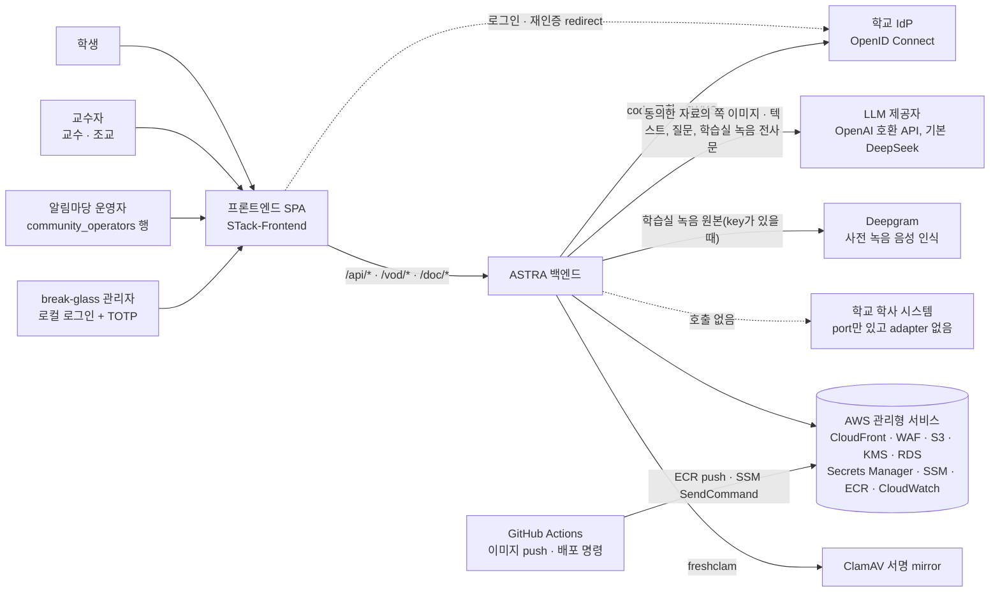

경계를 넘는 것은 다음이 전부다.

| 경계 | 오가는 것 | 근거 |
|---|---|---|
| 브라우저 ↔ 백엔드 | opaque session cookie `ASTRA_SESSION`(`HttpOnly`, `Secure`, `SameSite=Lax`, DB에는 hash), 기기 cookie `ASTRA_DEVICE`, CSRF double-submit cookie(`XSRF-TOKEN`, 브라우저 session 동안 같은 값이고 로그인·로그아웃 응답만 바꾼다)와 header, 로그인 전 값(state, nonce, PKCE verifier, 돌아갈 경로)을 암호화해 담은 `ASTRA_LOGIN`. 상태를 바꾸는 요청은 `Origin`도 본다 | `identity/session/SessionProperties`, `DeviceCookie`, `CsrfCookie`, `SecurityConfiguration`(`csrf.spa()`), `OriginCheckFilter`, `identity/sso/SsoController`, `integration/oidc/LoginBinding` |
| 브라우저 ↔ CloudFront `/vod/*`, `/doc/*` | CloudFront signed cookie(custom policy). 경로 prefix가 `/vod/{assetKey}/` 또는 `/doc/{renditionKey}/`이고 만료가 정해져 있다. 영상 복호화 key는 이 cookie로 받지 않고 `GET /api/courses/{courseId}/lecture-items/{itemId}/hls-key`가 요청마다 권한을 판정해 준다 | `files/DeliveryCookieService`, `integration/delivery/CloudFrontDeliverySigner`, `learning/LectureVideoController`, `infra/terraform/modules/edge/main.tf`(`trusted_key_groups`) |
| 백엔드 ↔ 학교 IdP | 브라우저가 authorization 요청(code flow + PKCE, 재인증은 `prompt=login`)을 들고 가고, api가 discovery, token endpoint(code, verifier, client secret), JWKS를 부른다. id_token은 검증만 하고 IdP token은 저장하지 않는다. 설정한 host로만 보낸다 | `integration/oidc/OidcIdentityProvider`, `IdTokenVerifier`, `IssuerHttp`, `OidcProperties.allowedHosts`, [ADR-0017](adr/0017-school-sso-oidc.md) |
| 백엔드 ↔ LLM 제공자 | worker만 부른다. 쪽별 요약(`PAGE_SUMMARY`)은 쪽 이미지, 쪽 텍스트, 자료 제목을, 학습 대화(`STUDY_CHAT`)는 질문, 그 파일의 쪽 텍스트, 게시한 해설을 보낸다. 글은 `PatternRedactor`가 전자우편, 휴대전화 번호, 8~10자리 숫자를 가린 뒤 보낸다. 이름과 쪽 이미지는 가리지 않는다 | `summary/policy/ProcessingScope`, `summary/pipeline/TextRedactor`, `PatternRedactor`, `integration/llm/OpenAiCompatibleLlmClient` |
| LLM 호출의 동의 조건 | `LlmGate`가 모두 확인한다. 배포 스위치 `astra.llm.enabled`, 책임 교수자의 `llm_consents` 행(과목 × 교수자 × 범위, 동의 당시 `ProviderProfile` 지문과 지금 지문이 같음), 그 교수자가 지금도 과목의 결정권자(담당자 명단의 교수·비정규 담당자, `CourseStaff.isDecider` port). API key가 없으면 `LlmClient` bean이 없다. worker는 모델을 부르기 전마다 다시 확인하고, 철회하면 `ConsentRevoked` 이벤트로 대기 작업을 취소한다. 학습실 녹음 요약은 `LlmGate`를 거치지 않는다(동의 단계 없음, 소유자 결정) | `summary/policy/LlmGate`, `ConsentService`, `ProviderProfile`, `integration/llm/LlmConfiguration`, `summary/job/SummaryJobService.onConsentRevoked`, `summary/chat/StudyChatService.onConsentRevoked`, [ADR-0032](adr/0032-llm-consent-and-study-chat.md) |
| 백엔드 ↔ Deepgram, LLM 제공자(학습실 녹음) | worker만 부른다. `ASTRA_DEEPGRAM_API_KEY`가 있으면 새 학습실 녹음의 원본 바이트를 stream으로 `POST /v1/listen`(`model=nova-3&language=multi&language_hint=ko,en&utterances=true&mip_opt_out=true`, header `Authorization: Token`)에 보내고, 받은 전사 줄(`[초] 말`)을 요약 모델에 보낸다. 이름, 제목, 과목, 사용자 ID는 보내지 않는다. 결과는 소유자만 녹음 상세로 읽는다. 설정한 Deepgram 주소 하나로만 보낸다 | `files/studyroom/RecordingStudyRunner`, `RecordingSummarizer`, `files/api/SpeechToText`, `TextModel`, `integration/deepgram/DeepgramSpeechToText`, `integration/llm/LlmTextModel`, [ADR-0041](adr/0041-recording-transcription-and-summary.md) |
| 백엔드 ↔ 학사 시스템 | 없다. `identity.api.RegistrarDirectory` port만 있고 구현 bean이 없어 학사 동기화 요청은 503이다 | `identity/api/RegistrarDirectory`, `identity/account/ProfileController`(`ObjectProvider<RegistrarDirectory>`) |
| 백엔드 ↔ AWS | S3는 api와 worker가 instance role로 읽고 쓴다(content, delivery bucket, SSE-KMS). RDS는 JDBC(`sslMode=REQUIRED`). 비밀값은 host의 배포 script가 Secrets Manager에서 읽어 `.env`로 쓰고, container는 Secrets Manager를 부르지 않는다. container log는 docker `awslogs` driver가 CloudWatch로 보낸다 | `infra/terraform/modules/app/main.tf`, `modules/deploy/templates/deploy.sh`, `modules/app/templates/app-user-data.sh`, `envs/pre-adoption/main.tf`(`DB_URL`) |
| freshclam ↔ 서명 mirror | 서명 내려받기만 한다. 업로드 파일은 받지 않는다 | `compose.yaml`(`freshclam`, `signatures` network) |
| GitHub Actions ↔ AWS | GitHub OIDC로 deploy role을 받아 ECR에 이미지를 올리고 SSM 배포 문서를 image tag 하나로 실행한다 | `infra/terraform/modules/deploy/main.tf` |

사람의 구분은 코드에서 읽었다. 과목 역할(교수자, 학생)은 `catalog.api.CourseMemberships.roleOf`, 알림마당 운영자는 `communication/CommunityOperators`, break-glass는 `identity/breakglass/BreakGlassLogin`이 정한다.

## 2. Container

### 2.1 AWS 배포

`infra/terraform/envs/pre-adoption` 하나가 정의하는 구성이다. EC2 한 대에서 `compose.yaml`을 실행한다.

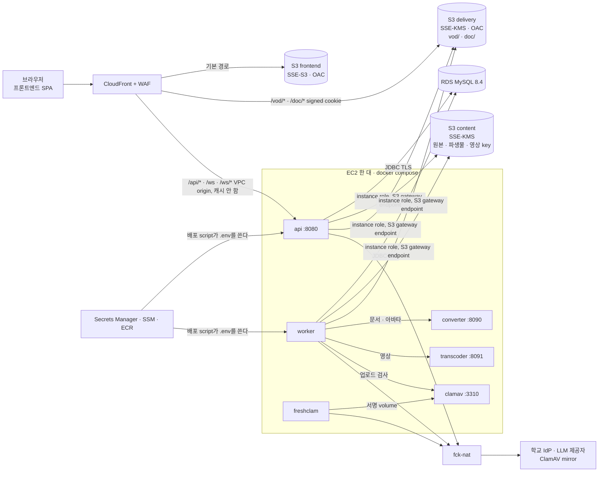

- 이미지는 하나다. `docker/entrypoint.sh`가 command 인자로 역할을 고른다. `api`와 `worker`는 Spring profile `api`, `worker`로 같은 jar를 띄우고, worker는 HTTP를 container 안의 `127.0.0.1`에만 연다. `converter`는 `com.stackcorp.converter.ConverterServer`(`/render`, `/avatar`), `transcoder`는 `com.stackcorp.transcoder.TranscoderServer`(`/transcode`, ffmpeg)를 같은 jar에서 main class로 띄운다. converter 이미지는 Dockerfile target `converter`(LibreOffice 추가)다.
- clamav와 freshclam은 `clamav/clamav` 이미지이고 compose profile `scan`으로만 뜬다. Terraform은 `scan_uploads`가 켜져 있으면 `COMPOSE_PROFILES=scan`, `ASTRA_SCAN_REQUIRED=true`를 `.env`에 넣는다.
- MySQL container는 compose profile `mysql`일 때만 뜬다. Terraform 구성은 이 profile을 켜지 않고 `DB_URL`을 RDS로 준다.
- CloudFront behavior는 `modules/edge/main.tf`의 `api_paths`(`/api/*`, `/ws`, `/ws/*`)와 `delivery_paths`(`/vod/*`, `/doc/*`)이고 나머지는 frontend bucket이다. `/actuator`는 어느 behavior에도 없다.
- S3 frontend bucket에 쓰는 것은 이 레포가 아니다. 앱의 instance role은 content와 delivery bucket만 허용한다(`modules/app/main.tf`의 `bucket_arns`).

### 2.2 host 안의 network

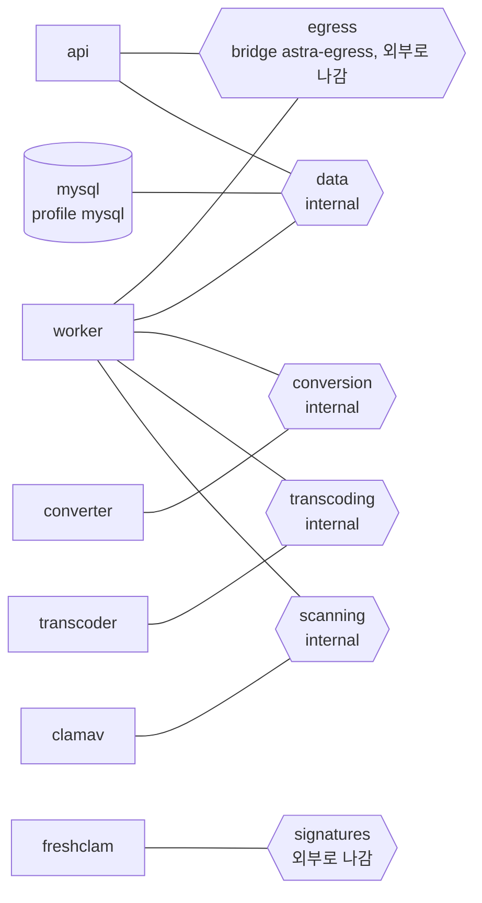

| 출발 | 닿는 곳 | 닿지 못하는 곳 |
|---|---|---|
| api | 외부(egress), mysql/RDS, S3, instance metadata | converter, transcoder, clamav |
| worker | 외부(egress), mysql/RDS, S3, instance metadata, converter, transcoder, clamav | 없음 |
| converter | 없음. `conversion` 하나에만 있고 그 network는 internal이다 | 외부, DB, S3, instance metadata |
| transcoder | 없음. `transcoding` 하나에만 있다. 작업 파일은 `transcoder-work` volume에 요청마다 만들고 지운다 | 외부, DB, S3, instance metadata |
| clamav | 없음. `scanning` 하나에만 있다. freshclam과는 `clamav-db` volume만 같이 쓴다 | 외부, DB, S3, api |
| freshclam | 외부(서명 mirror) | 다른 container, instance metadata |

- host에 publish하는 port는 api의 8080 하나다(`ASTRA_API_BIND` 기본 `127.0.0.1`, Terraform은 `0.0.0.0`). 관리 port 8081과 converter의 상태 확인 port 8092는 container 안의 `127.0.0.1`에만 열리고 healthcheck(`docker/healthcheck.sh`)가 container 안에서 부른다.
- instance metadata는 host firewall이 막는다. `modules/app/templates/app-user-data.sh`가 `DOCKER-USER` chain에 "169.254.169.254로 가는 packet 중 `astra-egress` bridge에서 오지 않은 것은 버린다"는 규칙을 넣고, 배포 script가 매번 그 규칙이 있는지 확인한다.
- 모든 앱 container는 `read_only`, `cap_drop: [ALL]`, `no-new-privileges`이고 쓰기는 `/tmp` tmpfs(transcoder는 `/work` volume, api는 multipart 업로드 본문을 임시로 받는 `/spool` volume)에만 한다.

credential을 가진 container는 다음과 같다.

| 값 | 가진 container | 근거 |
|---|---|---|
| `.env` 전체: `DB_USERNAME`, `DB_PASSWORD`, `ASTRA_OIDC_CLIENT_SECRET`, `ASTRA_LLM_API_KEY`, `ASTRA_DEEPGRAM_API_KEY`, `ASTRA_CLOUDFRONT_PRIVATE_KEY`, break-glass 3값, 설정값 | api, worker | `compose.yaml`의 `env_file: .env`. 값은 `modules/deploy/templates/deploy.sh`가 Secrets Manager(`modules/app/main.tf`의 `secrets`)에서 받아 쓴다 |
| AWS instance role(S3, KMS, Secrets Manager, ECR, CloudWatch Logs) | api, worker | `egress` bridge에서만 instance metadata에 닿는다 |
| `MYSQL_USER`, `MYSQL_PASSWORD` | mysql(profile mysql일 때) | `compose.yaml`의 interpolation |
| RDS master 비밀번호 | 어느 container에도 없다. RDS가 Secrets Manager에 만들고 돌린다 | `modules/database/main.tf`(`manage_master_user_password`) |
| 없음 | converter, transcoder, clamav, freshclam | `env_file`이 없고 `environment`에는 port, 시간 제한, 크기 상한만 있다 |

### 2.3 CDN이 없는 구성

`.env.example`의 기본값이다. CloudFront와 Terraform 없이 `docker compose up`으로 띄우고, 같은 host의 프론트엔드 서버(STack-Frontend `server.mjs`, `127.0.0.1`에만 묶인다)가 브라우저를 받는다. TLS는 그 앞단(예: Cloudflare Tunnel)이 끝낸다.

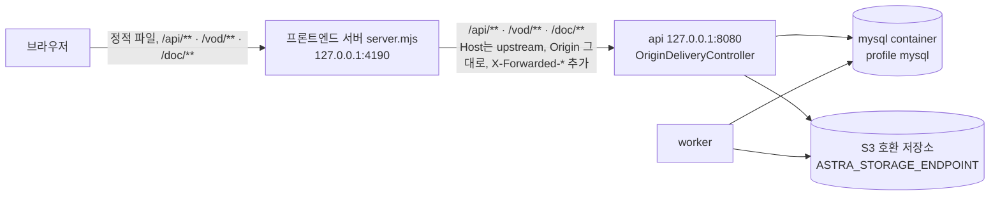

- proxy가 Host를 api 주소로 바꾸므로 `OriginCheckFilter`의 자기 origin 비교로는 브라우저의 Origin과 맞지 않는다. 앱은 `X-Forwarded-Host`·`X-Forwarded-Proto`를 믿지 않는다. `compose.yaml`이 api에 `ASTRA_SESSION_ALLOWED_ORIGINS`를 요구하고(없으면 compose가 구성을 거부한다), `identity/session/SessionProperties`는 브라우저가 보낼 수 없는 모양의 값이면 시작하지 않는다.
- api가 보는 연결은 모두 `astra_egress` network의 한 주소에서 온다. 운영 구성(Frontend-final `deploy/hermes/eclass-frontend/compose.yaml`)은 프론트엔드 container를 그 network에 붙여 `http://api:8080`으로 넘기므로 그 container의 주소이고, server.mjs를 host에서 띄우면 bridge gateway다. 브라우저 주소는 `ASTRA_CLIENT_ADDRESS_TRUSTED_PROXIES`(loopback과 그 network 범위)가 있을 때만 `X-Forwarded-For`를 오른쪽부터 읽어 정한다(`identity/session/ClientAddresses`). Cloudflare가 받은 값 뒤에 브라우저 주소를 덧붙이고, server.mjs는 loopback에서 온 요청(같은 container의 cloudflared)이면 받은 값 뒤에 연결한 쪽 주소를 덧붙이고 그 밖이면 연결한 쪽 주소 하나로 바꾼다. 덧붙이지 않는 앞단을 server.mjs 앞에 두면 이 설정은 위조한 주소를 읽는다. `compose.yaml`은 network 범위를 고정하지 않으므로 network를 다시 만들면 목록을 다시 확인한다.
- `astra.delivery.origin.enabled=true`(`ASTRA_DELIVERY_ORIGIN_ENABLED`)이면 `integration/delivery/OriginDeliveryConfiguration`이 `OriginDeliverySigner`와 `OriginDeliveryController`(`GET /vod/{key}/{file}`, `GET /doc/{key}/{file}`)를 만든다. cookie는 `ASTRA-Delivery`(만료 시각과 경로 prefix의 HMAC-SHA256)이고 api가 직접 검증한 뒤 `files.api.DeliveryObjects`로 delivery bucket의 객체를 돌려준다([ADR-0009](adr/0009-origin-delivery-without-cdn.md)).
- CloudFront 서명(`astra.cloudfront.key-pair-id`)과 함께 켜면 시작하지 않는다. 둘 다 없으면 `DeliveryCookieService`가 빈 목록을 돌려주고, 미리보기와 요약에 `pageImageBase`가 없으며 영상 재생 시작은 503 `delivery_unavailable`이다. `compose.yaml`은 api에 `ASTRA_DELIVERY_REQUIRED=true`를 넣어 그 상태로는 시작하지 않게 한다(`files/DeliveryCookieService`).
- compose에는 S3 container가 없다. 저장소는 `ASTRA_STORAGE_ENDPOINT`와 access key로 S3 호환 저장소를 가리키거나 AWS S3를 쓴다(`files/storage/StorageProperties`).
- converter, transcoder, clamav의 network 구성은 2.2절과 같다.

그림의 근거: `compose.yaml`(services, networks, volumes, `env_file`, profiles), `Dockerfile`(target `runtime`, `converter`), `docker/entrypoint.sh`(역할별 main), `infra/terraform/envs/pre-adoption/main.tf`(module 조립과 `.env` 값), `modules/edge/main.tf`(origin, behavior), `modules/storage/main.tf`(bucket과 암호화), `modules/app/main.tf`(IAM, secrets), `modules/app/templates/app-user-data.sh`(metadata firewall), `modules/deploy/templates/deploy.sh`(`.env` 생성).

## 3. Component

### 3.1 모듈 지도

`com.stackcorp.astra` 아래 패키지 하나가 Spring Modulith 모듈 하나다. 아래 표와 그림은 각 모듈의 `package-info.java`가 선언한 `allowedDependencies`를 그대로 옮긴 것이고, 마지막 두 열은 실제 `import`에서 읽었다. `ModuleStructureTests.modulesDependOnlyOnDeclaredPublicApis`가 같은 선언으로 `ApplicationModules.verify()`를 돌리므로, 표에 없는 의존이 생기면 테스트가 실패한다.

| 모듈 | type | `allowedDependencies` | import가 있는 모듈 | 선언했지만 import가 없는 의존 |
|---|---|---|---|---|
| `assessment` | CLOSED | `learning :: api`, `catalog :: api`, `identity :: api`, `files :: api`, `shared` | `catalog`, `files`, `identity`, `learning`, `shared` | 없음 |
| `catalog` | CLOSED | `identity :: api`, `shared` | `identity`, `shared` | 없음 |
| `communication` | CLOSED | `catalog :: api`, `identity :: api`, `files :: api`, `shared` | `catalog`, `files`, `identity`, `shared` | 없음 |
| `files` | CLOSED | `catalog :: api`, `identity :: api`, `shared` | `catalog`, `identity`, `shared` | 없음 |
| `home` | CLOSED | `catalog :: api`, `learning :: api`, `assessment :: api`, `communication :: api`, `shared` | `assessment`, `catalog`, `communication`, `learning`, `shared` | 없음 |
| `identity` | CLOSED | `shared` | `shared` | 없음 |
| `integration` | CLOSED | `identity :: api`, `catalog :: api`, `learning :: api`, `files :: api`, `summary :: api`, `shared` | `catalog`, `files`, `identity`, `learning`, `shared`, `summary` | 없음 |
| `learning` | CLOSED | `catalog :: api`, `identity :: api`, `files :: api`, `shared` | `catalog`, `files`, `identity`, `shared` | 없음 |
| `shared` | OPEN | 없음 | 없음 | 없음 |
| `summary` | CLOSED | `files :: api`, `identity :: api`, `shared` | `files`, `identity`, `shared` | 없음 |

표는 저장소 루트에서 아래 script로 만들었다. 결과를 그대로 옮겼다.

<details><summary>allowedDependencies와 import 비교 script</summary>

```python
import re, pathlib, collections
root = pathlib.Path('src/main/java/com/stackcorp/astra')
used = collections.defaultdict(set)
for f in root.glob('*/**/*.java'):
    m = f.relative_to(root).parts[0]
    used[m] |= set(re.findall(r'^import com\.stackcorp\.astra\.(\w+)\.', f.read_text(), re.M)) - {m}
for pi in sorted(root.glob('*/package-info.java')):
    m, src = pi.parent.name, pi.read_text()
    deps = re.findall(r'"([^"]+)"', re.search(r'allowedDependencies\s*=\s*\{([^}]*)\}', src).group(1))
    unused = sorted({d.split(' ::')[0] for d in deps} - used[m])
    print(m, 'OPEN' if 'Type.OPEN' in src else 'CLOSED', deps, sorted(used[m]), unused)
```

</details>

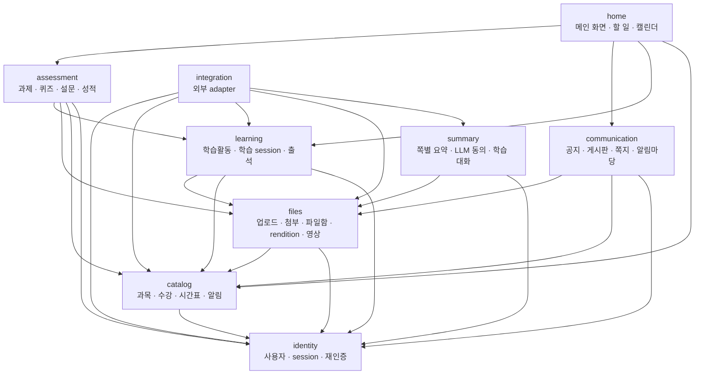

- 화살표는 모두 대상 모듈의 `api` 패키지(`@NamedInterface("api")`)로 간다. `shared`는 `OPEN` 모듈이라 모든 모듈이 내부까지 쓸 수 있다.
- `integration`이 구현하는 port는 3.3절에 있다. 이 그림에서는 `integration`이 port를 정의한 모듈의 `api`에 의존하는 방향으로만 보인다.
- `home`과 `integration`의 `api` 패키지는 비어 있고, 이 둘에 의존하는 모듈은 없다.
- `com.stackcorp.converter`와 `com.stackcorp.transcoder`는 `com.stackcorp.astra` 밖이라 Spring Modulith 모듈이 아니다. 둘은 `com.stackcorp.astra`를 import하지 않고, `com.stackcorp.astra`도 둘을 import하지 않는다. 앱은 HTTP로만 부른다.

Spring Modulith가 만드는 그림도 있다. `ModuleStructureTests.writesC4ComponentDiagrams`가 `build/spring-modulith-docs/`에 `components.puml`과 모듈별 `module-*.puml`을 쓴다. 이 파일은 commit하지 않는다.

### 3.2 모듈 안

모듈마다 주요 class를 역할로 묶었다. 같은 상자의 class는 같은 역할이다. 그림에 없는 class는 record, enum, 설정 properties, 작은 helper다. 근거는 각 class의 stereotype(`@RestController`, `@Service`, `@Repository`, `@Component`, `@Scheduled`, `@Profile("worker")`), `implements` 절, constructor로 받는 협력자다.

#### 3.2.1 identity

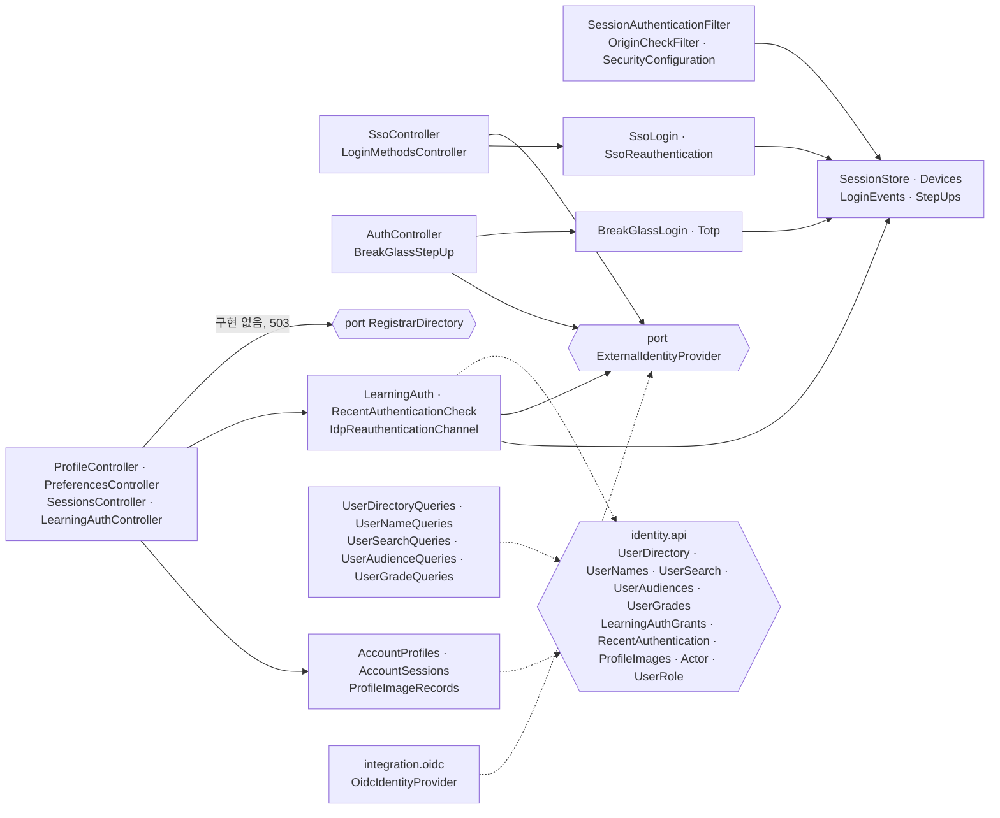

- 모든 요청의 인증은 `SessionAuthenticationFilter`가 `SessionStore`로 `user_sessions`를 읽어 `Actor`(사용자, 역할, break-glass 여부, session ID)를 만든다. 다른 모듈의 controller는 `@AuthenticationPrincipal Actor`만 받는다.
- `ExternalIdentityProvider`와 `RegistrarDirectory`는 `ObjectProvider`로 받는다. bean이 없으면 로그인 endpoint는 404, 학사 동기화는 503이다.

#### 3.2.2 catalog

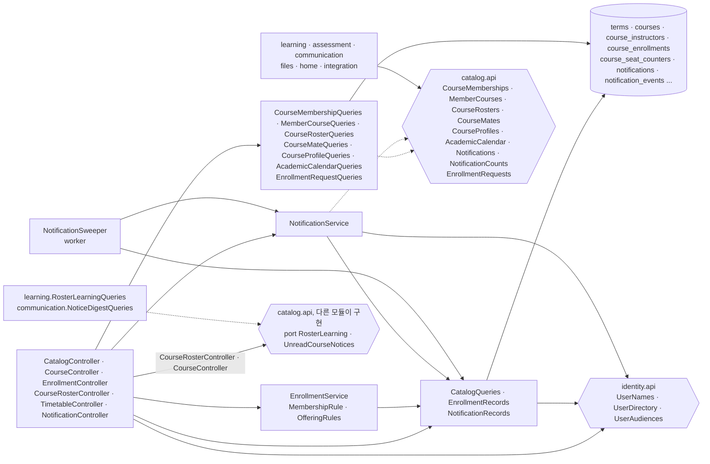

- 과목 역할 판정은 `MembershipRule` 하나이고 `CourseMembershipQueries.roleOf`가 이를 쓴다. 다른 모듈의 권한 판정은 모두 `CourseMemberships.roleOf`에서 시작한다.
- `NotificationService`는 `Notifications`(쓰기)와 `NotificationCounts`(읽기)를 함께 구현한다. 쓰기 method는 `@Transactional(propagation = MANDATORY)`라 호출한 모듈의 transaction 밖에서 부르면 실패한다.
- 담당자 수강생 명단의 학습 열(최근 학습, 진도율)은 `learning`이 가진 기록이다. `catalog`는 `learning`에 의존하지 않으므로 `RosterLearning` port를 정의하고 `learning/RosterLearningQueries`가 구현한다. `CourseRosterController`가 담당자 권한을 판정한 뒤 그 과목 수강생 ID만 넘긴다.
- 내 과목(`CourseController`)은 역할을 과목 행과 같은 문장에서 `MembershipRule`로 정하고, 담당 과목의 수강생 수(`learners`)를 `CourseRosterQueries.counts`로 한 번에 센다. 수강생 명단의 `total`과 같은 사람이다.
- 내 과목의 안 읽은 공지 수(`unreadNotices`, 강의실 왼쪽 메뉴의 공지 배지)는 `communication`이 가진 기록이다. `catalog`는 `communication`에 의존하지 않으므로 `UnreadCourseNotices` port를 정의하고 `communication/NoticeDigestQueries`가 메인 화면(`CourseNoticeDigest.unreadCounts`)과 같은 집계로 구현한다. 목록의 모든 과목 ID를 한 번에 넘긴다.

#### 3.2.3 learning

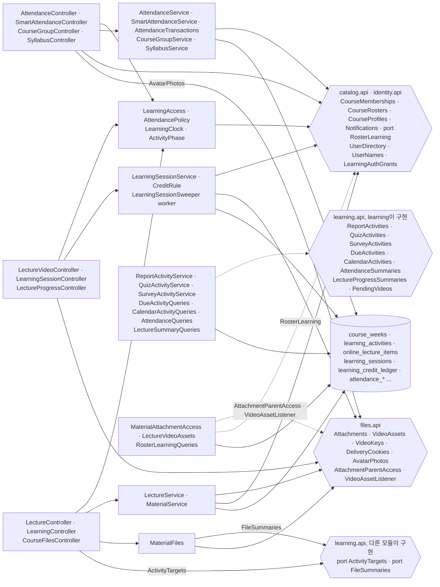

- 이 모듈에는 `*Records` class가 없다. service와 일부 controller(`LearningController`, `LectureController`, `LectureProgressController`, `LectureVideoController`, `CourseFilesController`)가 `JdbcClient`로 자기 테이블을 직접 읽고 쓴다.
- `ReportActivities`, `QuizActivities`, `SurveyActivities`는 `assessment`가 과제·퀴즈·설문의 학습활동 행(`learning_activities`)을 만들고 읽는 API다. `assessment`는 `learning_activities`를 직접 쓰지 않는다.
- `learning`은 `assessment`와 `summary`에 의존하지 않는다. 주차 목록의 평가 활동 ID(과제·퀴즈·설문 ID, 지각 마감)는 `ActivityTargets` port로 묻고 `assessment`가 구현한다. 자료 파일의 요약 게시 여부는 `FileSummaries` port로 묻고 `integration`이 `summary.api.PublishedSummaries`로 구현한다. `MaterialFiles`가 첨부 목록과 게시 여부를 묶어 자료 목록, 활동 상세, `GET /api/courses/{courseId}/files`(`CourseFilesController`)에 준다.
- 활동의 구간(`not_open`, `open`, `late`, `closed`)은 `ActivityPhase`가 DB 시계로 정한다.

#### 3.2.4 assessment

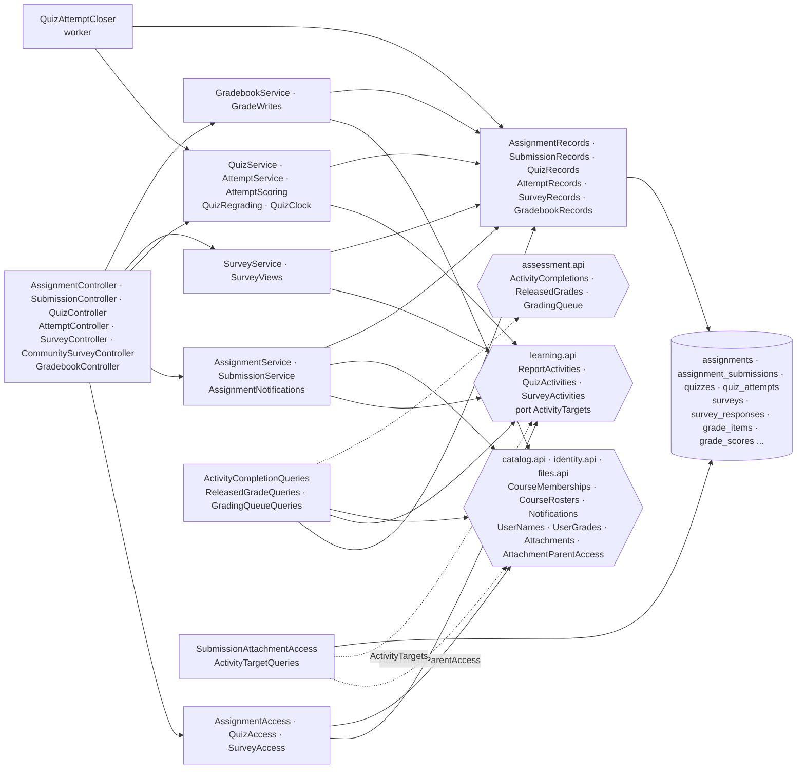

- 학생 합계와 공개 점수는 `ReleasedGradeQueries`가, 활동별 완료 여부는 `ActivityCompletionQueries`가, 담당 과목의 채점 대기 과제·퀴즈는 `GradingQueueQueries`가 `home`에 내보낸다. `GradingQueueQueries`는 수강생 명단을 `catalog.api.CourseRosters`의 여러 과목 조회로, 활동 제목과 삭제 여부를 `learning.api`의 `ReportActivities`, `QuizActivities`로 읽는다. `ActivityTargetQueries`는 `learning.api.ActivityTargets` port의 구현이고, `assignments`, `quizzes`, `surveys`를 한 쿼리로 읽어 활동 ID마다 과제·퀴즈·설문 ID와 지각 마감을 준다.
- 성적 쓰기는 `GradeWrites`가 `grade_items` 행 잠금 아래에서 한다. 퀴즈 정답 정정의 재채점은 `QuizRegrading` 한 transaction이다([ADR-0037](adr/0037-quiz-regrade-and-assessment-deletion.md)).

#### 3.2.5 communication

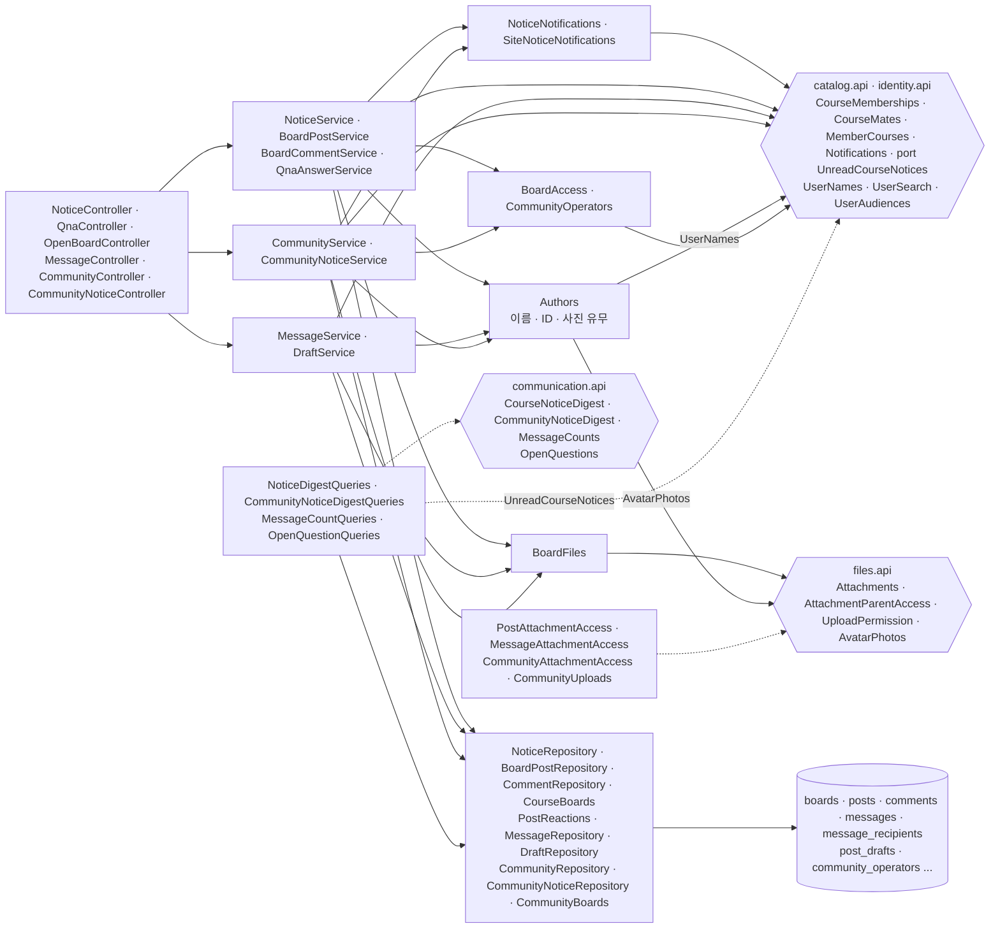

- 공지, 질의응답, 열린게시판, 알림마당 공지·자료·1:1 문의는 모두 `boards`와 `posts`의 행이다. 게시판 종류는 `BoardKind`가 나눈다.
- 쪽지 받는사람 범위는 `MessageService`가 `CourseMemberships`, `CourseMates`, `UserSearch`로 정한다([ADR-0025](adr/0025-message-recipient-scope-and-boxes.md)).
- 글·댓글·공지·문의의 작성자와 쪽지의 사람은 `Authors`가 이름(`UserNames`)과 사진 유무(`files.api.AvatarPhotos`)를 한 번에 모아 만든다. 누구의 사용자 ID를 드러낼지는 service가 정한다(익명 질문, 알림마당 운영자).

#### 3.2.6 files: 요청 쪽

`files`는 class가 많아 두 그림으로 나눴다. 이 그림은 api process가 받는 요청 쪽이다.

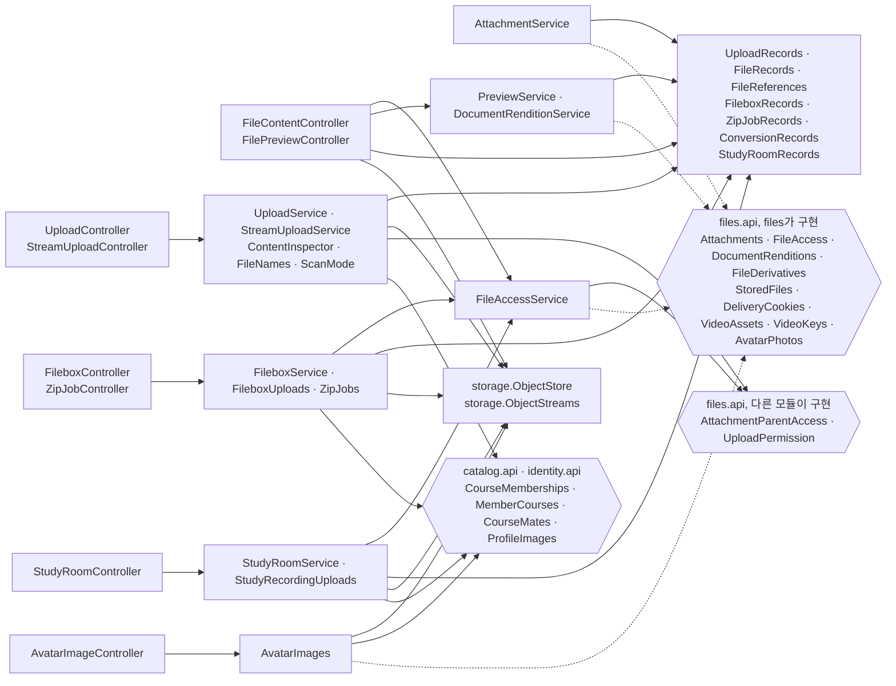

- S3를 부르는 class는 `files.storage`의 `ObjectStore`와 `ObjectStreams` 둘뿐이다. 다른 모듈은 `files.api`로만 파일을 읽고 쓴다.
- 파일 권한은 `FileAccessService`가 `List<AttachmentParentAccess>`를 돌며 첨부의 부모 모듈에 묻는다. 과목 없는 업로드 권한은 `UploadService`가 `List<UploadPermission>`에 묻는다.
- 학습실(`files.studyroom`, [ADR-0040](adr/0040-study-room-sync.md))은 녹음을 `StudyRecordingUploads`로 업로드 흐름에 넣고, 강의자료 배치를 `FileAccess`로 확인하며, 과목 구성원은 `CourseMemberships`로 본다. 녹음 파일은 첨부가 없어 `FileAccessService`가 허락하는 길이 없다.

#### 3.2.7 files: worker 쪽

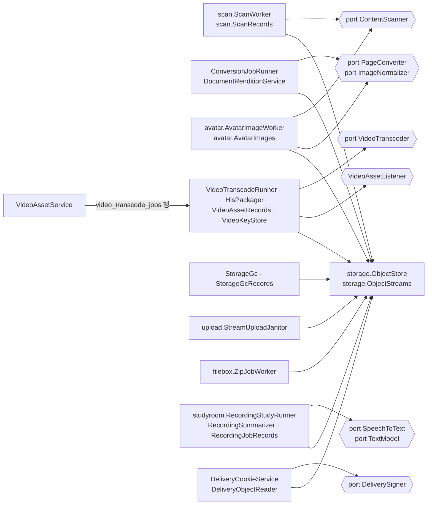

- `VideoAssetService.register`(learning이 부른다)가 `video_assets`와 `video_transcode_jobs` 행을 만들고, `VideoTranscodeRunner`가 그 행을 잡는다. 두 class 사이에 호출은 없고 테이블 행만 있다.
- `VideoAssetListener`는 `learning/LectureVideoAssets`가 구현한다. 게시, 실패, 회수 때 `online_lecture_items`의 재생 경로와 상태를 바꾼다.
- `studyroom.RecordingStudy`(녹음 업로드 transaction)가 `study_room_recording_jobs` 행을 만들고 `RecordingStudyRunner`가 잡는다. 여기도 테이블 행만 있다([ADR-0041](adr/0041-recording-transcription-and-summary.md)).
- port(P1~P5)의 구현은 `integration`에 있다(3.3절). P5는 `deepgram.DeepgramSpeechToText`와 `llm.LlmTextModel`(`summary.api.LlmClient`를 감싼다)이다.

#### 3.2.8 summary

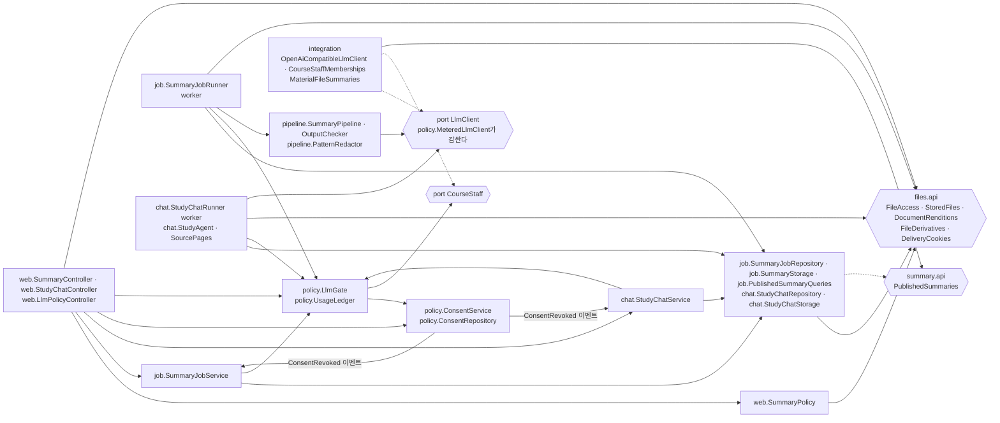

- 패키지 사이 방향은 `web → chat → job → pipeline → pack`, `web/chat/job → policy`이고 거꾸로 가는 import는 없다(5.1절 package 순환 검사).
- 요약 본문과 대화 본문은 DB가 아니라 `files.api.FileDerivatives`로 content bucket에 둔다(`SummaryStorage`, `StudyChatStorage`).
- `summary`는 `catalog`에 의존하지 않는다. 사람이 과목 담당인지(`isInstructor`), 외부 LLM 동의와 요약 생성 요청을 하는 결정권자인지(`isDecider`, 담당자 명단의 교수·비정규 담당자)는 `CourseStaff` port로 묻고, `integration/membership/CourseStaffMemberships`가 `catalog.api.CourseMemberships`로 답한다.
- `PublishedSummaries`는 `summary`가 구현하는 공개 API다. `job.PublishedSummaryQueries`가 `summary_publications`의 게시 pointer만 읽어 게시본이 있는 파일 ID를 돌려주고, `integration/summary/MaterialFileSummaries`가 이것으로 `learning.api.FileSummaries`를 구현한다.

#### 3.2.9 integration

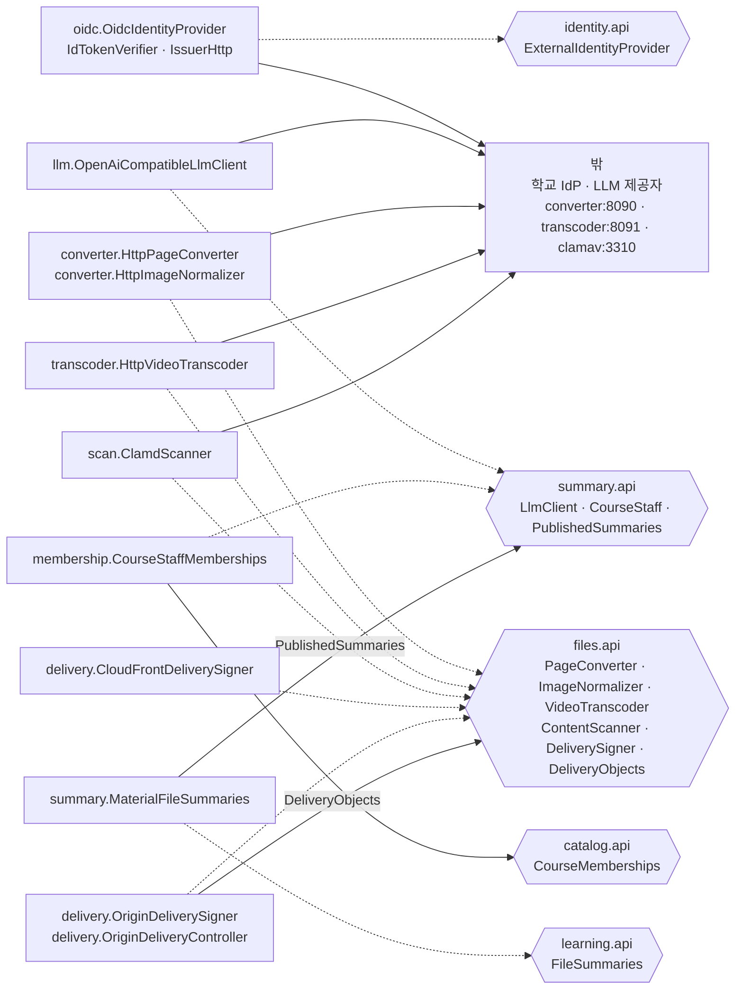

adapter마다 켜지는 조건이 있다. 조건이 맞지 않으면 bean이 없고, port를 쓰는 쪽은 `ObjectProvider`로 받아 그 기능을 끈다.

| adapter | 켜지는 조건 | 근거 |
|---|---|---|
| `OidcIdentityProvider` | `astra.oidc.issuer`가 있다 | `oidc/OidcConfiguration.IssuerConfigured` |
| `OpenAiCompatibleLlmClient` | `astra.llm.api-key`가 있고 `astra.llm.enabled`가 false가 아니다 | `llm/LlmConfiguration.ApiKeyConfigured` |
| `ClamdScanner` | `astra.scan.clamd.host`가 있다 | `scan/ClamdConfiguration.HostConfigured` |
| `CloudFrontDeliverySigner` | `astra.cloudfront.key-pair-id`가 있다 | `delivery/CloudFrontConfiguration` |
| `OriginDeliverySigner`, `OriginDeliveryController` | `astra.delivery.origin.enabled=true` | `delivery/OriginDeliveryConfiguration` |
| `HttpPageConverter`, `HttpImageNormalizer`, `HttpVideoTranscoder` | 언제나. 기본 주소는 `http://converter:8090`, `http://transcoder:8091`이다 | `converter/ConverterConfiguration`, `transcoder/TranscoderConfiguration` |
| `CourseStaffMemberships` | 언제나(`@Component`) | `membership/CourseStaffMemberships` |
| `MaterialFileSummaries` | 언제나(`@Component`) | `summary/MaterialFileSummaries` |

외부로 나가는 HTTP client와 socket은 `integration` 안에만 있다(5.1절).

#### 3.2.10 home과 shared

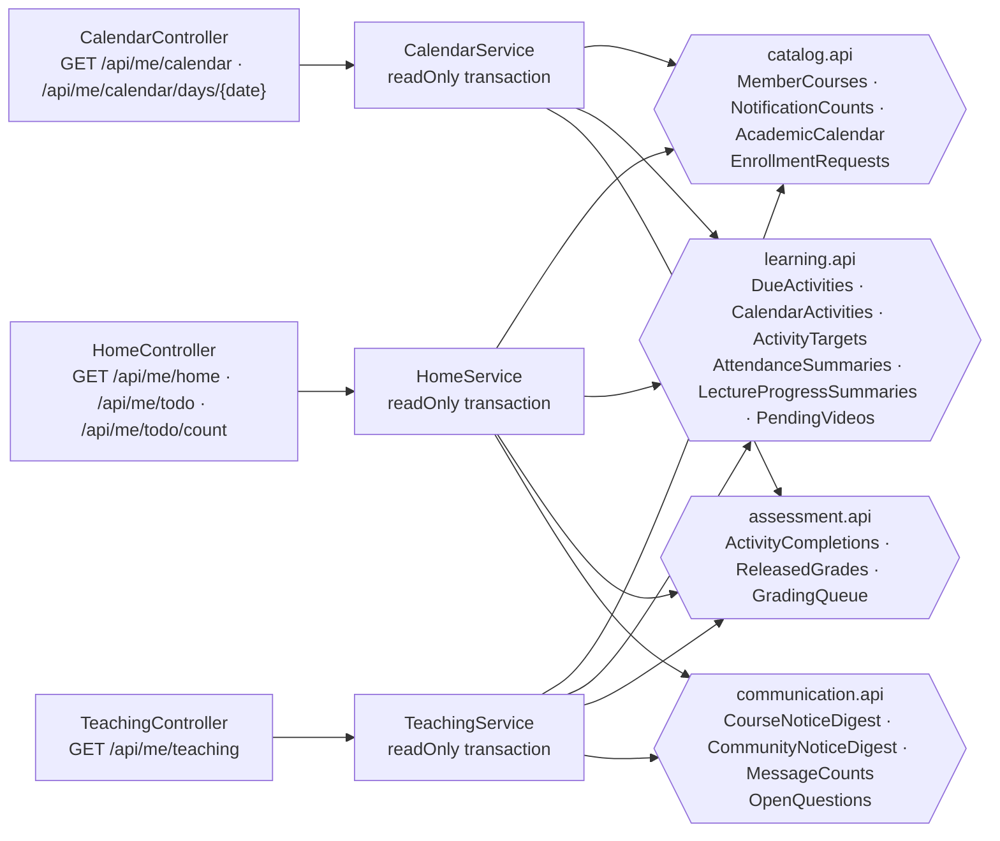

`home`은 쓰기가 없고 테이블도 없다. `JdbcClient`는 DB 시계(`SELECT CURRENT_TIMESTAMP(3)`)에만 쓴다. 다른 모듈의 `api`만 읽어 한 응답으로 모은다. 할 일, 캘린더, 담당자 메인의 다가오는 일정의 평가 활동은 `learning.api.ActivityTargets`로 과제·퀴즈·설문 ID를 붙인다(구현은 `assessment`). 메인 과목 카드의 진행 주는 `MemberCourses`가 주는 수업 기간으로, 진도율과 출석은 `LectureProgressSummaries`와 `AttendanceSummaries`로 정한다. 담당자 메인(`TeachingService`)은 `GradingQueue`, `PendingVideos`, `OpenQuestions`, `EnrollmentRequests`의 수를 담당 과목마다 모은다.

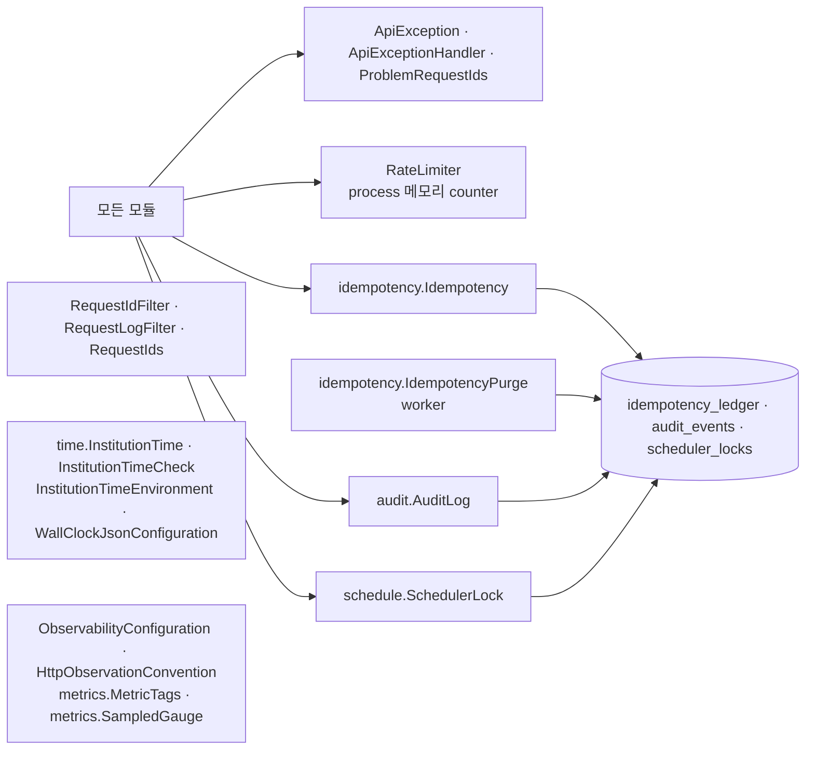

`RF`, `TIME`, `OBS`는 모듈이 부르지 않고 Spring이 filter, 시작 검사, 설정으로 건다. `InstitutionTimeCheck`는 시작할 때 설정, JVM, DB session의 시간대가 같은지 보고 다르면 시작을 멈춘다([ADR-0039](adr/0039-institution-wall-clock-time.md)).

### 3.3 port

한 모듈의 `api` 패키지에 있고 다른 모듈이 구현하는 interface 전부다. `grep`으로 `api` 패키지의 interface마다 `implements`하는 class를 찾았다.

| port | 정의한 모듈 | 구현 class | 구현 모듈 | 쓰는 class |
|---|---|---|---|---|
| `ExternalIdentityProvider` | identity | `integration/oidc/OidcIdentityProvider` | integration | `SsoController`, `AuthController`, `LoginMethodsController`, `IdpReauthenticationChannel` |
| `RegistrarDirectory` | identity | 없음 | 없음 | `ProfileController`(bean이 없으면 503) |
| `LlmClient` | summary | `integration/llm/OpenAiCompatibleLlmClient` | integration | `SummaryJobRunner`, `StudyChatRunner`(`MeteredLlmClient`로 감싼다) |
| `CourseStaff` | summary | `integration/membership/CourseStaffMemberships` | integration | `LlmGate`, `LlmPolicyController` |
| `PageConverter` | files | `integration/converter/HttpPageConverter` | integration | `DocumentRenditionService` |
| `ImageNormalizer` | files | `integration/converter/HttpImageNormalizer` | integration | `avatar/AvatarImages` |
| `VideoTranscoder` | files | `integration/transcoder/HttpVideoTranscoder` | integration | `VideoTranscodeRunner` |
| `ContentScanner` | files | `integration/scan/ClamdScanner` | integration | `scan/ScanWorker`, `scan/ScanMode`, `avatar/AvatarImages` |
| `DeliverySigner` | files | `integration/delivery/CloudFrontDeliverySigner`, `integration/delivery/OriginDeliverySigner` | integration | `DeliveryCookieService` |
| `AttachmentParentAccess` | files | `assessment/SubmissionAttachmentAccess`, `learning/MaterialAttachmentAccess`, `communication/PostAttachmentAccess`, `communication/MessageAttachmentAccess`, `communication/CommunityAttachmentAccess` | assessment, learning, communication | `FileAccessService` |
| `UploadPermission` | files | `communication/CommunityUploads` | communication | `upload/UploadService` |
| `VideoAssetListener` | files | `learning/LectureVideoAssets` | learning | `VideoTranscodeRunner` |
| `ActivityTargets` | learning | `assessment/ActivityTargetQueries` | assessment | `learning/LearningController`, `home/HomeService`, `home/CalendarService`, `home/TeachingService` |
| `FileSummaries` | learning | `integration/summary/MaterialFileSummaries`(`summary.api.PublishedSummaries`에 위임) | integration | `learning/MaterialFiles` |
| `RosterLearning` | catalog | `learning/RosterLearningQueries` | learning | `catalog/CourseRosterController` |
| `UnreadCourseNotices` | catalog | `communication/NoticeDigestQueries` | communication | `catalog/CourseController` |

- `files.api.DeliveryObjects`는 port가 아니라 `files`가 구현(`DeliveryObjectReader`)하고 `integration/delivery/OriginDeliveryController`가 쓰는 공개 API다. `summary.api.PublishedSummaries`도 `summary`가 구현(`job/PublishedSummaryQueries`)하고 `integration/summary/MaterialFileSummaries`가 쓰는 공개 API다.
- `identity.api.SecondFactorChannel`은 `identity` 안의 `IdpReauthenticationChannel`만 구현한다. `summary.api.LlmTool`은 다른 모듈이 쓰지 않는다.
- 담당자 메인과 과목 카드에 더한 API는 port가 아니다. 정의한 모듈이 구현하고 `home`이 쓴다: `assessment.api.GradingQueue`(`GradingQueueQueries`), `learning.api.PendingVideos`·`LectureProgressSummaries`(`LectureSummaryQueries`), `learning.api.AttendanceSummaries`(`AttendanceQueries`), `communication.api.OpenQuestions`(`OpenQuestionQueries`), `catalog.api.EnrollmentRequests`(`EnrollmentRequestQueries`). `catalog.api.CourseRosters`의 여러 과목 조회는 `assessment/GradingQueueQueries`가 쓴다.

### 3.4 배경 작업

worker profile에서만 뜨는 `@Scheduled` method 전부다. 같은 job을 worker 여러 대가 돌려도 한 번만 처리되게 하는 방법을 코드에서 읽었다. "SKIP LOCKED + lease"는 `SELECT ... FOR UPDATE SKIP LOCKED`로 행 하나를 잡고 같은 transaction에서 `lease_owner`, `lease_expires_at`을 쓴 뒤 commit하는 방식이다. 이후 갱신은 `lease_owner = :owner` 조건부 UPDATE다. `SchedulerLock`은 `shared.schedule.SchedulerLock.runExclusively(name, atMostFor, task)`이고 `scheduler_locks`의 이름별 행 하나를 lease로 쓴다.

| class | method(주기 기본값) | 잡는 것 | 겹침을 막는 방법 |
|---|---|---|---|
| `assessment/QuizAttemptCloser` | `scheduled`(30s) | 마감이 지난 진행 중 `quiz_attempts` | 후보는 잠그지 않고 읽고, 응시마다 READ COMMITTED transaction에서 그 학생의 응시를 기본 키 순서로 `FOR UPDATE`한 뒤 상태를 다시 본다. SKIP LOCKED는 아니다 |
| `catalog/NotificationSweeper` | `scheduled`(30s) | 보일 시각이 지난 `notification_events`, 보존 기간이 지난 `notifications` | 사건 하나씩 `FOR UPDATE SKIP LOCKED`(`NotificationRecords.claimDue`). 지우기도 SKIP LOCKED. (유형, 대상, 사용자) unique key가 중복 알림을 막는다 |
| `files/scan/ScanWorker` | `poll`(10s) | `blob_state = 'quarantined'`인 `file_blobs` | SKIP LOCKED + scan lease(`scan_lease_expires_at`). 판정 기록은 lease 조건부 compare-and-set |
| `files/ConversionJobRunner` | `poll`(5s), `recover`(1m) | `conversion_jobs` 대기 행, lease가 끝난 `converting` 행 | SKIP LOCKED + lease. 요약·학습 대화의 `prepare`도 같은 행을 잡으므로 잡을 때마다 lease 소유자 뒤에 임의 값을 붙여, 같은 process의 늦은 시도가 다시 잡힌 행을 닫지 못한다 |
| `files/avatar/AvatarImageWorker` | `poll`(5s), `recover`(1m) | `image_status = 'TEMP'`인 `profile_images` | SKIP LOCKED + lease. 잡는 SQL은 `identity/account/ProfileImageRecords`에 있고 `identity.api.ProfileImages`로 부른다 |
| `files/VideoTranscodeRunner` | `poll`(10s) | `video_transcode_jobs` 대기 행 | SKIP LOCKED + lease. 실행 중 `leaseRenewal`마다 lease를 늘리고 잃으면 멈춘다 |
| 같은 class | `poll` 안의 `withdrawRemovedFiles` | 원본이 지워졌거나 거부된 영상 asset | `SchedulerLock` `files.video_withdraw`(10m) |
| 같은 class | `recoverExpired`(1m) | lease가 끝난 `running` 작업 | SKIP LOCKED(`VideoAssetRecords.lockExpired`) |
| `files/StorageGc` | `run`(1m) | 만료 업로드, 지운 파일의 파생물, 참조가 0인 `file_blobs` | `SchedulerLock` `files.storage_gc`(10m). blob 삭제 표시는 SKIP LOCKED |
| `files/upload/StreamUploadJanitor` | `abortAbandoned`(1h) | content bucket의 끝나지 않은 multipart upload | `SchedulerLock` `files.stream_upload_janitor`(10m). 목록을 잠금 없이 읽기 때문이다 |
| `files/filebox/ZipJobWorker` | `poll`(10s) | `requested`이거나 lease가 끝난 `building` `zip_jobs`, TTL이 지난 생성물 | SKIP LOCKED + lease. 파일을 하나 넣을 때마다 lease를 늘린다 |
| `files/studyroom/RecordingStudyRunner` | `poll`(10s) | 검사를 마친 녹음의 대기 전사, 전사가 끝난 녹음의 대기 요약 | `SchedulerLock` `files.recording_study_claim`(1m)으로 잡기만 차례로 세우고(종류별 동시 처리 상한을 세기 위해) 그 안에서 SKIP LOCKED + lease. 실행은 잠금 밖에서 하고 `leaseRenewal`마다 lease를 늘린다 |
| 같은 class | `recoverExpired`(1m) | lease가 끝난 `processing` 작업 | SKIP LOCKED(`RecordingJobRecords.lockExpired`) |
| `learning/LearningSessionSweeper` | `sweep`(30s) | lease가 끝난 `learning_sessions` | `SchedulerLock` `learning.session_sweep`(5m) + session마다 조건부 UPDATE |
| `shared/idempotency/IdempotencyPurge` | `scheduled`(15m) | 보존기한이 지난 `idempotency_ledger` | SKIP LOCKED, READ COMMITTED |
| `summary/job/SummaryJobRunner` | `poll`(5s) | `queued` `summary_jobs` | SKIP LOCKED + lease(`SummaryJobRepository.claimNext`) |
| 같은 class | `failExpired`(30s) | lease가 끝난 `running` 작업 | 조건부 UPDATE(`lease_expires_at < CURRENT_TIMESTAMP(3)`) |
| `summary/chat/StudyChatRunner` | `poll`(1s) | `queued` `study_chat_exchanges` | SKIP LOCKED + lease(`StudyChatRepository.claimNext`) |
| 같은 class | `sweep`(30s) | lease가 끝난 질문, 보존 기간이 지난 대화 | lease 만료는 조건부 UPDATE, 대화 삭제는 `SchedulerLock` `summary.studychat_purge`(10m) |
| `files/FilesBacklog`, `summary/job/SummaryBacklog`, `summary/chat/StudyChatBacklog` | `sample`(1m) | 대기열 길이를 세어 gauge로 둔다 | 잠금 없음. 읽기만 한다 |

- 주기 실행은 `@Profile("worker")`인 설정 class의 `@EnableScheduling`이 켠다(`QuizWorkerScheduling`, `NotificationSweeper`, `FilesWorkerScheduling`, `StorageGcConfiguration`, `ZipJobScheduling`, `ScanWorkerScheduling`, `LearningSessionConfiguration`, `IdempotencyConfiguration`, `SummaryConfiguration`). api process에서는 어느 job도 돌지 않는다.
- 주기 기본값은 각 `@Scheduled`의 `fixedDelayString` 기본값이다(예: `${astra.scan.poll-interval:10s}`).
- 모든 job은 Spring Boot가 만든 scheduler 하나를 함께 쓰고, thread는 `spring.task.scheduling.pool.size=10`개다. 대기열을 비울 때까지 도는 poll이 바빠도 다른 job은 남는 thread에서 돈다(`WorkerSchedulingTests`). 같은 method는 `fixedDelay`라 자기와 겹치지 않는다. 같은 class의 다른 method(예: `poll`과 lease 만료)는 한 process 안에서도 겹칠 수 있고, 위 표의 방법이 worker 여러 대에서와 같이 막는다.

## 4. Code

두 흐름을 class와 method 이름으로 그렸다. 각 화살표는 코드의 method 호출 하나다.

### 4.1 학생이 과제를 제출한다

`POST /api/courses/{courseId}/assignments/{assignmentId}/submission`. 출처: `assessment/SubmissionController.submit`, `SubmissionService.submit`, `submitLocked`, `replay`, `AssignmentAccess.submittable`, `SubmissionRecords`, `files/upload/AttachmentService.derive`.

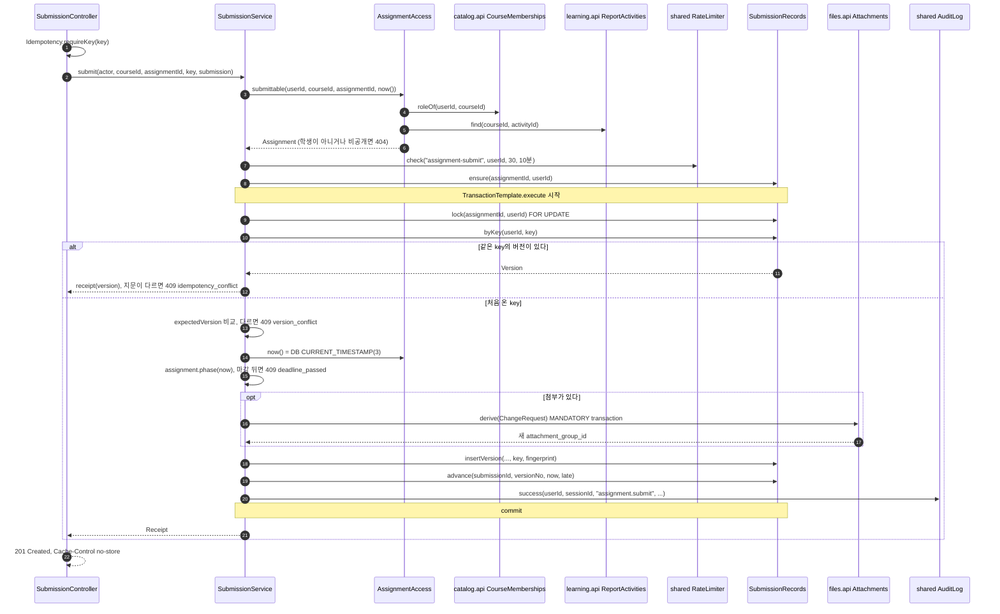

- 멱등은 `shared.idempotency.Idempotency.execute`(공용 원장 `idempotency_ledger`)를 쓰지 않는다. 이 명령은 `Idempotency.requireKey`로 key 형식만 보고, receipt는 제출 버전 행(`assignment_submission_versions`)이며 unique key (`submitted_by_user_id`, `idempotency_key`)가 중복을 막는다([ADR-0015](adr/0015-assignment-submission-model.md)). 같은 key가 다른 과제에서 동시에 쓰이면 `DuplicateKeyException`을 잡아 먼저 commit한 버전으로 답한다.
- 제출은 알림을 만들지 않는다. 과제의 알림은 교수자가 과제를 공개하거나 점수를 공개할 때 `AssignmentService`가 `AssignmentNotifications.sync`, `graded`로 `catalog.api.Notifications.publish`를 같은 transaction에서 부른다.
- 첨부 확정(`AttachmentService.derive`)은 이전 버전의 첨부 그룹을 바꾸지 않고 새 그룹을 만든다. 검사가 끝나지 않은 업로드가 있으면 `AttachmentException`이 나고 409 `attachment_not_ready`다.

### 4.2 교수자가 강의 영상을 올리고 학생이 재생한다

출처: `files/upload/StreamUploadController.upload`, `StreamUploadService.receive`, `learning/LectureService.addItem`, `files/VideoAssetService.register`, `files/scan/ScanWorker`, `files/VideoTranscodeRunner.poll`, `runOnce`, `execute`, `integration/transcoder/HttpVideoTranscoder.transcode`, `files/HlsPackager.accept`, `publish`, `learning/LectureVideoAssets.ready`, `learning/LearningSessionController.start`, `LearningSessionService.doStart`, `files/DeliveryCookieService.forVideo`, `integration/delivery/CloudFrontDeliverySigner.sign`.

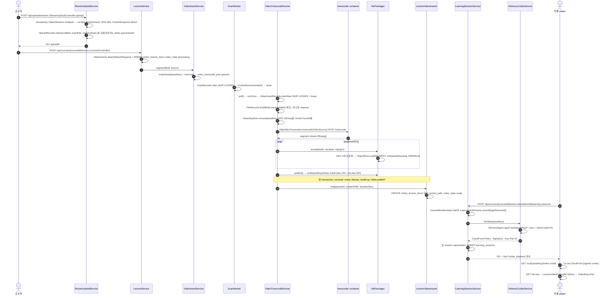

- 업로드 바이트는 api가 받아 content bucket에 multipart로 바로 흘려 쓴다. 같은 내용의 살아 있는 blob이 이미 있으면 `referenceBlob`이 그 blob을 참조하고, 방금 올린 객체는 `discard`로 지운다.
- 학습자는 `LearningAuthGrants.current`에 유효한 grant가 있어야 시작한다. 없으면 403 `learning_auth_required`다([ADR-0029](adr/0029-step-up-and-learning-auth.md)). 학습자가 아닌 담당자는 grant를 보지 않는다.
- transcoder는 key를 받지 않는다. 암호화는 worker의 `HlsPackager`가 한다([ADR-0016](adr/0016-video-upload-and-transcoder.md)).
- `LectureVideoController.playback`(`POST .../playback`)도 같은 `DeliveryCookies.forVideo`로 cookie를 낸다. 출석 인정 시간을 적립하지 않는 재생 허가이고, 학습 session은 하트비트마다 cookie를 다시 낸다.

## 5. 의존 규칙과 확인

### 5.1 규칙과 확인 방법

| 규칙 | 확인 방법 | 자동 |
|---|---|---|
| 모듈은 `allowedDependencies`에 적은 모듈에만 의존한다 | `ModuleStructureTests.modulesDependOnlyOnDeclaredPublicApis`의 `ApplicationModules.verify()`. CI의 `gradle build`가 돌린다 | 예 |
| 다른 모듈의 내부 패키지를 참조하지 않는다. 공개하는 것은 `api` named interface뿐이다 | 같은 `verify()` | 예 |
| 모듈 사이에 순환이 없다 | 같은 `verify()` | 예 |
| 모듈 안 패키지 사이에도 순환이 없다 | `ModuleStructureTests.packagesAreFreeOfCycles`(ArchUnit). 아래 script도 `com.stackcorp.astra` 아래 34개 패키지의 import graph에서 순환을 찾지 못했다 | 예 |
| 다른 모듈의 테이블을 읽거나 쓰지 않는다(SC-01) | 테스트 없음. 아래 script가 SQL 문자열의 테이블 이름을 DB 설계의 영역과 맞춘다 | 아니요 |
| S3는 `files`만 부른다(ADR-0007) | `ModuleStructureTests.onlyStorageAndDeliveryUseTheAwsSdk`. `software.amazon.awssdk`는 `files/storage`(S3)와 `integration/delivery`(CloudFront cookie 서명 utility)만 쓴다 | 예 |
| 외부 network 호출은 `integration`만 한다 | `ModuleStructureTests.onlyIntegrationOpensNetworkConnections`. AWS SDK를 빼면 `java.net.http`, `java.net.Socket`, `HttpURLConnection`, Spring의 HTTP client를 쓰는 class는 `integration`의 adapter뿐이다 | 예 |
| converter와 transcoder process는 앱 코드를 쓰지 않는다 | `ModuleStructureTests.sidecarProcessesShareNoCodeWithTheApp`. `com.stackcorp.converter`, `com.stackcorp.transcoder`와 `com.stackcorp.astra`는 서로 참조하지 않는다 | 예 |
| 알림 생성과 첨부 변경은 호출한 모듈의 transaction 안에서만 한다(ADR-0027) | `NotificationService`의 쓰기 method와 `AttachmentService`의 `attach`, `change`, `derive`, `release`가 `@Transactional(propagation = MANDATORY)`다. transaction 밖에서 부르면 실행 중에 실패한다 | 실행 시 |
| 배경 작업은 worker process에서만 돈다 | scheduling 설정 class가 `@Profile("worker")`다 | 실행 시 |
| `home`에는 아무도 의존하지 않는다 | 어느 `allowedDependencies`에도 `home`이 없으므로 `verify()`가 막는다 | 예 |

<details><summary>모듈 안 패키지 순환 검사 script</summary>

```python
import re, pathlib, collections, graphlib
root = pathlib.Path('src/main/java')
g = collections.defaultdict(set)
for f in (root / 'com/stackcorp/astra').rglob('*.java'):
    pkg = '.'.join(f.parent.relative_to(root).parts)
    for imp in re.findall(r'^import (com\.stackcorp\.astra\.[\w.]+);', f.read_text(), re.M):
        parts = imp.split('.')
        target = '.'.join(parts[:next(i for i, p in enumerate(parts) if p[0].isupper())])
        if target != pkg:
            g[pkg].add(target)
graphlib.TopologicalSorter(g).prepare()  # CycleError if any package cycle exists
print(len(g), 'packages, no cycle')
```

</details>

### 5.2 다른 모듈의 테이블

테이블의 영역은 ASTRA-Reference `db/design/`의 `10_identity`~`80_shared` 각 문서 "테이블 목록" 절이다(모두 113개). 이 목록은 ASTRA-Reference branch [`STAC-000-db-design-v38`](https://github.com/STack-Corp/ASTRA-Reference/tree/STAC-000-db-design-v38/db/design)(`2d628a7`)에 있다. 그 branch가 병합되고 이 레포의 `reference/` submodule(`f8e8267`)을 올리기 전에는 submodule의 목록에 `70_summary`, `80_shared`가 없어 이 검사에 쓸 수 없다. 영역 이름과 모듈 이름은 같다. 아래 script는 `src/main/java/com/stackcorp/astra`의 모든 줄에서 `FROM`, `JOIN`, `INTO`, `UPDATE` 뒤의 이름을 읽어 그 테이블의 영역과 소스의 모듈을 비교한다. SQL은 모두 `JdbcClient`의 문자열이고 JPA는 없으므로 SQL 문자열이 테이블 접근의 전부다. 문자열을 이어 붙여 테이블 이름을 만드는 곳(`"FROM " + ...`)은 없다.

<details><summary>테이블 영역 검사 script</summary>

```python
import re, sys, pathlib, collections
design = pathlib.Path(sys.argv[1])  # reference/db/design
owner = {}
for md in design.glob('*.md'):
    sec = re.search(r'^## 테이블 목록\n(.*?)^## ', md.read_text(), re.S | re.M).group(1)
    owner.update({t: md.stem.split('_', 1)[1] for t in re.findall(r'^\| `([a-z0-9_]+)` \|', sec, re.M)})
kw = re.compile(r'\b(?:FROM|JOIN|INTO|UPDATE)\s+([a-z][a-z0-9_]*)\b')
root = pathlib.Path('src/main/java/com/stackcorp/astra')
uses = collections.defaultdict(lambda: collections.defaultdict(list))
for f in sorted(root.glob('*/**/*.java')):
    m = f.relative_to(root).parts[0]
    for n, line in enumerate(f.read_text().splitlines(), 1):
        for t in kw.findall(line):
            if t in owner:
                uses[m][t].append(f'{f}:{n}')
print(len(owner), 'tables in design;', len({t for m in uses for t in uses[m]}), 'used by code')
for m in sorted(uses):
    foreign = {t: l for t, l in uses[m].items() if owner[t] != m}
    print(m, 'own', sum(owner[t] == m for t in uses[m]), 'foreign', foreign or 'none')
```

</details>

결과(2026-11-12, `f4a8b3a`, `python3 script.py <ASTRA-Reference STAC-000-db-design-v38>/db/design`):

| 모듈 | 쓰는 자기 영역 테이블 | 다른 영역 테이블 |
|---|---|---|
| `assessment` | 20 | 없음 |
| `catalog` | 13 | 없음 |
| `communication` | 10 | 없음 |
| `files` | 14 | 없음 |
| `identity` | 10 | 없음 |
| `learning` | 21 | 없음 |
| `shared` | 3 | 없음 |
| `summary` | 6 | 없음 |

- 코드가 쓰는 테이블은 113개 중 97개다. 나머지 16개(`academic_sync_logs`, `activity_view_logs`, `ai_file_summaries`, `assignment_peer_reviews`, `course_merged_groups`, `course_merged_group_members`, `course_week_folds`, `grade_criteria`, `grade_criterion_scores`, `online_lecture_item_replacements`, `online_lecture_timestamps`, `password_change_logs`, `preview_sessions`, `supporters_chats`, `supporters_chat_messages`, `user_credentials`)는 어느 모듈도 쓰지 않는다.
- 마이그레이션이 만드는 테이블 중 설계 목록에 없는 것은 `v34_survey_rekey_responses`, `v34_survey_rekey_answers`이고, 둘 다 `V34__survey_random_keys_and_upload_fingerprint.sql` 안에서 만들고 지우는 임시 테이블이다.
- 이 검사는 테이블 이름만 본다. 다른 모듈의 ID를 값으로 가진 열(아래 예외)은 잡지 않는다.

### 5.3 규칙에서 벗어난 곳

다른 모듈의 테이블을 읽거나 쓰는 SQL은 없다(5.2절). 모듈 사이, 모듈 안 패키지 사이의 순환도 없다(5.1절). 규칙과 다르거나 문서로 정한 예외는 다음이다.

| 곳 | 내용 | 판단 |
|---|---|---|
| `catalog/NotificationService.java:280`(`activityOf`), `catalog/NotificationRecords.java`(`notification_events`, `notifications`) | `catalog`가 소유한 알림 행이 `activity_id`와 `target_ref_id`로 `learning`, `assessment`, `communication`의 객체를 가리킨다. 값으로만 받고 그 테이블을 읽지 않는다 | 문서화한 예외. architecture.md 4.1절 알림 항목, [ADR-0027](adr/0027-notifications-in-producer-transaction.md), [ADR-0036](adr/0036-notification-screen-target-and-instructor-roster.md) |
| `learning/LectureService.java:161`, `:176`(`online_lecture_items.attachment_group_id`, `video_asset_id`), `communication/BoardPostRepository.java:179`(`posts.attachment_group_id`), `assessment/SubmissionRecords.java:152`(`insertVersion`의 `attachment_group_id`) | 각 모듈의 행이 `files` 소유의 첨부 그룹, 영상 asset ID를 값으로 가진다. 내용은 `files.api`(`Attachments`, `VideoAssets`)로만 읽는다 | 규칙 안. 값 참조이고 SQL 접근은 없다 |
| `catalog/CourseController.java`, `catalog/TimetableController.java`, `identity/account/PreferencesController.java`, `learning/CourseFilesController.java`, `learning/LearningController.java`, `learning/LectureController.java`, `learning/LectureProgressController.java`, `learning/LectureVideoController.java` | controller가 `JdbcClient`로 자기 모듈 테이블을 직접 읽는다. 다른 controller는 service나 `*Records`를 거친다 | 모듈 규칙(4.2절)이 정한 것은 아니다. 모듈 안 계층이 class마다 다르다는 사실만 적는다 |

## 6. 코드에 없는 것

architecture.md나 배포 파일에 이름이 있지만 지금 코드에 없는 것이다. 그래서 위 그림에 없다.

- 학사 시스템 adapter. `RegistrarDirectory` 구현이 없다. architecture.md 4.3절의 worker "학사 동기화"도 없다.
- MediaConvert. `VideoTranscoder` 구현은 `HttpVideoTranscoder` 하나이고 Terraform에도 MediaConvert resource가 없다. architecture.md 3.1절 그림과 4.3절 api 항목에 이름만 있다.
- WebSocket. CloudFront에 `/ws`, `/ws/*` behavior가 있지만(`modules/edge/main.tf`) 앱에 WebSocket endpoint가 없다.
- Spring Modulith event publication registry와 "미완료 이벤트 재전송" worker. `build.gradle`에 `spring-modulith-starter-core`만 있다. 지금 이벤트는 `summary`의 `ConsentRevoked` 하나이고 같은 process 안의 `@EventListener`다.
- 학교 도입 구성(ALB, ECS, Valkey, RDS Multi-AZ). Terraform 환경은 `envs/pre-adoption` 하나다.
