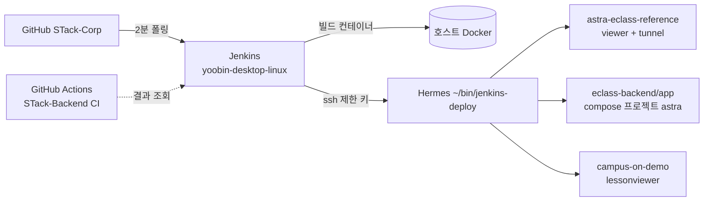

# Jenkins CI/CD

STack-Corp 레포 3개의 CI와 배포를 `yoobin-desktop-linux`의 Jenkins가 맡습니다. 배포 대상은 Hermes(Oracle Cloud ARM64) 한 대입니다.

| 레포 | CI | 배포 (`main`) |
|---|---|---|
| Frontend-final | Jenkins: 모든 브랜치·같은 조직 PR 에서 `npm ci`·`npm run typecheck`·`vite build` (node 22 컨테이너) | Hermes `eclass-frontend`: `dist/` 를 새로 빌드해 바꾸고 viewer·tunnel 재생성 (약 25초) |
| STack-Backend | GitHub Actions (`.github/workflows/ci.yml`: 빌드·테스트, 스키마 검사, 컨테이너 smoke) | Jenkins 가 그 커밋의 Actions CI 성공을 기다린 뒤 Hermes `eclass-backend`: 이미지 2개 빌드, DB 백업, `compose up --wait` (약 3–10분) |
| STack-lessonviewer | Jenkins: `ci/Dockerfile` 이미지(bun + PyMuPDF)에서 `typecheck`·`test`·`build` | Hermes `campus-lessonviewer` |

각 레포 루트의 `Jenkinsfile`이 파이프라인입니다. STack-Backend 잡은 `main` 만 보고(PR 은 Actions 가 검사), Actions CI 가 실패·취소되면 배포하지 않습니다.



이력: e-class 프론트엔드는 2026-11-10 ASTRA-Reference → STack-eclass-Frontend(STAC-90), 2026-11-13 STack-Frontend(현재 `STack-Frontend-Keep-`, 보관)로 옮겼고, 2026-11-14 Frontend-final 로 바뀌었습니다. 백엔드는 같은 시기 STack-Backend(e-class 백엔드)로 바뀌었습니다. 캠퍼스 온 화면·백엔드는 각 레포의 `archive/campus-on` 브랜치에 있고, Hermes 의 `campus-on-demo` 는 마지막 배포 상태로 멈춰 있습니다(LessonViewer 만 배포).

## 접속

- 주소: `http://100.94.176.38:8090` (Tailscale 안에서만). 공용 인터넷·LAN에는 열지 않습니다.
- 계정: `admin`. 비밀번호는 `yoobin-desktop-linux:~/jenkins/secrets/admin_password`.
- GitHub 웹훅은 Jenkins 가 공개 주소가 없어 쓰지 않습니다. 레포마다 2분마다 새 커밋·PR 을 확인합니다. 즉시 돌리려면 UI 에서 해당 레포 → `Scan Repository Now`.

## 설치·갱신

`yoobin-desktop-linux` 에서 `~/jenkins` 에 이 디렉터리 내용을 둡니다(`secrets/` 는 저장소에 넣지 않음).

```sh
# Windows 작업 PC 에서
tar -C deploy/jenkins -cf - Dockerfile plugins.txt compose.yaml casc | ssh yoobin-desktop-linux 'cd ~/jenkins && tar -xf -'
ssh yoobin-desktop-linux 'cd ~/jenkins && docker compose up -d --build'
```

설정은 전부 `casc/jenkins.yaml`(Configuration as Code)에 있습니다. UI 에서 바꾼 시스템 설정·잡은 재시작하면 이 파일 내용으로 돌아갑니다. 잡 목록에서 빠진 잡(예: 옛 STack-Frontend, STack-eclass-Frontend)은 재시작 뒤 UI 에서 지웁니다. Job DSL 스크립트 안에서는 `${...}` 를 쓰지 않습니다. JCasC 가 비밀값 변수로 해석해 빈 문자열로 바꿉니다.

Jenkins 는 호스트 Docker 소켓을 씁니다. Jenkins 에 로그인한 사람은 이 PC 의 Docker 를 쓸 수 있는 것과 같으므로 계정을 늘리지 않습니다. 포크 PR 은 빌드하지 않습니다(같은 조직 브랜치의 PR 만).

## 비밀값

`~/jenkins/secrets/` (디렉터리 700, 파일 600). 컨테이너에는 `/run/secrets` 로 읽기 전용 마운트되고 JCasC 가 같은 이름의 `${...}` 로 읽습니다.

| 파일 | Jenkins 자격 증명 | 내용 |
|---|---|---|
| `admin_password` | 로그인 | 무작위 생성 |
| `github_token` | `github-token` | fine-grained PAT `jenkins-yoobin-desktop-linux`. 소유자 STack-Corp, 레포 **Frontend-final·STack-Backend·STack-lessonviewer**. Contents·Metadata·Pull requests·**Actions** 읽기, Commit statuses 쓰기 |
| `hermes_deploy_key` | `hermes-deploy` | ed25519 개인 키. Hermes `authorized_keys` 에서 `command="/home/ubuntu/bin/jenkins-deploy",restrict` 로 묶임 |

레포 deploy key 는 조직 설정에서 막혀 있어 GitHub 접근은 토큰 하나로 합니다. 토큰을 바꾸면 파일을 덮어쓰고 `docker compose restart` 합니다. 레포를 더하거나 이름을 바꾸면 토큰의 허용 레포도 같이 고칩니다(빠지면 잡 스캔이 404).

## Hermes 배포

`deploy/hermes/jenkins-deploy` 를 Hermes `~/bin/jenkins-deploy` 에 둡니다. Jenkins 키로는 이 스크립트만 실행됩니다.

```sh
scp deploy/hermes/jenkins-deploy hermes:/tmp/ && ssh hermes 'install -m 755 /tmp/jenkins-deploy ~/bin/jenkins-deploy'
```

- 인자는 `<대상> <40자리 커밋>` 두 개만 받습니다. 대상: `eclass-frontend`, `eclass-backend`, `campus-lessonviewer`.
- 커밋이 `origin/main` 에 있어야 하고, Hermes 체크아웃에 추적 파일 변경이 있으면 배포하지 않습니다. 같은 compose 프로젝트의 배포는 `flock` 으로 줄을 세웁니다.
- 실패하면 이전 커밋으로 되돌려 다시 띄우고 1로 끝납니다(Jenkins 빌드 실패).

| 대상 | Hermes 경로 | 절차 | 되돌리기 |
|---|---|---|---|
| `eclass-frontend` | `~/projects/astra-eclass-reference/Frontend-final` | node 22 컨테이너에서 `npm ci`·`tsc`·`vite build --outDir dist-next` → `dist`↔`dist-next` 교체 → viewer·tunnel 재생성 → `/`, `/api/auth/methods` 확인 | `dist-prev` 를 다시 `dist` 로 |
| `eclass-backend` | `~/projects/eclass-backend/app` | 새 커밋의 `compose.yaml` 이 지금 `.env` 로 해석되는지 확인(새 필수 변수가 있으면 아무것도 바꾸지 않고 실패) → 현재 이미지를 `:previous` 로 태그 → `astra-backend:local`·`astra-backend-converter:local` 빌드 → MySQL 덤프(`~/backups/eclass-mysql`, 14개) → `compose up -d --wait` → `/api/auth/methods` 확인 | `:previous` 이미지로 되돌려 재기동. **Flyway 마이그레이션은 되돌리지 않습니다.** 필요하면 덤프로 복원 |
| `campus-lessonviewer` | `~/projects/campus-on-demo/lessonviewer` | `compose up --build lessonviewer` → 게이트웨이에서 403 응답 확인 | 이전 커밋으로 재빌드 |

STack-Backend 에 새 환경 변수가 생기면 Hermes `~/projects/eclass-backend/app/.env` 에 먼저 넣어야 배포가 통과합니다(`.env.example` 참고).

### Hermes 에만 있는 설정 (사본)

| 사본 | Hermes 위치 | 내용 |
|---|---|---|
| `deploy/hermes/eclass-frontend/compose.yaml`, `cloudflared.yml` | `~/projects/astra-eclass-reference/` | viewer(server.mjs, `ASTRA_API_ORIGIN=http://api:8080`, 네트워크 `astra_egress`) + tunnel `b6ca641a…` |
| `deploy/hermes/eclass-backend/compose.override.yaml` | `~/projects/eclass-backend/app/` | S3 호환 저장소(SeaweedFS)와 버킷 생성, 로그 상한, MySQL 한도 1280m |

`.env`, `s3.json`, `s3-credentials.env`, `~/projects/eclass-backend/break-glass.txt`(운영자 비상 계정)는 Hermes 에만 있고(600) 저장소에 넣지 않습니다. e-class 백엔드 `.env` 에는 학교 e-Class 로그인(`ASTRA_ECLASS_LOGIN_BASE_URL`), ClamAV 검사(`COMPOSE_PROFILES=mysql,scan`, `ASTRA_SCAN_REQUIRED=true`), LLM(Hive API, DeepSeek v4.1 Flash, 텍스트 전용)이 켜져 있습니다.

## 공개 도메인

| 주소 | 가는 곳 | 설정 위치 |
|---|---|---|
| `eclass.stack-edu.com` | Hermes viewer(Frontend-final) → `/api`·`/doc`·`/vod` 는 같은 host 의 e-class 백엔드 api | `cloudflared.yml`, Cloudflare Access(허용 이메일) |
| `astra-eclass.mywiki.pe.kr` (옛 주소) | `eclass.stack-edu.com` 으로 308 | Frontend-final `server.mjs` |

## 서버 운영 (Hermes)

- 백업: `hermes-db-backup.timer` 가 매일 KST 04:30 에 gyeongmae(호스트 PostgreSQL)·campus-on(PostgreSQL)·e-class(MySQL)를 `~/backups/db/<이름>/` 에 7개씩 남기고 `yoobin-desktop-linux:/home/hermes-ml/hermes-backups/db` 로 rsync 합니다. 실패하면 `gyeongmae-alert@` 가 텔레그램으로 알립니다. 스크립트는 `~/bin/hermes-db-backup`.
- 자원 한도: 모든 compose 서비스에 메모리·CPU 한도와 로그 상한(20m×3)이 있습니다(campus-on-demo 는 `compose.override.yaml`). `gyeongmae-api` 는 systemd `MemoryHigh=1280M`, `MemoryMax=1536M`.
- 디스크·로그: `/etc/docker/daemon.json`(기본 로그 상한, live-restore. 다음 Docker 재시작부터), journald 1G 상한, sysstat 수집.
